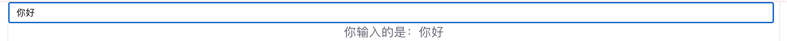
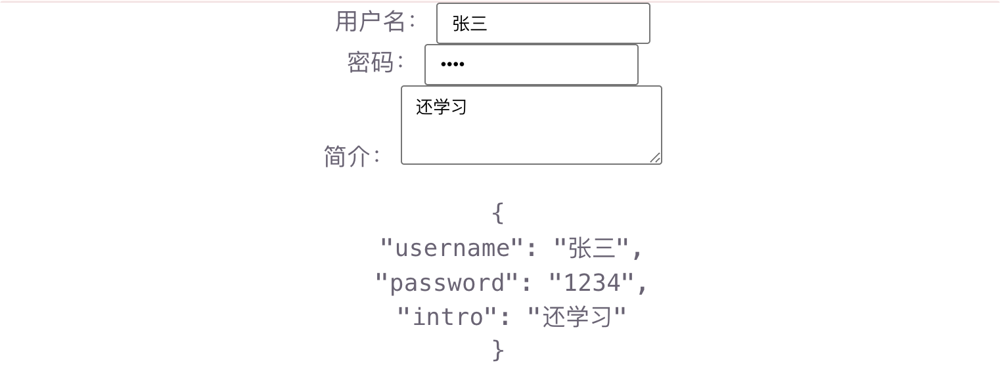
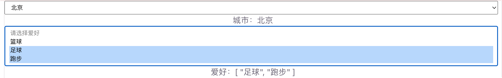
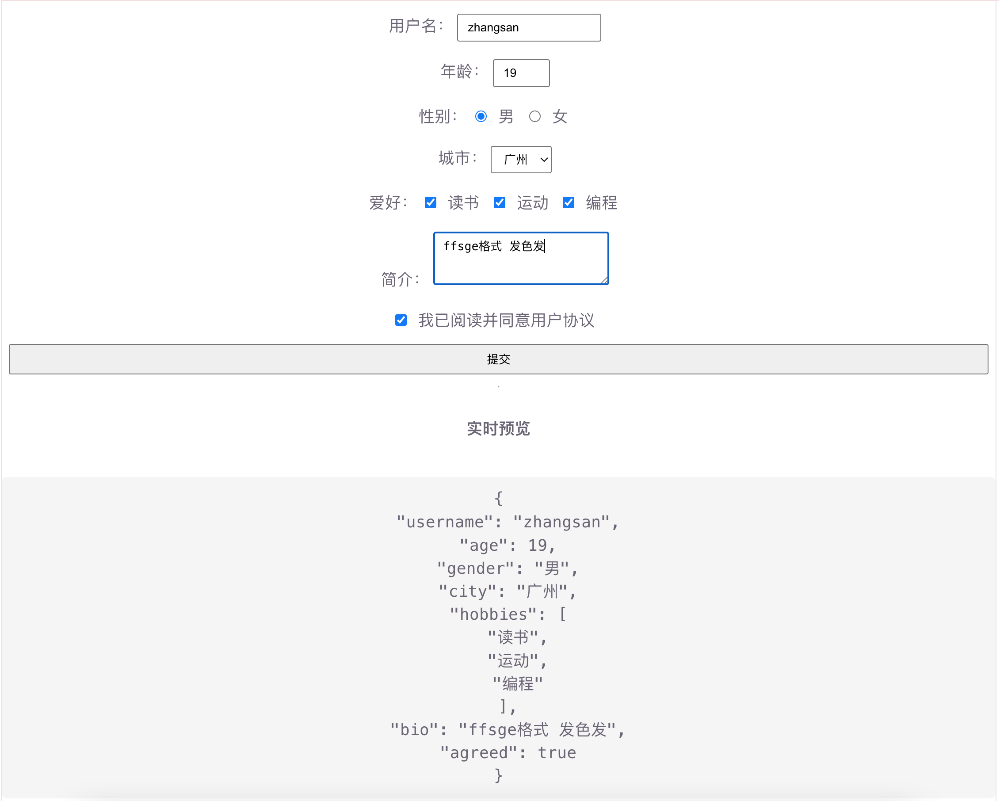

# 表单输入绑定

表单输入绑定用来把 **输入框、复选框、单选框、下拉框** 等表单控件和响应式数据双向同步。Vue3 用 `v-model` 指令完成这件事。

适合：登录注册、搜索框、筛选条件、个人资料编辑、问卷填写等场景。

## 为什么需要表单输入绑定

用户在页面上输入时，既要「数据 → 界面」显示，也要「界面 → 数据」回写。如果手写 `value` + `@input`，每个控件都要写两遍；用 `v-model` 一行搞定双向绑定：

```vue
<!-- 不推荐：手动同步 -->
<input :value="message" @input="message = $event.target.value" />

<!-- 推荐：v-model 双向绑定 -->
<input v-model="message" />
```

`v-model` 本质就是上面这种「绑定值 + 监听输入」的语法糖。

## 文本类输入

`input`/`textarea`

### 基本用法

```vue
<script setup>
/**
 * v-model 基础 Demo
 * 输入框内容与 message 双向同步
 */
import { ref } from 'vue'

/** 输入内容 */
const message = ref('')
</script>

<template>
  <input v-model="message" placeholder="随便输入点什么" />
  <p>你输入的是：{{ message }}</p>
</template>
```

运行输出：



要点：

- `ref` 定义的数据，在模板里用 `v-model` 时**不用写 `.value`**
- 改输入框 → `message` 自动变；改 `message` → 输入框也跟着变
- `<textarea>` 同样用 `v-model`，不要写在标签中间：

```vue
<!-- 正确 -->
<textarea v-model="bio"></textarea>

<!-- 错误：插值不会双向更新 -->
<textarea>{{ bio }}</textarea>
```

### 多字段表单

```vue
<script setup>
/**
 * 多字段表单 Demo
 */
import { reactive } from 'vue'

/** 表单对象 */
const form = reactive({
  username: '',
  password: '',
  intro: ''
})
</script>

<template>
  <p>
    用户名：
    <input v-model="form.username" />
  </p>
  <p>
    密码：
    <input v-model="form.password" type="password" />
  </p>
  <p>
    简介：
    <textarea v-model="form.intro" rows="3"></textarea>
  </p>
  <pre>{{ form }}</pre>
</template>
```

用 `reactive` 管一组表单字段很常见；单个字段用 `ref` 也可以。

运行截图：



## 复选框、单选框、下拉框

### 单个复选框（绑定布尔值）

```vue
<script setup>
/**
 * 单个 checkbox Demo
 */
import { ref } from 'vue'

/** 是否同意协议 */
const agreed = ref(false)
</script>

<template>
  <label>
    <input type="checkbox" v-model="agreed" />
    我已阅读并同意用户协议
  </label>
  <p>状态：{{ agreed ? '已同意' : '未同意' }}</p>
</template>
```

运行截图：


### 多个复选框（绑定数组）

同一组 `checkbox` 绑到同一个数组时，勾选会把对应 `value` 放进数组，取消则移除：

```vue
<script setup>
/**
 * 多个 checkbox Demo
 * 选中的爱好存进数组
 */
import { ref } from 'vue'

/** 已选爱好 */
const hobbies = ref([])
</script>

<template>
  <label><input type="checkbox" value="读书" v-model="hobbies" /> 读书</label>
  <label><input type="checkbox" value="运动" v-model="hobbies" /> 运动</label>
  <label><input type="checkbox" value="音乐" v-model="hobbies" /> 音乐</label>
  <p>已选：{{ hobbies }}</p>
</template>
```

运行截图：


### 单选框 radio

一组 `radio` 共用同一个 `v-model`，选中项的 `value` 会写进数据：

```vue
<script setup>
/**
 * radio Demo
 */
import { ref } from 'vue'

/** 性别 */
const gender = ref('女')
</script>

<template>
  <label><input type="radio" value="男" v-model="gender" /> 男</label>
  <label><input type="radio" value="女" v-model="gender" /> 女</label>
  <p>当前：{{ gender }}</p>
</template>
```

运行截图：


### 下拉框 select

```vue
<script setup>
/**
 * select Demo
 */
import { ref } from 'vue'

/** 所选城市 */
const city = ref('上海')
/** 爱好 */
const hobbies = ref(['篮球'])
</script>

<template>
  <select v-model="city">
    <option disabled value="">请选择城市</option>
    <option>北京</option>
    <option>上海</option>
    <option>广州</option>
  </select>
  <p>城市：{{ city }}</p>
  <select v-model="hobbies" multiple="multiple">
    <option disabled value="">请选择爱好</option>
    <option>篮球</option>
    <option>足球</option>
    <option>跑步</option>
  </select>
  <p>爱好：{{ hobbies }}</p>
</template>
```

多选下拉：加 `multiple`，`v-model` 绑定**数组**。

运行截图：



## 常用修饰符

| 修饰符    | 作用                                          | 示例                   |
| :-------- | :-------------------------------------------- | :--------------------- |
| `.lazy`   | 在 `change`（失焦等）时才更新，而不是每次输入 | `v-model.lazy="msg"`   |
| `.number` | 自动把输入转成数字                            | `v-model.number="age"` |
| `.trim`   | 自动去掉首尾空格                              | `v-model.trim="name"`  |

可以组合使用：

```vue
<input v-model.trim.number="age" type="number" />
<script setup>
/**
 * v-model 修饰符 Demo
 */
import { ref } from 'vue'

const name = ref('')
const age = ref(18)
const remark = ref('')
</script>

<template>
  <p>
    姓名（去空格）：
    <input v-model.trim="name" />
    →「{{ name }}」
  </p>
  <p>
    年龄（转数字）：
    <input v-model.number="age" type="number" />
    → {{ age }}（类型：{{ typeof age }}）
  </p>
  <p>
    备注（失焦才更新）：
    <input v-model.lazy="remark" />
    → {{ remark }}
  </p>
</template>
```

运行截图：


## 入门综合 Demo

一个简易「用户资料」表单：覆盖文本、数字、单选、多选、下拉，并实时预览。

```vue
<script setup>
/**
 * 表单输入绑定综合 Demo
 * - v-model：各类表单控件双向绑定
 * - .trim / .number：修饰符
 * - reactive：集中管理表单数据
 */
import { reactive, computed } from 'vue'

/** 表单数据 */
const form = reactive({
  username: '',
  age: 18,
  gender: '女',
  city: '上海',
  hobbies: [],
  bio: '',
  agreed: false
})

/** 是否可以提交：同意协议且用户名非空 */
const canSubmit = computed(() => {
  return form.agreed && form.username.trim().length > 0
})

/** 提交表单 */
function onSubmit() {
  if (!canSubmit.value) return
  alert(`提交成功：${form.username}`)
}
</script>

<template>
  <h3>用户资料</h3>

  <p>
    用户名：
    <input v-model.trim="form.username" placeholder="请输入用户名" />
  </p>

  <p>
    年龄：
    <input v-model.number="form.age" type="number" min="1" max="120" />
  </p>

  <p>
    性别：
    <label><input type="radio" value="男" v-model="form.gender" /> 男</label>
    <label><input type="radio" value="女" v-model="form.gender" /> 女</label>
  </p>

  <p>
    城市：
    <select v-model="form.city">
      <option>北京</option>
      <option>上海</option>
      <option>广州</option>
      <option>深圳</option>
    </select>
  </p>

  <p>
    爱好：
    <label><input type="checkbox" value="读书" v-model="form.hobbies" /> 读书</label>
    <label><input type="checkbox" value="运动" v-model="form.hobbies" /> 运动</label>
    <label><input type="checkbox" value="编程" v-model="form.hobbies" /> 编程</label>
  </p>

  <p>
    简介：
    <textarea v-model="form.bio" rows="3" placeholder="简单介绍一下自己"></textarea>
  </p>

  <p>
    <label>
      <input type="checkbox" v-model="form.agreed" />
      我已阅读并同意用户协议
    </label>
  </p>

  <button :disabled="!canSubmit" @click="onSubmit">提交</button>

  <hr />
  <h4>实时预览</h4>
  <pre>{{ form }}</pre>
</template>

<style>
p {
  margin: 10px 0;
}
label {
  margin-right: 12px;
}
button:disabled {
  opacity: 0.5;
  cursor: not-allowed;
}
pre {
  background: #f5f5f5;
  padding: 12px;
  border-radius: 6px;
}
</style>
```

运行效果预期：

1. 输入用户名：右侧预览里的 `username` 同步变化（首尾空格会被 `.trim` 去掉）
2. 改年龄：预览里是数字类型（`.number`）
3. 点单选 / 勾爱好 / 选城市：对应字段实时更新
4. 未勾选协议或用户名为空时，「提交」按钮禁用；都满足后可点并弹出提示

运行截图：




## 快速对照

| 控件                          | `v-model` 绑定类型   | 说明                       |
| :---------------------------- | :------------------- | :------------------------- |
| `<input type="text">`         | 字符串               | 最常用                     |
| `<textarea>`                  | 字符串               | 不要用插值包内容           |
| 单个 `checkbox`               | 布尔值               | 是否勾选                   |
| 多个 `checkbox`               | 数组                 | 勾选的 `value` 集合        |
| `radio`                       | 字符串 / 数字等      | 选中项的 `value`           |
| `<select>`                    | 字符串（或多选数组） | 当前选项                   |
| `.lazy` / `.number` / `.trim` | 修饰符               | 失焦更新 / 转数字 / 去空格 |