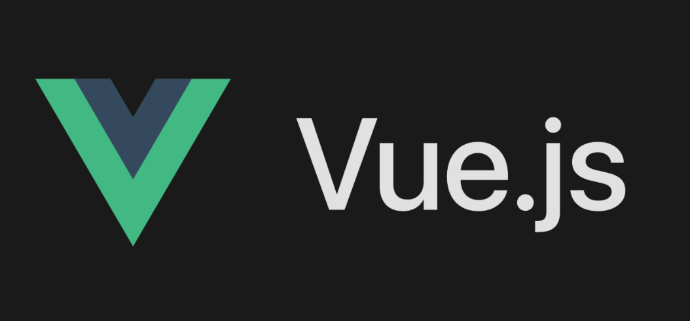

# Vue3 简介

**Vue**（发音为 /vjuː/，类似 **View**）是一款用于构建用户界面的**渐进式 JavaScript 框架**，由尤雨溪（也是 Vite 的作者）于 2014 年创建。

vue官方网站：https://vuejs.org/ 

vue中文官方网站：https://cn.vuejs.org/

中文官方用户指南：https://cn.vuejs.org/guide/quick-start.html

用一句话概括：**Vue 的核心是“声明式渲染”和“组件化”，它像乐高积木一样，让你用简洁的模板把数据和 DOM 关联起来，轻松搭建复杂的交互界面。**

我们可以通过一个生活类比来理解它：

- **传统原生 JS（像手动搭帐篷）**：你要从零开始，拿到数据后，手动用 `getElementById` 找到 DOM 节点，再一点点往里填内容、绑定事件。数据一变，又得重新手动更新 DOM，非常繁琐。
- **Vue（像智能同步的魔镜）**：你只需要在“镜子”（模板）里声明好数据的位置，当背后的数据发生变化时，**镜子里的画面会自动更新**，完全不用你亲自操作 DOM。你只需要关心“数据是什么”，而不用关心“DOM 怎么改”。

**Vue 最核心的三大特点：**

1. **响应式数据驱动**：数据改变，视图自动变化。你修改一个 JS 变量，页面上的文字、样式、列表会全部自动刷新，这是 Vue 最吸引人的“魔法”。
2. **组件化开发**：页面被拆分成一个个独立、可复用的小零件（组件）。比如一个按钮、一个弹窗、一个列表，各自管好自己的数据和样式，拼装起来就是一个完整的页面，便于团队协作和维护。
3. **声明式渲染**：通过简洁的模板语法（如 `{{ message }}` 或 `v-bind`），直观地描述 UI 应该长什么样，代码读起来像 HTML，上手门槛极低。

**目前有两个主要大版本：**

- **Vue 2（经典版）**：已进入维护尾声，官方已于 2023 年底结束支持（EOL），不建议新项目使用。
- **Vue 3（当前主流）**：性能更快（使用 Proxy 替代 defineProperty）、体积更小，并引入了 **组合式 API（Composition API）**，让复杂逻辑的组织和复用更加灵活优雅（是目前所有新项目的首选）。

**Vue 的绝对优势：**

- **门槛极低**：你只要会基础的 HTML/CSS/JS，花半天看文档就能上手写页面，被称为“最简单的前端框架”。
- **渐进式灵活**：你可以在一个老旧的 jQuery 项目里只用 Vue 做一个弹窗组件，也可以用它配合 Vite/Router/Pinia 搭建完整的大型单页应用（SPA），按需引入，不强求全盘采用。
- **中文文档极佳**：拥有全网最友好、最详尽的中文官方文档，对国内开发者极其友好。

**与 React 的简单对比**：React 偏向“纯 JS 一切皆函数”，理念较硬核；而 Vue 则拥抱 HTML/CSS/JS 分离的传统，模板更贴近原生 Web 标准，新手能更快找到亲切感。