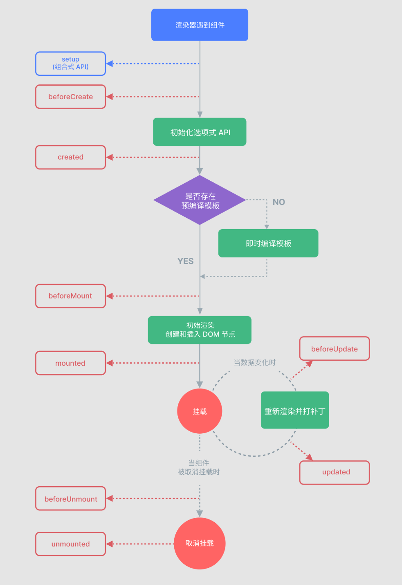

# 生命周期

组件从创建、挂载到页面、更新，再到卸载，会经历一系列固定阶段。Vue 在这些节点提供了**生命周期钩子**，方便你在合适的时机执行逻辑（请求数据、操作 DOM、清理定时器等）。

组合式 API（<span v-pre>`<script setup>`</span>）里用的是 `onXxx` 函数；选项式 API（`<scrip>`） 里对应的是 `beforeCreate`、`mounted` 等方法名。

## 生命周期一览(组合式 API)

| 钩子              | 触发时机             | 常见用途                       |
| ----------------- | -------------------- | ------------------------------ |
| `onBeforeMount`   | 挂载前，DOM 尚未生成 | 很少单独用                     |
| `onMounted`       | 挂载完成，DOM 已就绪 | 请求接口、操作 DOM、启动定时器 |
| `onBeforeUpdate`  | 数据变化导致更新前   | 更新前读取旧 DOM               |
| `onUpdated`       | 更新完成，DOM 已刷新 | 依赖最新 DOM 的逻辑            |
| `onBeforeUnmount` | 卸载前               | 清理定时器、取消监听、中断请求 |
| `onUnmounted`     | 卸载完成             | 收尾清理                       |

还有两个和调试相关的钩子：`onErrorCaptured`（捕获后代错误）、`onRenderTracked` / `onRenderTriggered`（开发调试用）。入门阶段优先掌握 **`onMounted`** 和 **`onBeforeUnmount` / `onUnmounted`**。

## 执行顺序



记忆口诀：**挂载看 mounted，更新看 updated，离开记得清理 unmount**。

## Demo1 计数 + 挂载提示

下面这个 Demo 展示最常用的两个钩子：

- `onMounted`：组件挂载后打印提示、记录时间
- `onUnmounted`：组件卸载时清理（这里用日志模拟）

```vue
<script setup>
/**
 * 生命周期入门 Demo
 * 演示 onMounted / onUnmounted 的基本用法
 */
import { ref, onMounted, onUnmounted } from 'vue'

const count = ref(0)
const tip = ref('组件尚未挂载')

/** 计数加一 */
function add() {
  count.value++
}

// 挂载完成：DOM 已就绪，适合初始化
onMounted(() => {
  tip.value = '组件已挂载（onMounted）'
  console.log('onMounted：可以安全操作 DOM 或请求数据')
})

// 卸载完成：做清理工作
onUnmounted(() => {
  console.log('onUnmounted：组件已卸载，记得清理副作用')
})
</script>

<template>
  <div>
    <h2>Vue3 生命周期 Demo</h2>
    <p>{{ tip }}</p>
    <p>当前计数：{{ count }}</p>
    <button @click="add">+1</button>
  </div>
</template>
```

要点：

- 钩子要在 `setup` 同步阶段注册（`<script setup>` 顶层直接写即可）
- `onMounted` 之后才能可靠拿到 DOM；发请求、`document.querySelector` 等多放这里
- 组件销毁时一定要清理定时器、事件监听，避免内存泄漏

运行截图：


## Demo2 定时器 + 正确清理

很多副作用（定时器、窗口监听）必须在卸载时关掉。用 `onBeforeUnmount` 或 `onUnmounted` 清理：

```vue
<script setup>
/**
 * 生命周期清理 Demo
 * 挂载时开启定时器，卸载时清除，避免内存泄漏
 */
import { ref, onMounted, onBeforeUnmount } from 'vue'

const now = ref('')
let timer = null

/** 把当前时间格式化为 2026-11-02 17:25:17 这种样式 */
function formatDateTime(date) {
  const pad = (n) => String(n).padStart(2, '0')
  return (
    `${date.getFullYear()}-${pad(date.getMonth() + 1)}-${pad(date.getDate())} ` +
    `${pad(date.getHours())}:${pad(date.getMinutes())}:${pad(date.getSeconds())}`
  )
}

onMounted(() => {
  now.value = formatDateTime(new Date())
  // 每秒刷新一次时间
  timer = setInterval(() => {
    now.value = formatDateTime(new Date())
  }, 1000)
})

// 卸载前清除定时器
onBeforeUnmount(() => {
  if (timer) {
    clearInterval(timer)
    timer = null
  }
})
</script>

<template>
  <div>
    <h2>当前时间</h2>
    <p>{{ now }}</p>
    <p>离开页面时会自动清除定时器</p>
  </div>
</template>
```

运行截图：


