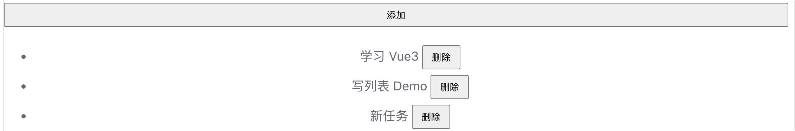
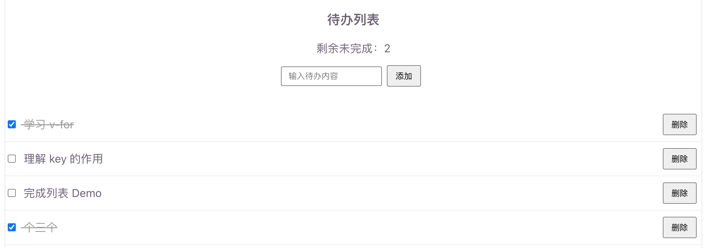

# 列表渲染

列表渲染用来根据数组（或对象）**批量生成一组 DOM**。Vue3 用 `v-for` 指令完成这件事。

适合：商品列表、待办事项、评论区、表格行、下拉选项等场景。

## 为什么需要列表渲染

页面上经常要展示「很多条结构相同的数据」。如果一条条手写标签，数据一变就要手动改 DOM。用 `v-for` 绑定数组后，增删改数据，列表会自动更新：

```vue
<!-- 不推荐：手写很多重复标签 -->
<li>苹果</li>
<li>香蕉</li>
<li>橙子</li>

<!-- 推荐：用 v-for 根据数据生成 -->
<li v-for="item in fruits" :key="item">{{ item }}</li>
```

## v-for 基本用法

### 遍历数组

语法：`v-for="item in list"`，也可写成 `(item, index) in list` 拿到下标。

```vue
<script setup>
/**
 * v-for 基础 Demo
 * 根据水果数组渲染列表
 */
import { ref } from 'vue'

/** 水果列表 */
const fruits = ref(['苹果', '香蕉', '橙子'])
</script>

<template>
  <ul>
    <li v-for="(item, index) in fruits" :key="index">
      {{ index + 1 }}. {{ item }}
    </li>
  </ul>
</template>
```

要点：

- `item` 是当前项，`index` 是下标（从 0 开始）
- 模板里 `fruits` 会自动解包，不用写 `.value`
- **尽量给每项加 `:key`**

运行截图：


#### 必须了解：key

`:key` 帮 Vue 识别「哪一项是哪一项」，在列表增删、排序、过滤时复用/更新 DOM 更准确。

```vue
<li v-for="item in list" :key="item.id">
  {{ item.name }}
</li>
```

建议：

- 优先用**唯一且稳定**的 id（数据库主键、UUID 等）
- 不要轻易用 `index` 当 key（尤其列表会插入、删除、排序时）
- `key` 的值在同一列表里应唯一

### 遍历对象

也可以遍历对象的属性：

```vue
<script setup>
/**
 * v-for 遍历对象 Demo
 */
import { reactive } from 'vue'

/** 用户信息对象 */
const user = reactive({
  name: '小明',
  age: 20,
  city: '上海'
})
</script>

<template>
  <ul>
    <!-- value：属性值；key：属性名；index：序号 -->
    <li v-for="(value, key, index) in user" :key="key">
      {{ index + 1 }}. {{ key }}：{{ value }}
    </li>
  </ul>
</template>
```

运行截图：


### 用 `<template>` 包一组元素

想为每一项渲染多个相邻标签时，用 `<template>`（本身不会生成额外标签）：

```vue
<template v-for="item in list" :key="item.id">
  <h4>{{ item.title }}</h4>
  <p>{{ item.desc }}</p>
</template>
```

## 数组更新会驱动视图

Vue 能追踪常见数组变更方法，调用后列表会自动刷新：

| 方法                | 作用         |
| ------------------- | ------------ |
| `push` / `pop`      | 末尾增 / 删  |
| `shift` / `unshift` | 开头删 / 增  |
| `splice`            | 按位置增删改 |
| `sort` / `reverse`  | 排序 / 反转  |

也可以整体替换数组（如过滤、映射后赋新值）：

```vue
<script setup>
/**
 * 数组操作 Demo
 * 演示增删与过滤
 */
import { ref } from 'vue'

const todos = ref([
  { id: 1, text: '学习 Vue3' },
  { id: 2, text: '写列表 Demo' }
])

let nextId = 3

/** 追加一项 */
function addTodo() {
  todos.value.push({ id: nextId++, text: '新任务' })
}

/** 删除指定 id */
function removeTodo(id) {
  todos.value = todos.value.filter((t) => t.id !== id)
}
</script>

<template>
  <button @click="addTodo">添加</button>
  <ul>
    <li v-for="todo in todos" :key="todo.id">
      {{ todo.text }}
      <button @click="removeTodo(todo.id)">删除</button>
    </li>
  </ul>
</template>
```

运行截图：



## v-for 和 v-if

**不要写在同一个元素上**（可读性差，且容易踩坑）。推荐先过滤数据，或用 `<template>` 分层：

```vue
<!-- 推荐：先算好要渲染的列表 -->
<li v-for="item in activeList" :key="item.id">
  {{ item.name }}
</li>

<!-- 或：外层 template 过滤，内层再渲染 -->
<template v-for="item in list" :key="item.id">
  <li v-if="item.active">{{ item.name }}</li>
</template>
```

空列表提示可以配合条件渲染：

```vue
<p v-if="list.length === 0">暂无数据</p>
<ul v-else>
  <li v-for="item in list" :key="item.id">{{ item.name }}</li>
</ul>
```

## 入门综合 Demo

一个简易待办列表：支持添加、完成切换、删除，并用 `v-if` 显示空状态。

```vue
<script setup>
/**
 * 列表渲染综合 Demo
 * - v-for：渲染待办列表
 * - :key：用唯一 id 标识每一项
 * - 数组方法：push / filter / 改属性
 * - v-if：空列表提示
 */
import { ref, computed } from 'vue'

/** 待办列表 */
const todos = ref([
  { id: 1, text: '学习 v-for', done: true },
  { id: 2, text: '理解 key 的作用', done: false },
  { id: 3, text: '完成列表 Demo', done: false }
])

/** 输入框内容 */
const input = ref('')
/** 下一 id */
let nextId = 4

/** 未完成数量 */
const leftCount = computed(() => todos.value.filter((t) => !t.done).length)

/** 添加待办 */
function addTodo() {
  const text = input.value.trim()
  if (!text) return
  todos.value.push({ id: nextId++, text, done: false })
  input.value = ''
}

/** 切换完成状态 */
function toggleTodo(id) {
  const todo = todos.value.find((t) => t.id === id)
  if (todo) todo.done = !todo.done
}

/** 删除一项 */
function removeTodo(id) {
  todos.value = todos.value.filter((t) => t.id !== id)
}
</script>

<template>
  <h3>待办列表</h3>
  <p>剩余未完成：{{ leftCount }}</p>

  <div class="row">
    <input v-model="input" placeholder="输入待办内容" @keyup.enter="addTodo" />
    <button @click="addTodo">添加</button>
  </div>

  <p v-if="todos.length === 0">暂无待办，先添加一条吧</p>

  <ul v-else>
    <li v-for="todo in todos" :key="todo.id" :class="{ done: todo.done }">
      <label>
        <input
          type="checkbox"
          :checked="todo.done"
          @change="toggleTodo(todo.id)"
        />
        {{ todo.text }}
      </label>
      <button @click="removeTodo(todo.id)">删除</button>
    </li>
  </ul>
</template>

<style>
.row {
  margin-bottom: 12px;
}
.row input {
  margin-right: 8px;
}
.done {
  color: #999;
  text-decoration: line-through;
}
ul {
  padding-left: 0;
  list-style: none;
}
li {
  display: flex;
  justify-content: space-between;
  align-items: center;
  padding: 6px 0;
  border-bottom: 1px solid #eee;
}
</style>
```

运行效果预期：

1. 初始：显示 3 条待办，第 1 条已完成（删除线）
2. 输入内容点「添加」或回车：列表末尾多一项
3. 勾选复选框：完成状态切换，剩余数量跟着变
4. 点「删除」：该项从列表消失；删光后出现空状态提示

运行截图：

