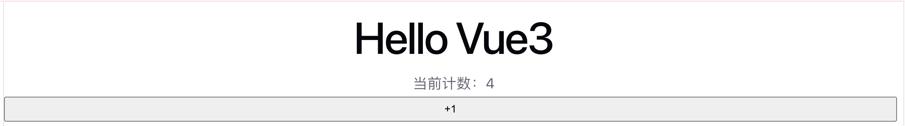
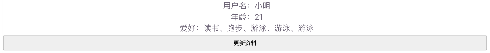
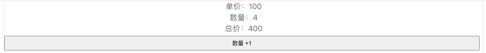
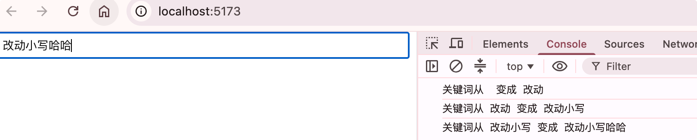

# 响应式基础

Vue3 的核心能力之一是**响应式系统**：数据变化时，依赖这些数据的视图或逻辑会自动更新。理解 `ref`、`reactive`、`computed`、`watch`，就能写出大部分常见交互。

------

## 什么是响应式？

简单理解：

1. 把普通数据变成「可追踪」的响应式数据
2. 组件里用到这些数据时，Vue 会记录依赖关系
3. 数据一改，相关界面自动重新渲染

Vue3 底层主要用 `Proxy` 实现响应式（比 Vue2 的 `Object.defineProperty` 更强大、更灵活）。

## 核心 API 速览

| API                     | 用途                         | 典型场景                       |
| ----------------------- | ---------------------------- | ------------------------------ |
| `ref`                   | 包装基本类型或任意值         | 计数、开关、字符串、对象也可以 |
| `reactive`              | 包装对象，得到深层响应式对象 | 表单对象、配置对象             |
| `computed`              | 根据已有状态派生新值         | 总价、过滤列表、全名           |
| `watch` / `watchEffect` | 监听变化并执行副作用         | 请求接口、本地存储、日志       |

## `ref`

**最常用**，`ref` 可以包装任意类型。在 <span v-pre>`<script setup>`</span> 里用 `.value` 读写；在模板里会自动解包，不用写 `.value`。

```vue
<script setup>
import { ref } from 'vue'

// 包装数字
const count = ref(0)

// 包装字符串
const title = ref('Hello Vue3')

function add() {
  count.value++ // 脚本里必须用 .value
}
</script>

<template>
  <!-- 模板里直接用 count，不用 .value -->
  <h1>{{ title }}</h1>
  <p>当前计数：{{ count }}</p>
  <button @click="add">+1</button>
</template>
```

要点：

- 脚本中：`count.value`
- 模板中：<span v-pre>`{{ count }}`</span>
- `ref` 既能包基本类型，也能包对象

运行截图：



## `reactive`

`reactive` 专门用于对象（Object / Array），返回的是 Proxy 代理对象，**不能整体替换**，适合表单、配置这类结构。

```vue
<script setup>
import { reactive } from 'vue'

const form = reactive({
  username: '',
  age: 18,
  hobby: ['读书', '跑步']
})

function update() {
  form.username = '小明' // 直接改属性，不需要 .value
  form.age++
  form.hobby.push('游泳')
}
</script>

<template>
  <p>用户名：{{ form.username }}</p>
  <p>年龄：{{ form.age }}</p>
  <p>爱好：{{ form.hobby.join('、') }}</p>
  <button @click="update">更新资料</button>
</template>
```

### `ref` vs `reactive` 

- 基本类型（number / string / boolean）→ 用 `ref`
- 一组相关字段的对象 → 可用 `reactive`，也可用 `ref({})`
- 不确定时，**优先用 `ref`**，写法更统一，也方便整体替换：`user.value = { ... }`

运行截图：



## `computed`

**计算属性**

根据已有响应式数据「计算」出新值，有缓存：依赖不变时不会重复计算。

```vue
<script setup>
import { ref, computed } from 'vue'

const price = ref(100)
const count = ref(2)

// 总价 = 单价 × 数量
const total = computed(() => price.value * count.value)
</script>

<template>
  <p>单价：{{ price }}</p>
  <p>数量：{{ count }}</p>
  <p>总价：{{ total }}</p>
  <button @click="count++">数量 +1</button>
</template>
```

注意：计算属性默认是只读的，一般不要在里面改数据，只负责「算」。

运行截图：



## `watch`

**侦听变化**

数据变化时执行副作用（发请求、写本地存储、打印日志等）。

```vue
<script setup>
import { ref, watch } from 'vue'

const keyword = ref('')

// 监听单个 ref
watch(keyword, (newVal, oldVal) => {
  console.log('关键词从', oldVal, '变成', newVal)
  // 这里可以发搜索请求
})
</script>

<template>
  <input v-model="keyword" placeholder="输入搜索词" />
</template>
```

运行截图：



常用选项：

```js
watch(keyword, (newVal) => {
  // ...
}, {
  immediate: true, // 一上来就先执行一次
  deep: true       // 深度监听对象内部变化（监听 reactive / 对象时常用）
})
```

`watchEffect` 则更省事：自动收集回调里用到的依赖，一有变化就执行：

```js
import { ref, watchEffect } from 'vue'

const count = ref(0)

watchEffect(() => {
  console.log('count 当前是', count.value)
})
```

