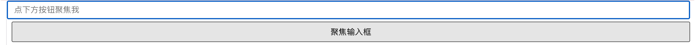
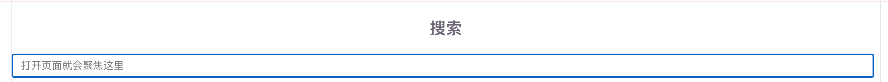
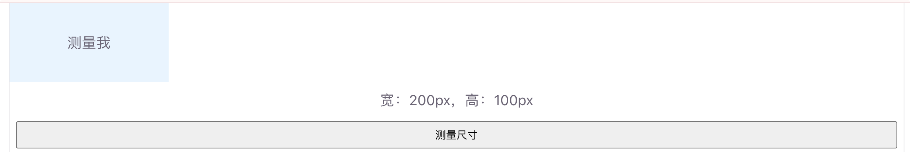
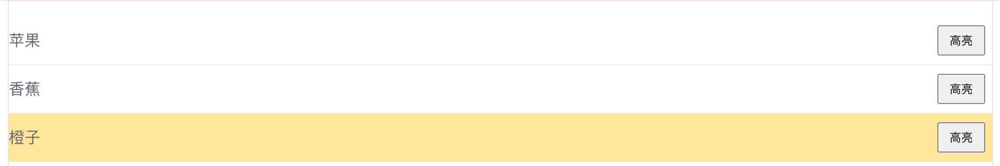

# 模板引用 ref

模板引用用来**拿到页面上某个真实 DOM 元素或子组件实例**。声明式数据绑定解决不了时（比如聚焦输入框、量尺寸、调第三方库），就用它。

适合：自动聚焦、滚动到某处、读取元素宽高、调用子组件方法等场景。

## 为什么需要模板引用

Vue 提倡用数据驱动视图，多数时候改 `ref` / `reactive` 就够了。但有些事必须直接碰 DOM：

```js
// 比如：页面加载后让输入框自动获得焦点
inputEl.focus()

// 比如：读取某个盒子的实际宽度
boxEl.offsetWidth
```

这时用 `ref` 属性把模板里的节点「挂」到脚本变量上。

## 基本用法

在模板元素上写 `ref="名字"`，脚本里用同名的 `ref(null)` 接收。挂载完成后，变量的 `.value` 就是对应 DOM。

```vue
<script setup>
/**
 * 模板引用基础 Demo
 * 点击按钮让输入框获得焦点
 */
import { ref } from 'vue'

// 用来存放 input 的 DOM 引用，初始为 null
const inputRef = ref(null)

/** 聚焦输入框 */
function focusInput() {
  // 挂载后才有值，使用前建议判断一下
  inputRef.value?.focus()
}
</script>

<template>
  <input ref="inputRef" placeholder="点下方按钮聚焦我" />
  <button @click="focusInput">聚焦输入框</button>
</template>
```

运行截图：



要点：

- `<script setup>` 里：模板 `ref="inputRef"` 会自动匹配同名的 `inputRef`
- 脚本里访问要用 `.value`：`inputRef.value`
- 组件挂载前是 `null`，操作 DOM 建议放在点击事件、`onMounted` 里

## Demo1 自动聚焦

页面一打开就聚焦搜索框，用 `onMounted`：

```vue
<script setup>
/**
 * 自动聚焦 Demo
 * 组件挂载后自动 focus 输入框
 */
import { ref, onMounted } from 'vue'

const searchRef = ref(null)

onMounted(() => {
  // 此时 DOM 已渲染完成，可以安全操作
  searchRef.value?.focus()
})
</script>

<template>
  <h3>搜索</h3>
  <input ref="searchRef" placeholder="打开页面就会聚焦这里" />
</template>
```

运行截图：



## Demo2 读取元素尺寸

```vue
<script setup>
/**
 * 读取 DOM 尺寸 Demo
 * 点击按钮显示盒子的宽高
 */
import { ref } from 'vue'

const boxRef = ref(null)
const info = ref('尚未测量')

/** 读取盒子宽高 */
function measure() {
  const el = boxRef.value
  if (!el) return
  info.value = `宽：${el.offsetWidth}px，高：${el.offsetHeight}px`
}
</script>

<template>
  <div
    ref="boxRef"
    style="width: 200px; height: 100px; background: #e8f4ff; line-height: 100px; text-align: center;"
  >
    测量我
  </div>
  <p>{{ info }}</p>
  <button @click="measure">测量尺寸</button>
</template>
```

运行截图：



## Demo3 v-for 中的引用

列表里多个元素都要引用时，用函数式 `ref`，把每个 DOM 推进数组：

```vue
<script setup>
/**
 * v-for 模板引用 Demo
 * 收集列表每一项的 DOM，点击高亮某一项
 */
import { ref } from 'vue'

const items = ref(['苹果', '香蕉', '橙子'])
const itemRefs = ref([])

/** 把每个 li 的 DOM 收集进数组 */
function setItemRef(el) {
  if (el) {
    itemRefs.value.push(el)
  }
}

/** 高亮第 index 项 */
function highlight(index) {
  itemRefs.value.forEach((el, i) => {
    el.style.background = i === index ? '#ffe58f' : ''
  })
}

// 注意：列表更新前可清空，避免重复堆积
// 更稳妥的做法是在更新前：itemRefs.value = []
</script>

<template>
  <ul>
    <li v-for="(item, index) in items" :key="item" :ref="setItemRef">
      {{ item }}
      <button @click="highlight(index)">高亮</button>
    </li>
  </ul>
</template>
```

说明：`v-for` 里不要指望普通字符串 `ref` 自动变成数组（Composition API 下推荐函数式 `ref`）。

运行截图：

