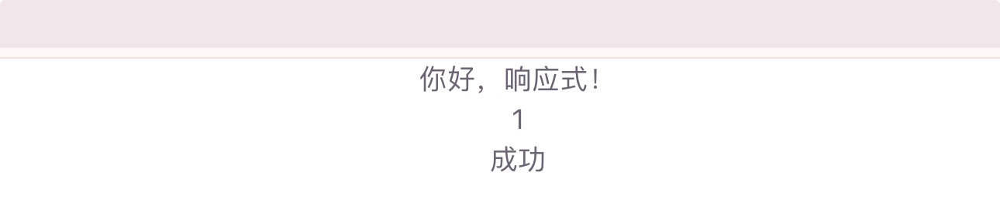
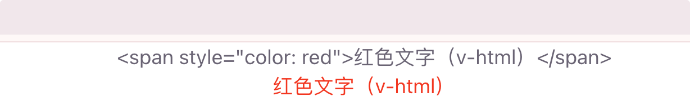
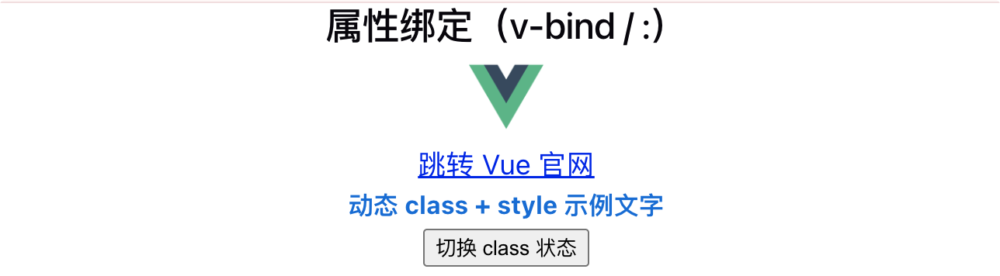
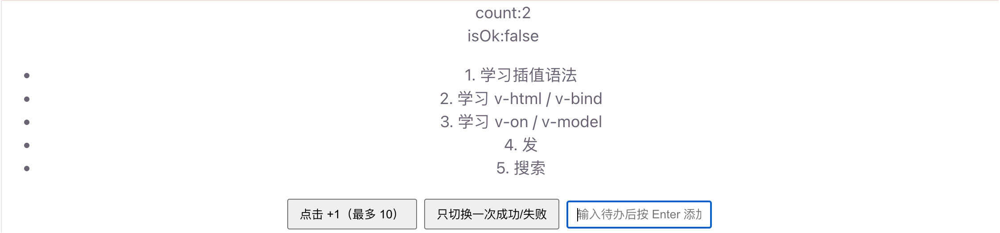
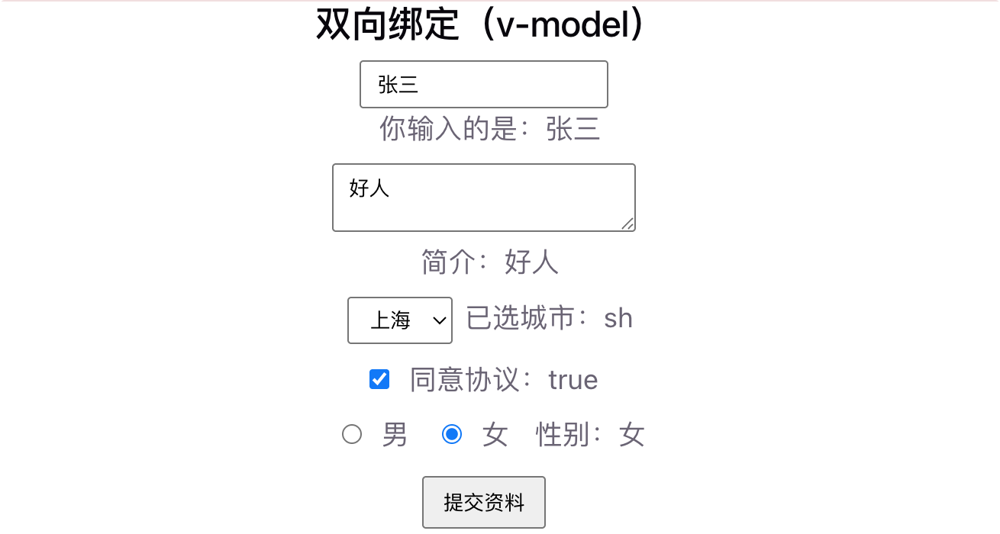
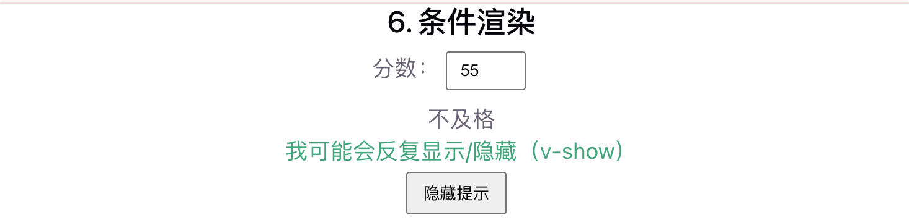
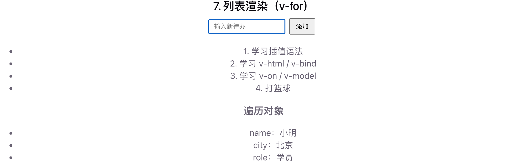

# 模板语法

Vue 模板语法是一套扩展了 HTML 的声明式语法，用来把组件数据绑定到页面上。   写好模板后，Vue 会自动根据数据变化更新 DOM。

## 文本插值

<span v-pre>`{{ }}`</span>

用双大括号把数据渲染到页面：

```vue
<p>{{ message }}</p>
```

也支持简单表达式：

```vue
<p>{{ count + 1 }}</p>
<p>{{ isOk ? '成功' : '失败' }}</p>
```

> 注意： <span v-pre>`{{ }}`</span> 里只能写**单个表达式**，不能写 `if`、`for` 等语句。

完整实例：

```vue
<script setup>

import { ref} from 'vue'

/** 欢迎文案 */
const message = ref('你好，响应式！')
/** 计数器 */
const count = ref(0)
/** 是否成功 */
const isOk= ref(true)

</script>

<template>
  <p>{{ message }}</p>
  <p>{{ count + 1 }}</p>
  <p>{{ isOk ? '成功' : '失败' }}</p>
</template>
```

运行结果：



## 原始 HTML

`v-html`

默认插值会转义 HTML。若要渲染原始 HTML，使用 `v-html`：

```vue
<div v-html="rawHtml"></div>
const rawHtml = '<span style="color: red">红色文字</span>'
```

完整实例：

```vue
<script setup>

import { ref} from 'vue'

const rawHtml = ref('<span style="color: red">红色文字（v-html）</span>')

</script>

<template>
  <div>{{rawHtml}}</div>
  <div v-html="rawHtml"></div>
</template>
```

运行结果：




## 属性绑定

`v-bind` （简写 `:`）

动态绑定 HTML 属性：

```vue
<!-- 完整写法 -->


<!-- 简写（最常用） -->

<a :href="link">跳转</a>
<button :disabled="isDisabled">提交</button>
```

绑定对象一次设置多个 class / style：

```vue
<div :class="{ active: isActive, 'text-red': hasError }"></div>
<div :style="{ color: textColor, fontSize: fontSize + 'px' }"></div>
```

完整实例：

```vue
<script setup>

import { ref} from 'vue'

/** 【3. v-bind】图片、链接、样式相关数据 */
const imageUrl = ref('https://vuejs.org/images/logo.png')
const link = ref('https://cn.vuejs.org/')
const isDisabled = ref(false)
const isActive = ref(true)
const hasError = ref(false)
const textColor = ref('#0969da')
const fontSize = ref(16)

/**
 * 切换激活 / 错误样式（演示 :class）
 */
function toggleStyle() {
  isActive.value = !isActive.value
  hasError.value = !hasError.value
}


</script>

<template>
  <!-- ========== 属性绑定：v-bind / : ========== -->
  <section>
    <h2>属性绑定（v-bind / :）</h2>
    
    <p>
      <a :href="link" target="_blank">跳转 Vue 官网</a>
    </p>
    <div
        :class="{ active: isActive, 'text-red': hasError }"
        :style="{ color: textColor, fontSize: fontSize + 'px' }"
    >
      动态 class + style 示例文字
    </div>
    <button @click="toggleStyle">切换 class 状态</button>
  </section>
</template>

<style scoped>

.active {
  font-weight: bold;
}
.text-red {
  color: #c00 !important;
}

</style>
```

运行结果：




## 事件绑定

`v-on`（简写 `@`）

监听 DOM 事件：

```vue
<!-- 完整写法 -->
<button v-on:click="count++">+1</button>

<!-- 简写（最常用） -->
<button @click="count++">+1</button>
<button @click="handleClick">点击</button>
<input @keyup.enter="submit" />
```

常用事件修饰符：

| 修饰符     | 作用            |
| :--------- | :-------------- |
| `.stop`    | 阻止冒泡        |
| `.prevent` | 阻止默认行为    |
| `.once`    | 只触发一次      |
| `.enter`   | 按 Enter 键触发 |

```html
<form @submit.prevent="onSubmit">
  <button type="submit">提交</button>
</form>
```

完整实例：

```vue
<script setup>

import { ref} from 'vue'

const isDisabled = ref(false)
const count = ref(0)
const isOk = ref(true)
const newTodo = ref('')

/**
 * 【事件绑定】计数 +1
 */
function addCount() {
  count.value++
  // 满 10 次后禁用按钮，顺便演示 :disabled
  if (count.value >= 10) {
    isDisabled.value = true
  }
}


const todos = ref([
  { id: 1, name: '学习插值语法' },
  { id: 2, name: '学习 v-html / v-bind' },
  { id: 3, name: '学习 v-on / v-model' }
])

/**
 * 添加待办（配合 @keyup.enter / 表单提交）
 */
function addTodo() {
  const name = newTodo.value.trim()
  if (!name) return
  todos.value.push({
    id: Date.now(),
    name
  })
  newTodo.value = ''
}

</script>

<template>
  <!-- ========== 事件绑定：v-on / @ ========== -->
  <section>
    <p> count:{{ count}}</p>
    <p> isOk:{{ isOk}}</p>
    <ul>
      <li v-for="(item, index) in todos" :key="item.id">
        {{ index + 1 }}. {{ item.name }}
      </li>
    </ul>
    <!-- 简写 + :disabled -->
    <button :disabled="isDisabled" @click="addCount">
      点击 +1（最多 10）
    </button>
    <!-- .once：只触发一次 -->
    <button @click.once="isOk = !isOk">只切换一次成功/失败</button>
    <!-- .enter：按 Enter 触发 -->
    <input
        v-model="newTodo"
        placeholder="输入待办后按 Enter 添加"
        @keyup.enter="addTodo"
    />
  </section>
</template>
```

运行结果：




## 双向绑定

`v-model`

常用于表单，数据和输入框同步：

```vue
<input v-model="username" placeholder="请输入用户名" />
<p>你输入的是：{{ username }}</p>

<textarea v-model="desc"></textarea>

<select v-model="city">
  <option value="bj">北京</option>
  <option value="sh">上海</option>
</select>
```

复选框 / 单选：

```vue
<input type="checkbox" v-model="checked" />
<input type="radio" value="男" v-model="gender" />
<input type="radio" value="女" v-model="gender" />
```

完整实例：

```vue
<script setup>

import { ref} from 'vue'

/** 【v-model】表单相关数据 */
const username = ref('')
const desc = ref('')
const city = ref('bj')
const checked = ref(false)
const gender = ref('男')

/**
 * 表单提交（配合 @submit.prevent）
 */
function onSubmit() {
  alert(`提交成功！用户：${username.value || '游客'}，城市：${city.value}`)
}

</script>

<template>
  <section>
    <h2>双向绑定（v-model）</h2>
    <div class="row">
      <input v-model="username" placeholder="请输入用户名" />
      <p>你输入的是：{{ username || '（空）' }}</p>
    </div>
    <div class="row">
      <textarea v-model="desc" placeholder="个人简介" rows="2"></textarea>
      <p>简介：{{ desc || '（未填写）' }}</p>
    </div>
    <div class="row">
      <select v-model="city">
        <option value="bj">北京</option>
        <option value="sh">上海</option>
      </select>
      <span>已选城市：{{ city }}</span>
    </div>
    <div class="row">
      <label>
        <input type="checkbox" v-model="checked" />
        同意协议：{{ checked }}
      </label>
    </div>
    <div class="row">
      <label>
        <input type="radio" value="男" v-model="gender" /> 男
      </label>
      <label>
        <input type="radio" value="女" v-model="gender" /> 女
      </label>
      <span>性别：{{ gender }}</span>
    </div>
    <!-- .prevent：阻止表单默认刷新 -->
    <form @submit.prevent="onSubmit">
      <button type="submit">提交资料</button>
    </form>
  </section>

</template>

<style>
section {
  margin-bottom: 28px;
  padding-bottom: 16px;
  border-bottom: 1px solid #eee;
}
.row {
  margin: 10px 0;
}
.tip {
  color: #0a7;
}
.active {
  font-weight: bold;
}
.text-red {
  color: #c00 !important;
}
input,
textarea,
select {
  padding: 6px 10px;
  margin-right: 8px;
}
button {
  margin: 4px 8px 4px 0;
  padding: 6px 12px;
  cursor: pointer;
}
button:disabled {
  cursor: not-allowed;
  opacity: 0.6;
}
label {
  margin-right: 12px;
}
</style>
```

运行截图：




## 条件渲染

`v-if` / `v-else-if` / `v-else` / `v-show`

```vue
<p v-if="score >= 90">优秀</p>
<p v-else-if="score >= 60">及格</p>
<p v-else>不及格</p>

<!-- v-show：用 CSS display 切换，适合频繁切换 -->
<p v-show="isVisible">我可能会反复显示/隐藏</p>
```

| 指令     | 特点                                |
| :------- | :---------------------------------- |
| `v-if`   | 真正创建/销毁 DOM，适合条件很少变化 |
| `v-show` | 只切换显示，适合频繁切换            |

完整实例：

```vue
<script setup>

import { ref} from 'vue'

/** 【条件渲染】分数与显隐开关 */
const score = ref(85)
const isVisible = ref(true)
</script>

<template>
  <section>
    <h2>6. 条件渲染</h2>
    <div class="row">
      <label>
        分数：
        <input type="number" v-model.number="score" min="0" max="100" />
      </label>
    </div>
    <p v-if="score >= 90">优秀</p>
    <p v-else-if="score >= 60">及格</p>
    <p v-else>不及格</p>

    <p v-show="isVisible" class="tip">我可能会反复显示/隐藏（v-show）</p>
    <button @click="isVisible = !isVisible">
      {{ isVisible ? '隐藏提示' : '显示提示' }}
    </button>
  </section>

</template>
```

运行截图：




## 列表渲染

`v-for`

```vue
<ul>
  <li v-for="(item, index) in list" :key="item.id">
    {{ index + 1 }}. {{ item.name }}
  </li>
</ul>
```

遍历对象：

```html
<li v-for="(value, key) in user" :key="key">
  {{ key }}：{{ value }}
</li>
```

> 列表务必加 `:key`，帮助 Vue 正确复用和更新节点。

完整实例：

```vue
<script setup>

import { ref} from 'vue'

/** 【列表渲染】待办列表与对象遍历 */
const todos = ref([
  { id: 1, name: '学习插值语法' },
  { id: 2, name: '学习 v-html / v-bind' },
  { id: 3, name: '学习 v-on / v-model' }
])
const newTodo = ref('')
const user = ref({
  name: '小明',
  city: '北京',
  role: '学员'
})

/**
 * 添加待办（配合 @keyup.enter / 表单提交）
 */
function addTodo() {
  const name = newTodo.value.trim()
  if (!name) return
  todos.value.push({
    id: Date.now(),
    name
  })
  newTodo.value = ''
}


</script>

<template>
  <section>
    <h2>7. 列表渲染（v-for）</h2>
    <form @submit.prevent="addTodo">
      <input v-model="newTodo" placeholder="输入新待办" />
      <button type="submit">添加</button>
    </form>
    <ul>
      <li v-for="(item, index) in todos" :key="item.id">
        {{ index + 1 }}. {{ item.name }}
      </li>
    </ul>

    <h3>遍历对象</h3>
    <ul>
      <li v-for="(value, key) in user" :key="key">
        {{ key }}：{{ value }}
      </li>
    </ul>
  </section>

</template>
```

运行截图：

