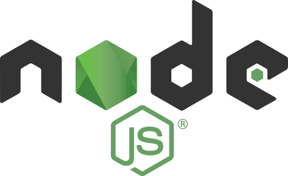
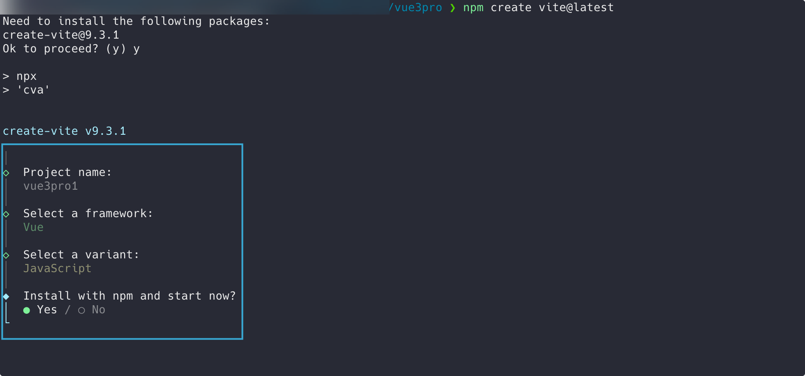
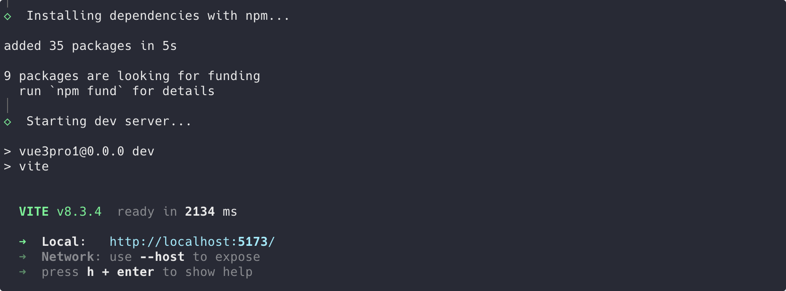
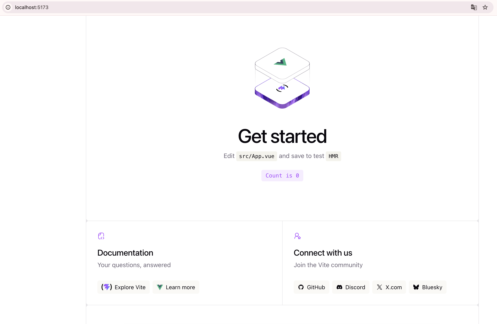
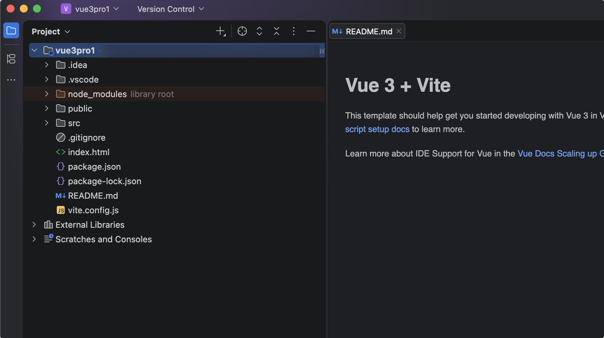
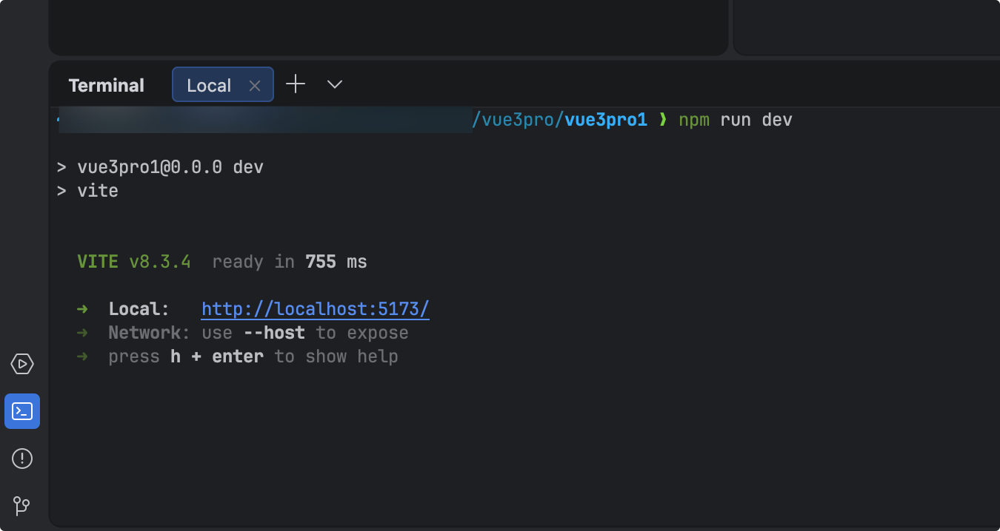

# Vite构建Vue项目

## 安装nodejs

首先要运行Vue+Vite项目，必须安装运行环境Node.js。使用Node24版本。

nodejs官网： https://nodejs.org/zh-cn

Node.js® 是一个免费、开源、跨平台的 JavaScript 运行时环境，它让开发人员能够创建服务器、 Web 应用、命令行工具和脚本。



## 构建项目

首先新建一个项目父目录 vue3pro

当前目录执行：`npm create vite@latest`

这条命令是**用 Vite 官方脚手架快速创建一个新项目的“一键启动”指令**。

- **npm**：Node.js 的包管理工具（相当于手机里的“应用商店”）。
- **create**：这是 `npm init` 的简写/别名，专门用来**初始化**一个项目骨架。它有一个特殊机制：遇到 `npm create <包名>`，会自动补全并执行 `create-<包名>` 这个工具包。
- **vite@latest**：指定要使用的工具包名为 `create-vite`，并且 `@latest` 表示**强制安装 npm 仓库中最新的稳定版本**（确保你不会用到旧版本）。

**合起来，这条命令的实际执行逻辑是：**
下载并运行 `create-vite` 这个脚手架工具，它会引导你在终端里选择要使用的框架（Vue、React、Svelte 等）和语言（JS 或 TS），然后自动帮你在当前目录下生成一套完整的项目文件夹。

给项目取名vue3pro1，选Vue框架，语言选JavaScript，然后点yes安装。



一会就安装完了，我们点击链接测试下：



安装成功：



## 项目解析

用idea打开项目



idea里，进入终端，输入npm run dev 启动项目。



目录结构总览

```
vue3pro1/
├── public/                # 静态公共资源（不经打包处理，原样拷贝）
│   ├── favicon.svg
│   └── icons.svg
├── src/                   # 业务源码目录
│   ├── assets/            # 需经 Vite 处理的静态资源
│   │   ├── hero.png
│   │   ├── vite.svg
│   │   └── vue.svg
│   ├── components/        # Vue 组件
│   │   └── HelloWorld.vue
│   ├── App.vue            # 根组件
│   ├── main.js            # 应用入口
│   └── style.css          # 全局样式
├── index.html             # HTML 入口模板
├── package.json           # 项目依赖与脚本
├── package-lock.json      # 依赖锁定文件
├── vite.config.js         # Vite 配置
```
