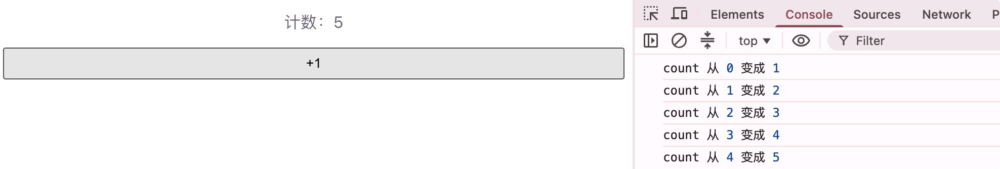

# 侦听器 watch

侦听器用来**观察响应式数据的变化**，并在变化时执行副作用（发请求、存本地、同步别的状态、打印日志等）。

适合：搜索框防抖请求、根据 id 拉详情、监听路由参数、把数据写入 `localStorage` 等「数据变了要办事」的场景。

和计算属性的区别很简单：

|              | `computed`     | `watch`              |
| ------------ | -------------- | -------------------- |
| 目的         | 算出一个值     | 执行副作用           |
| 有没有返回值 | 有（派生数据） | 一般没有             |
| 缓存         | 有             | 无（每次变都跑回调） |

## 为什么需要侦听器

计算属性适合「由 A、B 算出 C」。但有些事不是算值，而是**做事**：

```js
// 例如：keyword 一变，就去请求接口
// 这不是「派生一个值」，而是副作用 → 用 watch
```

## 基本用法：watch

从 `vue` 引入 `watch`，第一个参数是「看谁」，第二个参数是「变了怎么办」。

```vue
<script setup>
/**
 * 侦听器基础 Demo
 * 监听 count，变化时打印新旧值
 */
import { ref, watch } from 'vue'

const count = ref(0)

// 监听单个 ref
watch(count, (newVal, oldVal) => {
  console.log('count 从', oldVal, '变成', newVal)
})
</script>

<template>
  <p>计数：{{ count }}</p>
  <button @click="count++">+1</button>
</template>
```

要点：

- 监听 `ref` 时，直接传 `count`，**不要**写成 `count.value`
- 回调里拿到的 `newVal` / `oldVal` 已经是解包后的值
- 默认是**懒执行**：只有值真正变化后才会触发（首次不跑）

运行截图：



## 监听多个来源

可以传一个数组，同时盯几个数据：

```js
import { ref, watch } from 'vue'

const firstName = ref('张')
const lastName = ref('三')

watch([firstName, lastName], ([newFirst, newLast], [oldFirst, oldLast]) => {
  console.log('姓名变化：', oldFirst + oldLast, '→', newFirst + newLast)
})
```

也可以监听一个 getter（适合 `reactive` 对象里的某个字段）：

```js
import { reactive, watch } from 'vue'

const user = reactive({ age: 18, name: '小明' })

// 只盯 age
watch(
  () => user.age,
  (newAge, oldAge) => {
    console.log('年龄：', oldAge, '→', newAge)
  }
)
```

## 常用选项：immediate 与 deep

### immediate：立刻执行一次

默认首次不执行。需要「一上来就跑一遍」时打开：

```js
watch(
  count,
  (newVal) => {
    console.log('当前 count：', newVal)
  },
  { immediate: true } // 创建时也会执行一次
)
```

### deep：深度监听对象/数组

默认改对象内部属性时，有时侦听不到（取决于怎么写）。需要盯内部变化时用 `deep`：

```js
import { reactive, watch } from 'vue'

const form = reactive({ name: '', age: 0 })

watch(
  form,
  (newVal) => {
    console.log('表单变了', newVal)
  },
  { deep: true }
)

// form.name = '李四' 也会触发
```

入门阶段：监听整个 `reactive` 对象并希望内部字段变化也触发 → 加 `{ deep: true }`

## Demo1 搜索关键字请求

模拟「输入关键字 → 自动请求列表」的常见场景。

```vue
<script setup>
/**
 * 搜索侦听 Demo
 * keyword 变化时模拟请求接口
 */
import { ref, watch } from 'vue'

const keyword = ref('')
const result = ref('请输入关键字')
const loading = ref(false)

/**
 * 模拟接口请求
 * @param {string} key 搜索关键字
 */
function mockSearch(key) {
  return new Promise((resolve) => {
    setTimeout(() => {
      resolve(key ? `找到与「${key}」相关的 3 条结果` : '请输入关键字')
    }, 500)
  })
}

// 监听关键字变化
watch(keyword, async (newKey) => {
  loading.value = true
  result.value = await mockSearch(newKey.trim())
  loading.value = false
})
</script>

<template>
  <div style="font-family: sans-serif; max-width: 400px; margin: 40px auto;">
    <h2>Vue3 侦听器 Demo</h2>

    <input v-model="keyword" placeholder="输入关键字搜索" style="width: 100%; padding: 8px;" />

    <p v-if="loading">搜索中...</p>
    <p v-else>{{ result }}</p>
  </div>
</template>
```

操作后你会看到：

- 输入内容 → `keyword` 变 → `watch` 回调执行 → 更新 `result`
- 这是典型副作用：发请求、改别的状态，不适合用 `computed`

运行截图：


## Demo2 同步到 localStorage

```vue
<script setup>
/**
 * 本地存储同步 Demo
 * theme 变化时写入 localStorage
 */
import { ref, watch } from 'vue'

const theme = ref(localStorage.getItem('theme') || 'light')

watch(theme, (newTheme) => {
  localStorage.setItem('theme', newTheme)
  console.log('主题已保存：', newTheme)
})

/** 切换主题 */
function toggleTheme() {
  theme.value = theme.value === 'light' ? 'dark' : 'light'
}
</script>

<template>
  <div>
    <p>当前主题：{{ theme }}</p>
    <button @click="toggleTheme">切换主题</button>
  </div>
</template>
```

刷新页面后，主题还能从 `localStorage` 读回来。

运行截图：


## 简单了解：watchEffect

`watchEffect` 会**自动追踪回调里用到的响应式依赖**，不用手动指定监听谁；并且**一创建就会立刻执行一次**。

```js
import { ref, watchEffect } from 'vue'

const count = ref(0)

watchEffect(() => {
  // 自动追踪 count，count 变了会再跑
  console.log('count 现在是', count.value)
})
```

对比记忆：

- 需要新旧值、精确控制「听谁」→ 用 `watch`
- 只想「用到啥就自动听啥」，且要立即跑 → 用 `watchEffect`

入门优先熟练 `watch` 即可。