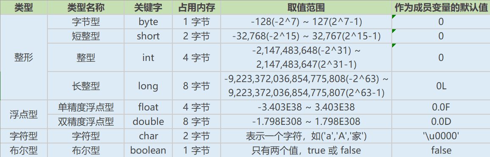

# Java基础知识-基础语法-数据类型

## Java 有哪些数据类型

**定义：** `Java` 语言是强类型语言，对于每一种数据都定义了明确的具体的数据类型，在内存中分配了不同大小的内存空间。

**分类**

- 基本数据类型
  - 数值型
    - 整数类型(`byte`,`short`,`int`,`long`)
    - 浮点类型(`float`,`double`)
  - 字符型(`char`)
  - 布尔型(`boolean`)
- 引用数据类型
- 类(`class`)
- 接口(`interface`)
- 数组(`[]`)

**Java 基本数据类型图**



**switch 是否能作用在 byte 上，是否能作用在 long 上，是否能作用在 String 上**

在 `Java 5` 以前，`switch(expr)`中，`expr` 只能是 `byte、short、char、int`。从 `Java5` 开始，`Java` 中引入了枚举类型，`expr` 也可以是 `enum` 类型，从 `Java 7` 开始，`expr` 还可以是字符串（`String`），但是长整型（`long`）在目前所有的版本中都是不可以的。

**用最有效率的方法计算 2 乘以 8**

`2 << 3`（左移 3 位相当于乘以 2 的 3 次方，右移 3 位相当于除以 2 的 3 次方）。

**Math.round(11.5) 等于多少？Math.round(-11.5)等于多少**

`Math.round(11.5)`的返回值是 `12`，`Math.round(-11.5)`的返回值是`-11`。四舍五入的原理是在参数上加 `0.5` 然后进行下取整。

**float f=3.4;是否正确**

不正确。`3.4` 是双精度数，将双精度型（`double`）赋值给浮点型（`float`）属于下转型（`down-casting`，也称为窄化）会造成精度损失，因此需要强制类型转换 `float f =(float)3.4`; 或者写成 `float f =3.4F`;。

**short s1 = 1; s1 = s1 + 1;有错吗?short s1 = 1; s1 += 1;有错吗**

对于 `short s1 = 1; s1 = s1 + 1;`由于 `1` 是 `int` 类型，因此 `s1+1` 运算结果也是 `int` 型，需要强制转换类型才能赋值给 `short` 型。

而 `short s1 = 1; s1 += 1;`可以正确编译，因为 `s1+= 1;`相当于 `s1 = (short(s1 + 1);`其中有隐含的强制类型转换。

## 编码

**Java 语言采用何种编码方案？有何特点？**

`Java` 语言采用 `Unicode` 编码标准，`Unicode`（标准码），它为每个字符制订了一个唯一的数值，因此在任何的语言，平台，程序都可以放心的使用。

## 注释

**什么是 Java 注释**

**定义：** 用于解释说明程序的文字

**分类**

- 单行注释  
  格式： `// 注释文字`
- 多行注释  
  格式： `/* 注释文字 */`
- 文档注释  
  格式：`/** 注释文字 */`

**作用**

在程序中，尤其是复杂的程序中，适当地加入注释可以增加程序的可读性，有利于程序的修改、调试和交流。注释的内容在程序编译的时候会被忽视，不会产生目标代码，注释的部分不会对程序的执行结果产生任何影响。

注意事项：多行和文档注释都不能嵌套使用。

## 访问修饰符

**访问修饰符 `public,private,protected`,以及`不写（默认）`时的区别**

**定义：** `Java` 中，可以使用访问修饰符来保护对类、变量、方法和构造方法的访问。`Java` 支持 `4` 种不同的访问权限。

**分类**

**`private` :** 在同一类内可见。使用对象：变量、方法。 注意：不能修饰类（外部类）

**`default` (即缺省，什么也不写，不使用任何关键字）:** 在同一包内可见，不使用任何修饰符。使用对象：类、接口、变量、方法。

**`protected` :** 对同一包内的类和所有子类可见。使用对象： 变量、方法。 注意：不能修饰类（外部类）。

**`public` :** 对所有类可见。使用对象：类、接口、变量、方法

**访问修饰符图**


## 运算符

**`&`和`&&`的区别**

`&`运算符有两种用法：(1)按位与；(2)逻辑与。

`&&`运算符是短路与运算。逻辑与跟短路与的差别是非常巨大的，虽然二者都要求运算符左右两端的布尔值都是 `true` 整个表达式的值才是 `true`。`&&`之所以称为短路运算，是因为如果`&&`左边的表达式的值是 `false`，右边的表达式会被直接短路掉，不会进行运算。

注意：逻辑或运算符（`|`）和短路或运算符（`||`）的差别也是如此。

## 关键字

**Java 有没有 goto**

`goto` 是 `Java` 中的保留字，在目前版本的 `Java` 中没有使用。

**final 有什么用？**

用于修饰`类`、`属性`和`方法`；

- 被 `final` 修饰的类不可以被继承
- 被 `final` 修饰的方法不可以被重写
- 被 `final` 修饰的变量不可以被改变，被 `final` 修饰不可变的是变量的引用，而不是引用指向的内容，引用指向的内容是可以改变的

**final finally finalize 区别**

- `final` 可以修饰类、变量、方法，修饰类表示该类不能被继承、修饰方法表示该方法不能被重写、修饰变量表示该变量是一个常量不能被重新赋值。
- `finally` 一般作用在 `try-catch` 代码块中，在处理异常的时候，通常我们将一定要执行的代码方法 `finally` 代码块中，表示不管是否出现异常，该代码块都会执行,一般用来存放一些关闭资源的代码。
- `finalize` 是一个方法，属于 `Object` 类的一个方法，而 `Object` 类是所有类的父类，该方法一般由垃圾回收器来调用，当我们调用 `System.gc()` 方法的时候，由垃圾回收器调用 `finalize()`回收垃圾，一个对象是否可回收的最后判断。

**this 关键字的用法**

`this` 是自身的一个对象，代表对象本身，可以理解为：指向对象本身的一个指针。

`this` 的用法在 `java` 中大体可以分为 `3` 种：

1. 普通的直接引用，`this` 相当于是指向当前对象本身。

2. 形参与成员名字重名，用 `this` 来区分：

```java
public Person(String name, int age) {
    this.name = name;
    this.age = age;
}
```

3. 引用本类的构造函数

```java
class Person{
    private String name;
    private int age;

    public Person() {
    }

    public Person(String name) {
        this.name = name;
    }
    public Person(String name, int age) {
        this(name);
        this.age = age;
    }
}
```

**super 关键字的用法**

`super` 可以理解为是指向自己超（父）类对象的一个指针，而这个超类指的是离自己最近的一个父类。

`super` 也有三种用法：

1. 普通的直接引用

与 `this` 类似，`super` 相当于是指向当前对象的父类的引用，这样就可以用 `super.xxx` 来引用父类的成员。

2. 子类中的成员变量或方法与父类中的成员变量或方法同名时，用 `super` 进行区分

```java
class Person{
    protected String name;

    public Person(String name) {
        this.name = name;
    }

}

class Student extends Person{
    private String name;

    public Student(String name, String name1) {
        super(name);
        this.name = name1;
    }

    public void getInfo(){
        System.out.println(this.name);      //Child
        System.out.println(super.name);     //Father
    }

}

public class Test {
    public static void main(String[] args) {
       Student s1 = new Student("Father","Child");
       s1.getInfo();

    }
}
```

3. 引用父类构造函数

- `super`（参数）：调用父类中的某一个构造函数（应该为构造函数中的第一条语句）。
- `this`（参数）：调用本类中另一种形式的构造函数（应该为构造函数中的第一条语句）

**this 与 super 的区别**

- `super:`它引用当前对象的直接父类中的成员（用来访问直接父类中被隐藏的父类中成员数据或函数，基类与派生类中有相同成员定义时如：`super.变量名` `super.成员函数数据名（实参）`
- `this:`它代表当前对象名（在程序中易产生二义性之处，应使用 `this` 来指明当前对象；如果函数的形参与类中的成员数据同名，这时需用 `this` 来指明成员变量名）
- `super()`和 `this()`类似,区别是，`super()`在子类中调用父类的构造方法，`this()`在本类内调用本类的其它构造方法。
- `super()`和 `this()`均需放在构造方法内第一行。
- 尽管可以用 `this` 调用一个构造器，但却不能调用两个。
- `this` 和 `super` 不能同时出现在一个构造函数里面，因为 `this` 必然会调用其它的构造函数，其它的构造函数必然也会有 `super` 语句的存在，所以在同一个构造函数里面有相同的语句，就失去了语句的意义，编译器也不会通过。
- `this()`和 `super()`都指的是对象，所以，均不可以在 `static` 环境中使用。包括：`static 变量`,`static 方法`，`static 语句块`。
- 从本质上讲，`this` 是一个指向本对象的指针, 然而 `super` 是一个 `Java` 关键字。

**static 存在的主要意义**

`static` 的主要意义是在于创建独立于具体对象的域变量或者方法。以致于即使没有创建对象，也能使用属性和调用方法！

`static` 关键字还有一个比较关键的作用就是 用来形成静态代码块以优化程序性能。`static` 块可以置于类中的任何地方，类中可以有多个 `static` 块。在类初次被加载的时候，会按照 `static` 块的顺序来执行每个 `static` 块，并且只会执行一次。

为什么说 `static` 块可以用来优化程序性能，是因为它的特性:**只会在类加载的时候执行一次**。因此，很多时候会将一些只需要进行一次的初始化操作都放在 `static` 代码块中进行。

**static 的独特之处**

1. 被 `static` 修饰的变量或者方法是独立于该类的任何对象，也就是说，这些变量和方法不属于任何一个实例对象，而是被类的实例对象所共享。

> 怎么理解 “被类的实例对象所共享” 这句话呢？就是说，一个类的静态成员，它是属于大伙的【大伙指的是这个类的多个对象实例，我们都知道一个类可以创建多个实例！】，所有的类对象共享的，不像成员变量是自个的【自个指的是这个类的单个实例对象】…我觉得我已经讲的很通俗了，你明白了咩？

2. 在该类被第一次加载的时候，就会去加载被 `static` 修饰的部分，而且只在类第一次使用时加载并进行初始化，注意这是第一次用就要初始化，后面根据需要是可以再次赋值的。

3. `static` 变量值在类加载的时候分配空间，以后创建类对象的时候不会重新分配。赋值的话，是可以任意赋值的！

4. 被 `static` 修饰的变量或者方法是优先于对象存在的，也就是说当一个类加载完毕之后，即便没有创建对象，也可以去访问。

**static 应用场景**

因为 `static` 是被类的实例对象所共享，因此如果某个成员变量是被所有对象所共享的，那么这个成员变量就应该定义为静态变量。

因此比较常见的 `static` 应用场景有：

1. 修饰成员变量
2. 修饰成员方法
3. 静态代码块
4. 修饰类【只能修饰内部类也就是静态内部类】
5. 静态导包

**static 注意事项**

1. 静态只能访问静态。
2. 非静态既可以访问非静态的，也可以访问静态的。

## 流程控制语句

**break ,continue ,return 的区别及作用**

`break` 跳出总上一层循环，不再执行循环(结束当前的循环体)

`continue` 跳出本次循环，继续执行下次循环(结束正在执行的循环 进入下一个循环条件)

`return` 程序返回，不再执行下面的代码(结束当前的方法 直接返回)

**在 Java 中，如何跳出当前的多重嵌套循环**

在 `Java` 中，要想跳出多重循环，可以在外面的循环语句前定义一个标号，然后在里层循环体的代码中使用带有标号的 `break` 语句，即可跳出外层循环。例如：

```java
public static void main(String[] args) {
    ok:
    for (int i = 0; i < 10; i++) {
        for (int j = 0; j < 10; j++) {
            System.out.println("i=" + i + ",j=" + j);
            if (j == 5) {
                break ok;
            }

        }
    }
}
```

<font color=gray size=2>参考：https://blog.csdn.net/ThinkWon</font>
