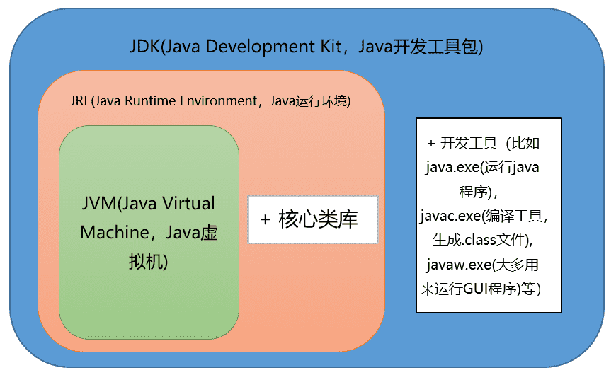

# Java基础知识-Java概述篇

## 何为编程

编程就是让计算机为解决某个问题而使用某种程序设计语言编写程序代码,并最终得到结果的过程。

为了使计算机能够理解人的意图,人类就必须要将需解决的问题的思路、方法、和手段通过计算机能够理解的形式告诉计算机,使得计算机能够根据人的指令一步一步去工作,完成某种特定的任务。这种人和计算机之间交流的过程就是编程。

## 什么是 Java

`Java` 是一门面向对象编程语言,不仅吸收了 `C++` 语言的各种优点,还摒弃了 `C++` 里难以理解的多继承、指针等概念,因此 `Java` 语言具有功能强大和简单易用两个特征。 `Java` 语言作为静态面向对象编程语言的代表,极好地实现了面向对象理论,允许程序员以优雅的思维方式进行复杂的编程。

## jdk1.5 之后的三大版本

- `Java SE`(`J2SE,Java 2 Platform Standard Edition`,标准版)`Java SE` 以前称为 `J2SE`。它允许开发和部署在桌面、服务器、嵌入式环境和实时环境中使用的 `Java` 应用程序。`Java SE` 包含了支持 `Java Web` 服务开发的类,并为 `Java EE` 和 `Java ME` 提供基础。

- `Java EE`(`J2EE,Java 2 Platform Enterprise Edition`,企业版)`Java EE`以前称为`J2EE`。企业版本帮助开发和部署可移植、健壮、可伸缩且安全的服务器端`Java`应用程序。`Java EE`是在`Java SE`的基础上构建的,它提供`Web`服务、组件模型、管理和通信 `API`,可以用来实现企业级的面向服务体系结构(`service-oriented architecture,SOA`)和`Web2.0`应用程序。2018 年 2 月,`Eclipse`宣布正式将`JavaEE`更名为`JakartaEE`.

- `Java ME`(`J2ME,Java 2 Platform Micro Edition`,微型版)`Java ME`以前称为 `J2ME`。`Java ME`为在移动设备和嵌入式设备(比如手机、PDA、电视机顶盒和打印机)上运行的应用程序提供一个健壮且灵活的环境。`Java ME`包括灵活的用户界面、健壮的安全模型、许多内置的网络协议以及对可以动态下载的连网和离线应用程序的丰富支持。基于`Java ME`规范的应用程序只需编写一次,就可以用于许多设备,而且可以利用每个设备的本机功能。

## JVM、JRE 和 JDK 的关系

**JVM**
`Java Virtual Machine`是 `Java` 虚拟机,`Java` 程序需要运行在虚拟机上,不同的平台有自己的虚拟机,因此 `Java` 语言可以实现跨平台。

**JRE**
`Java Runtime Environment` 包括 `Java` 虚拟机和 `Java` 程序所需的核心类库等。核心类库主要是 `java.lang` 包:包含了运行 `Java` 程序必不可少的系统类,如基本数据类型、基本数学函数、字符串处理、线程、异常处理类等,系统缺省加载这个包。

如果想要运行一个开发好的 `Java` 程序,计算机中只需要安装 `JRE` 即可。

**JDK**
`Java Development Kit` 是提供给 `Java` 开发人员使用的,其中包含了 `Java` 的开发工具,也包括了 `JRE`。所以安装了 `JDK`,就无需再单独安装 `JRE` 了。其中的开发工具:编译工具(`javac.exe`),打包工具(`jar.exe`)等。

**JVM&JRE&JDK 关系图**


## 什么是跨平台性？原理是什么

所谓跨平台性,是指 `java` 语言编写的程序,一次编译后,可以在多个系统平台上运行。

**实现原理:** `Java` 程序是通过 `java` 虚拟机在系统平台上运行的,只要该系统可以安装相应的 `java` 虚拟机,该系统就可以运行 `java` 程序。

## Java 语言有哪些特点

- 简单易学(`Java` 语言的语法与 `C` 语言和 `C++`语言很接近)
- 面向对象(封装,继承,多态)
- 平台无关性(`Java` 虚拟机实现平台无关性)
- 支持网络编程并且很方便(`Java` 语言诞生本身就是为简化网络编程设计的)
- 支持多线程(多线程机制使应用程序在同一时间并行执行多项任务)
- 健壮性(`Java` 语言的强类型机制、异常处理、垃圾的自动收集等)
- 安全性

## 什么是字节码？采用字节码的最大好处是什么?

**字节码:** `Java` 源代码经过虚拟机编译器编译后产生的文件(即扩展为`.class`的文件),它不面向任何特定的处理器,只面向虚拟机。

**采用字节码的好处:**
`Java` 语言通过字节码的方式,在一定程度上解决了传统解释型语言执行效率低的问题,同时又保留了解释型语言可移植的特点。所以 `Java` 程序运行时比较高效,而且,由于字节码并不专对一种特定的机器,因此,`Java` 程序无须重新编译便可在多种不同的计算机上运行。

**java 中的编译器和解释器:**
`Java` 中引入了虚拟机的概念,即在机器和编译程序之间加入了一层抽象的虚拟机器。这台虚拟的机器在任何平台上都提供给编译程序一个的共同的接口。编译程序只需要面向虚拟机,生成虚拟机能够理解的代码,然后由解释器来将虚拟机代码转换为特定系统的机器码执行。在 `Java` 中,这种供虚拟机理解的代码叫做字节码(即扩展为`.class` 的文件),它不面向任何特定的处理器,只面向虚拟机。每一种平台的解释器是不同的,但是实现的虚拟机是相同的。`Java` 源程序经过编译器编译后变成字节码,字节码由虚拟机解释执行,虚拟机将每一条要执行的字节码送给解释器,解释器将其翻译成特定机器上的机器码,然后在特定的机器上运行,这就是上面提到的 `Java` 的特点的编译与解释并存的解释。

```
Java源代码---->编译器---->jvm可执行的Java字节码(即虚拟指令)---->jvm---->jvm中解释器----->机器可执行的二进制机器码---->程序运行。
```

## 什么是 Java 程序的主类？应用程序和小程序的主类有何不同？

一个程序中可以有多个类,但只能有一个类是主类。在 Java 应用程序中,这个主类是指包含`main()`方法的类。而在 Java 小程序中,这个主类是一个继承自系统类 `JApplet` 或 `Applet` 的子类。应用程序的主类不一定要求是 `public` 类,但小程序的主类要求必须是 `public` 类。主类是 Java 程序执行的入口点。

## Java 应用程序与小程序之间有那些差别？

简单说应用程序是从主线程启动(也就是 `main()`方法)。`applet` 小程序没有 `main` 方法,主要是嵌在浏览器页面上运行(调用 `init()`线程或者 `run()`来启动),嵌入浏览器这点跟 `flash` 的小游戏类似。

## Java 和 C++的区别

我知道很多人没学过 `C++`,但是面试官就是没事喜欢拿咱们 `Java` 和 `C++`比呀!没办法!!!就算没学过 `C++`,也要记下来！

- 都是面向对象的语言,都支持封装、继承和多态
- `Java` 不提供指针来直接访问内存,程序内存更加安全
- `Java` 的类是单继承的,`C++`支持多重继承；虽然 `Java` 的类不可以多继承,但是接口可以多继承。
- `Java` 有自动内存管理机制,不需要程序员手动释放无用内存

## Oracle JDK 和 OpenJDK 的对比

- `Oracle JDK`版本将每三年发布一次,而`OpenJDK`版本每三个月发布一次；
- `OpenJDK`是一个参考模型并且是完全开源的,而`Oracle JDK`是`OpenJDK`的一个实现,并不是完全开源的；
- `Oracle JDK`比`OpenJDK`更稳定。`OpenJDK`和`Oracle JDK`的代码几乎相同,但`Oracle JDK`有更多的类和一些错误修复。因此,如果您想开发企业/商业软件,我建议您选择`Oracle JDK`,因为它经过了彻底的测试和稳定。某些情况下,有些人提到在使用`OpenJDK`可能会遇到了许多应用程序崩溃的问题,但是,只需切换到`Oracle JDK`就可以解决问题；
- 在响应性和`JVM`性能方面,`Oracle JDK`与`OpenJDK`相比提供了更好的性能；
- `Oracle JDK`不会为即将发布的版本提供长期支持,用户每次都必须通过更新到最新版本获得支持来获取最新版本；
- `Oracle JDK`根据二进制代码许可协议获得许可,而`OpenJDK`根据`GPL v2`许可获得许可。

<font color=gray size=2>参考：https://blog.csdn.net/ThinkWon</font>
