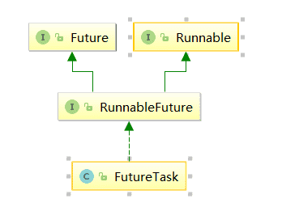
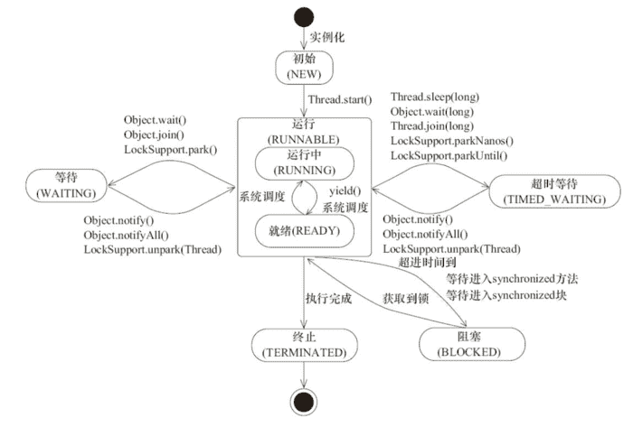
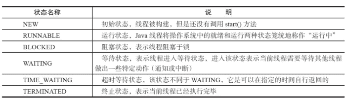
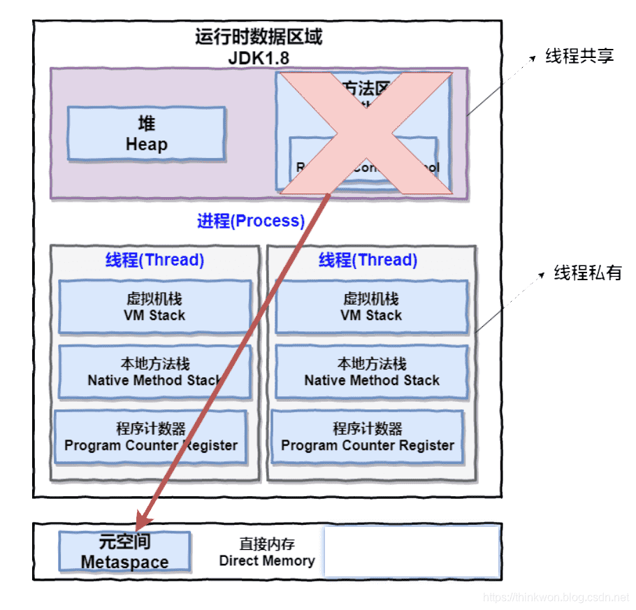
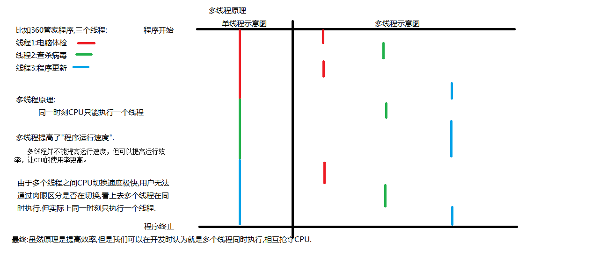
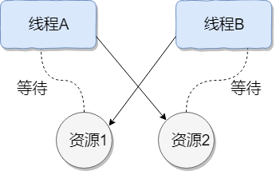

# 并发编程-线程的状态和基本操作

在上一篇文章中[为什么要学习并发编程](https://www.buubiu.com/2020/09/05/%E5%B9%B6%E5%8F%91%E7%BC%96%E7%A8%8B-%E4%BC%98%E7%BC%BA%E7%82%B9/)谈到了为什么花功夫去学习并发编程的技术，也就是说我们必须了解到并发编程的优缺点，我们在什么情况下可以去考虑开启多个线程去实现我们的业务，当然使用多线程我们应该着重注意一些什么，在上一篇文章中会有一些讨论。那么，说了这么多，无论是针对面试还是实际工作中作为一名软件开发人员都应该具备这样的技能。万事开头难，接下来就应该了解如何新建一个线程？线程状态是怎样转换的？关于线程状态的操作是怎样的？这篇文章就主要围绕这三个方面来聊一聊
## 新建线程

一个java程序从main()方法开始执行，然后按照既定的代码逻辑执行，看似没有其他线程参与，但实际上java程序天生就是一个多线程程序，包含了：（1）分发处理发送给给JVM信号的线程；（2）调用对象的finalize方法的线程；（3）清除Reference的线程；（4）main线程，用户程序的入口。那么，如何在用户程序中新建一个线程呢？

主要有三种方式创建线程和Executor框架创建线程池

### 创建线程方式

#### 继承Thread类

步骤

1. 定义一个Thread类的子类，重写run方法，将相关逻辑实现，run()方法就是线程要执行的业务逻辑方法
2. 创建自定义的线程子类对象
3. 调用子类实例的star()方法来启动线程

```java
public class MyThread extends Thread {

    @Override
    public void run() {
        System.out.println(Thread.currentThread().getName() + " run()方法正在执行...");
    }

}

public class TheadTest {

    public static void main(String[] args) {
        MyThread myThread = new MyThread(); 	
        myThread.start();
        System.out.println(Thread.currentThread().getName() + " main()方法执行结束");
    }

}

```

运行结果

```java
main main()方法执行结束
Thread-0 run()方法正在执行...
```

#### 实现Runnable接口

步骤

1. 定义Runnable接口实现类MyRunnable，并重写run()方法
2. 创建MyRunnable实例myRunnable，以myRunnable作为target创建Thead对象，**该Thread对象才是真正的线程对象**
3. 调用线程对象的start()方法

```java
public class MyRunnable implements Runnable {

    @Override
    public void run() {
        System.out.println(Thread.currentThread().getName() + " run()方法执行中...");
    }

}

public class RunnableTest {

    public static void main(String[] args) {
        MyRunnable myRunnable = new MyRunnable();
        Thread thread = new Thread(myRunnable);
        thread.start();
        System.out.println(Thread.currentThread().getName() + " main()方法执行完成");
    }

}

```

执行结果

```java
main main()方法执行完成
Thread-0 run()方法执行中...
```

#### 实现Callable接口

步骤

1. 创建实现Callable接口的类myCallable
2. 以myCallable为参数创建FutureTask对象
3. 将FutureTask作为参数创建Thread对象
4. 调用线程对象的start()方法

```java
public class MyCallable implements Callable<Integer> {

    @Override
    public Integer call() {
        System.out.println(Thread.currentThread().getName() + " call()方法执行中...");
        return 1;
    }

}

public class CallableTest {

    public static void main(String[] args) {
        FutureTask<Integer> futureTask = new FutureTask<Integer>(new MyCallable());
        Thread thread = new Thread(futureTask);
        thread.start();

        try {
            Thread.sleep(1000);
            System.out.println("返回结果 " + futureTask.get());
        } catch (InterruptedException e) {
            e.printStackTrace();
        } catch (ExecutionException e) {
            e.printStackTrace();
        }
        System.out.println(Thread.currentThread().getName() + " main()方法执行完成");
    }

}

```

执行结果

```java
Thread-0 call()方法执行中...
返回结果 1
main main()方法执行完成
```

#### 使用Executor框架创建线程池

Executors提供了一系列工厂方法用于创先线程池，返回的线程池都实现了ExecutorService接口。

主要有newFixedThreadPool，newCachedThreadPool，newSingleThreadExecutor，newScheduledThreadPool，后续详细介绍这四种线程池

```java
public class MyRunnable implements Runnable {

    @Override
    public void run() {
        System.out.println(Thread.currentThread().getName() + " run()方法执行中...");
    }

}

public class SingleThreadExecutorTest {

    public static void main(String[] args) {
        ExecutorService executorService = Executors.newSingleThreadExecutor();
        MyRunnable runnableTest = new MyRunnable();
        for (int i = 0; i < 5; i++) {
            executorService.execute(runnableTest);
        }

        System.out.println("线程任务开始执行");
        executorService.shutdown();
    }

}

```

执行结果

```java
线程任务开始执行
pool-1-thread-1 is running...
pool-1-thread-1 is running...
pool-1-thread-1 is running...
pool-1-thread-1 is running...
pool-1-thread-1 is running...
```

三种标准方式合在一起如下：

```java
public class CreateThreadDemo {
	    public static void main(String[] args) {
	        //1.继承Thread
	        Thread thread = new Thread() {
	            @Override
	            public void run() {
	                System.out.println("继承Thread");
	                super.run();
	            }
	        };
	        thread.start();
	        //2.实现runable接口
	        Thread thread1 = new Thread(new Runnable() {
	            @Override
	            public void run() {
	                System.out.println("实现runable接口");
	            }
	        });
	        thread1.start();
	        //3.实现callable接口
	        ExecutorService service = Executors.newSingleThreadExecutor();
	        Future<String> future = service.submit(new Callable() {
	            @Override
	            public String call() throws Exception {
	                return "通过实现Callable接口";
	            }
	        });
	        try {
	            String result = future.get();
	            System.out.println(result);
	        } catch (InterruptedException e) {
	            e.printStackTrace();
	        } catch (ExecutionException e) {
	            e.printStackTrace();
	        }
	    }
}
```

四种新建线程的方式具体看以上注释，需要注意的是：

- 由于java不能多继承可以实现多个接口，因此，在创建线程的时候尽量多考虑采用实现接口的形式；
- 实现callable接口，提交给ExecutorService返回的是异步执行的结果，另外，通常也可以利用`FutureTask(Callable<V> callable)`将callable进行包装然后FeatureTask提交给ExecutorsService。如图，



-  另外由于FeatureTask也实现了Runable接口也可以利用上面第二种方式（实现Runable接口）来新建线程；
- 可以通过Executors将Runable转换成Callable，具体方法是：`Callable callable(Runnable task, T result)， Callable<Object> callable(Runnable task)`。

## 线程状态转换



此图来源于《JAVA并发编程的艺术》一书中，线程是会在不同的状态间进行转换的，java线程线程转换图如上图所示。线程创建之后它将处于 **NEW（新建）** 状态，之后调用`start()`方法开始运行，当调用`wait(),join(),LockSupport.lock()`方法线程会进入到**WAITING(等待)**状态，而同样的`wait(long timeout)，sleep(long),join(long),LockSupport.parkNanos(),LockSupport.parkUtil()`增加了超时等待的功能，也就是调用这些方法后线程会进入**TIMED_WAITING(超时等待)**状态，当超时等待时间到达后，线程会切换到**Runable**的状态，另外当**WAITING**和**TIMED _WAITING**状态时可以通过`Object.notify(),Object.notifyAll()`方法使线程转换到**Runable**状态。当线程出现资源竞争时，即等待获取锁的时候，线程会进入到**BLOCKED**阻塞状态，当线程获取锁时，线程进入到**Runable**状态。线程运行结束后，线程进入到**TERMINATED**状态，状态转换可以说是线程的生命周期。另外需要注意的是：

- 当线程进入到synchronized方法或者synchronized代码块时，线程切换到的是BLOCKED状态，而使用java.util.concurrent.locks下lock进行加锁的时候线程切换的是WAITING或者TIMED_WAITING状态，因为lock会调用LockSupport的方法。

用一个表格将上面六种状态进行一个总结归纳。



## 线程状态的基本操作

除了新建一个线程外，线程在生命周期内还有需要进行一些基本操作，而这些操作会成为线程间一种通信方式，比如使用中断（interrupted）方式通知实现线程间的交互等等，下面就将具体说说这些操作。

### interrupted

中断可以理解为线程的一个标志位，它表示了一个运行中的线程是否被其他线程进行了中断操作。中断好比其他线程对该线程打了一个招呼。其他线程可以调用该线程的interrupt()方法对其进行中断操作，同时该线程可以调用
isInterrupted()来感知其他线程对其自身的中断操作，从而做出响应。另外，同样可以调用Thread的静态方法
interrupted()对当前线程进行中断操作，该方法会清除中断标志位。**需要注意的是，当抛出InterruptedException时候，会清除中断标志位，也就是说在调用isInterrupted会返回false。**

|               方法名                |         详细解释         |                             备注                             |
| :---------------------------------: | :----------------------: | :----------------------------------------------------------: |
|       public void interrupt()       |      中断该线程对象      | 如果该线程被调用了Object wait/Object wait(long)，或者被调用sleep(long)，join()/join(long)方法时会抛出interruptedException并且中断标志位将会被清除 |
|   public boolean isinterrupted()    | 测试该线程对象是否被中断 |                     中断标志位不会被清除                     |
| public static boolean interrupted() |  测试当前线程是否被中断  |                      中断标志位会被清除                      |

下面结合具体的实例来看一看

```java
public class InterruptDemo {
    public static void main(String[] args) throws InterruptedException {
        //sleepThread睡眠1000ms
        final Thread sleepThread = new Thread() {
            @Override
            public void run() {
                try {
                    Thread.sleep(1000);
                } catch (InterruptedException e) {
                    e.printStackTrace();
                }
                super.run();
            }
        };
        //busyThread一直执行死循环
        Thread busyThread = new Thread() {
            @Override
            public void run() {
                while (true) ;
            }
        };
        sleepThread.start();
        busyThread.start();
        sleepThread.interrupt();
        busyThread.interrupt();
        while (sleepThread.isInterrupted()) ;
        System.out.println("sleepThread isInterrupted: " + sleepThread.isInterrupted());
        System.out.println("busyThread isInterrupted: " + busyThread.isInterrupted());
    }
}
```

输出结果

```java
sleepThread isInterrupted: false
busyThread isInterrupted: true
java.lang.InterruptedException: sleep interrupted
	at java.lang.Thread.sleep(Native Method)
	at com.jourwon.test.InterruptDemo$1.run(InterruptDemo.java:17)
```

开启了两个线程分别为sleepThread和BusyThread， sleepThread睡眠1s，BusyThread执行死循环。然后分别对着两个线程进行中断操作，可以看出sleepThread抛出InterruptedException后清除标志位，而busyThread就不会清除标志位。

另外，同样可以通过中断的方式实现线程间的简单交互， while (sleepThread.isInterrupted()) 表示在Main线程中会持续监测sleepThread线程，一旦sleepThread的中断标志位清零，即sleepThread.isInterrupted()返回为false时才会继续Main线程才会继续往下执行。因此，中断操作可以看做线程间一种简便的交互方式。**一般在结束线程时通过中断标志位或者标志位的方式可以有机会去清理资源，相对于武断而直接的结束线程，这种方式要优雅和安全**

### join

join方法可以看做是线程间协作的一种方式，很多时候，一个线程的输入可能非常依赖于另一个线程的输出，这就像两个好基友，一个基友先走在前面突然看见另一个基友落在后面了，这个时候他就会在原处等一等这个基友，等基友赶上来后，就两人携手并进。其实线程间的这种协作方式也符合现实生活。在软件开发的过程中，从客户那里获取需求后，需要经过需求分析师进行需求分解后，这个时候产品，开发才会继续跟进。如果一个线程实例A执行了threadB.join()，其含义是：当前线程A会等待threadB线程终止后threadA才会继续执行。关于join方法一共提供如下这些方法:

| 方法名                                                       | 详细注释                                                     | 备注                                                         |
| ------------------------------------------------------------ | ------------------------------------------------------------ | ------------------------------------------------------------ |
| public final void join() throws InterruptedException         | 等待这个线程死亡。                                           | 如果任何线程中断当前线程，如果抛出InterruptedException异常时，当前线程的中断状态将被清除 |
| public final void join(long millis) throws InterruptedException | 等待这个线程死亡的时间最多为`millis`毫秒。 `0`的超时意味着永远等待。 | 如果millis为负数，抛出IllegalArgumentException异常           |
| public final void join(long millis, int nanos) throws InterruptedException | 等待最多`millis`毫秒加上这个线程死亡的`nanos`纳秒。          | 如果millis为负数或者nanos不在0-999999范围抛出IllegalArgumentException异常 |

Thread类除了提供join()方法外，另外还提供了超时等待的方法，如果线程threadB在等待的时间内还没有结束的话，threadA会在超时之后继续执行。join方法源码关键是：

```
 while (isAlive()) {
    wait(0);
 }
```

可以看出来当前等待对象threadA会一直阻塞，直到被等待对象threadB结束后即isAlive()返回false的时候才会结束while循环，当threadB退出时会调用notifyAll()方法通知所有的等待线程。下面用一个具体的例子来说说join方法的使用：

```java
public class JoinDemo {
    public static void main(String[] args) {
        Thread previousThread = Thread.currentThread();
        for (int i = 1; i <= 10; i++) {
            Thread curThread = new JoinThread(previousThread);
            curThread.start();
            previousThread = curThread;
        }
    }

    static class JoinThread extends Thread {
        private Thread thread;

        public JoinThread(Thread thread) {
            this.thread = thread;
        }

        @Override
        public void run() {
            try {
                thread.join();
                System.out.println(thread.getName() + " terminated.");
            } catch (InterruptedException e) {
                e.printStackTrace();
            }
        }
    }
}
```

输出结果为：

```java
main terminated.
Thread-0 terminated.
Thread-1 terminated.
Thread-2 terminated.
Thread-3 terminated.
Thread-4 terminated.
Thread-5 terminated.
Thread-6 terminated.
Thread-7 terminated.
Thread-8 terminated.
```

在上面的例子中一个创建了10个线程，每个线程都会等待前一个线程结束才会继续运行。可以通俗的理解成接力，前一个线程将接力棒传给下一个线程，然后又传给下一个线程…

### sleep

`public static native void sleep(long millis)`方法显然是Thread的静态方法，很显然它是让当前线程按照指定的时间休眠，其休眠时间的精度取决于处理器的计时器和调度器。需要注意的是如果当前线程获得了锁，sleep方法并不会失去锁。sleep方法经常拿来与Object.wait()方法进行比较，这也是面试经常被问的地方。

> **sleep() VS wait()**

两者主要的区别：

1. sleep()方法是Thread的静态方法，而wait是Object实例方法
2. wait()方法必须要在同步方法或者同步块中调用，也就是必须已经获得对象锁。而sleep()方法没有这个限制可以在任何地方使用。另外，wait()方法会释放占有的对象锁，使得该线程进入等待池中，等待下一次获取资源。而sleep()方法只是会让出CPU并不会释放掉对象锁；
3. sleep()方法在休眠时间达到后，如果再次获得CPU时间片就会继续执行，而wait()方法必须等待Object.notift/Object.notifyAll通知后，才会离开等待池，并且再次获得CPU时间片才会继续执行。

### yield

`public static native void yield();`这是一个静态方法，一旦执行，它会是当前线程让出CPU，但是，需要注意的是，让出的CPU并不是代表当前线程不再运行了，如果在下一次竞争中，又获得了CPU时间片当前线程依然会继续运行。另外，让出的时间片只会分配**给当前线程相同优先级**的线程。什么是线程优先级了？下面就来具体聊一聊。

现代操作系统基本采用时分的形式调度运行的线程，操作系统会分出一个个时间片，线程会分配到若干时间片，当前时间片用完后就会发生线程调度，并等待这下次分配。线程分配到的时间多少也就决定了线程使用处理器资源的多少，而线程优先级就是决定线程需要或多或少分配一些处理器资源的线程属性。

在Java程序中，通过一个**整型成员变量Priority**来控制优先级，优先级的范围从1~10.在构建线程的时候可以通过**setPriority(int)**方法进行设置，默认优先级为5，优先级高的线程相较于优先级低的线程优先获得处理器时间片。需要注意的是在不同JVM以及操作系统上，线程规划存在差异，有些操作系统甚至会忽略线程优先级的设定。

另外需要注意的是，sleep()和yield()方法，同样都是当前线程会交出处理器资源，而它们不同的是，sleep()交出来的时间片其他线程都可以去竞争，也就是说都有机会获得当前线程让出的时间片。而yield()方法只允许与当前线程具有相同优先级的线程能够获得释放出来的CPU时间片。

## 线程优先级

**理论上**来说系统会根据优先级来决定首先使哪个线程进入运行状态。当 CPU 比较闲的时候，设置线程优先级几乎不会有任何作用，而且很多操作系统压根不会理会你设置的线程优先级，所以不要让业务过度依赖于线程的优先级。

另外，**线程优先级具有继承特性**比如 A 线程启动 B 线程，则 B 线程的优先级和 A 是一样的。**线程优先级还具有随机性** 也就是说线程优先级高的不一定每一次都先执行完。

Thread 类中包含的成员变量代表了线程的某些优先级。如**Thread.MIN_PRIORITY（常数 1）**，**Thread.NORM_PRIORITY（常数 5）**,**Thread.MAX_PRIORITY（常数 10）**。其中每个线程的优先级都在**1**到**10** 之间，1的优先级为最低，10的优先级为最高，在默认情况下优先级都是**Thread.NORM_PRIORITY（常数 5）**。

**一般情况下，不会对线程设定优先级别，更不会让某些业务严重地依赖线程的优先级别，比如权重，借助优先级设定某个任务的权重，这种方式是不可取的，一般定义线程的时候使用默认的优先级就好了。**

**相关方法：**

```java
public final void setPriority(int newPriority) //为线程设定优先级
public final int getPriority() //获取线程的优先级
```

**设置线程优先级方法源码：**

```java
public final void setPriority(int newPriority) {
    ThreadGroup g;
    checkAccess();
    //线程游戏优先级不能小于 1 也不能大于 10，否则会抛出异常
    if (newPriority > MAX_PRIORITY || newPriority < MIN_PRIORITY) {
        throw new IllegalArgumentException();
    }
    //如果指定的线程优先级大于该线程所在线程组的最大优先级，那么该线程的优先级将设为线程组的最大优先级
    if((g = getThreadGroup()) != null) {
        if (newPriority > g.getMaxPriority()) {
            newPriority = g.getMaxPriority();
        }
        setPriority0(priority = newPriority);
    }
}
```

## 进程和线程

### 进程

一个在内存中运行的应用程序。每个进程都有自己独立的一块内存空间，一个进程可以有多个线程，比如在Windows系统中，一个运行的xx.exe就是一个进程。


### 线程

进程中的一个执行任务（控制单元），负责当前进程中程序的执行。一个进程至少有一个线程，一个进程可以运行多个线程，多个线程可共享数据。

与进程不同的是同类的多个线程共享进程的**堆**和**方法区**资源，但每个线程有自己的**程序计数器**、**虚拟机栈**和**本地方法栈**，所以系统在产生一个线程，或是在各个线程之间作切换工作时，负担要比进程小得多，也正因为如此，线程也被称为轻量级进程。

Java 程序天生就是多线程程序，我们可以通过 JMX 来看一下一个普通的 Java 程序有哪些线程，代码如下。

```java
public class MultiThread {
	public static void main(String[] args) {
		// 获取 Java 线程管理 MXBean
		ThreadMXBean threadMXBean = ManagementFactory.getThreadMXBean();
		// 不需要获取同步的 monitor 和 synchronizer 信息，仅获取线程和线程堆栈信息
		ThreadInfo[] threadInfos = threadMXBean.dumpAllThreads(false, false);
		// 遍历线程信息，仅打印线程 ID 和线程名称信息
		for (ThreadInfo threadInfo : threadInfos) {
			System.out.println("[" + threadInfo.getThreadId() + "] " + threadInfo.getThreadName());
		}
	}
}
```

上述程序输出如下（输出内容可能不同，不用太纠结下面每个线程的作用，只用知道 main 线程执行 main 方法即可）：

```
[6] Monitor Ctrl-Break //监听线程转储或“线程堆栈跟踪”的线程
[5] Attach Listener //负责接收到外部的命令，而对该命令进行执行的并且把结果返回给发送者
[4] Signal Dispatcher // 分发处理给 JVM 信号的线程
[3] Finalizer //在垃圾收集前，调用对象 finalize 方法的线程
[2] Reference Handler //用于处理引用对象本身（软引用、弱引用、虚引用）的垃圾回收的线程
[1] main //main 线程,程序入口
```

从上面的输出内容可以看出：**一个 Java 程序的运行是 main 线程和多个其他线程同时运行**。

### 进程与线程的区别总结

线程具有许多传统进程所具有的特征，故又称为轻型进程(Light—Weight Process)或进程元；而把传统的进程称为重型进程(Heavy—Weight Process)，它相当于只有一个线程的任务。在引入了线程的操作系统中，通常一个进程都有若干个线程，至少包含一个线程。

**根本区别**：进程是操作系统资源分配的基本单位，而线程是处理器任务调度和执行的基本单位

**资源开销**：每个进程都有独立的代码和数据空间（程序上下文），程序之间的切换会有较大的开销；线程可以看做轻量级的进程，同一类线程共享代码和数据空间，每个线程都有自己独立的运行栈和程序计数器（PC），线程之间切换的开销小。

**包含关系**：如果一个进程内有多个线程，则执行过程不是一条线的，而是多条线（线程）共同完成的；线程是进程的一部分，所以线程也被称为轻权进程或者轻量级进程。

**内存分配**：同一进程的线程共享本进程的地址空间和资源，而进程之间的地址空间和资源是相互独立的

**影响关系**：一个进程崩溃后，在保护模式下不会对其他进程产生影响，但是一个线程崩溃整个进程都死掉。所以多进程要比多线程健壮。

**执行过程**：每个独立的进程有程序运行的入口、顺序执行序列和程序出口。但是线程不能独立执行，必须依存在应用程序中，由应用程序提供多个线程执行控制，两者均可并发执行

### 从 JVM 角度说进程和线程之间的关系（重要）

#### 图解进程和线程的关系

下图是 Java 内存区域，通过下图我们从 JVM 的角度来说一下线程和进程之间的关系。



从上图可以看出：一个进程中可以有多个线程，多个线程共享进程的**堆**和**方法区 (JDK1.8 之后的元空间)资源，但是每个线程有自己的程序计数器、虚拟机栈 和 本地方法栈**。

#### 程序计数器为什么是私有的?

程序计数器主要有下面两个作用：

1. 字节码解释器通过改变程序计数器来依次读取指令，从而实现代码的流程控制，如：顺序执行、选择、循环、异常处理。
2. 在多线程的情况下，程序计数器用于记录当前线程执行的位置，从而当线程被切换回来的时候能够知道该线程上次运行到哪儿了。

需要注意的是，如果执行的是 native 方法，那么程序计数器记录的是 undefined 地址，只有执行的是 Java 代码时程序计数器记录的才是下一条指令的地址。

所以，程序计数器私有主要是为了**线程切换后能恢复到正确的执行位置**。

#### 虚拟机栈和本地方法栈为什么是私有的?

- **虚拟机栈**：每个 Java 方法在执行的同时会创建一个栈帧用于存储局部变量表、操作数栈、常量池引用等信息。从方法调用直至执行完成的过程，就对应着一个栈帧在 Java 虚拟机栈中入栈和出栈的过程。
- **本地方法栈**：和虚拟机栈所发挥的作用非常相似，区别是： **虚拟机栈为虚拟机执行 Java 方法 （也就是字节码）服务，而本地方法栈则为虚拟机使用到的 Native 方法服务。** 在 HotSpot 虚拟机中和 Java 虚拟机栈合二为一。

所以，为了**保证线程中的局部变量不被别的线程访问到**，虚拟机栈和本地方法栈是线程私有的。

#### 一句话简单了解堆和方法区

堆和方法区是所有线程共享的资源，其中堆是进程中最大的一块内存，主要用于存放新创建的对象 (所有对象都在这里分配内存)，方法区主要用于存放已被加载的类信息、常量、静态变量、即时编译器编译后的代码等数据。

### 多进程和多线程区别

多进程：操作系统中同时运行的多个程序

多线程：在同一个进程中同时运行的多个任务

举个例子，多线程下载软件，可以同时运行多个线程，但是通过程序运行的结果发现，每一次结果都不一致。 因为多线程存在一个特性：**随机性**。造成的原因：**CPU在瞬间不断切换去处理各个线程而导致的，可以理解成多个线程在抢CPU资源。**

**多线程提高CPU使用率**



多线程并不能提高运行速度，但可以提高运行效率，让CPU的使用率更高。但是如果多线程有安全问题或出现频繁的上下文切换时，运算速度可能反而更低。

### Java中的多线程

Java程序的进程里有几个线程：主线程，垃圾回收线程(后台线程)等

在 Java 中，当我们启动 main 函数时其实就是启动了一个 JVM 的进程，而 main 函数所在的线程就是这个进程中的一个线程，也称主线程。

Java支持多线程，当Java程序执行main方法的时候，就是在执行一个名字叫做main的线程，可以在main方法执行时，开启多个线程A,B,C，多个线程 main,A,B,C同时执行，相互抢夺CPU，Thread类是java.lang包下的一个常用类,每一个Thread类的对象，就代表一个处于某种状态的线程

## 守护线程Daemon

守护线程是一种特殊的线程，就和它的名字一样，它是系统的守护者，在后台默默地守护一些系统服务，比如垃圾回收线程，JIT线程就可以理解守护线程。与之对应的就是用户线程，用户线程就可以认为是系统的工作线程，它会完成整个系统的业务操作。用户线程完全结束后就意味着整个系统的业务任务全部结束了，因此系统就没有对象需要守护的了，守护线程自然而然就会退。当一个Java应用，只有守护线程的时候，虚拟机就会自然退出。下面以一个简单的例子来表述Daemon线程的使用。

```java
public class DaemonDemo {
    public static void main(String[] args) {
        Thread daemonThread = new Thread(new Runnable() {
            @Override
            public void run() {
                while (true) {
                    try {
                        System.out.println("i am alive");
                        Thread.sleep(500);
                    } catch (InterruptedException e) {
                        e.printStackTrace();
                    } finally {
                        System.out.println("finally block");
                    }
                }
            }
        });
        daemonThread.setDaemon(true);
        daemonThread.start();
        //确保main线程结束前能给daemonThread能够分到时间片
        try {
            Thread.sleep(800);
        } catch (InterruptedException e) {
            e.printStackTrace();
        }
    }
}
```

输出结果为：

```java
i am alive
finally block
i am alive
```

上面的例子中daemodThread run方法中是一个while死循环，会一直打印,但是当main线程结束后daemonThread就会退出所以不会出现死循环的情况。main线程先睡眠800ms保证daemonThread能够拥有一次时间片的机会，也就是说可以正常执行一次打印“i am alive”操作和一次finally块中"finally block"操作。紧接着main 线程结束后，daemonThread退出，这个时候只打印了"i am alive"并没有打印finnal块中的。因此，这里需要注意的是**守护线程在退出的时候并不会执行finnaly块中的代码，所以将释放资源等操作不要放在finnaly块中执行，这种操作是不安全的**

线程可以通过setDaemon(true)的方法将线程设置为守护线程。并且需要注意的是设置守护线程要先于start()方法，否则会报这样的异常:

```java
Exception in thread "main" java.lang.IllegalThreadStateException at java.lang.Thread.setDaemon(Thread.java:1365) at learn.DaemonDemo.main(DaemonDemo.java:19)
```

但是该线程还是会执行，只不过会当做正常的用户线程执行。

## 线程死锁

### 认识线程死锁

`百度百科`：死锁是指两个或两个以上的进程（线程）在执行过程中，由于竞争资源或者由于彼此通信而造成的一种阻塞的现象，若无外力作用，它们都将无法推进下去。此时称系统处于死锁状态或系统产生了死锁，这些永远在互相等待的进程（线程）称为死锁进程（线程）。

多个线程同时被阻塞，它们中的一个或者全部都在等待某个资源被释放。由于线程被无限期地阻塞，因此程序不可能正常终止。

如下图所示，线程 A 持有资源 2，线程 B 持有资源 1，他们同时都想申请对方的资源，所以这两个线程就会互相等待而进入死锁状态。



下面通过一个例子来说明线程死锁，代码模拟了上图的死锁的情况 (代码来源于《并发编程之美》)：

```java
public class DeadLockDemo {
    private static Object resource1 = new Object();//资源 1
    private static Object resource2 = new Object();//资源 2

    public static void main(String[] args) {
        new Thread(() -> {
            synchronized (resource1) {
                System.out.println(Thread.currentThread() + "get resource1");
                try {
                    Thread.sleep(1000);
                } catch (InterruptedException e) {
                    e.printStackTrace();
                }
                System.out.println(Thread.currentThread() + "waiting get resource2");
                synchronized (resource2) {
                    System.out.println(Thread.currentThread() + "get resource2");
                }
            }
        }, "线程 1").start();

        new Thread(() -> {
            synchronized (resource2) {
                System.out.println(Thread.currentThread() + "get resource2");
                try {
                    Thread.sleep(1000);
                } catch (InterruptedException e) {
                    e.printStackTrace();
                }
                System.out.println(Thread.currentThread() + "waiting get resource1");
                synchronized (resource1) {
                    System.out.println(Thread.currentThread() + "get resource1");
                }
            }
        }, "线程 2").start();
    }
}
```

输出结果

```java
Thread[线程 1,5,main]get resource1
Thread[线程 2,5,main]get resource2
Thread[线程 1,5,main]waiting get resource2
Thread[线程 2,5,main]waiting get resource1
```

线程 A 通过 synchronized (resource1) 获得 resource1 的监视器锁，然后通过`Thread.sleep(1000)`；让线程 A 休眠 1s 为的是让线程 B 得到CPU执行权，然后获取到 resource2 的监视器锁。线程 A 和线程 B 休眠结束了都开始企图请求获取对方的资源，然后这两个线程就会陷入互相等待的状态，这也就产生了死锁。上面的例子符合产生死锁的四个必要条件。

形成死锁的四个必要条件：

1. **互斥条件**：线程(进程)对于所分配到的资源具有排它性，即一个资源只能被一个线程(进程)占用，直到被该线程(进程)释放
2. **请求与保持条件**：一个线程(进程)因请求被占用资源而发生阻塞时，对已获得的资源保持不放。
3. **不剥夺条件**：线程(进程)已获得的资源在末使用完之前不能被其他线程强行剥夺，只有自己使用完毕后才释放资源。
4. **循环等待条件**：当发生死锁时，所等待的线程(进程)必定会形成一个环路（类似于死循环），造成永久阻塞

### 如何避免线程死锁

我们只要破坏产生死锁的四个条件中的其中一个就可以了。

**破坏互斥条件**

这个条件我们没有办法破坏，因为我们用锁本来就是想让他们互斥的（临界资源需要互斥访问）。

**破坏请求与保持条件**

一次性申请所有的资源。

**破坏不剥夺条件**

占用部分资源的线程进一步申请其他资源时，如果申请不到，可以主动释放它占有的资源。

**破坏循环等待条件**

靠按序申请资源来预防。按某一顺序申请资源，释放资源则反序释放。破坏循环等待条件。

我们对线程 2 的代码修改成下面这样就不会产生死锁了。

```java
new Thread(() -> {
    synchronized (resource1) {
        System.out.println(Thread.currentThread() + "get resource1");
        try {
            Thread.sleep(1000);
        } catch (InterruptedException e) {
            e.printStackTrace();
        }
        System.out.println(Thread.currentThread() + "waiting get resource2");
        synchronized (resource2) {
            System.out.println(Thread.currentThread() + "get resource2");
        }
    }
}, "线程 2").start();
```

输出结果

```java
Thread[线程 1,5,main]get resource1
Thread[线程 1,5,main]waiting get resource2
Thread[线程 1,5,main]get resource2
Thread[线程 2,5,main]get resource1
Thread[线程 2,5,main]waiting get resource2
Thread[线程 2,5,main]get resource2
123456
```

我们分析一下上面的代码为什么避免了死锁的发生?

线程 1 首先获得到 resource1 的监视器锁，这时候线程 2 就获取不到了。然后线程 1 再去获取 resource2 的监视器锁，可以获取到。然后线程 1 释放了对 resource1、resource2 的监视器锁的占用，线程 2 获取到就可以执行了。这样就破坏了破坏循环等待条件，因此避免了死锁。

> 参考：
>
> [线程状态及基本操作](https://www.codercc.com/backend/basic/juc/base/thread-state.html)
>
> [线程的状态和基本操作](https://blog.csdn.net/ThinkWon/article/details/102027115)

