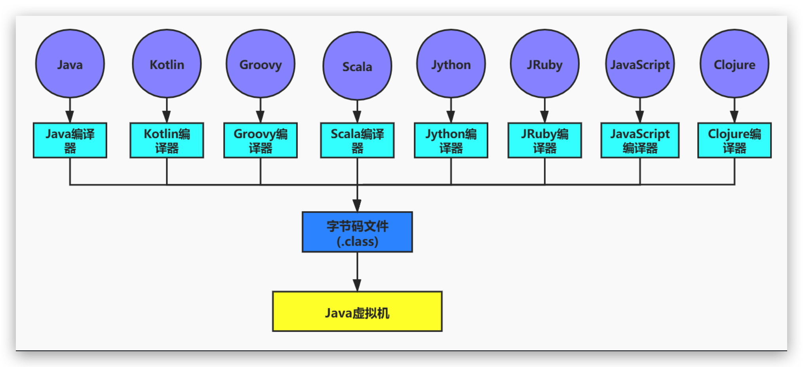
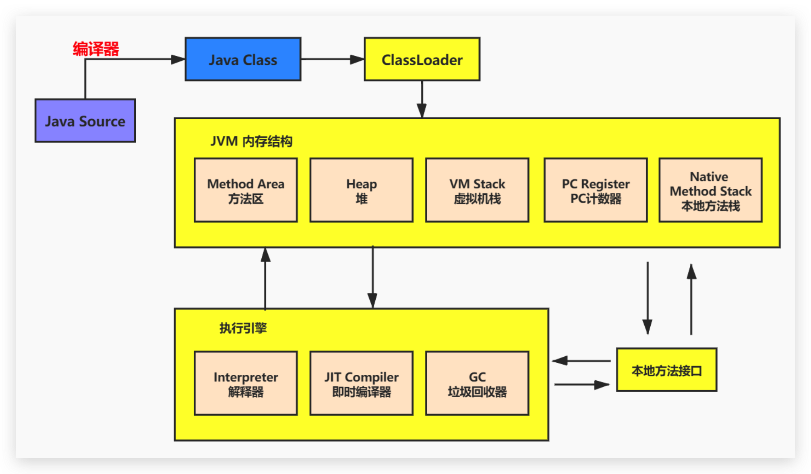
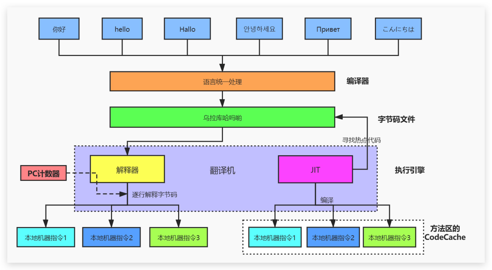

# Class文件结构-概述

## 字节码文件的跨平台性

- **Java 语言，跨平台的（write once，run anywhere）**

  - 当 Java 源代码成功编译成字节码后，如果想在不同的平台上面运行，则无须再次编译。
  - 这个优势不再那么吸引人了。Python、PHP、Perl、Ruby、Lisp 等有强大的解释器。
  - 跨平台似乎已经快称为一门语言必选的特性。

- **Java 虚拟机：跨语言的平台**

  **Java 虚拟机不和包括 Java 在内的任何语言绑定，它只与"Class 文件"这种特定的二进制文件格式所关联。**无论使用何种语言进行软件开发， 只要能将源文件编译为正确的 Class 文件，那么这种语言就可以在 Java 虚拟机上执行，可以说，统一而强大的 Class 文件结构，就是 Java 虚拟机的基石、桥梁。

  <!--more-->

  

  java虚拟机规范：https://docs.oracle.com/javase/specs/index.html

  所有的 JVM 全部遵守 Java 虚拟机规范，也就是说所有的 JVM 环境都是一样的， 这样一来字节码文件可以在各种 JVM 上进行。

- **想要让一个 Java 程序正确地运行在 JVM 中，Java 源码就是必须要被编译为符合 JVM 规范的字节码**

  - 前端编译器的主要任务就是负责将符合 Java 语法规范的 Java 代码转换为符合 JVM 规范的字节码文件。
  - javac 是一种能够将 Java 源码编译为字节码的前端编译器。
  - javac 编译器在将 Java 源码编译为一个有效的字节码文件过程中经历了 4 个步骤，分别是**词法分析、语法分析、语义分析以及生成字节码。**

  

Oracle 的 JDK 软件包括两部分内容

- 一部分是将 Java 源代码编译成 Java 虚拟机的指令集的编译器
- 另一部分是用于实现 Java 虚拟机的运行时环境

**前端编译器并不包含在 JVM 中**

## Java 的前端编译器



### 前端编译器 VS 后端编译器

Java 源代码的编译结果是字节码，那么肯定需要有一种编译器能够将 Java 源码编译为字节码，承担这个重要责任的就是配置在 path 环境变量中的 **javac 编译器**。javac 是一种能够将 Java 源码编译为字节码的**前端编译器**。

HotSpot VM 并没有强制要求前端编译器只能使用 javac 来编译字节码，其实只要编译结果符合 JVM 规范都可以被 JVM 所识别即可。在 Java 的前端编译器领域，除了 javac 之外，还有一种被大家经常用到的前端编译器，那就是内置在 Eclipse 中的 **ECJ（Eclipse Compiler for Java）编译器**。和 javac 的全量式编译不同，ECJ 是一种增量式编译器。

- 在 Eclipse 中，当开发人员编写完代码后，使用"Ctrl + S"快捷键时，ECJ 编译器所采取的**编译方案**是把未编译部分的源码逐行进行编译，而非每次都全量编译。因此 ECJ 的编译效率会比 javac 更加迅速和高效，当然编译质量和 javac 相比大致还是一样的。
- ECJ 不仅是 Eclipse 的默认内置前端编译器，在 Tomcat 中同样也是使用 ECJ 编译器来编译 JSP 文件。由于 ECJ 编译器是采用 GPLv2 的开源协议进行源代码公开，所以，大家可以登录 Eclipse 官网下载 ECJ 编译器的源码进行二次开发。
- 默认情况下，IntelliJ IDEA 使用 javac 编译器（还可以自己设置为 AspectJ 编译器 ajc）。

前端编译器并不会直接涉及编译优化等方面的技术，而是将这些具体优化细节移交给 HotSpot 的 JIT 编译器负责。

> AOT （静态提前编译器， Ahead Of Time Compiler ）：提前把源代码编译成机器指令

## 透过字节码指令看代码细节

**BAT 面试题**

1. 类文件结构有几个部分?
2. 知道字节码吗？字节码都有哪些？ `Integer x = 5; int y = 5;`比较 `x == y` 都经过哪些步骤？

### 示例 1

代码：

```java 
package com.buubiu;

public class IntegerTest {
    public static void main(String[] args) {

        Integer x = 5;
        int y = 5;
        System.out.println(x == y); // true

        Integer i1 = 10;
        Integer i2 = 10;
        System.out.println(i1 == i2);//true  java.lang.Integer.IntegerCache

        Integer i3 = 128;
        Integer i4 = 128;
        System.out.println(i3 == i4);//false     java.lang.Integer.IntegerCache
    }
}
```

字节码：

```java
 0 iconst_5
 1 invokestatic #2 <java/lang/Integer.valueOf : (I)Ljava/lang/Integer;>
 4 astore_1
 5 iconst_5
 6 istore_2
 7 getstatic #3 <java/lang/System.out : Ljava/io/PrintStream;>
10 aload_1
11 invokevirtual #4 <java/lang/Integer.intValue : ()I>
14 iload_2
15 if_icmpne 22 (+7)
18 iconst_1
19 goto 23 (+4)
22 iconst_0
23 invokevirtual #5 <java/io/PrintStream.println : (Z)V>
26 bipush 10
28 invokestatic #2 <java/lang/Integer.valueOf : (I)Ljava/lang/Integer;>
31 astore_3
32 bipush 10
34 invokestatic #2 <java/lang/Integer.valueOf : (I)Ljava/lang/Integer;>
37 astore 4
39 getstatic #3 <java/lang/System.out : Ljava/io/PrintStream;>
42 aload_3
43 aload 4
45 if_acmpne 52 (+7)
48 iconst_1
49 goto 53 (+4)
52 iconst_0
53 invokevirtual #5 <java/io/PrintStream.println : (Z)V>
56 sipush 128
59 invokestatic #2 <java/lang/Integer.valueOf : (I)Ljava/lang/Integer;>
62 astore 5
64 sipush 128
67 invokestatic #2 <java/lang/Integer.valueOf : (I)Ljava/lang/Integer;>
70 astore 6
72 getstatic #3 <java/lang/System.out : Ljava/io/PrintStream;>
75 aload 5
77 aload 6
79 if_acmpne 86 (+7)
82 iconst_1
83 goto 87 (+4)
86 iconst_0
87 invokevirtual #5 <java/io/PrintStream.println : (Z)V>
90 return
```

通过字节码文件可以看出，调用了`Integer.valueOf()`方法。

Integer部分源码：

```java
private static class IntegerCache {
  static final int low = -128;
  static final int high;
  static final Integer cache[];

  static {
    // high value may be configured by property
    int h = 127;
    String integerCacheHighPropValue =
      sun.misc.VM.getSavedProperty("java.lang.Integer.IntegerCache.high");
    if (integerCacheHighPropValue != null) {
      try {
        int i = parseInt(integerCacheHighPropValue);
        i = Math.max(i, 127);
        // Maximum array size is Integer.MAX_VALUE
        h = Math.min(i, Integer.MAX_VALUE - (-low) -1);
      } catch( NumberFormatException nfe) {
        // If the property cannot be parsed into an int, ignore it.
      }
    }
    high = h;

    cache = new Integer[(high - low) + 1];
    int j = low;
    for(int k = 0; k < cache.length; k++)
      cache[k] = new Integer(j++);

    // range [-128, 127] must be interned (JLS7 5.1.7)
    assert IntegerCache.high >= 127;
  }

  private IntegerCache() {}
}
public static Integer valueOf(int i) {
  if (i >= IntegerCache.low && i <= IntegerCache.high)
    return IntegerCache.cache[i + (-IntegerCache.low)];
  return new Integer(i);
}
```

通过观察源码可以看出-128-127不会new出新对象，而是用的`Integer` 的内部缓存，所以前两个值都为true

### 示例 2

代码：

```java
package com.buubiu;

public class StringTest {
    public static void main(String[] args) {
        String str = new String("hello") + new String("world");
        String str1 = "helloworld";
        System.out.println(str == str1);   // false
        String str2 = new String("helloworld");
        System.out.println(str == str2);   // false
    }
}
```

字节码：

```java
 0 new #2 <java/lang/StringBuilder>
 3 dup
 4 invokespecial #3 <java/lang/StringBuilder.<init> : ()V>
 7 new #4 <java/lang/String>
10 dup
11 ldc #5 <hello>
13 invokespecial #6 <java/lang/String.<init> : (Ljava/lang/String;)V>
16 invokevirtual #7 <java/lang/StringBuilder.append : (Ljava/lang/String;)Ljava/lang/StringBuilder;>
19 new #4 <java/lang/String>
22 dup
23 ldc #8 <world>
25 invokespecial #6 <java/lang/String.<init> : (Ljava/lang/String;)V>
28 invokevirtual #7 <java/lang/StringBuilder.append : (Ljava/lang/String;)Ljava/lang/StringBuilder;>
31 invokevirtual #9 <java/lang/StringBuilder.toString : ()Ljava/lang/String;>
34 astore_1
35 ldc #10 <helloworld>
37 astore_2
38 getstatic #11 <java/lang/System.out : Ljava/io/PrintStream;>
41 aload_1
42 aload_2
43 if_acmpne 50 (+7)
46 iconst_1
47 goto 51 (+4)
50 iconst_0
51 invokevirtual #12 <java/io/PrintStream.println : (Z)V>
54 new #4 <java/lang/String>
57 dup
58 ldc #10 <helloworld>
60 invokespecial #6 <java/lang/String.<init> : (Ljava/lang/String;)V>
63 astore_3
64 getstatic #11 <java/lang/System.out : Ljava/io/PrintStream;>
67 aload_1
68 aload_3
69 if_acmpne 76 (+7)
72 iconst_1
73 goto 77 (+4)
76 iconst_0
77 invokevirtual #12 <java/io/PrintStream.println : (Z)V>
80 return
```

通过查看字节码指令，可以看到 `str` 是由 `StringBuilder#toString` 所得，是新创建的 `String` ，`str1` 指向常量池中的对象，`str2` 是新创建的 `String` ，因此互相都不相等

### 示例 3

成员变量（非静态的）的赋值过程：

1. 默认初始化 
2. 显式初始化 /代码块中初始化
3. 构造器中初始化
4. 有了对象之后，可以“对象.属性”或"对象.方法"

代码：

```java
package com.buubiu;

/*
成员变量（非静态的）的赋值过程： ① 默认初始化 - ② 显式初始化 /代码块中初始化 - ③ 构造器中初始化 - ④ 有了对象之后，可以“对象.属性”或"对象.方法"
 的方式对成员变量进行赋值。
 */
class Father {
    int x = 10;

    public Father() {
        this.print();
        x = 20;
    }

    public void print() {
        System.out.println("Father.x = " + x);
    }
}

class Son extends Father {
    int x = 30;

    public Son() {
        this.print();
        x = 40;
    }

    public void print() {
        System.out.println("Son.x = " + x);
    }
}

public class SonTest {
    public static void main(String[] args) {
        Father f = new Son();
        System.out.println(f.x);
    }
}
/*
输出：
Son.x = 0
Son.x = 30
20
 */
```

`Father` 类的 `<init>` 字节码（即：public Father()的字节码）：

```java
 0 aload_0
 1 invokespecial #1 <java/lang/Object.<init> : ()V>
 4 aload_0
 5 bipush 10
 7 putfield #2 <com/buubiu/Father.x : I>
10 aload_0
11 invokevirtual #3 <com/buubiu/Father.print : ()V>
14 aload_0
15 bipush 20
17 putfield #2 <com/buubiu/Father.x : I>
20 return
```

字节码执行步骤：

1. 执行父类 `Object` 的构造器
2. 显式初始化 `x` 为 `10`
3. 执行 `print` 方法
4. 赋值 `x` 为 `20`


`Son` 类的 `<init>` 字节码（即：public Son()字节码）：

```java
 0 aload_0
 1 invokespecial #1 <com/buubiu/Father.<init> : ()V>
 4 aload_0
 5 bipush 30
 7 putfield #2 <com/buubiu/Son.x : I>
10 aload_0
11 invokevirtual #3 <com/buubiu/Son.print : ()V>
14 aload_0
15 bipush 40
17 putfield #2 <com/buubiu/Son.x : I>
20 return
```

字节码执行步骤：

1. 执行父类`Father`的构造器
   1. 执行父类 `Object` 的构造器
   2. 显式初始化 `x` 为 `10`
   3. 执行 `print` 方法（因为多态，实际执行的是 `Son` 的 `print` 方法 ），这时`Son`中的`x`还没有显式赋值，只是默认赋值为0，所以输出：Son.x = 0
   4. 赋值 `x` 为 `20`
2. 显式初始化为 `30`
3. 执行 `print` 方法（因为多态，实际执行的是 `Son` 的的 `print` 方法 ），这时`Son`中的`x`已经显式赋值为30，所以输出：Son.x = 30
4. 赋值 `x` 为 `40`，但是最后的`f.x`是调用的父类的属性（因为属性无法多态），所以输出：20
