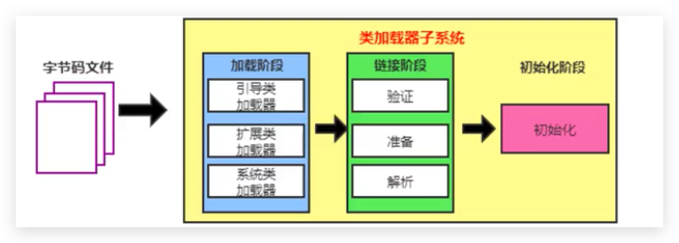
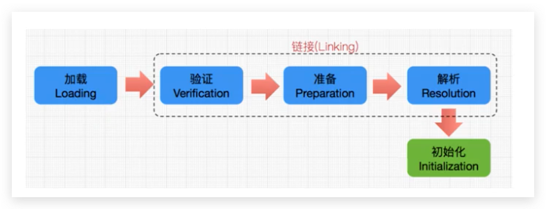
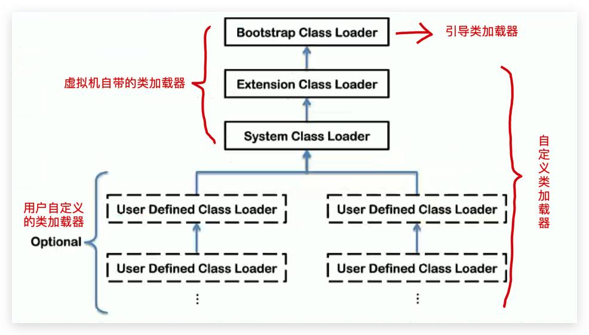
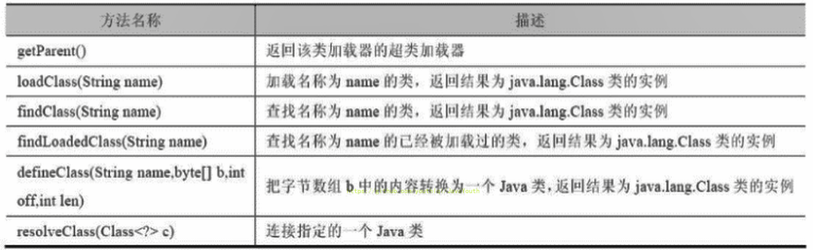
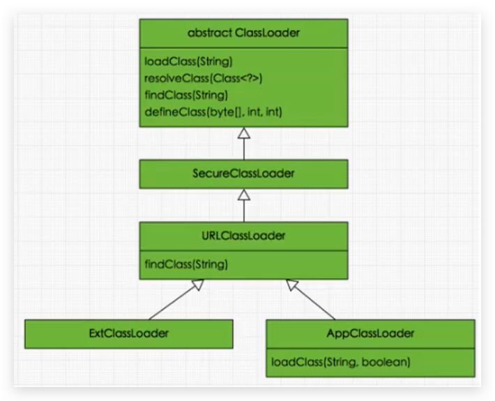
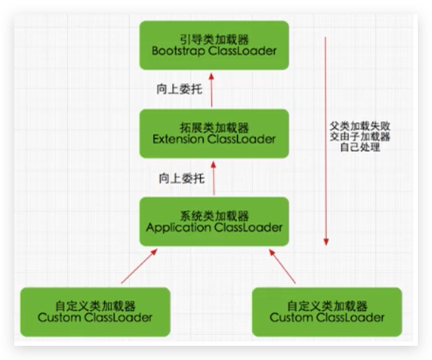
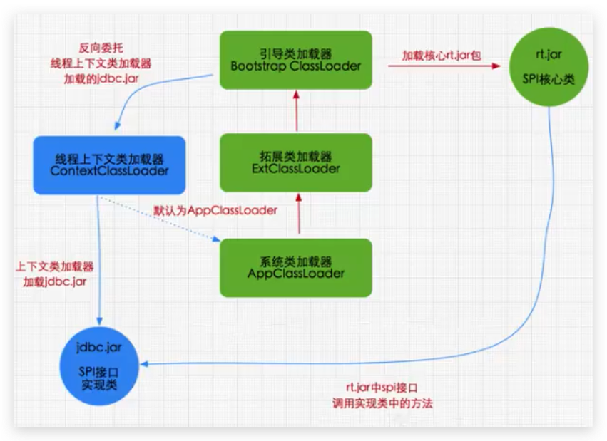

# JVM-类加载子系统

## 介绍



- 类加载器子系统负责从文件系统或者网络中加载 Class 文件，class 文件在文件开头有特定的文件标识。
- ClassLoader 只负责 class 文件的加载，至于它是否可以运行，则有 ExecutionEngine 决定。
- 加载的类信息存放于一块称为方法区的内存空间。除了类的信息外，方法区中还会存放运行时常量池信息。可能还包括字符串字面量和数字常量（这部分常量信息是Class文件中常量池部分的内存映射）。

<!--more-->

## 类的加载过程



### 加载（Loading）

1. 通过一个类的全限定名获取定义此类的二进制字节流
2. 将这个字节流所代表的静态存储结构转化为方法区的运行时数据结构
3. `在内存中生成一个代表这个类的 java.lang.Class 对象`，作为方法区这个类的各种数据的访问入口


字节码文件的来源，或者说 加载 `.class`文件的方式：

- 从本地系统中直接加载
- 通过网络获取，典型场景：Web Applet
- 从 zip 压缩包中读取，成为日后 jar 、war 格式的基础
- 运行时计算生成，使用最多的是：动态代理技术
- 由其他文件生成，典型场景：JSP 应用
- 从加密文件中获取，典型的防 Class 文件被反编译的保护措施


### 链接（Linking）

#### 验证（Verify）

- 目的在于确保 Class 文件的字节流中包含的信息符合当前虚拟机要求，保证被加载类的正确性，不会危害虚拟机自身安全。
- 主要包括四种验证：**文件格式验证，元数据验证，字节码验证，符号引用验证**。
  - 比如：字节码二进制文件开头都是以 cafe baby 开头的 .class 文件，否则就会报错 Verify Error

#### 准备（Prepare）

- 为类变量分配内存并且设置该变量的默认初始值

  `private static int a=1; //这里a在准备阶段赋值为0，在后续的初始化阶段才会赋值为 1`

  - 数值型赋值为 0
  - 浮点型赋值为  0.0
  - char 型赋值为 -u0000
  - 布尔型赋值为 false
  - 引用类型赋值为 null

- **这里不包含用 final 修饰的 static，因为 final 在编译的时候就会分配了，准备阶段会显式初始化，直接初始化为代码指定的值**

- **这里不会为实例变量分配初始化（因为变量还没创建）**，类变量会分配在方法区中，而实例变量是会随着对象一起分配的 Java 堆中。

#### 解析（Resolve）

- 将常量池内的符号引用转化为直接引用的过程。
- 事实上，解析操作往往会伴随着 JVM 在执行完初始化之后再执行。
- 符号引用就是一组符号来描述所引用的目标。符号引用的字面量形式明确定义在《java虚拟机规范》的 Class 文件格式中。直接引用就是直接指向目标的指针、相对偏移量或一个间接定位到目标的句柄。
- 解析动作主要针对类或接口、字段、类方法、接口方法、方法类型等。对应常量池中的 CONSTANT_Class_info、CONSTANT_Fieldref_info、CONSTRANT_Methordref_info 等。

### 初始化（Initialization）

- **初始化阶段就是执行类构造器方法\<clinit\>()的过程**。
- 此方法不需要定义，是 javac 编译器自动收集类中的所有类变量（static修饰的变量）的赋值动作和静态代码块中的语句合并而来。
- 构造器方法中指令按语句在源文件中出现的顺序执行。
- **\<clinit\>()不同与类的构造器。**（构造器是虚拟机视角下的\<init\>()）
- 若该类具有父类，JVM会保证子类的\<clinit\>()执行前，父类的\<clinit\>()已经执行完毕。
- 虚拟机必须保证一个类的\<clinit\>()方法在多线程下被同步加锁。（即：说明类加载到内存中只需要加载一次就行了，放在了方法区，并缓存起来，jdk8叫作原空间）

## 类加载器分类

JVM支持两种类型的类加载器，分别为`引导类加载器（Bootstrap ClassLoader)`和`自定义类加载器（UserDefined ClassLoader)-将所有派生与抽象类ClassLoader的类加载器都划分为自定义类加载器`。


在程序中常见的类加载器始终只有3个，如下所示：



**这里的四者之间的关系是包含关系。不是上层下层，也不是子父类的继承关系。**

```java
package com.buubiu;

/**
 * @comment:
 * @author: buubiu
 * @create: 2022/5/25 13:48
 */
public class ClassLoaderTest {

	public static void main(String[] args) {
		//获取系统类加载器
		ClassLoader systemClassLoader = ClassLoader.getSystemClassLoader();
		System.out.println(systemClassLoader);//sun.misc.Launcher$AppClassLoader@18b4aac2

		//获取其上层：扩展类加载器
		ClassLoader extClassLoader = systemClassLoader.getParent();
		System.out.println(extClassLoader);//sun.misc.Launcher$ExtClassLoader@75b84c92

		//获取其上层：结果获取不到引导类加载器
		ClassLoader bootstrapClassLoad = extClassLoader.getParent();
		System.out.println(bootstrapClassLoad);//null

		//对于用户自定义类来说：默认使用系统类加载器进行加载
		ClassLoader classLoader = ClassLoaderTest.class.getClassLoader();
		System.out.println(classLoader);//sun.misc.Launcher$AppClassLoader@18b4aac2

		//String类使用引导类加载器进行加载的。由此得出----> Java的核心类库都是使用引导类加载器进行加载的。
		ClassLoader classLoader1 = String.class.getClassLoader();
		System.out.println(classLoader1);//null
	}
}

```

### 虚拟机自带的加载器

#### 引导类加载器（启动类加载器，Bootstrap ClassLoader）

- 这个类加载使用 `C/C++ 语言实现的`，嵌套在JVM内部。
- 它用来加载 Java 的核心库（`JAVA_HOME/jre/lib/rt.jar、resources.jar `或` sun.boot.class.path `路径下的内容），用户提供 JVM 自身需要的类。
- 并不继承自 `java.lang.ClassLoader`，没有父加载器。
- 加载扩展类和应用程序类加载器，并指定为他们的父类加载器。
- 出于安全考虑，Bootstrap 启动类加载器只加载包名为 java、javax、sun 等开头的类。

#### 扩展类加载器（Extension ClassLoader）

- Java 语言编写，由 `sun.misc.Launcher$ExtClassLoader `实现
- `派生于 ClassLoader 类`
- 父类加载器为启动类加载器（引导类加载器，Bootstrap ClassLoader）
- 从 java.ext.dirs 系统属性所指定的目录中加载类库，或从JDK的安装目录 jar/lib/ext 子目录（扩展目录）下加载类库。`如果用户创建的 JAR 放在此目录下，也会自动由扩展类加载器加载。`

#### 系统类加载器（应用程序类加载器，AppClassLoader）

- Java 语言编写，由 `sun.misc.Launcher$AppClassLoader `实现
- 派生于 ClassLoader 类
- 父类加载器为扩展类加载器
- 它负责加载环境变量 classpath 或系统属性 java.class.path 指定路径下的类库
- `该类加载是程序中默认的类加载器`，一般来说，Java 应用的类都是由它来完成加载。
- 通过 ClassLoader.getSystemClassLoader() 方法可以获取到该类加载器。

### 用户自定义类加载器

在Java的日常应用程序开发中，类的加载几乎是由上述3种类加载器相互配合执行的，在必要时，我们还可以自定义类加载器，来定制类的加载方式。

#### 为什么要自定义类加载器？

**在什么场景下需要自定义类加载器呢？**

- 隔离加载类

  比如说假设现在Spring框架，和RocketMQ有包名路径完全一样的类，类名也一样，这个时候类就冲突了，这个时候就需要自定义类加载器。不过一般的主流框架和中间件都会自定义类加载器，实现不同的框架，中间价之间是隔离的

- 修改类加载的方式

  在某些时候，我们只需要引导类加载器就可以了，这时候，可以更改虚拟机自带的类加载器，让它们按需加载。

- 扩展加载源

  可以考虑从数据库中加载类，机顶盒等等不同的地方

- 防止源码泄漏

  对字节码文件进行加密防篡改，自己用的时候需要通过自定义类加载器来对其进行解密。

#### 如何自定义类加载器？

1. 通过继承抽象类java.lang.ClassLoader类的方式，实现自己的类加载器，以满足一些特殊的需求
2. 在JDK1.2之前，在自定义类加载器时，总会去继承ClassLoader类并重写loadClass()方法，从而实现自定义的类加载类，但是在JDK1.2之后已不再建议用户去覆盖loadClass()方法，而是建议把自定义的类加载逻辑写在findclass()方法中
3. 在编写自定义类加载器时，如果没有太过于复杂的需求，可以直接继承URIClassLoader类，这样就可以避免自己去编写findclass()方法及其获取字节码流的方式，使自定义类加载器编写更加简洁。

```java
public class CustomClassLoader extends ClassLoader {
    @Override
    protected Class<?> findClass(String name) throws ClassNotFoundException {

        try {
            byte[] result = getClassFromCustomPath(name);
            if (result == null) {
                throw new FileNotFoundException();
            } else {
                //defineClass和findClass搭配使用
                return defineClass(name, result, 0, result.length);
            }
        } catch (FileNotFoundException e) {
            e.printStackTrace();
        }

        throw new ClassNotFoundException(name);
    }
		//自定义流的获取方式
    private byte[] getClassFromCustomPath(String name) {
        //从自定义路径中加载指定类:细节略
        //如果指定路径的字节码文件进行了加密，则需要在此方法中进行解密操作。
        return null;
    }

    public static void main(String[] args) {
        CustomClassLoader customClassLoader = new CustomClassLoader();
        try {
            Class<?> clazz = Class.forName("One", true, customClassLoader);
            Object obj = clazz.newInstance();
            System.out.println(obj.getClass().getClassLoader());
        } catch (Exception e) {
            e.printStackTrace();
        }
    }
}
```

## ClassLoader的使用说明

### 介绍

ClassLoader 类是一个抽象类，其后所有的类加载器都继承自 ClassLoader（不包括启动类加载器）



### 继承关系

sun.misc.Launcher 是一个java虚拟机的入口应用



### 获取ClassLoader的方式

| 序号 | 途径                            | 方法                                           |
| ---- | ------------------------------- | ---------------------------------------------- |
| 1    | 获取当前类的ClassLoader         | clazz.getClassoader()                          |
| 2    | 获取当前线程上下文的ClassLoader | Thread.currentThread().getContextClassLoader() |
| 3    | 获取系统的ClassLoader           | ClassLoader.getSystemClassLoader()             |
| 4    | 获取调用者的ClassLoader         | DriverManager.getCallerClassLoader()           |

示例：

```java
package com.buubiu;

/**
 * @comment:
 * @author: buubiu
 * @create: 2022/5/25 16:36
 */
public class GetClassLoaderTest {

	public static void main(String[] args) {
		try {
			//1.获取当前类的ClassLoader
			ClassLoader classLoader = Class.forName("java.lang.String").getClassLoader();
			System.out.println(classLoader);//null

			//2.获取当前线程上下文的ClassLoader
			ClassLoader contextClassLoader = Thread.currentThread().getContextClassLoader();
			System.out.println(contextClassLoader);//sun.misc.Launcher$AppClassLoader@18b4aac2

			//3.获取系统的ClassLoader
			ClassLoader systemClassLoader = ClassLoader.getSystemClassLoader();
			System.out.println(systemClassLoader);//sun.misc.Launcher$AppClassLoader@18b4aac2

		} catch (ClassNotFoundException e) {
			e.printStackTrace();
		}
	}
}
```

## 双亲委派机制

### 介绍

Java虚拟机对class文件采用的是**按需加载**的方式，也就是说当需要使用该类时才会将它的class文件加载到内存生成class对象。而且加载某个类的class文件时，Java虚拟机采用的是双亲委派模式，即把请求交由父类处理，它是一种任务委派模式。

### 工作原理



1. 如果一个类加载器收到了类加载请求，它并不会自己先去加载，而是把这个请求委托给父类的加载器区执行；
2. 如果父类加载器还存在父类加载器，则进一步向上委托，依次递归，请求最终将到达顶层的启动类加载器；
3. 如果父类加载器可以完成类加载任务，就成功返回，倘若父类加载器无法完成此加载任务，子加载器才会尝试自己区加载，这就是双亲委派模式。


#### 举例验证一：

1. 首先建立一个包为 `java.lang`的`String`类，并写上 static 代码块

   ```java
   package java.lang;
   
   /**
    * @comment:
    * @author: buubiu
    * @create: 2022/5/25 17:03
    */
   public class String {
   
   	static {
   		System.out.println("我是自定义的String类的静态代码块");
   	}
   }
   
   ```

   

2. 在其他类里面去加载这个 String 类，观察加载的String类是JDK自带的String类，还是自己编写的String类

   ```java
   package com.buubiu;
   
   /**
    * @comment:
    * @author: buubiu
    * @create: 2022/5/25 17:05
    */
   public class StringTest {
   
   	public static void main(String[] args) {
   		java.lang.String s = new java.lang.String();
   		System.out.println("hello,buubiu");
   	}
   }
   
   ```

   结果：hello,buubiu
   解释：

   程序并没有输出我们静态代码块中的内容，可见仍然加载的是 JDK 自带的 String 类，由于双亲委派机制一直找父类，所以最后找到了Bootstrap ClassLoader，Bootstrap ClassLoader找到的是 JDK 自带的 String 类

#### 举例验证二：

还是刚刚第一个String，修改一下：

```java
package java.lang;

/**
 * @comment:
 * @author: buubiu
 * @create: 2022/5/25 17:03
 */
public class String {

	static {
		System.out.println("我是自定义的String类的静态代码块");
	}

	public static void main(String[] args) {
		System.out.println("hello String");
	}
}
```

执行报错：

```java
错误: 在类 java.lang.String 中找不到 main 方法, 请将 main 方法定义为:
   public static void main(String[] args)
否则 JavaFX 应用程序类必须扩展javafx.application.Application
```

解释：

由于双亲委派机制一直找父类，所以最后找到了Bootstrap ClassLoader，Bootstrap ClassLoader找到的是 JDK 自带的 String 类，在那个String类中并没有 main() 方法，所以就报了上面的错误。

#### 举例验证三：



当我们加载jdbc.jar 用于实现数据库连接的时候：

1. 我们现在程序中需要用到SPI接口，而SPI接口属于rt.jar包中Java核心api
2. 然后使用双亲委派机制，引导类加载器把rt.jar包加载进来，而rt.jar包中的SPI只存在一些接口，没有具体的实现类
3. 具体的实现类就涉及到了某些第三方的jar包了，比如我们加载SPI的实现类jdbc.jar包【首先我们需要知道的是 jdbc.jar是基于SPI接口进行实现的】
4. 这时候就会反向委托线程上下文类加载器加载jdbc.jar，而线程上下文类加载器就是系统类加载器
5. 这样一个完整的调用就实现了

从上面可以说明：

**SPI核心接口由引导类加载器来加载，SPI具体实现类由系统类加载器来加载**

### 优势

- 避免类的重复加载（因为类加载器是由层次关系的）

- 保护程序安全，防止核心API被随意篡改

  - 例如上面的例子一，自定义类：java.lang.String，创建同包名同名的类无效（`沙箱安全机制`）

  - 禁止使用核心类的包名创建自定义类，比如：

    创建一个包名为 java.lang 下面的 buubiu 类：

    ```java
    package java.lang;
    
    /**
     * @comment:
     * @author: buubiu
     * @create: 2022/5/25 17:32
     */
    public class buubiu {
    
    	public static void main(String[] args) {
    		System.out.println("hello");
    	}
    }
    ```

    结果报错：不允许在核心类的包下创建类

    ```java
    Error: A JNI error has occurred, please check your installation and try again
    Exception in thread "main" java.lang.SecurityException: Prohibited package name: java.lang
    	at java.lang.ClassLoader.preDefineClass(ClassLoader.java:655)
    	at java.lang.ClassLoader.defineClass(ClassLoader.java:754)
    	at java.security.SecureClassLoader.defineClass(SecureClassLoader.java:142)
    	at java.net.URLClassLoader.defineClass(URLClassLoader.java:473)
    	at java.net.URLClassLoader.access$100(URLClassLoader.java:74)
    	at java.net.URLClassLoader$1.run(URLClassLoader.java:369)
    	at java.net.URLClassLoader$1.run(URLClassLoader.java:363)
    	at java.security.AccessController.doPrivileged(Native Method)
    	at java.net.URLClassLoader.findClass(URLClassLoader.java:362)
    	at java.lang.ClassLoader.loadClass(ClassLoader.java:418)
    	at sun.misc.Launcher$AppClassLoader.loadClass(Launcher.java:352)
    	at java.lang.ClassLoader.loadClass(ClassLoader.java:351)
    	at sun.launcher.LauncherHelper.checkAndLoadMain(LauncherHelper.java:601)
    ```

    

### 沙箱安全机制

自定义String类时：在加载自定义String类的时候会率先使用引导类加载器加载，而引导类加载器在加载的过程中会先加载jdk自带的文件（rt.jar包中java.lang.String.class），报错信息说没有main方法，就是因为加载的是rt.jar包中的String类。这样可以保证对java核心源代码的保护，这就是`沙箱安全机制`。


## 其他问题

### 判断Class对象是否相同

在JVM中表示两个class对象是否为同一个类需要满足两个条件：

1. 类的完整类名必须一致，包括包名
2. **加载这个类的ClassLoader（指ClassLoader实例对象）必须相同**

换句话说，在JVM中，即使这两个类对象（class对象）来源同一个Class文件，被同一个虚拟机所加载，但只要加载它们的ClassLoader实例对象不同，那么这两个类对象也是不相等的


### 对类加载器的引用

- JVM必须知道一个类型是由启动加载器加载的还是由用户类加载器加载的
- **如果一个类型是由用户类加载器加载的，那么JVM会将这个类加载器的一个引用作为类型信息的一部分保存在方法区中**
- 当解析一个类型到另一个类型的引用的时候，JVM需要保证这两个类型的类加载器是相同的


### 类的主动使用和被动使用

Java程序对类的使用方式分为：主动使用和被动使用。区别在于会不会导致类的初始化。

#### 主动使用

会进行类的初始化，分为七种情况：

1. 创建类的实例
2. 访问某个类或接口的静态变量，或者对该静态变量赋值
3. 调用类的静态方法
4. 反射（比如：Class.forName("com.buubiu.Test")）
5. 初始化一个类的子类
6. Java虚拟机启动的时候被标明为启动类的类
7. JDK 7 开始提供的动态语言支持：
   1. java.lang.invoke.MethodHandle实例的解析结果
   2. REF_getStatic、REF_putStatic、REF_invokeStatic句柄对应的类没有初始化，则初始化

#### 被动使用

除了以上七种情况，其他使用Java类的方式都是对类的 **被动使用**，都 **不会导致类的初始化**
