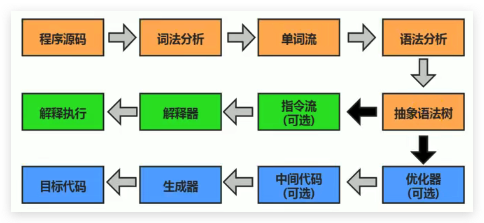
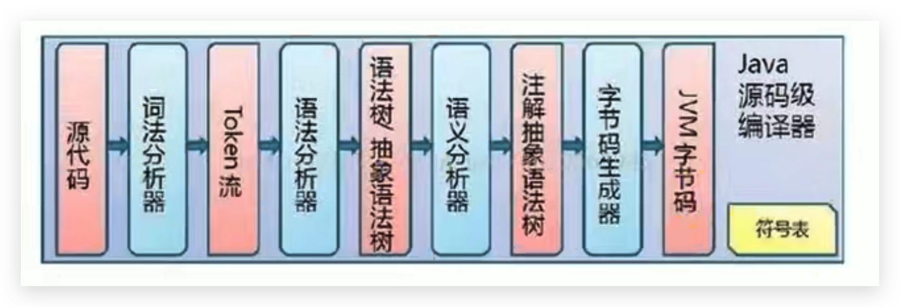
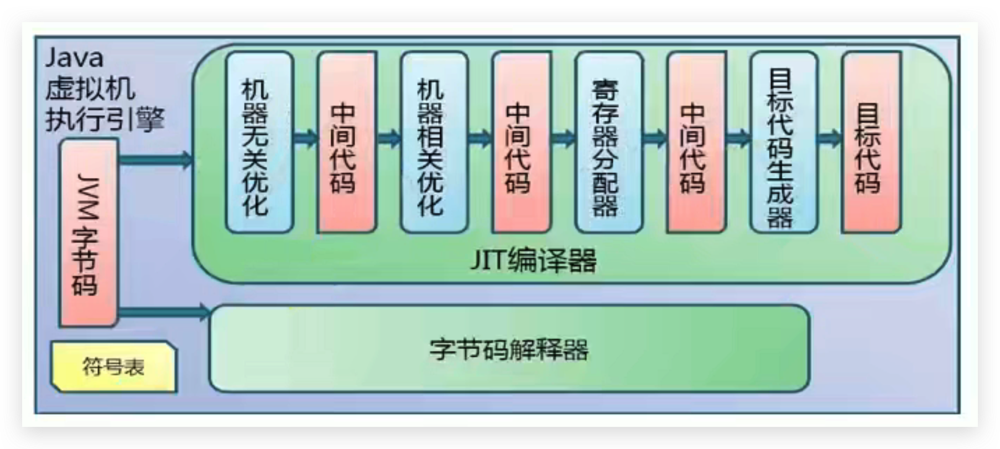

# JVM-执行引擎-Java代码编译和执行的过程

## 概述

大部分的程序代码转换成物理机的目标代码或虚拟机能执行的指令集之前，都需要经过下图中的各个步骤：

<!--more-->

1. 前面橙色部分是编译生成生成字节码文件的过程（javac编译器来完成，也就是前端编译器），和JVM没有关系。

   Java代码编译是由Java源码编译器（javac）来完成，流程图如下所示：

   

2. 后面绿色（解释执行）和蓝色（即时编译）才是JVM需要考虑的过程

   Java字节码的执行是由JVM执行引擎来完成，流程图如下所示：

   

## 解释器（Interpreter）

解释器（`Interpreter`）：当Java虚拟机启动时会根据预定义的规范**对字节码采用逐行解释的方式执行**，将每条字节码文件中的内容“翻译”为对应平台的本地机器指令执行。

## JIT编译器

`JIT（Just In Time Compiler）`编译器：就是虚拟机将源代码一次性直接编译成和本地机器平台相关的机器语言，但并不是马上执行。

## Java是半编译半解释型语言

- JDK1.0时代，将Java语言定位为“解释执行”还是比较准确的。
- 再后来，Java也发展出可以直接生成本地代码的编译器。
- 现在JVM在执行Java代码的时候，通常都会将解释执行与编译执行二者结合起来进行。
- JIT编译器将字节码翻译成本地代码后，就可以做一个缓存操作，存储在方法区的JIT 代码缓存中（执行效率更高了），并且在翻译成本地代码的过程中可以做优化。
