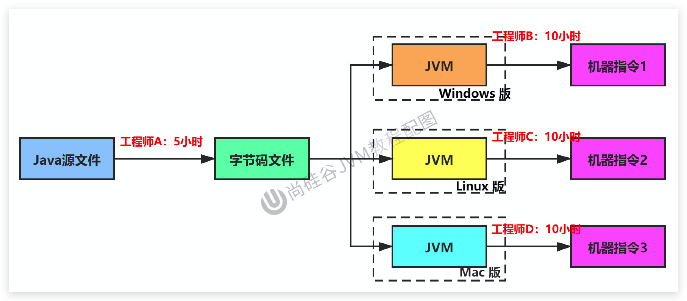
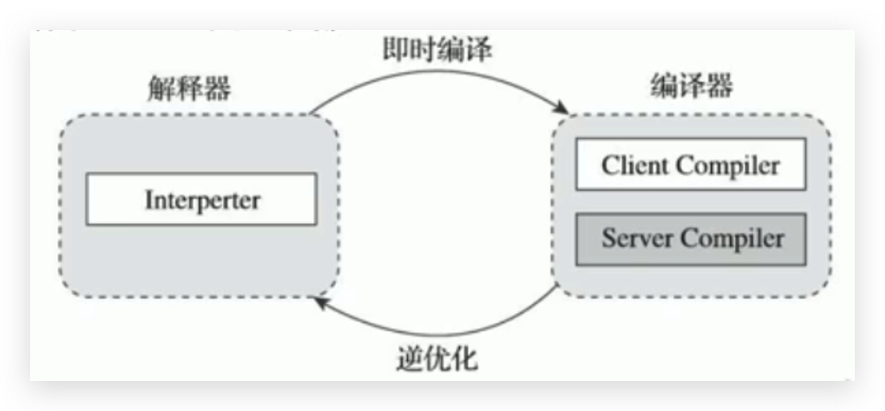
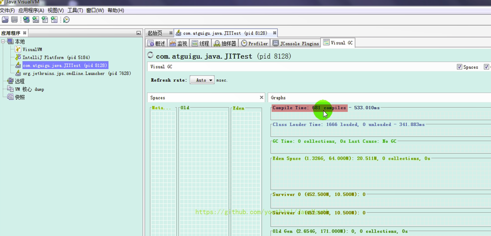

# JVM-执行引擎-解释器和JIT编译器

## 解释器

### 引入

JVM设计者们的初衷仅仅只是单纯地**为了满足Java程序实现跨平台特性**，因此避免采用静态编译的方式由高级语言直接生成本地机器指令，从而诞生了实现解释器在运行时采用逐行解释字节码执行程序的想法。



<!--more-->

- 解释器真正意义上所承担的角色就是一个运行时“翻译者”，将字节码文件中的内容“翻译”为对应平台的本地机器指令执行。
- 当一条字节码指令被解释执行完成后，接着再根据PC寄存器中记录的下一条需要被执行的字节码指令执行解释操作。

### 解释器的分类

在Java的发展历史里，一共有两套解释执行器，即古老的`字节码解释器`、现在普遍使用的`模板解释器`。

#### 字节码解释器

字节码解释器在执行时通过**纯软件代码**模拟字节码的执行，效率非常低下。

#### 模板解释器

而模板解释器将**每一条字节码和一个模板函数相关联**，模板函数中直接产生这条字节码执行时的机器码，从而很大程度上提高了解释器的性能。

在HotSpot VM中，解释器主要由Interpreter模块和Code模块构成。

- Interpreter模块：实现了解释器的核心功能
- Code模块：用于管理HotSpot VM在运行时生成的本地机器指令

### 解释器的现状

- 由于解释器在设计和实现上非常简单，因此除了Java语言之外，还有许多高级语言同样也是基于解释器执行的，比如Python、Perl、Ruby等。但是在今天，**基于解释器执行已经沦落为低效的代名词**，并且时常被一些C/C++程序员所调侃。

- 为了解决这个问题，JVM平台支持一种叫作即时编译的技术。即时编译的目的是避免函数被解释执行，而是**将整个函数体编译成为机器码，每次函数执行时，只执行编译后的机器码即可**，这种方式可以使执行效率大幅度提升。

不过无论如何，基于解释器的执行模式仍然为中间语言的发展做出了不可磨灭的贡献。

## JIT编译器

### 引入

**Java 代码执行的分类**

- 第一种是将源代码编译成字节码文件，然后在运行时通过解释器将字节码文件转为机器码执行
- 第二种是编译执行（直接编译成机器码）。现代虚拟机为了提高执行效率，会使用即时编译技术（JIT，Just In Time）将方法编译成机器码后再执行

HotSpot VM是目前市面上高性能虚拟机的代表作之一。它**采用解释器与即时编译器并存的架构**。在Java虚拟机运行时，解释器和即时编译器能够相互协作，各自取长补短，尽力去选择最合适的方式来权衡编译本地代码的时间和直接解释执行代码的时间。

在今天，Java程序的运行性能早已脱胎换骨，已经达到了可以和C/C++ 程序一较高下的地步。

### 为什么还需要解释器

有些开发人员会感觉到诧异，**既然HotSpot VM中已经内置JIT编译器了，那么为什么还需要再使用解释器来“拖累”程序的执行性能呢**？比如JRockit VM内部就不包含解释器，字节码全部都依靠即时编译器编译后执行。

#### 首先明确两点

- 当程序启动后，解释器可以马上发挥作用，**响应速度快**，省去编译的时间，立即执行。
- 编译器要想发挥作用，把代码编译成本地代码，**需要一定的执行时间**，但编译为本地代码后，执行效率高。

#### 所以

- 尽管JRockit VM中程序的执行性能会非常高效，但程序在启动时必然需要花费更长的时间来进行编译。对于服务端应用来说，启动时间并非是关注重点，但对于那些看中启动时间的应用场景而言，或许就需要采用解释器与即时编译器并存的架构来换取一个平衡点。
- 在此模式下，**在Java虚拟器启动时，解释器可以首先发挥作用，而不必等待即时编译器全部编译完成后再执行，这样可以省去许多不必要的编译时间。随着时间的推移，编译器发挥作用，把越来越多的代码编译成本地代码，获得更高的执行效率。--HotSpot JVM的执行方式**
- 同时，解释执行在编译器进行激进优化不成立的时候，作为编译器的“逃生门”（后备方案）。

### 案例

#### 理论：

**注意解释执行与编译执行在线上环境微妙的辩证关系。**

- **机器在热机状态（已经运行了一段时间叫热机状态）可以承受的负载要大于冷机状态（刚启动的时候叫冷机状态）**。如果以热机状态时的流量进行切流，可能使处于冷机状态的服务器因无法承载流量而假死。

- 在生产环境发布过程中，以分批的方式进行发布，根据机器数量划分成多个批次，每个批次的机器数至多占到整个集群的1/8。曾经有这样的故障案例：某程序员在发布平台进行分批发布，在输入发布总批数时，误填写成分为两批发布。如果是热机状态，在正常情况下一半的机器可以勉强承载流量，但由于刚启动的JVM均是解释执行，还没有进行热点代码统计和JIT动态编译，导致机器启动之后，当前1/2发布成功的服务器马上全部宕机，此故障说明了JIT的存在。—阿里团队

  

#### 举例

```java
public class JITTest {
    public static void main(String[] args) {
        ArrayList<String> list = new ArrayList<>();

        for (int i = 0; i < 1000; i++) {
            list.add("让天下没有难学的技术");

            try {
                Thread.sleep(1000);
            } catch (InterruptedException e) {
                e.printStackTrace();
            }
        }

    }
}
```

通过 JVisualVM 查看 JIT 编译器执行的编译次数


