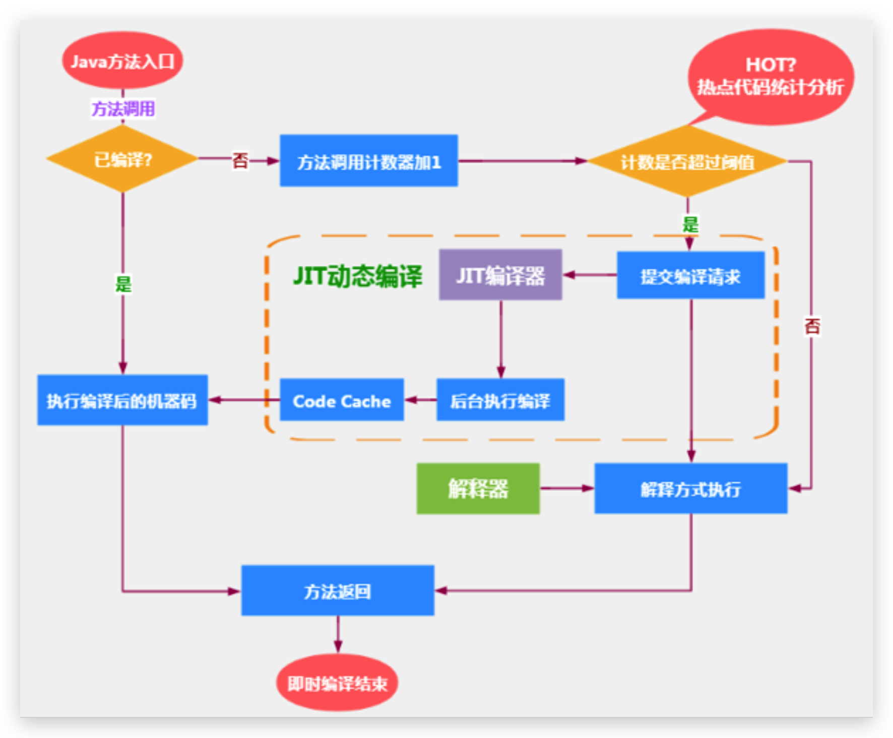
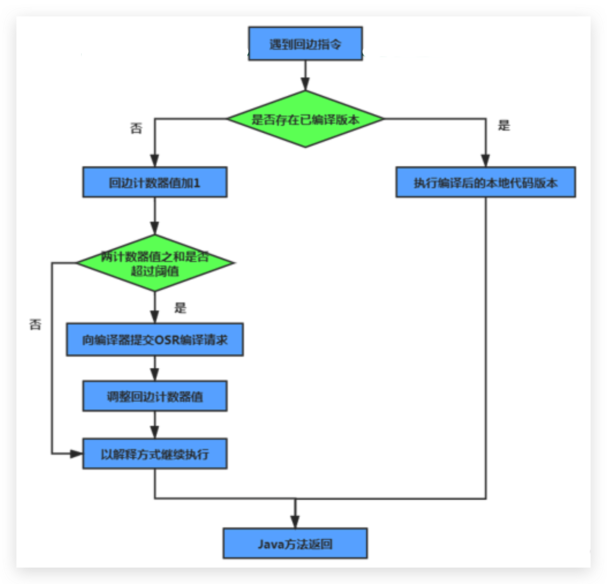

# JVM-执行引擎-JIT编译器深入理解

## 概念解释

- Java 语言的“编译期”其实是一段“不确定”的操作过程，因为它可能是指一个**前端编译器**（其实叫“编译器的前端”更准确一些）把`.java`文件转变成`.class`文件的过程。
- 也可能是指虚拟机的**后端运行期编译器**（`JIT编译器`，`Just In Time Compiler`）把字节码转变成机器码的过程。
- 还可能是指使用**静态提前编译器**（`AOT编译器`，`Ahead of Time Compiler`）直接把.java文件编译成本地机器代码的过程。（可能是后续发展的趋势）

比较常见的编译器：

前端编译器：Sun 的 javac、Eclipse JDT中的增量式编译器（ECJ）。
JIT编译器：HotSpot VM的C1、C2编译器。
AOT 编译器：GNU Compiler for the Java（GCJ）、Excelsior JET。

<!--more-->

## 如何选择启动JIT编译器

### 热点代码及探测方式

- 当然是否需要启动JIT编译器将字节码直接编译为对应平台的本地机器指令，则需要根据代码被调用`执行的频率`而定。
- 关于那些需要被编译为本地代码的字节码，也被称之为`“热点代码”`，JIT编译器在运行时会针对那些频繁被调用的“热点代码”做出`深度优化`，将其直接编译为对应平台的本地机器指令，以此提升Java程序的执行性能。

#### 热点代码

- 一个被多次调用的方法，或者是一个方法体内部循环次数较多的循环体都可以被称之为“`热点代码`”。
- 因此都可以通过JIT编译器编译为本地机器指令。
- 由于这种编译方式发生在方法的执行过程中，因此也被称之为`栈上替换`，或简称为`OSR (On StackReplacement)编译`。

#### 探测方式

- 一个方法究竟**要被调用多少次**，或者一个循环体究竟需要执行多少次循环才可以达到这个标准？必然需要一个明确的阈值，JIT编译器才会将这些“热点代码”编译为本地机器指令执行。这里主要依靠`热点探测功能`。

## 方法调用计数器

**目前HotSpot VM所采用的热点探测方式是`基于计数器`的热点探测。**

- 采用基于计数器的热点探测，HotSpot VM将会为每一个方法都建立2个不同类型的计数器，分别为方法调用计数器（`Invocation Counter`）和回边计数器（`Back Edge Counter`）。
  - 方法调用计数器用于统计方法的调用次数
  - 回边计数器则用于统计循环体执行的循环次数
- 这个计数器就用于统计方法被调用的次数，**它的默认阀值在 Client 模式下是 1500 次，在 Server 模式下是 10000 次**。超过这个阈值，就会触发JIT编译。
- 这个阀值可以通过虚拟机参数` -XX:CompileThreshold` 来人为设定。

### 执行过程（原理）



当一个方法被调用时，会先检查该方法是否存在被JIT编译过的版本

- 如果存在，则优先使用编译后的本地代码来执行
- 如果不存在已被编译过的版本，则将此方法的调用计数器值加1，然后判断方法调用计数器与回边计数器值之和是否超过方法调用计数器的阀值。
  - 如果已超过阈值，那么将会向即时编译器提交一个该方法的代码编译请求。
  - 如果未超过阈值，则使用解释器对字节码文件解释执行

### 热度衰减

- 如果不做任何设置，方法调用计数器统计的并不是方法被调用的绝对次数，而是一个相对的执行频率，即**一段时间之内方法被调用的次数**。
- 当**超过一定的时间限度**，如果方法的调用次数仍然不足以让它提交给即时编译器编译，那这个方法的调用计数器就会被**减少一半**，这个过程称为方法调用计数器热度的`衰减（Counter Decay）`，而这段时间就称为此方法统计的`半衰周期（Counter Half Life Time）`（半衰周期是化学中的概念，比如出土的文物通过查看C60来获得文物的年龄）
- 进行热度衰减的动作是在虚拟机进行垃圾收集时顺便进行的，可以使用虚拟机参数 `-XX:-UseCounterDecay` 来关闭热度衰减，让方法计数器统计方法调用的绝对次数，这样的话，只要系统运行时间足够长，绝大部分方法都会被编译成本地代码。
- 另外，可以使用 `-XX:CounterHalfLifeTime` 参数设置半衰周期的时间，单位是秒。

## 回边计数器

它的作用是统计一个方法中**循环体代码执行的次数**，在字节码中遇到控制流向后跳转的指令称为`“回边”（Back Edge）`。显然，建立回边计数器统计的目的就是为了触发OSR编译。



## HotSpotVM可以设置程序执行方式

缺省（默认）情况下 HotSpot VM 是采用解释器与即时编译器并存的架构，当然开发人员可以根据具体的应用场景，通过命令显式地为Java虚拟机指定在运行时到底是**完全采用解释器**执行，还是**完全采用即时编译器**执行。如下所示：

- `-Xint`：完全采用解释器模式执行程序；
- `-Xcomp`：完全采用即时编译器模式执行程序。如果即时编译出现问题，解释器会介入执行
- `-Xmixed`：采用解释器+即时编译器的混合模式共同执行程序。

```sh
$ java -version
openjdk version "1.8.0_322"
OpenJDK Runtime Environment (build 1.8.0_322-bre_2022_02_28_15_01-b00)
OpenJDK 64-Bit Server VM (build 25.322-b00, mixed mode)

$ java -Xint -version
openjdk version "1.8.0_322"
OpenJDK Runtime Environment (build 1.8.0_322-bre_2022_02_28_15_01-b00)
OpenJDK 64-Bit Server VM (build 25.322-b00, interpreted mode)

$ java -Xcomp -version
openjdk version "1.8.0_322"
OpenJDK Runtime Environment (build 1.8.0_322-bre_2022_02_28_15_01-b00)
OpenJDK 64-Bit Server VM (build 25.322-b00, compiled mode)

$ java -Xmixed -version
openjdk version "1.8.0_322"
OpenJDK Runtime Environment (build 1.8.0_322-bre_2022_02_28_15_01-b00)
OpenJDK 64-Bit Server VM (build 25.322-b00, mixed mode)
```

代码举例：

```java
/**
 * 测试解释器模式和JIT编译模式
 *  -Xint  : 6520ms
 *  -Xcomp : 950ms
 *  -Xmixed : 936ms
 */
public class IntCompTest {
    public static void main(String[] args) {

        long start = System.currentTimeMillis();

        testPrimeNumber(1000000);

        long end = System.currentTimeMillis();

        System.out.println("花费的时间为：" + (end - start));

    }

    public static void testPrimeNumber(int count){
        for (int i = 0; i < count; i++) {
            //计算100以内的质数
            label:for(int j = 2;j <= 100;j++){
                for(int k = 2;k <= Math.sqrt(j);k++){
                    if(j % k == 0){
                        continue label;
                    }
                }
                //System.out.println(j);
            }

        }
    }
}
```

## HotSpot VM中JIT分类

### C1和C2编译器

在HotSpot VM中内嵌有两个JIT编译器，分别为`Client Compiler`和`Server Compiler`，但大多数情况下我们简称为`C1编译器` 和` C2编译器`。开发人员可以通过如下命令显式指定Java虚拟机在运行时到底使用哪一种即时编译器，如下所示：

- `-client`：指定Java虚拟机运行在Client模式下，并使用C1编译器；
  C1编译器会对字节码进行简单和**可靠的优化，耗时短**，以达到更快的编译速度。
- `-server`：指定Java虚拟机运行在server模式下，并使用C2编译器。
  C2进行**耗时较长的优化，以及激进优化**，但优化的代码执行效率更高。（使用C++）

### C1和C2编译器不同的优化策略

在不同的编译器上有不同的优化策略：

- C1编译器上主要有方法内联，去虚拟化、元余消除。

  - **方法内联**：将引用的函数代码编译到引用点处，这样可以减少栈帧的生成，减少参数传递以及跳转过程

  - **去虚拟化**：对唯一的实现樊进行内联

  - **冗余消除**：在运行期间把一些不会执行的代码折叠掉

- C2的优化主要是在全局层面，逃逸分析是优化的基础。基于逃逸分析在C2上有如下几种优化：

  - **标量替换**：用标量值代替聚合对象的属性值

  - **栈上分配**：对于未逃逸的对象分配对象在栈而不是堆

  - **同步消除**：清除同步操作，通常指synchronized

> 也就是说之前的逃逸分析，只有在C2（server模式下）才会触发。

#### 分层编译策略

`分层编译（Tiered Compilation）策略`：程序解释执行（不开启性能监控）可以触发C1编译，将字节码编译成机器码，可以进行简单优化，也可以加上性能监控，C2编译会根据性能监控信息进行激进优化。

不过在Java7版本之后，一旦开发人员在程序中显式指定命令“-server"时，默认将会开启分层编译策略，由C1编译器和C2编译器相互协作共同来执行编译任务。

### 总结

- 一般来讲，JIT编译出来的机器码性能比解释器高

- C2编译器启动时长比C1慢，系统稳定执行以后，C2编译器执行速度远快于C1编译器

## 拓展

### Graal 编译器

- 自JDK10起，HotSpot又加入了一个全新的即时编译器：Graal编译器（与 C1/C2 并列）

- 编译效果短短几年时间就追平了G2编译器，未来可期（对应还出现了Graal虚拟机，是有可能替代Hotspot的虚拟机的）

- 目前，带着 “实验状态” 标签，需要使用开关参数 `-XX:+UnlockExperimentalvMOptions -XX:+UseJVMCICompiler` 去激活才能使用

### AOT编译器

- jdk9 引入了`AOT编译器（静态提前编译器，Ahead Of Time Compiler）`（与 JIT 编译器并列）

- Java 9引入了实验性 AOT 编译工具 `jaotc`。它借助了Graal编译器，将所输入的Java类文件转换为机器码，并存放至生成的动态共享库之中。

- 所谓AOT编译，是与即时编译相对立的一个概念。我们知道，**即时编译指的是在程序的运行过程中**，将字节码转换为可在硬件上直接运行的机器码，并部署至托管环境中的过程。而**AOT编译指的则是在程序运行之前**，便将字节码转换为机器码的过程。
- 文件转换流程：`.java -> .class -> (使用jaotc) -> .so`

#### 优缺点

**优点：**

- Java虚拟机加载已经预编译成二进制库，可以直接执行。
- 不必等待即时编译器的预热，减少Java应用给人带来“第一次运行慢” 的不良体验

**缺点：**

- 破坏了 java “ 一次编译，到处运行”，必须为每个不同的硬件，OS编译对应的发行包
- **降低了Java链接过程的动态性**，加载的代码在编译器就必须全部已知。
- 还需要继续优化中，最初只支持 Linux X64 java base 
