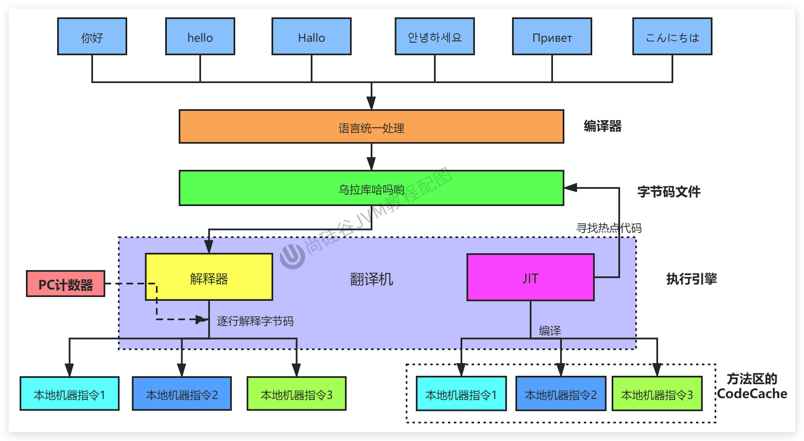
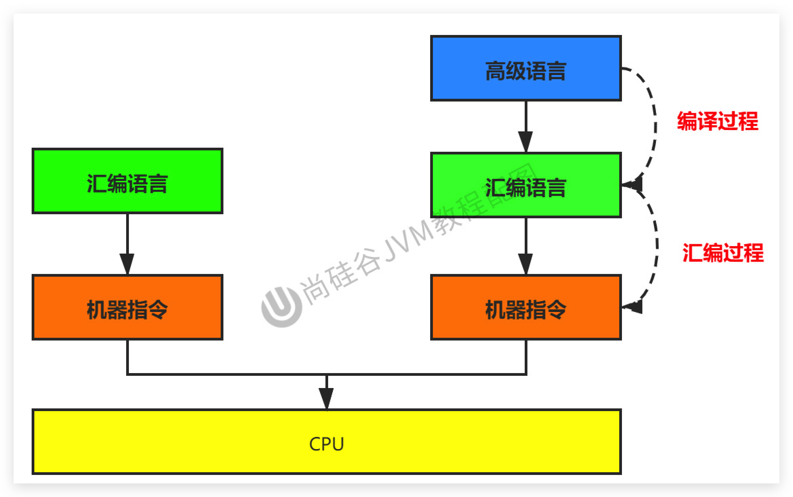
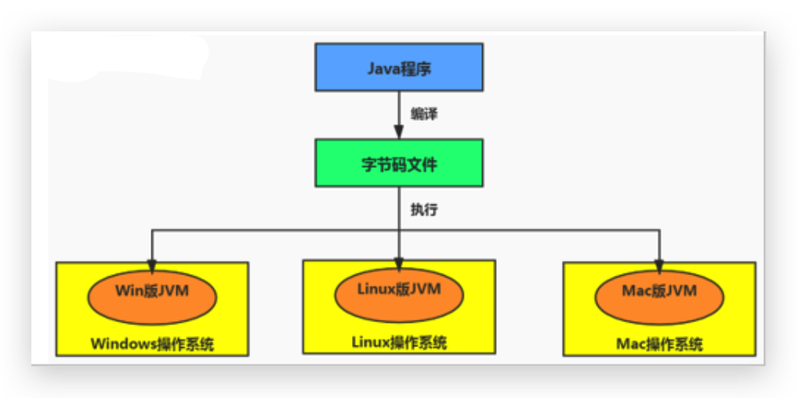
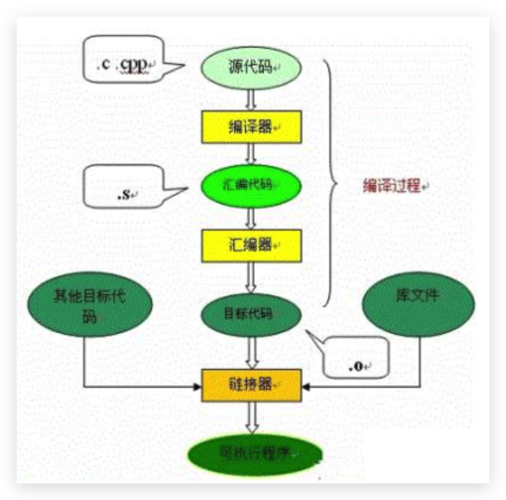

# JVM-执行引擎-机器码_指令_汇编语言

## 总体介绍

<!--more-->

## 机器码

- **各种用二进制编码方式表示的指令，叫做机器指令码**。开始，人们就用它采编写程序，这就是机器语言。
- 机器语言虽然能够被计算机理解和接受，但和人们的语言差别太大，不易被人们理解和记忆，并且用它编程容易出差错。
- 用它编写的程序一经输入计算机，CPU直接读取运行，因此和其他语言编的程序相比，执行速度最快。
- 机器指令与CPU紧密相关，所以不同种类的CPU所对应的机器指令也就不同。

## 指令和指令集

### 指令

- 由于机器码是由0和1组成的二进制序列，可读性实在太差，于是人们发明了指令。
- **指令就是把机器码中特定的0和1序列**，简化成对应的指令（一般为英文简写，如mov，inc等），可读性稍好
- 由于不同的硬件平台，执行同一个操作，对应的机器码可能不同，所以不同的硬件平台的同一种指令（比如mov），对应的机器码也可能不同。

### 指令集

不同的硬件平台，各自支持的指令，是有差别的。因此**每个平台所支持的指令，称之为对应平台的指令集。**

如常见的

- x86指令集，对应的是x86架构的平台
- ARM指令集，对应的是ARM架构的平台

## 汇编语言

- 由于指令的可读性还是太差，于是人们又发明了汇编语言。
- 在汇编语言中，用`助记符（Mnemonics）`代替机器指令的操作码，用`地址符号（Symbol）`或`标号（Label）`代替**指令或操作数的地址**。

- 在不同的硬件平台，汇编语言对应着不同的机器语言指令集，通过汇编过程转换成机器指令。
  - 由于计算机只认识指令码，所以用汇编语言编写的程序还必须翻译（汇编）成机器指令码，计算机才能识别和执行。

## 高级语言

- 为了使计算机用户编程序更容易些，后来就出现了各种高级计算机语言。高级语言比机器语言、汇编语言**更接近人的语言**

- 当计算机执行高级语言编写的程序时，仍然**需要把程序解释和编译成机器的指令码。完成这个过程的程序就叫做解释程序或编译程序（如下图）。**

## 字节码

- 字节码是一种中间状态（中间码）的二进制代码（文件），它比机器码更抽象，需要直译器转译后才能成为机器码

- 字节码主要为了实现特定软件运行和软件环境、与硬件环境无关。

- 字节码的实现方式是通过编译器和虚拟机器。编译器将源码编译成字节码，特定平台上的虚拟机器将字节码转译为可以直接执行的指令。

  - 字节码典型的应用为：Java bytecode

    

## C、C++源程序执行过程

编译过程又可以分成两个阶段：**编译和汇编**。

- **编译过程**：是读取源程序（字符流），对之进行词法和语法的分析，将高级语言指令转换为功能等效的汇编代码
- **汇编过程**：实际上指把汇编语言代码翻译成目标机器指令的过程。
