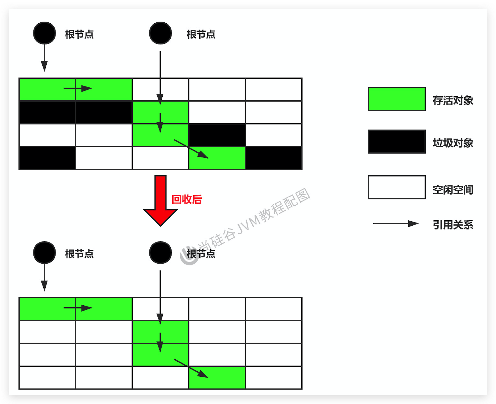
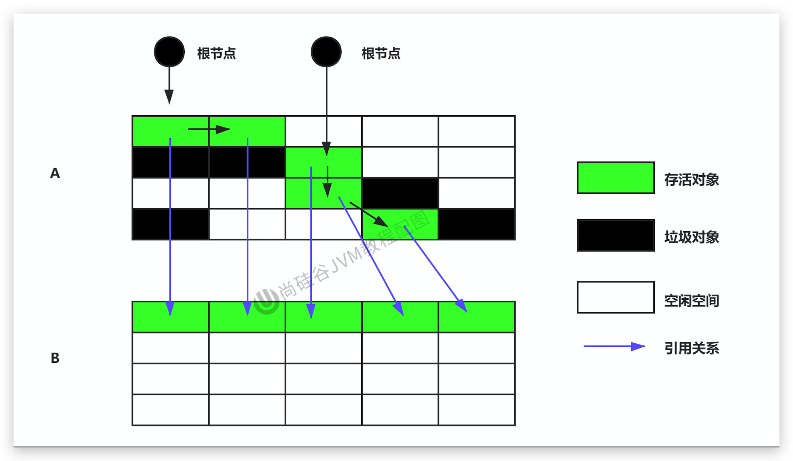
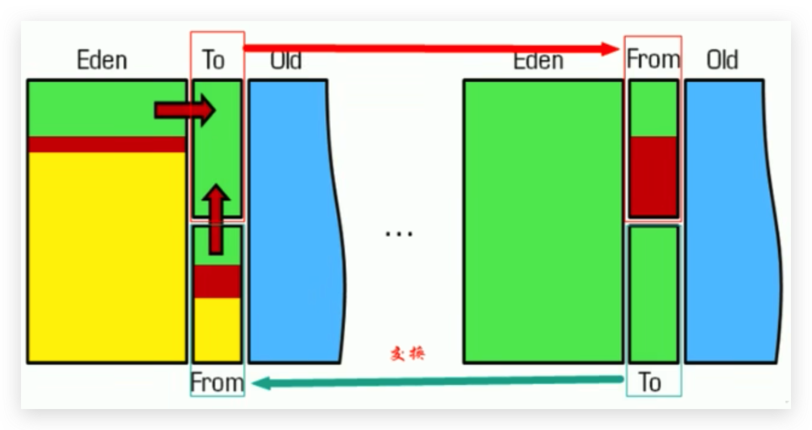
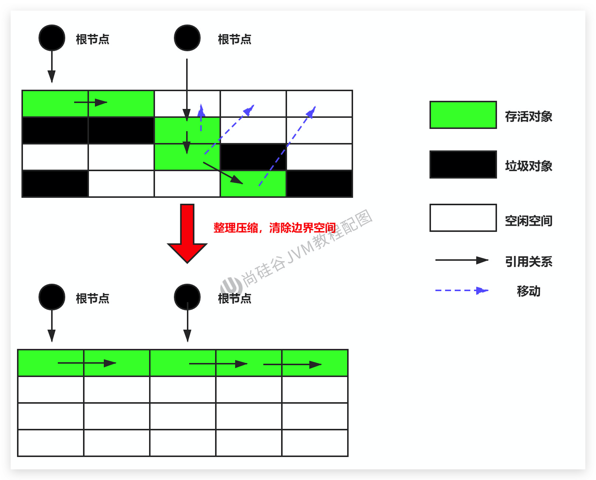

# 垃圾回收-相关算法-清除阶段

## 引入

当成功区分出内存中存活对象和死亡对象后，GC接下来的任务就是执行垃圾回收，释放掉无用对象所占用的内存空间，以便有足够的可用内存空间为新对象分配内存。目前在JVM中比较常见的三种垃圾收集算法是

1. 标记-清除算法（Mark-Sweep）
2. 复制算法（Copying）
3. 标记-压缩算法（Mark-Compact）

<!--more-->

## 标记-清除算法（Mark-Sweep）

### 背景

`标记-清除算法（Mark-Sweep）`是一种非常基础和常见的垃圾收集算法，该算法被J.McCarthy等人在1960年提出并并应用于Lisp语言。

### 执行过程

当堆中的有效内存空间（available memory）被耗尽的时候，就会停止整个程序（也被称为stop the world），然后进行两项工作，第一项则是标记，第二项则是清除

- `标记`：Collector从引用根节点开始遍历，标记所有被引用的对象。一般是在对象的Header中记录为可达对象。（注意：标记的是被引用的对象，也就是可达对象，并非标记的是即将被清除的垃圾对象）

- `清除`：Collector对堆内存从头到尾进行线性的遍历，如果发现某个对象在其Header中没有标记为可达对象，则将其回收。

### 图示

### 内存分配方式

采用`空闲列表`分配内存

### 优缺点

#### 优点

1. 是一种非常基础和常见的垃圾收集算法
2. 比较容易被人想到

#### 缺点

1. 标记清除算法的效率不算高
2. 在进行GC的时候，需要停止整个应用程序，用户体验较差
3. 这种方式清理出来的空闲内存是不连续的，容易产生内碎片，而且需要维护一个空闲列表

### 注意：何为清除？

这里所谓的清除并不是真的置空，而是把需要清除的对象地址保存在空闲的地址列表里。下次有新对象需要加载时，判断垃圾的位置空间是否够，如果够，就存放（也就是覆盖原有的地址）。

**关于空闲列表是在为对象分配内存的时候提过：**[空闲列表与指针碰撞](../JVM-026-运行时数据区-对象的实例化内存布局与访问定位/#为对象分配内存)

1. 如果内存规整
   - 采用指针碰撞的方式进行内存分配
2. 如果内存不规整(或者说不连续的)
   - 虚拟机需要维护一个空闲列表
   - 采用空闲列表分配内存

## 复制算法（Copying）

### 背景

为了解决标记-清除算法在垃圾收集效率方面的缺陷，M.L.Minsky于1963年发表了著名的论文，“使用双存储区的Lisp语言垃圾收集器CA LISP Garbage Collector Algorithm Using Serial Secondary Storage）”。M.L.Minsky在该论文中描述的算法被人们称为`复制（Copying）算法`，它也被M.L.Minsky本人成功地引入到了Lisp语言的一个实现版本中。

### 原理

将活着的内存空间分为两块，每次只使用其中一块，在垃圾回收时将正在使用的内存中的存活对象复制到未被使用的内存块中，之后清除正在使用的内存块中的所有对象；然后在交换两个内存的角色，最后完成垃圾回收。

新生代里面就用到了复制算法，Eden区和S0区存活对象整体复制到S1区

### 图示

### 内存分配方式

采用`指针碰撞`的方式进行内存分配

### 优缺点

#### 优点

1. 没有标记和清除过程，实现简单，运行高效
2. 复制过去以后保证空间的连续性，不会出现“碎片”问题。

#### 缺点

1. 此算法的缺点也是很明显的，就是需要两倍的内存空间。
2. 对于G1这种分拆成为大量region的GC，复制而不是移动，意味着GC需要维护region之间对象引用关系，不管是内存占用或者时间开销也不小
3. `如果系统中的存活对象很多，那么复制算法需要复制的存活对象数量就很大，这样的话效率很低`

### 场景

在新生代，对常规应用的垃圾回收，一次通常可以回收70% - 99% 的内存空间。回收性价比很高。所以现在的商业虚拟机都是用这种收集算法回收新生代。

## 标记-压缩算法（Mark-Compact）

> 也就标记-整理算法

### 背景

1. 复制算法的高效性是建立在存活对象少、垃圾对象多的前提下的。这种情况在新生代经常发生，但是在老年代，更常见的情况是大部分对象都是存活对象。如果依然使用复制算法，由于存活对象较多，复制的成本也将很高。因此，`基于老年代垃圾回收的特性，需要使用其他的算法`。
2. 标记-清除算法的确可以应用在老年代中，但是该算法不仅执行效率低下，而且在执行完内存回收后还会产生内存碎片，所以JVM的设计者需要在此基础之上进行改进。`标记-压缩（Mark-Compact）算法`由此诞生。
3. 1970年前后，G.L.Steele、C.J.Chene和D.s.Wise等研究者发布标记-压缩算法。在许多现代的垃圾收集器中，人们都使用了标记-压缩算法或其改进版本。

### 执行过程

1. 第一阶段和标记清除算法一样，从根节点开始标记所有被引用对象
2. 第二阶段将所有的存活对象压缩到内存的一端，按顺序排放。
3. 最后，清理边界外所有的空间。

### 与标记-清除算法的比较

1. 标记-压缩算法的最终效果等同于标记-清除算法执行完成后，再进行一次内存碎片整理，因此，也可以把它称为`标记-清除-压缩（Mark-Sweep-Compact）算法`。
2. 二者的本质差异在于标记-清除算法是一种**非移动式的回收算法**，标记-压缩是**移动式的**。是否移动回收后的存活对象是一项优缺点并存的风险决策。
3. 可以看到，标记的存活对象将会被整理，按照内存地址依次排列，而未被标记的内存会被清理掉。如此一来，当我们需要给新对象分配内存时，JVM只需要持有一个内存的起始地址即可，这比维护一个空闲列表显然少了许多开销。

### 内存分配方式

采用`指针碰撞`的方式进行内存分配

### 优缺点

#### 优点

1. 消除了标记-清除算法当中，内存区域分散的缺点，我们需要给新对象分配内存时，JVM只需要持有一个内存的起始地址即可。
2. 消除了复制算法当中，内存减半的高额代价。

#### 缺点

1. 从效率上来说，标记-压缩算法要低于标记-清除算法，标记-清除算法低于复制算法。
2. 移动对象的同时，如果对象被其他对象引用，则还需要调整引用的地址（因为HotSpot虚拟机采用的不是句柄池的方式，而是直接指针）
3. 移动过程中，需要全程暂停用户应用程序。即：STW ，涉及到移动，时间比标记-清除长一些（其他算法也存在，只是暂停的时间长短不同）

## 对比三种算法

|               | 标记清除Mark-Sweep | 标记压缩Mark-Compact | 复制Copying                           |
| ------------- | ------------------ | -------------------- | ------------------------------------- |
| **速率/效率** | 中等               | 最慢                 | 最快                                  |
| **空间开销**  | 少（但会堆积碎片） | 少（不堆积碎片）     | 通常需要活对象的2倍大小（不堆积碎片） |
| **移动对象**  | 否                 | 是                   | 是                                    |

1. 效率上来说，复制算法是当之无愧的老大，但是却浪费了太多内存。
2. 而为了尽量兼顾上面提到的三个指标，标记-压缩算法相对来说更平滑一些，但是效率上不尽如人意，它比复制算法多了一个标记的阶段，比标记-清除多了一个整理内存的阶段。
