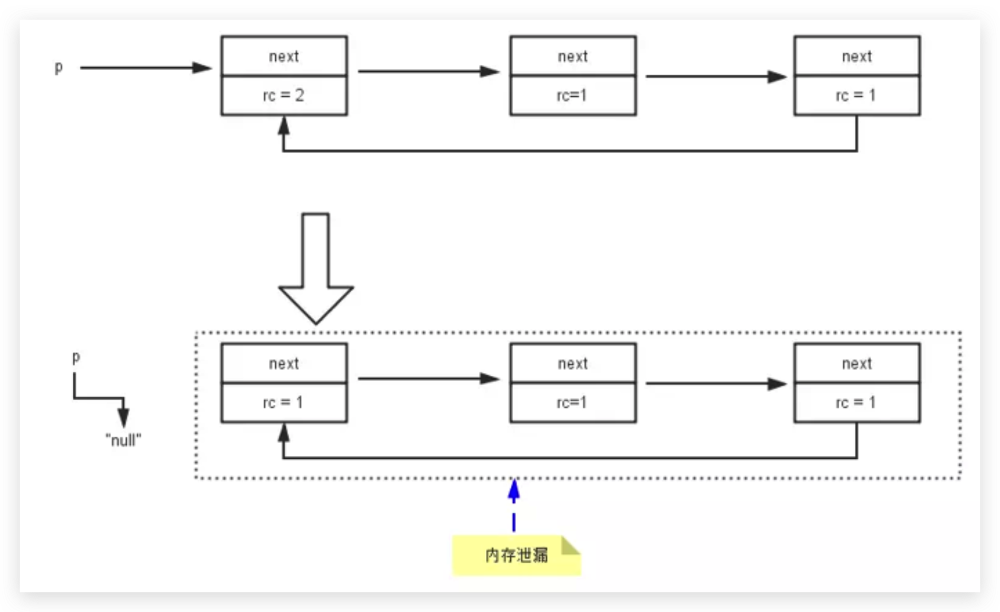
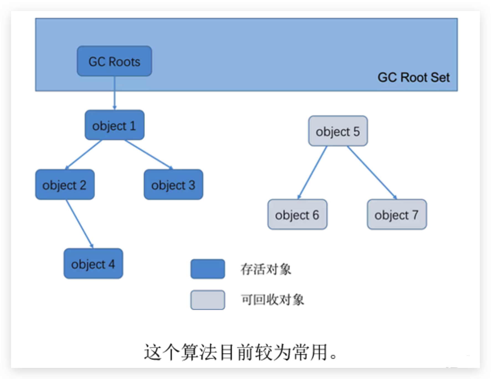

# 垃圾回收-相关算法-标记阶段

## 对象存活判断

在堆里存放着几乎所有的Java对象实例，在GC执行垃圾回收之前，首先**需要区分出内存中哪些是存活对象，哪些是已经死亡的对象。**只有被标记为己经死亡的对象，GC才会在执行垃圾回收时，释放掉其所占用的内存空间，因此这个过程我们可以称为`垃圾标记阶段`。

那么在JVM中究竟是如何标记一个死亡对象呢？简单来说，当一个对象已经不再被任何的存活对象继续引用时，就可以宣判为已经死亡。

判断对象存活一般有两种方式：**引用计数算法**和**可达性分析算法**。

<!--more-->

## 引用计数算法

### 定义

引用计数算法（`Reference Counting`）比较简单，对每个对象保存一个整型的**引用计数器属性。用于记录对象被引用的情况。**

### 实现思路

对于一个对象A，只要有任何一个对象引用了A，则A的引用计数器就加1；当引用失效时，引用计数器就减1。只要对象A的引用计数器的值为0，即表示对象A不可能再被使用，可进行回收。

### 优缺点

**优点：**

- 实现简单，垃圾对象便于辨识；
- 判定效率高，回收没有延迟性。

**缺点:**

- 它需要单独的字段存储计数器，这样的做法增加了**存储空间的开销**。
- 每次赋值都需要更新计数器，伴随着加法和减法操作，这增加了**时间开销**。
- 引用计数器有一个严重的问题，即**无法处理循环引用**的情况。这是一条致命缺陷，导致在Java的垃圾回收器中没有使用这类算法。

### 循环引用

当p的指针断开的时候，内部的引用形成一个循环，计数器都还算1，无法被回收，这就是循环引用，从而造成内存泄漏

### 总结

1. 引用计数算法，是很多语言的资源回收选择，例如因人工智能而更加火热的Python，它更是同时支持引用计数和垃圾收集机制。
2. 具体哪种最优是要看场景的，业界有大规模实践中仅保留引用计数机制，以提高吞吐量的尝试。
3. Java并没有选择引用计数，是因为其存在一个基本的难题，也就是很难处理循环引用关系。
4. Python如何解决循环引用？
   - 手动解除：很好理解，就是在合适的时机，解除引用关系。
   - 使用弱引用weakref，weakref是Python提供的标准库，旨在解决循环引用。

## 可达性分析算法

### 定义

1. 相对于引用计数算法而言，可达性分析算法不仅同样具备实现简单和执行高效等特点，更重要的是该算法可以有效地**解决在引用计数算法中循环引用的问题，防止内存泄漏的发生**。
2. 相较于引用计数算法，这里的可达性分析就是`Java、C#`选择的。这种类型的垃圾收集通常也叫作`追踪性垃圾收集（Tracing Garbage Collection）`或者叫作`根搜索算法`。

### 实现思路

所谓"GC Roots"根集合就是一组必须活跃的引用，基本思路：

1. 可达性分析算法是以根对象集合（GC Roots）为起始点，按照从上至下的方式**搜索被根对象集合所连接的目标对象是否可达。**
2. 使用可达性分析算法后，内存中的存活对象都会被根对象集合直接或间接连接着，搜索所走过的路径称为`引用链（Reference Chain）`
3. 如果目标对象没有任何引用链相连，则是不可达的，就意味着该对象己经死亡，可以标记为垃圾对象。
4. 在可达性分析算法中，只有能够被根对象集合直接或者间接连接的对象才是存活对象。

### GC Roots包含什么元素

**固定的元素：**

- 虚拟机栈中引用的对象
  - 比如：各个线程被调用的方法中使用到的参数、局部变量等。
- 本地方法栈内JNI（通常说的本地方法）引用的对象
- 堆（JDK1.6及以前在方法区）中类静态属性引用的对象
  - 比如：Java类的引用类型静态变量
- 堆（JDK1.6及以前在方法区）中常量引用的对象
  - 比如：字符串常量池（String Table）里的引用
- 所有被同步锁synchronized持有的对象
- Java虚拟机内部的引用。
  - 基本数据类型对应的Class对象，一些常驻的异常对象（如：NullPointerException、OutofMemoryError），系统类加载器。
- 反映java虚拟机内部情况的JMXBean、JVMTI中注册的回调、本地代码缓存等。

**其他元素：**

除了这些固定的GC Roots集合以外，根据用户所选用的垃圾收集器以及当前回收的内存区域不同，还可以有其他对象“临时性”地加入，共同构成完整GC Roots集合。比如：分代收集和局部回收（PartialGC）。

- 如果只针对Java堆中的某一块区域进行垃圾回收（比如：典型的只针对新生代），必须考虑到这个区域的对象完全有可能被其他区域的对象所引用（因为内存区域是虚拟机自己虚拟出来的，物理上不是孤立封闭的），这时候就需要一并将关联的区域对象也加入GC Roots集合中去考虑，才能保证可达性分析的准确性。

**总结：由于GC Root采用栈方式存放变量和指针，所以如果一个指针，它保存了堆内存里面的对象，但是自己又不存放在堆内存里面，那它就是一个GC Root。**

### 注意

- 如果要使用可达性分析算法来判断内存是否可回收，那么分析工作必须在一个能保障一致性的快照中进行。这点不满足的话分析结果的准确性就无法保证。
- 这点也是导致GC进行时必须"`Stop The World`"的一个重要原因。
  - 即使是号称（几乎）不会发生停顿的CMS收集器中，**枚举根节点时也是必须要停顿的**。
