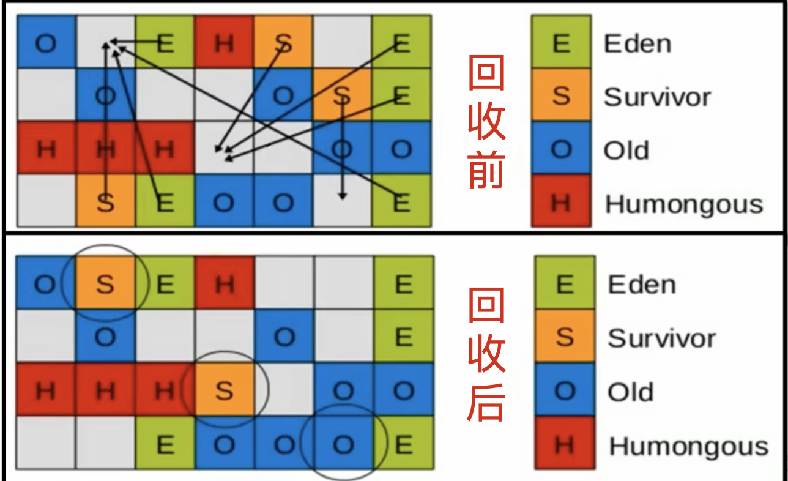
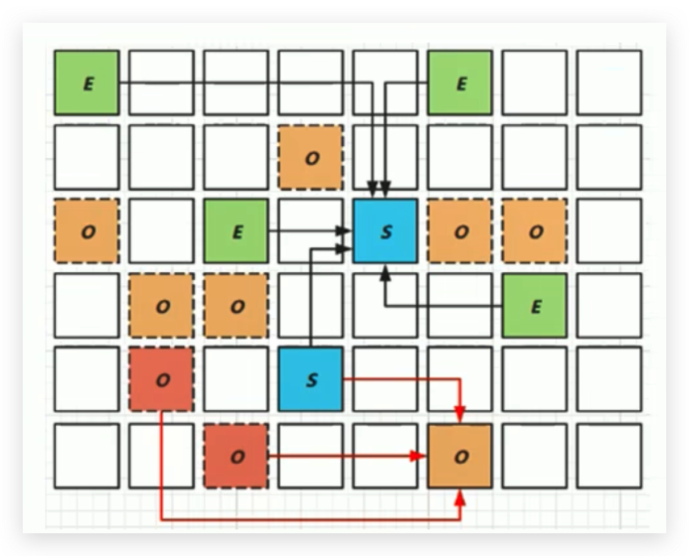

# 垃圾回收器-G1回收器-垃圾回收过程详情

## 过程一：年轻代GC

### 解释说明

- JVM启动时，G1先准备好Eden区，程序在运行过程中不断创建对象到Eden区，当Eden空间耗尽时，G1会启动一次年轻代垃圾回收过程。

- **年轻代回收只回收Eden区和Survivor区。**

- YGC时，首先G1停止应用程序的执行（Stop-The-World），G1创建回收集（Collection Set），回收集是指需要被回收的内存分段的集合，年轻代回收过程的回收集包含年轻代Eden区和Survivor区所有的内存分段。

### 图示

<!--more-->

图的大致意思就是：

- 回收完E和S区，剩余存活的对象会复制到新的S区

- S区达到一定的阈值可以晋升为O区

### 详细步骤

1. `第一阶段，扫描根(GC Roots)`

   跟是包括：static变量指向的对象、正在执行的方法调用链条上的局部变量等，以及记忆集(RSet)记录的外部引用，以上这些都作为扫描存活对象的入口。

2. `第二阶段，更新RSet`

   处理Dirty Card Queue(脏卡队列)中的card，更新RSet。此阶段完成后，**RSet可以准确反映被老年代所在的内存分段中对象的引用**

   > 1. 对于应用程序的引用赋值语句 object.field=object（field是老年代,object是新生代），JVM会在之前和之后执行特殊的操作以在dirty card queue中入队一个保存了对象引用信息的card。在年轻代回收的时候，G1会对Dirty Card Queue中所有的card进行处理，以更新RSet，保证RSet实时准确的反映引用关系。
   > 2. 那为什么不在引用赋值语句处直接更新RSet呢？这是为了性能的需要，RSet的处理需要线程同步，开销会很大，使用队列性能会好很多。

3. `第三阶段，处理RSet`

   识别被老年代对象指向的Eden中的对象，这些被指向的Eden中的对象被认为是存活的对象。

4. `第四阶段，复制对象。`

   - 此阶段，对象树被遍历（GC Roots 遍历关联的所有对象），Eden区内存段中存活的对象会被复制到Survivor区中空的内存分段，年龄记为1；
   - Survivor区内存段中存活的对象：若年龄未达阈值，也会被复制到Survivor区中空的内存分段，并且年龄会加1；若达到阀值则会被复制到老年代（Old区）中空的内存分段。
   - 如果Survivor空间不够，Eden空间的部分数据会直接晋升到老年代（Old区）空间。

5. `第五阶段，处理引用`

   处理Soft，Weak，Phantom，Final，JNI Weak 等引用。最终Eden空间的数据为空，GC停止工作，而目标内存中的对象都是连续存储的，没有碎片，所以复制过程可以达到内存整理的效果，减少碎片。

## 过程二：并发标记过程

1. `初始标记阶段`

   标记从根节点直接可达的对象。这个阶段是STW的，并且会触发一次年轻代GC。正是由于该阶段是STW的，所以我们只扫描根节点可达的对象，以节省时间。

2. `根区域扫描（Root Region Scanning）`

   G1 GC扫描Survivor区直接可达的老年代区域对象，并标记被引用的对象。这一过程必须在Young GC之前完成，因为Young GC会使用复制算法对Survivor区进行GC。

3. `并发标记（Concurrent Marking）`

   - 在整个堆中进行并发标记（和应用程序并发执行），此过程可能被Young GC中断。

   - **在并发标记阶段，若发现区域对象中的所有对象都是垃圾，那这个区域会被立即回收。**

   - 同时，并发标记过程中，会计算每个区域的对象活性（区域中存活对象的比例）。

4. `再次标记（Remark）`

   由于应用程序持续进行，需要修正上一次的标记结果。是STW的。G1中采用了比CMS更快的初始快照算法：**Snapshot-At-The-Beginning（SATB）**。

5. `独占清理（cleanup，STW）`

   计算各个区域的存活对象和GC回收比例，并进行排序，识别可以混合回收的区域。为下阶段做铺垫。是STW的。

   - **这个阶段并不会实际上去做垃圾的收集**

6. `并发清理阶段`

   识别并清理完全空闲的区域。

## 过程三：混合回收

### 解释说明

当越来越多的对象晋升到老年代Old Region时，为了避免堆内存被耗尽，虚拟机会触发一个混合的垃圾收集器，即`Mixed GC`，该算法并不是一个Old GC，除了**回收整个Young Region，还会回收一部分的Old Region**。这里需要注意：**是一部分老年代，而不是全部老年代**。可以选择哪些Old Region进行收集，从而可以对垃圾回收的耗时时间进行控制。也要注意的是**Mixed GC并不是Full GC**。

### 图示

### 详细步骤

1. 并发标记结束以后，老年代中百分百为垃圾的内存分段已经被回收了，部分为垃圾的内存分段被计算了出来。默认情况下，这些老年代的内存分段会分8次（可以通过`-XX:G1MixedGCCountTarget`设置）被回收。
2. 混合回收的回收集（Collection Set）包括八分之一的老年代内存分段，Eden区内存分段，Survivor区内存分段。混合回收的算法和年轻代回收的算法完全一样，只是回收集多了老年代的内存分段。具体过程请参考上面的年轻代回收过程。
3. 由于老年代中的内存分段默认分8次回收，G1会优先回收垃圾多的内存分段。**垃圾占内存分段比例越高的，越会被先回收。**并且有一个阈值会决定内存分段是否被回收。`-XX:G1MixedGCLiveThresholdPercent`，默认为65%，意思是垃圾占内存分段比例要达到65%才会被回收。如果垃圾占比太低，意味着存活的对象占比高，在复制的时候会花费更多的时间。
4. 混合回收并不一定要进行8次。因为有一个阈值`-XX:G1HeapWastePercent`，默认值为10%，意思是允许整个堆内存中有10%的空间被浪费，意味着如果发现可以回收的垃圾占堆内存的比例低于10%，则不再进行混合回收。因为GC会花费很多的时间但是回收到的内存却很少。

## 过程四：Full GC

### 解释说明

G1的初衷就是要避免Full GC的出现。但是如果上述方式不能正常工作，G1会**停止应用程序的执行**（Stop-The-World），使用**单线程**的内存回收算法进行垃圾回收，性能会非常差，应用程序停顿时间会很长。

所以要避免Full GC的发生，一旦发生Full GC，就需要对JVM参数进行调整。

### 触发的原因

**什么时候会发生Full GC呢？**

比如堆内存太小，当G1在复制存活对象的时候没有空的内存分段可用，则会回退到Full GC，这种情况可以通过增大内存解决。

**导致G1 Full GC的原因可能有两个：**

1. Evacuation（回收，排空）的时候没有足够的to-space（空闲空间）来存放晋升的对象；
2. 并发处理过程完成之前空间耗尽。（并发标记的时候，造垃圾的速度比标记的还快）
3. 设置的STW时间（暂停时间）太短的话，导致每次在GC的时候可以回收的Region就比较少，释放的空间也就比较少，此时用户线程有可能制造的垃圾比释放的空间多，在内存溢出之前会来一次Full GC。

## 补充

从Oracle官方透露出来的信息可获知，回收阶段（Evacuation）其实本也有想过设计成与用户程序一起并发执行，但这件事情做起来比较复杂，考虑到G1只是回一部分Region，停顿时间是用户可控制的，所以并不迫切去实现，**而选择把这个特性放到了G1之后出现的低延迟垃圾收集器（即ZGC）中。**另外，还考虑到G1不是仅仅面向低延迟，停顿用户线程能够最大幅度提高垃圾收集效率，为了保证吞吐量所以才选择了完全暂停用户线程的实现方案。

## G1 回收器的优化建议

1. 年轻代大小
   - 避免使用-Xmn或-XX:NewRatio等相关选项显式设置年轻代大小
   - 因为固定年轻代的大小会覆盖可预测的暂停时间目标。年轻代GC是并行独占式的，所以最好让垃圾回收器自己去调节
2. 暂停时间目标不要太过严苛
   - G1 GC的吞吐量目标是90%的应用程序时间和10%的垃圾回收时间
   - 评估G1 GC的吞吐量时，暂停时间目标不要太严苛。目标太过严苛表示你愿意承受更多的垃圾回收开销，而这些会直接影响到吞吐量。
