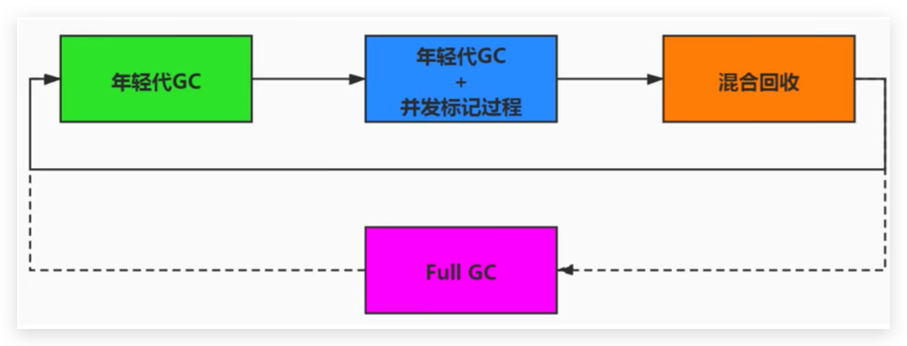
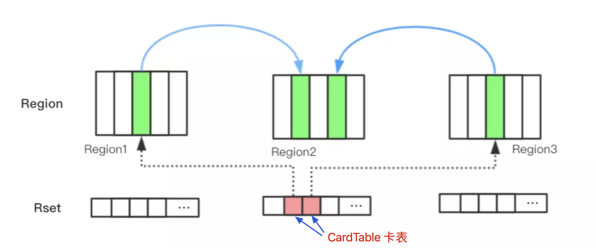

# 垃圾回收器-G1回收器-主要回收环节

## 主要环节

1. 年轻代GC（Young GC）
2. 老年代并发标记过程（Concurrent Marking）
3. 混合回收（Mixed GC）
4. Full GC （第四个环节，不是主要的；如果需要，单线程、独占式、高强度的Full GC还是继续存在的。它针对GC的评估失败提供了一种失败保护机制，即强力回收。）

<!--more-->

## 图示

顺时针，Young GC --> Young GC+Concurrent Marking --> Mixed GC顺序，进行垃圾回收

1. `年轻代GC`：应用程序分配内存，**当年轻代的Eden区用尽时开始年轻代回收过程**；G1的年轻代收集阶段是一个**并行的独占式**收集器。在年轻代回收期，G1 GC暂停所有应用程序线程，启动多线程执行年轻代回收。然后**从年轻代区间移动存活对象到Survivor区间或者老年区间，也有可能是两个区间都会涉及。**

2. `年轻代GC + 老年代并发标记过程`：当堆内存使用达到一定值（默认45%）时，开始老年代并发标记过程。

3. `年轻代GC + 老年代GC 混合回收`：标记完成马上开始混合回收过程。对于一个混合回收期，G1 GC从老年区间移动存活对象到空闲区间，这些空闲区间也就成为了老年代的一部分。和年轻代不同，老年代的G1回收器和其他GC不同，**G1的老年代回收器不需要整个老年代被回收，一次只需要扫描/回收一小部分老年代的Region就可以了**。同时，这个老年代Region是和年轻代一起被回收的。

   

举个例子：一个Web服务器，Java进程最大堆内存为4G，每分钟响应1500个请求，每45秒钟会新分配大约2G的内存。G1会每45秒钟进行一次年轻代回收，每31个小时整个堆的使用率会达到45%，会开始老年代并发标记过程，标记完成后开始四到五次的混合回收。

## Remembered Set 记忆集 与 Write Barrier 写屏障

### 引入（问题）

**一个对象被不同区域引用的问题**

- 一个Region不可能是孤立的，一个Region中的对象可能被其他任意Region中对象引用，判断对象存活时，是否需要扫描整个Java堆才能保证准确？

- 在其他的分代收集器，也存在这样的问题（而G1更突出，因为G1主要针对大堆）
- 回收新生代也不得不同时扫描老年代？这样的话会降低Minor GC的效率
- 

### 问题解决办法

- 无论G1还是其他分代收集器，JVM都是使用`Remembered Set(记忆集:简写Rset)`来避免全堆扫描；

- **每个Region都有一个对应的Remembered Set**

- 每次Reference类型数据写操作时，都会产生一个`Write Barrier(写屏障)`暂时中断操作；

- 然后检查将要写入的引用指向的对象是否和该Reference类型数据在不同的Region（其他收集器：检查老年代对象是否引用了新生代对象）；

- 如果不同，通过`CardTable(卡表)`把相关引用信息记录到引用指向对象的所在Region对应的Remembered Set中；

- 当进行垃圾收集时，在GC根节点的枚举范围加入Remembered Set；就可以保证不进行全局扫描，也不会有遗漏。

  

