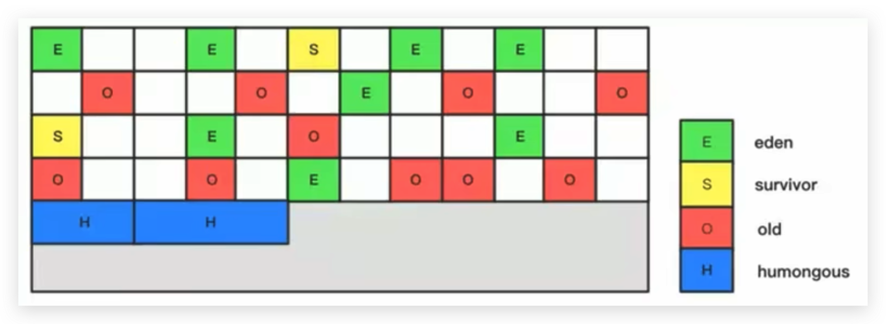
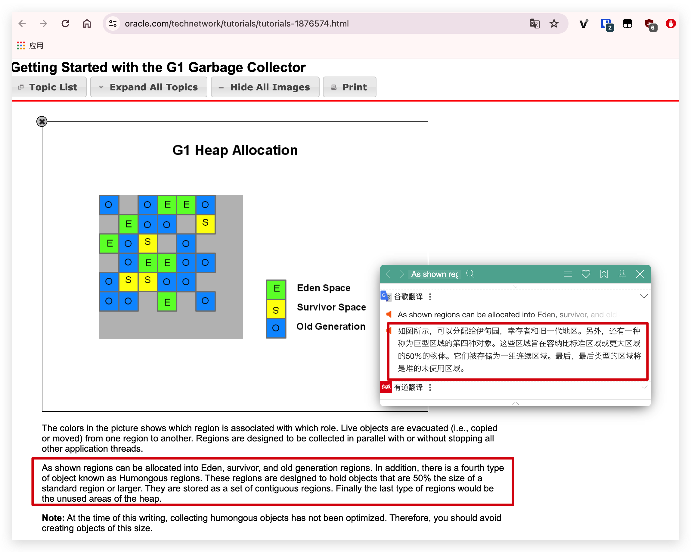
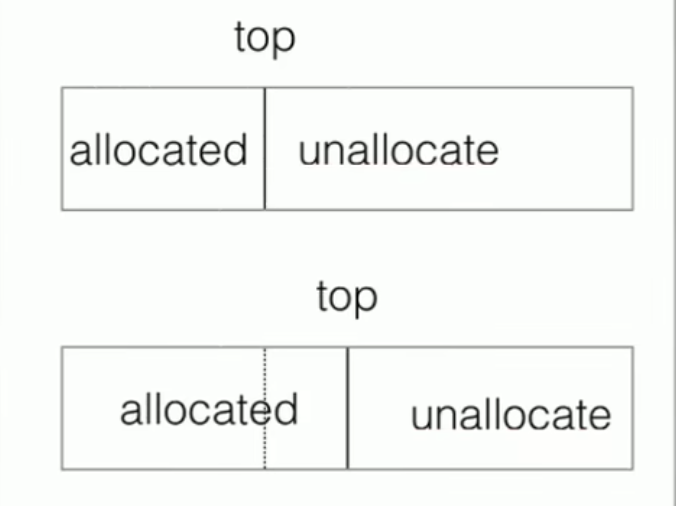

# 垃圾回收器-G1回收器-分区Region详解

## 引入

**化整为零**

使用G1收集器时，它将整个Java堆划分成约2048个大小相同的独立Region块，每个Region块大小根据堆空间的实际大小而定，整体被控制在1MB到32MB之间，且为2的N次幂，即1MB，2MB，4MB，8MB，16MB，32MB。可以通过 -XX:G1HeapRegionSize设定。**所有的Region大小相同，且在JVM生命周期内不会被改变。**

<!--more-->

## Region的角色划分

- 虽然还保留有新生代和老年代的概念，但新生代和老年代不再是物理隔离的了，它们都是一部分Region（不需要连续）的集合。通过Region的动态分配方式实现逻辑上的连续。

- 一个Region有可能属于Eden，Survivor，Old/Tenured或者humongous内存区域。但是一个Region只可能属于一个角色。图中的E表示该Region属于Eden内存区域，S表示属于Survivor内存区域，O表示属于Old内存区域，H表示属于humongous(巨型对象)内存区域。图中空白的表示未使用的内存空间。

- G1垃圾收集器还增加了一种新的内存区域，叫做Humongous内存区域，如图中的H块。主要用于存储大对象，如果超过0.5个Region，就放到H。[官方文档](https://www.oracle.com/technetwork/tutorials/tutorials-1876574.html)

  

**设置 H 的原因**

对于堆中的大对象，默认直接会被分配到老年代，但是如果**它是一个短期存在的大对象**就会对垃圾收集器造成负面影响。为了解决这个问题，G1划分了一个Humongous区，它用来专门存放大对象。如**果一个H区装不下一个大对象，那么G1会寻找连续的H区来存储**。为了能找到连续的H区，有时候不得不启动Full GC。G1的大多数行为都把H区作为老年代的一部分来看待。

## Region内部存放细节

- Bump - the - pointer ：指针碰撞

单个Region使用指针碰撞的方式来存放数据，上面allocated是已经使用的内存区域，top就是指针的位置，unallocate是没有使用的内存区域，当有新对象分配的时候，指针就会右移。

- TLAB

单个Region里面也会划分出一部分空间来用于并发回收过程中的新对象分配，就是单独给每个线程分配一小份区域，这样多线程共享的时候就可以并行的执行，不需要同步的执行，可以提高分配对象的效率。
