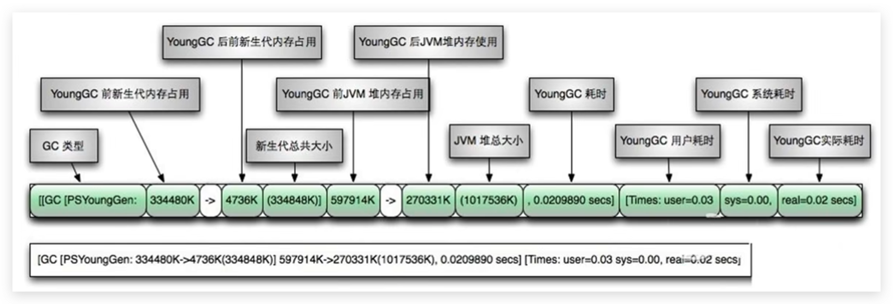
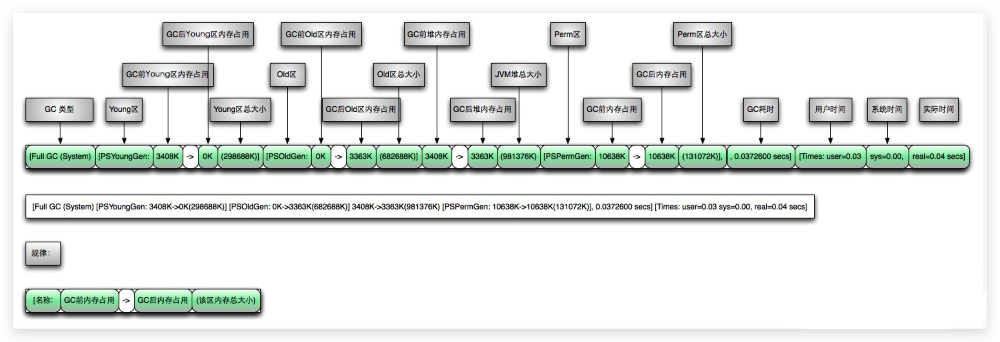
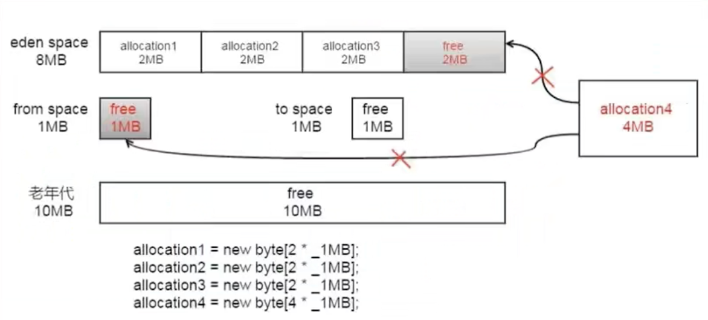
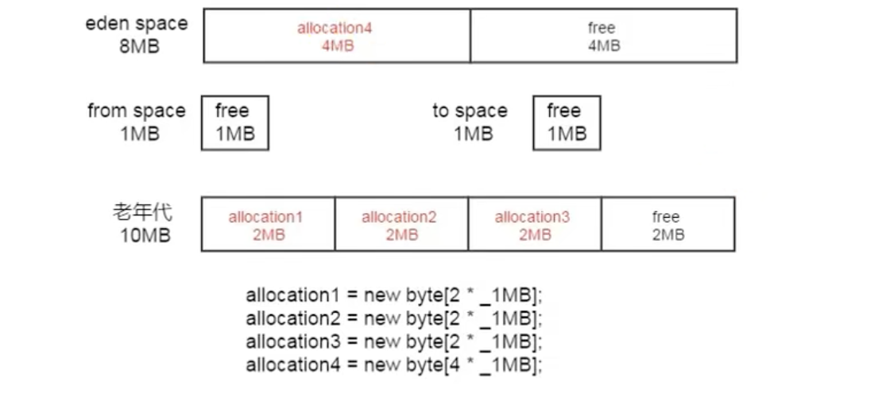

# 垃圾回收器-GC日志分析

## 常用参数配置

通过阅读GC日志，我们可以了解Java虚拟机内存分配与回收策略。

**内存分配与垃圾回收的参数列表**

- `-XX:+PrintGC` ：输出GC日志。类似：-verbose:gc
- `-XX:+PrintGCDetails `：输出GC的详细日志
- `-XX:+PrintGCTimestamps` ：输出GC的时间戳（以基准时间的形式）
- `-XX:+PrintGCDatestamps` ：输出GC的时间戳（以日期的形式，如2013-05-04T21: 53: 59.234 +0800）
- `-XX:+PrintHeapAtGC` ：在进行GC的前后打印出堆的信息
- `-Xloggc:…/logs/gc.log` ：日志文件的输出路径

<!--more-->

### -XX:+PrintGC

输出GC日志。类似：`-verbose:gc`

#### 代码

```java
package com.buubiu;

import java.util.ArrayList;

public class GCLogTest {
    public static void main(String[] args) {
        ArrayList<byte[]> list = new ArrayList<>();

        for (int i = 0; i < 500; i++) {
            byte[] arr = new byte[1024 * 100];//100KB
            list.add(arr);
//            try {
//                Thread.sleep(50);
//            } catch (InterruptedException e) {
//                e.printStackTrace();
//            }
        }
    }
}
```

JVM参数（jdk8环境）：

`-Xms60m -Xmx60m -XX:+PrintGC`

#### 输出

```sh
[GC (Allocation Failure)  15305K->13746K(58880K), 0.0108823 secs]
[GC (Allocation Failure)  29098K->28912K(58880K), 0.0117239 secs]
[Full GC (Ergonomics)  28912K->28668K(58880K), 0.0121593 secs]
[Full GC (Ergonomics)  43970K->43772K(58880K), 0.0139989 secs]

Process finished with exit code 0
```

#### 参数解析

这个只会显示总的GC堆的变化。

- GC、Full GC: GC的类型，GC只在新生代上进行，Full GC包括永生代，新生代，老年代。
- Allocation Failure： GC发生的原因。
- 15305K->13746K：堆在GC前的大小和GC后的大小。
- 58880K：现在的堆大小。
- 0.0108823 secs： GC特续的时间。

### -XX:+PrintGCDetails

#### 代码

```java
package com.buubiu;

import java.util.ArrayList;

public class GCLogTest {
    public static void main(String[] args) {
        ArrayList<byte[]> list = new ArrayList<>();

        for (int i = 0; i < 500; i++) {
            byte[] arr = new byte[1024 * 100];//100KB
            list.add(arr);
//            try {
//                Thread.sleep(50);
//            } catch (InterruptedException e) {
//                e.printStackTrace();
//            }
        }
    }
}
```

JVM参数（jdk8环境）：

`-Xms60m -Xmx60m -XX:+PrintGC -XX:+PrintGCDetails`

当-XX:+PrintGC与-XX:+PrintGCDetails都配置的时候，以能输出详细的那个参数为主，即以-XX:+PrintGCDetails为主

#### 输出

```sh
[GC (Allocation Failure) [PSYoungGen: 15298K->2528K(17920K)] 15298K->14046K(58880K), 0.0069092 secs] [Times: user=0.01 sys=0.02, real=0.01 secs] 
[GC (Allocation Failure) [PSYoungGen: 17881K->2532K(17920K)] 29398K->29124K(58880K), 0.0082118 secs] [Times: user=0.01 sys=0.02, real=0.01 secs] 
[Full GC (Ergonomics) [PSYoungGen: 2532K->0K(17920K)] [ParOldGen: 26592K->28969K(40960K)] 29124K->28969K(58880K), [Metaspace: 3346K->3346K(1056768K)], 0.0060808 secs] [Times: user=0.02 sys=0.01, real=0.00 secs] 
[Full GC (Ergonomics) [PSYoungGen: 15303K->3500K(17920K)] [ParOldGen: 28969K->40570K(40960K)] 44273K->44070K(58880K), [Metaspace: 3365K->3365K(1056768K)], 0.0089153 secs] [Times: user=0.02 sys=0.01, real=0.01 secs] 
Heap
 PSYoungGen      total 17920K, used 10120K [0x00000007bec00000, 0x00000007c0000000, 0x00000007c0000000)
  eden space 15360K, 65% used [0x00000007bec00000,0x00000007bf5e2158,0x00000007bfb00000)
  from space 2560K, 0% used [0x00000007bfd80000,0x00000007bfd80000,0x00000007c0000000)
  to   space 2560K, 0% used [0x00000007bfb00000,0x00000007bfb00000,0x00000007bfd80000)
 ParOldGen       total 40960K, used 40570K [0x00000007bc400000, 0x00000007bec00000, 0x00000007bec00000)
  object space 40960K, 99% used [0x00000007bc400000,0x00000007beb9e890,0x00000007bec00000)
 Metaspace       used 3408K, capacity 4564K, committed 4864K, reserved 1056768K
  class space    used 368K, capacity 388K, committed 512K, reserved 1048576K

Process finished with exit code 0
```

#### 参数解析

- GC、Full GC: 同样是GC的类型
- Allocation Failure： GC发生的原因。
- PSYoungGen：使用了Parallel Scavenge并行垃圾收集器的新生代GC前后大小的变化
- ParOldGen：使用了Parallel Old并行垃圾收集器的老年代GC前后大小的变化
- Metaspace：元数据区GC前后大小的变化，JDK1.8中引入了元数据区以替代永久代
- xxx secs：指GC花费的时间
- Times：
  - user：指的是垃圾收集器花费的所有CPU时间
  - sys：花费在等待系统调用或系统事件的时间
  - real：GC从开始到结束的时间，包括其他进程占用时间片的实际时间。

### -XX:+PrintGCTimeStamps

#### 代码

```java
package com.buubiu;

import java.util.ArrayList;

public class GCLogTest {
    public static void main(String[] args) {
        ArrayList<byte[]> list = new ArrayList<>();

        for (int i = 0; i < 500; i++) {
            byte[] arr = new byte[1024 * 100];//100KB
            list.add(arr);
//            try {
//                Thread.sleep(50);
//            } catch (InterruptedException e) {
//                e.printStackTrace();
//            }
        }
    }
}
```

JVM参数（jdk8环境）：

`-Xms60m -Xmx60m -XX:+PrintGC -XX:+PrintGCTimeStamps`

#### 输出

```sh
0.118: [GC (Allocation Failure)  15360K->13990K(58880K), 0.0068465 secs]
0.126: [GC (Allocation Failure)  29250K->29008K(58880K), 0.0087277 secs]
0.135: [Full GC (Ergonomics)  29008K->28869K(58880K), 0.0082276 secs]
0.144: [Full GC (Ergonomics)  44172K->43970K(58880K), 0.0089184 secs]

Process finished with exit code 0
```

#### 参数解析

- 0.118 0.126：在每行的前面加上了虚拟机启动到现在执行的秒数

### -XX:+PrintGCDateStamps

#### 代码

```java
package com.buubiu;

import java.util.ArrayList;

public class GCLogTest {
    public static void main(String[] args) {
        ArrayList<byte[]> list = new ArrayList<>();

        for (int i = 0; i < 500; i++) {
            byte[] arr = new byte[1024 * 100];//100KB
            list.add(arr);
//            try {
//                Thread.sleep(50);
//            } catch (InterruptedException e) {
//                e.printStackTrace();
//            }
        }
    }
}
```

JVM参数（jdk8环境）：

`-Xms60m -Xmx60m -XX:+PrintGC -XX:+PrintGCDateStamps`

#### 输出

```sh
2024-01-22T13:08:39.040+0800: [GC (Allocation Failure)  15298K->14006K(58880K), 0.0077802 secs]
2024-01-22T13:08:39.049+0800: [GC (Allocation Failure)  29358K->29076K(58880K), 0.0098255 secs]
2024-01-22T13:08:39.059+0800: [Full GC (Ergonomics)  29076K->28973K(58880K), 0.0104633 secs]
2024-01-22T13:08:39.071+0800: [Full GC (Ergonomics)  44278K->44073K(58880K), 0.0101868 secs]

Process finished with exit code 0
```

#### 参数解析

- 2024-01-22T13:08:39.040+0800：在每行的前面加上了年月日时分秒时间

### -Xloggc

如果想把GC日志存到文件的话，是下面这个参数：

`-Xloggc:/path/to/gc.log`

## 补充说明

jvm参数：

`-Xms60m -Xmx60m -XX:+PrintGCDetails`

输出：

```sh
[GC (Allocation Failure) [PSYoungGen: 15298K->2528K(17920K)] 15298K->14046K(58880K), 0.0188531 secs] [Times: user=0.01 sys=0.02, real=0.02 secs] 
[GC (Allocation Failure) [PSYoungGen: 17881K->2464K(17920K)] 29398K->29092K(58880K), 0.0104495 secs] [Times: user=0.02 sys=0.02, real=0.01 secs] 
[Full GC (Ergonomics) [PSYoungGen: 2464K->0K(17920K)] [ParOldGen: 26628K->28969K(40960K)] 29092K->28969K(58880K), [Metaspace: 3347K->3347K(1056768K)], 0.0208649 secs] [Times: user=0.02 sys=0.01, real=0.03 secs] 
[Full GC (Ergonomics) [PSYoungGen: 15303K->3500K(17920K)] [ParOldGen: 28969K->40570K(40960K)] 44273K->44071K(58880K), [Metaspace: 3378K->3378K(1056768K)], 0.0236503 secs] [Times: user=0.02 sys=0.01, real=0.02 secs] 
Heap
 PSYoungGen      total 17920K, used 10120K [0x00000007bec00000, 0x00000007c0000000, 0x00000007c0000000)
  eden space 15360K, 65% used [0x00000007bec00000,0x00000007bf5e21c0,0x00000007bfb00000)
  from space 2560K, 0% used [0x00000007bfd80000,0x00000007bfd80000,0x00000007c0000000)
  to   space 2560K, 0% used [0x00000007bfb00000,0x00000007bfb00000,0x00000007bfd80000)
 ParOldGen       total 40960K, used 40570K [0x00000007bc400000, 0x00000007bec00000, 0x00000007bec00000)
  object space 40960K, 99% used [0x00000007bc400000,0x00000007beb9ea38,0x00000007bec00000)
 Metaspace       used 3397K, capacity 4564K, committed 4864K, reserved 1056768K
  class space    used 366K, capacity 388K, committed 512K, reserved 1048576K
```

- `[GC`和`[Full GC`说明了这次垃圾收集器的类型，如果有"Full"则说明GC发生了"Stop The World"

- 如果使用Serial收集器在新生代的名字是Default New Generation，显示的是"[DefNew"

- 如果使用Serial Old 收集器在新生代的名字是Default Old Generation，显示的是"[DefOld"

- 如果使用Parallel scavenge收集器在新生代的名字是”[PSYoungGen"

- 老年代的收集和新生代道理一样，名字也是收集器决定的

- 如果使用ParNew收集器在老生代的名字会变成"[ParNew"，意思是"Parallel New Generation"

- 如果使用Parallel Old 收集器在老生代的名字是”[PSOldGen"

- 如果使用G1收集器的话，会显示为"garbage-first heap"

- `Allocation Failure`

  表明本次引起GC的原因是因为在年轻代中没有足够的空间能够存储新的数据了。

- `[PSYoungGen: 15298K->2528K(17920K)] 15298K->14046K(58880K)`

  - 中括号内：GC回收前年轻代大小 -> 回收后大小（年轻代总大小）
  - 中括号外：GC回收前年轻代和老年代大小 -> 回收后大小（年轻代和老年代总大小）

- user代表用户态回收耗时，sys内核态回收耗时，real实际耗时。由于多核线程切换的原因，时间总和可能会超过real时间

### 文字解释

```java
Heap（堆）
PSYoungGen（Parallel Scavenge收集器新生代）total 9216K，used 6234K [0x00000000ff600000,0x0000000100000000,0x0000000100000000)
eden space（堆中的Eden区默认占比是8）8192K，768 used [0x00000000ff600000,0x00000000ffc16b08,0x00000000ffe00000)
from space（堆中的Survivor，这里是From Survivor区默认占比是1）1024K， 0% used [0x00000000fff00000,0x00000000fff00000,0x0000000100000000)
to space（堆中的Survivor，这里是to Survivor区默认占比是1，需要先了解一下堆的分配策略）1024K, 0% used [0x00000000ffe00000,0x00000000ffe00000,0x00000000fff00000)
                                                                         
ParOldGen（老年代总大小和使用大小）total 10240K， used 7001K ［0x00000000fec00000,0x00000000ff600000,0x00000000ff600000)
object space（显示个使用百分比）10240K，688 used [0x00000000fec00000,0x00000000ff2d6630,0x00000000ff600000)

PSPermGen（永久代总大小和使用大小）total 21504K， used 4949K [0x00000000f9a00000,0x00000000faf00000,0x00000000fec00000)
object space（显示个使用百分比，自己能算出来）21504K， 238 used [0x00000000f9a00000,0x00000000f9ed55e0,0x00000000faf00000)
```


### 图示解释





## 举例

```java
package com.buubiu;

/**
 * 在jdk7 和 jdk8中分别执行
 * -Xms20M -Xmx20M -Xmn10M -XX:+PrintGCDetails -XX:SurvivorRatio=8 -XX:+UseSerialGC
 */
public class GCLogTest1 {
    private static final int _1MB = 1024 * 1024;

    public static void testAllocation() {
        byte[] allocation1, allocation2, allocation3, allocation4;
        allocation1 = new byte[2 * _1MB];
        allocation2 = new byte[2 * _1MB];
        allocation3 = new byte[2 * _1MB];
        allocation4 = new byte[4 * _1MB];
    }

    public static void main(String[] agrs) {
        testAllocation();
    }
}
```

### JDK7 中的情况

```sh
[GC (Allocation Failure) [DefNew: 7893K->347K(9216K), 0.0062353 secs] 7893K->6491K(19456K), 0.0062611 secs] [Times: user=0.00 sys=0.00, real=0.00 secs] 
Heap
 def new generation   total 9216K, used 4766K [0x00000007bec00000, 0x00000007bf600000, 0x00000007bf600000)
  eden space 8192K,  53% used [0x00000007bec00000, 0x00000007bf050a48, 0x00000007bf400000)
  from space 1024K,  33% used [0x00000007bf500000, 0x00000007bf556fb8, 0x00000007bf600000)
  to   space 1024K,   0% used [0x00000007bf400000, 0x00000007bf400000, 0x00000007bf500000)
 tenured generation   total 10240K, used 6144K [0x00000007bf600000, 0x00000007c0000000, 0x00000007c0000000)
   the space 10240K,  60% used [0x00000007bf600000, 0x00000007bfc00030, 0x00000007bfc00200, 0x00000007c0000000)
 Metaspace       used 3223K, capacity 4564K, committed 4864K, reserved 1056768K
  class space    used 342K, capacity 388K, committed 512K, reserved 1048576K

Process finished with exit code 0
```


1. 首先会将3个2M的数组存放到Eden区，然后后面4M的数组来了后，将无法存储，因为Eden区只剩下2M的剩余空间了，那么将会进行一次Young GC操作，将原来Eden区的内容，存放到Survivor区，但是Survivor区也存放不下，那么就会直接晋级存入Old 区



2. 然后将3个2M的数组存入到Eden区中



### JDK8 中的情况

```sh
[GC (Allocation Failure) [DefNew: 6322K->668K(9216K), 0.0034812 secs] 6322K->4764K(19456K), 0.0035169 secs] [Times: user=0.00 sys=0.00, real=0.00 secs] 
Heap
 def new generation   total 9216K, used 7050K [0x00000000fec00000, 0x00000000ff600000, 0x00000000ff600000)
  eden space 8192K,  77% used [0x00000000fec00000, 0x00000000ff23b668, 0x00000000ff400000)
  from space 1024K,  65% used [0x00000000ff500000, 0x00000000ff5a71d8, 0x00000000ff600000)
  to   space 1024K,   0% used [0x00000000ff400000, 0x00000000ff400000, 0x00000000ff500000)
 tenured generation   total 10240K, used 4096K [0x00000000ff600000, 0x0000000100000000, 0x0000000100000000)
   the space 10240K,  40% used [0x00000000ff600000, 0x00000000ffa00020, 0x00000000ffa00200, 0x0000000100000000)
 Metaspace       used 3469K, capacity 4496K, committed 4864K, reserved 1056768K
  class space    used 381K, capacity 388K, committed 512K, reserved 1048576K

Process finished with exit code 0
```

与 JDK7 不同的是，JDK8 直接判定 4M 的数组为大对象，直接怼到老年区去了。

> 部分jdk8版本还是像7一样，不会把4M直接放到老年代，可以用参数：-XX:PretenureSizeThreshold=4M  调整对象直接进入老年代的阈值参数，默认0

## 日志分析工具

根据保存的日志文件来分析。

可以用一些工具去分析这些GC日志，常用的日志分析工具有：

GCViewer、[GCEasy](gceasy.io)(推荐)、GCHisto、GCLogViewer、Hpjmeter、garbagecat等
