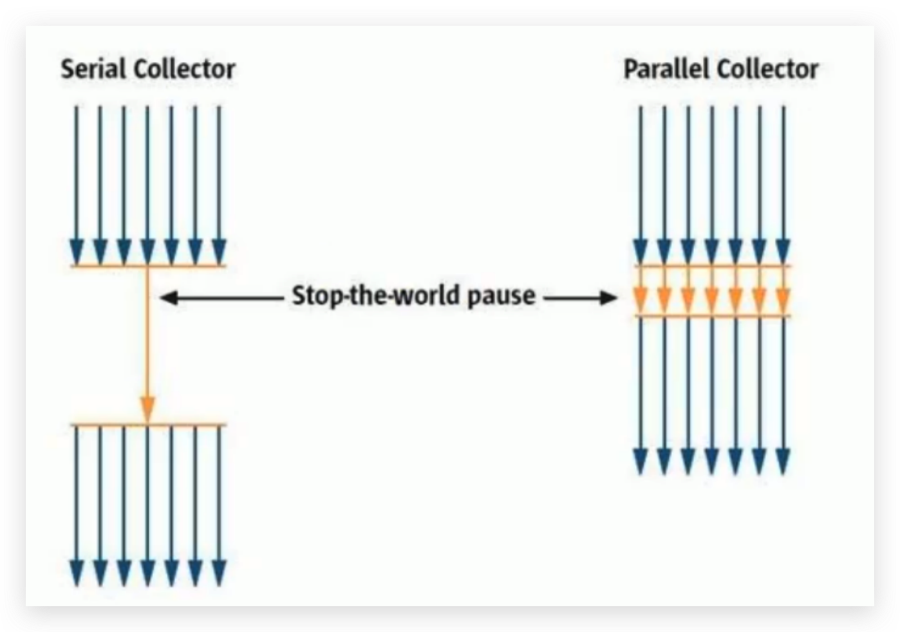
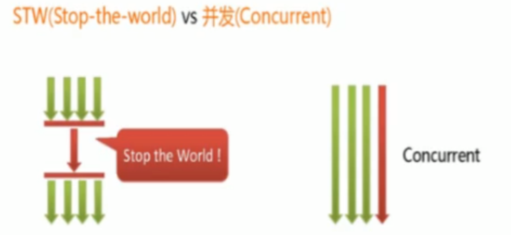

# 垃圾回收器-概述与分类

## 垃圾回收器概述

- 垃圾收集器没有在规范中进行过多的规定，可以由不同的厂商、不同版本的JVM来实现。

- 由于JDK的版本处于高速迭代过程中，因此Java发展至今已经衍生了众多的GC版本。

- 从不同角度分析垃圾收集器，可以将GC分为不同的类型。

<!--more-->

> **Java不同版本新特性**
>
> 1. 语法层面：Lambda表达式、switch、自动拆箱装箱、enum、泛型等。
> 2. API层面：Stream API、新的日期时间、Optional、String、集合框架等。
> 3. 底层优化：JVM优化、GC的变化、元空间、静态域、字符串常量池等。

## 垃圾回收器分类

### 按线程数分

按线程数分（垃圾回收的线程数），可以分为**串行垃圾回收器**和**并行垃圾回收器**。

- 串行回收指的是在同一时间段内只允许有一个CPU用于执行垃圾回收操作，此时工作线程被暂停，直至垃圾收集工作结束。
  - 在诸如单CPU处理器或者较小的应用内存等硬件平台不是特别优越的场合，串行回收器的性能表现可以超过并行回收器和并发回收器。所以，**串行回收默认被应用在客户端的Client模式下的JVM中。**
  - 在并发能力比较强的CPU上，并行回收器产生的停顿时间要短于串行回收器。

- 和串行回收相反，并行收集可以运用多个CPU同时执行垃圾回收，因此提升了应用的吞吐量，不过并行回收仍然与串行回收一样，采用独占式，使用了“`Stop-the-World`”机制。

### 按工作模式分

按照工作模式分，可以分为**并发式垃圾回收器**和**独占式垃圾回收器**。

- 并发式垃圾回收器与应用程序线程交替工作，以尽可能减少应用程序的停顿时间。
- 独占式垃圾回收器（Stop the World）一旦运行，就停止应用程序中的所有用户线程，直到垃圾回收过程完全结束。

### 按碎片处理方式分

按碎片处理方式分，可分为**压缩式垃圾回收器**和**非压缩式垃圾回收器**。

- 压缩式垃圾回收器会在回收完成后，对存活对象进行压缩整理，消除回收后的碎片。
  - 再分配对象空间使用：指针碰撞
- 非压缩式的垃圾回收器不进行这步操作。
  - 再分配对象空间使用：空闲列表

### 按工作的内存区间分

按工作的内存区间分，又可分为**年轻代垃圾回收器**和**老年代垃圾回收器**。
