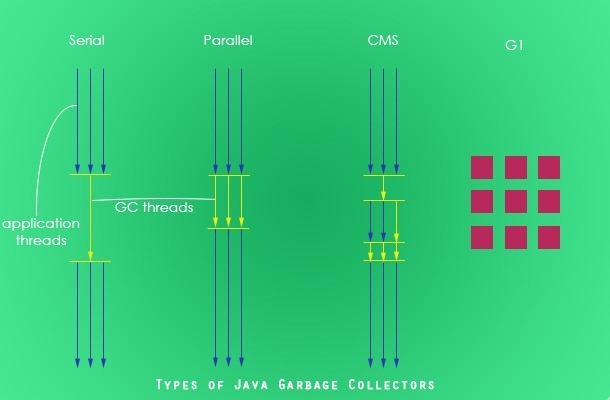
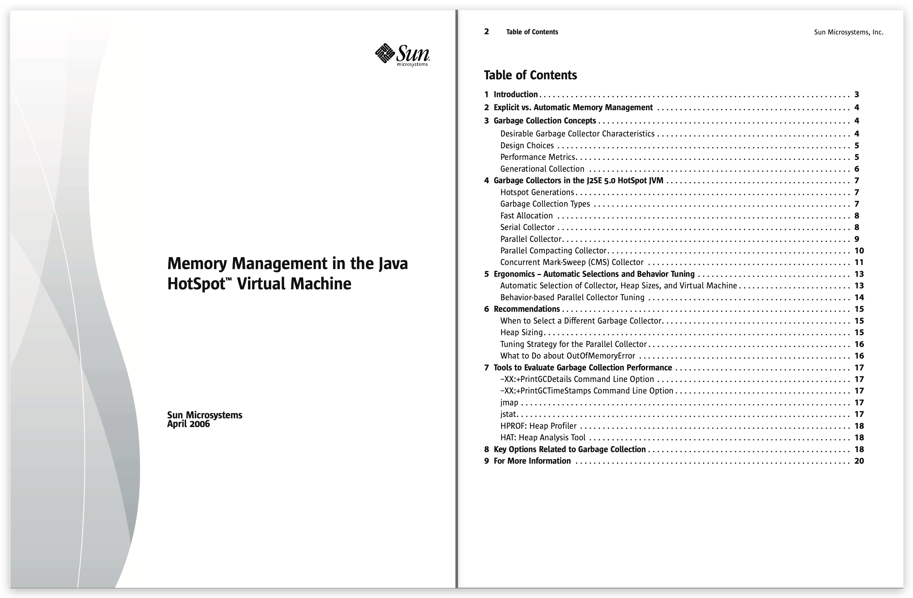
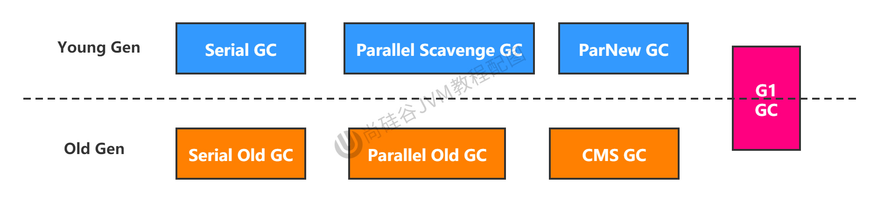
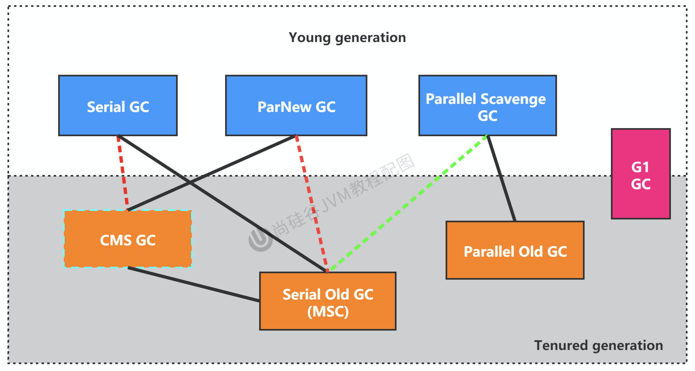
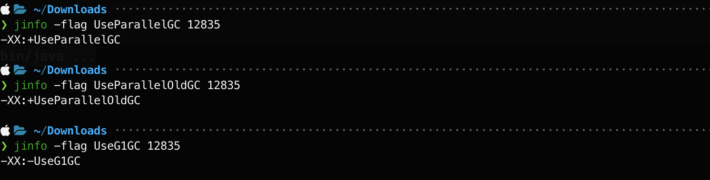

# 垃圾回收器-不同的垃圾回收器概述

## 引入

垃圾收集机制是Java的招牌能力，极大地提高了开发效率。
那么，Java常见的垃圾收集器有哪些？

<!--more-->

## 垃圾收集器发展史

有了虚拟机，就一定需要收集垃圾的机制，这就是`Garbage Collection`，对应的产品我们称为`Garbage Collector`。

1. 1999年随JDK1.3.1一起来的是串行方式的Serial GC，它是第一款GC。ParNew垃圾收集器是Serial收集器的多线程（并行）版本
2. 2002年2月26日，Parallel GC和Concurrent Mark Sweep GC跟随JDK1.4.2一起发布·
3. Parallel GC在JDK6之后成为HotSpot默认GC。
4. 2012年，在JDK1.7u4版本中，G1可用。
5. 2017年，JDK9中G1变成默认的垃圾收集器，以替代CMS。
6. 2018年3月，JDK10中G1垃圾回收器的并行完整垃圾回收，实现并行性来改善最坏情况下的延迟。
7. 2018年9月，JDK11发布。引入Epsilon 垃圾回收器，又被称为 "No-Op(无操作)“ 回收器。同时，引入ZGC：可伸缩的低延迟垃圾回收器（Experimental）
8. 2019年3月，JDK12发布。增强G1，自动返回未用堆内存给操作系统。同时，引入Shenandoah GC（OpenJDK）：低停顿时间的GC（Experimental）。
9. 2019年9月，JDK13发布。增强ZGC，自动返回未用堆内存给操作系统。
10. 2020年3月，JDK14发布。删除CMS垃圾回收器。扩展ZGC在macOS和Windows上的应用

## 7款经典的垃圾收集器

1. 串行回收器：Serial、Serial old
2. 并行回收器：ParNew、Parallel Scavenge、Parallel old
3. 并发回收器：CMS、G1



官方文档：

https://www.oracle.com/technetwork/java/javase/memorymanagement-whitepaper-150215.pdf



## 7款经典回收器与垃圾分代之间的关系



- 新生代收集器：Serial、ParNew、Parallel Scavenge；

- 老年代收集器：Serial old、Parallel old、CMS；

- 整堆收集器：G1；

## 垃圾收集器的组合关系

不同厂商、不同版本的虚拟机实现差别很大。HotSpot虚拟机在JDK7/8后所有收集器及组合（连线），如下图：



1. 两个收集器间有连线，表明它们可以搭配使用：
   - Serial/Serial old
   - Serial/CMS （JDK8标为废弃，JDK9移除）
   - ParNew/Serial Old （JDK8标为废弃，JDK9移除）
   - ParNew/CMS （JDK14移除）
   - Parallel Scavenge/Serial Old （JDK14标为废弃）
   - Parallel Scavenge/Parallel Old
   - G1

2. 其中Serial Old作为CMS出现"Concurrent Mode Failure"失败的后备预案。
3. （红色虚线）由于维护和兼容性测试的成本，在JDK 8时将Serial+CMS、ParNew+Serial Old这两个组合声明为废弃（JEP173），并在JDK9中完全取消了这些组合的支持（JEP214），即：移除。

4. （绿色虚线）JDK14中：弃用Parallel Scavenge和Serial Old GC组合（JEP366）
5. （青色虚线）JDK14中：删除CMS垃圾回收器（JEP363）

**综上所述：**

- JDK8以前可选：Serial/Serial old、Serial/CMS、ParNew/Serial Old、ParNew/CMS、Parallel Scavenge/Serial Old、Parallel Scavenge/Parallel Old、G1
- JDK8可选：        Serial/Serial old、ParNew/CMS、Parallel Scavenge/Serial Old、Parallel Scavenge/Parallel Old（默认）、G1
- JDK9可选：Serial/Serial old、ParNew/CMS、Parallel Scavenge/Serial Old、Parallel Scavenge/Parallel Old、G1（默认）
- JDK14可选：Serial/Serial old、Parallel Scavenge/Parallel Old、G1（默认）

## 说明

1. 为什么要有很多收集器，一个不够吗？因为Java的使用场景很多，移动端，服务器等。所以就需要针对不同的场景，提供不同的垃圾收集器，提高垃圾收集的性能。

2. 虽然我们会对各个收集器进行比较，但并非为了挑选一个最好的收集器出来。没有一种放之四海皆准、任何场景下都适用的完美收集器存在，更加没有万能的收集器。**所以我们选择的只是对具体应用最合适的收集器。**

## 如何查看默认的垃圾收集器

- `-XX:+PrintCommandLineFlags`：查看命令行相关参数（包含使用的垃圾收集器）
- 使用命令行指令：`jinfo -flag 相关垃圾回收器参数 进程ID`


代码：

```java
package com.buubiu;

import java.util.ArrayList;

/**
 *  -XX:+PrintCommandLineFlags
 */
public class GCUseTest {
    public static void main(String[] args) {
        ArrayList<byte[]> list = new ArrayList<>();

        while(true){
            byte[] arr = new byte[100];
            list.add(arr);
            try {
                Thread.sleep(10);
            } catch (InterruptedException e) {
                e.printStackTrace();
            }
        }
    }
}
```


### JDK8

**在 JDK 8 下，设置 JVM 参数**

-XX:+PrintCommandLineFlags

程序打印输出：-XX:+UseParallelGC 表示使用使用 ParallelGC ，ParallelGC 默认和 Parallel Old 绑定使用

```sh
-XX:InitialHeapSize=268435456 -XX:MaxHeapSize=4294967296 -XX:+PrintCommandLineFlags -XX:+UseCompressedClassPointers -XX:+UseCompressedOops -XX:+UseParallelGC 
```

**通过命令行指令查看**

命令行命令

```sh
jps
jinfo -flag UseParallelGC 进程id
jinfo -flag UseParallelOldGC 进程id
jinfo -flag UseG1GC 进程id
```

JDK 8 中默认使用 ParallelGC 和 ParallelOldGC 的组合



### JDK9~21

```sh
-XX:ConcGCThreads=2 -XX:G1ConcRefinementThreads=8 -XX:GCDrainStackTargetSize=64 -XX:InitialHeapSize=268435456 -XX:MarkStackSize=4194304 -XX:MaxHeapSize=4294967296 -XX:MinHeapSize=6815736 -XX:+PrintCommandLineFlags -XX:ReservedCodeCacheSize=251658240 -XX:+SegmentedCodeCache -XX:+UseCompressedOops -XX:+UseG1GC 
```

