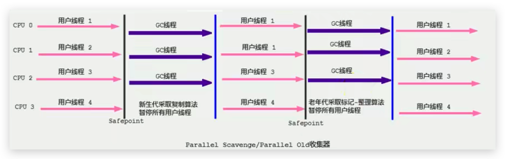

# 垃圾回收器-Parallel Scavenge回收器(吞吐量优先)

## 引入

HotSpot的年轻代中除了拥有ParNew收集器是基于并行回收的以外，`Parallel Scavenge收集器（简称Parallel收集器）`同样也采用了**复制算法、并行回收和"Stop the World"机制**。

<!--more-->

## 与ParNew比较

那么Parallel收集器的出现是否多此一举？

- 和ParNew收集器不同，Parallel Scavenge收集器的目标则是达到一个**可控制的吞吐量**（Throughput），它也被称为吞吐量优先的垃圾收集器。
- 自适应调节策略也是Parallel Scavenge与ParNew一个重要区别。（动态调整内存分配情况，以达到一个最优的吞吐量或低延迟）

## 说明

- 高吞吐量则可以高效率地利用CPU时间，尽快完成程序的运算任务，**主要适合在后台运算而不需要太多交互的任务**。因此，常见在服务器环境中使用。**例如，那些执行批量处理、订单处理、工资支付、科学计算的应用程序。**

- Parallel 收集器在JDK1.6时提供了用于执行老年代垃圾收集的 Parallel Old 收集器，用来代替老年代的Serial Old收集器。

- Parallel Old收集器采用了**标记-压缩算法**，但同样也是**基于并行回收和"Stop-the-World"机制**。
- 在程序吞吐量优先的应用场景中，Parallel收集器和Parallel Old收集器的组合，在server模式下的内存回收性能很不错。
2. **在Java8中，默认是此垃圾收集器。**

## 图示

## 相关JVM参数

1. `-XX:+UseParallelGC` 

   手动指定年轻代使用Parallel并行收集器执行内存回收任务。

2. `-XX:+UseParallelOldGC`

   手动指定老年代使用ParallelOld并行回收收集器。

**上面两个参数分别适用于新生代和老年代。jdk8是默认开启的。默认开启一个，另一个也会被开启。（互相激活）**

3. `-XX:ParallelGCThreads`

   设置年轻代并行收集器的线程数。一般地，最好与CPU数量相等，以避免过多的线程数影响垃圾收集性能。

   - 在默认情况下，当CPU数量小于8个，ParallelGCThreads的值等于CPU数量。

   - 当CPU数量大于8个，ParallelGCThreads的值等于3+[5*CPU_Count]/8]

4. `-XX:MaxGCPauseMillis`

   设置垃圾收集器最大停顿时间（即STW的时间）。单位是毫秒。

   - 为了尽可能地把停顿时间控制在XX:MaxGCPauseMillis 以内，收集器在工作时会调整Java堆大小或者其他一些参数。
   - 对于用户来讲，停顿时间越短体验越好。但是在服务器端，我们注重高并发，整体的吞吐量。所以服务器端适合Parallel，进行控制。
   - `该参数使用需谨慎。`

5. `-XX:GCTimeRatio`

   垃圾收集时间占总时间的比例，即等于 1 / (N+1) ，用于衡量吞吐量的大小。

   - 取值范围(0, 100)。默认值99，也就是垃圾回收时间占比不超过1。
   - 与前一个-XX:MaxGCPauseMillis参数有一定矛盾性，STW暂停时间越长，Radio参数就容易超过设定的比例。
   - 如果把此参数设置为19，那允许的最大GC时间就占总时间的5%（即1/（19+1）），默认值为99，就是允许最大1%（即1/（99+1））的垃圾收集时间。
