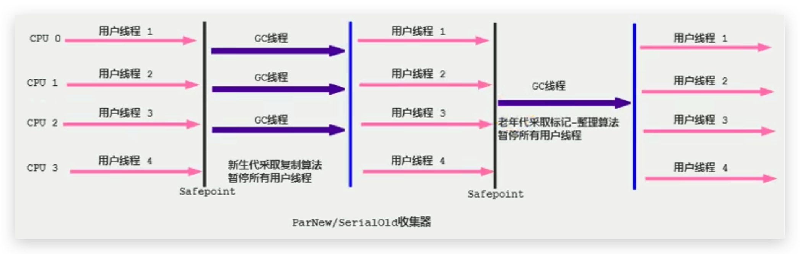

# 垃圾回收器-ParNew回收器(并行回收)

## 引入

- 如果说Serial GC是年轻代中的单线程垃圾收集器，那么ParNew收集器则是Serial收集器的多线程版本。
  - Par意思是Parallel的缩写，New：意思是只能处理新生代
- ParNew 收集器除了采用**并行回收**的方式执行内存回收外，两款垃圾收集器之间几乎没有任何区别。ParNew收集器在年轻代中同样也是**采用复制算法、"Stop-the-World"机制**。
- ParNew 是很多JVM运行**在Server模式下新生代的默认垃圾收集器**。

<!--more-->

## 图示



- 对于新生代，回收次数频繁，使用并行方式高效。
- 对于老年代，回收次数少，使用串行方式节省资源。（CPU并行需要切换线程，串行可以省去切换线程的资源）
- **这里（官方配对）的老年代默认使用的是SerialOld，其实它还可以使用CMS收集器**

## 说明

Q：由于ParNew收集器基于并行回收，那么是否可以断定ParNew收集器的回收效率在任何场景下都会比Serial收集器更高效？

A：**不能**

- ParNew收集器运行在多CPU的环境下，由于可以充分利用多CPU、多核心等物理硬件资源优势，可以更快速地完成垃圾收集，提升程序的吞吐量。

- 但是**在单个CPU的环境下，ParNew收集器不比Serial收集器更高效**。虽然Serial收集器是基于串行回收，但是由于CPU不需要频繁地做任务切换，因此可以有效避免多线程交互过程中产生的一些额外开销。

## 相关JVM参数

1. 在程序中，开发人员可以通过选项`-XX:+UseParNewGC`手动指定使用ParNew收集器执行内存回收任务。它表示年轻代使用并行收集器，不影响老年代 ，老年代默认使用Serial Old。
2. -XX:ParallelGCThreads限制线程数量，默认开启和CPU数据相同的线程数。

代码：

```java
package com.buubiu;

import java.util.ArrayList;

/**
 *  -XX:+PrintCommandLineFlags
 *
 *  -XX:+UseParNewGC：标明新生代使用ParNew GC，同时老年代默认使用Serial Old GC
 *  -XX:+UseConcMarkSweepGC：表明老年代使用CMS GC。同时，年轻代会触发对ParNew 的使用
 */
public class GCUseTest {
    public static void main(String[] args) {
        ArrayList<byte[]> list = new ArrayList<>();

        while(true){
            byte[] arr = new byte[100];
            list.add(arr);
            try {
                Thread.sleep(10);
            } catch (InterruptedException e) {
                e.printStackTrace();
            }
        }
    }
}
```

JVM参数：

`-XX:+PrintCommandLineFlags -XX:+UseParNewGC`

输出：

```sh
-XX:InitialHeapSize=268435456 -XX:MaxHeapSize=4294967296 -XX:+PrintCommandLineFlags -XX:+UseCompressedClassPointers -XX:+UseCompressedOops -XX:+UseParNewGC 
```

切换老年代GC为CMS：

JVM参数：

`-XX:+PrintCommandLineFlags -XX:+UseParNewGC -XX:+UseConcMarkSweepGC`

或不指定年轻代为UseParNewGC，因为如果老年代使用CMS GC的话，同时，年轻代会触发对ParNew 的使用

`-XX:+PrintCommandLineFlags -XX:+UseConcMarkSweepGC`

输出：

```sh
-XX:InitialHeapSize=268435456 -XX:MaxHeapSize=4294967296 -XX:MaxNewSize=697933824 -XX:MaxTenuringThreshold=6 -XX:OldPLABSize=16 -XX:+PrintCommandLineFlags -XX:+UseCompressedClassPointers -XX:+UseCompressedOops -XX:+UseConcMarkSweepGC -XX:+UseParNewGC 
```

