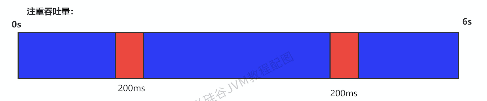
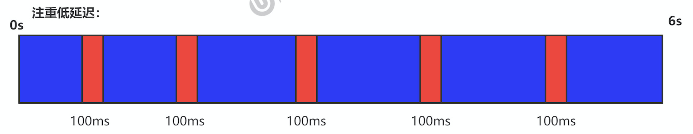

# 垃圾回收器-评估GC的性能指标

## 指标

1. `吞吐量：运行用户代码的时间占总运行时间的比例。`
   - （总运行时间 = 程序的运行时间 + 内存回收的时间）

2. 垃圾收集开销：吞吐量的补数，垃圾收集所用时间与总运行时间的比例。

3. `暂停时间：执行垃圾收集时，程序的工作线程被暂停的时间。`

4. 收集频率：相对于应用程序的执行，收集操作发生的频率。

5. `内存占用：Java堆区所占的内存大小。`

6. 快速：一个对象从诞生到被回收所经历的时间。

<!--more-->

## 指标关系

- **吞吐量、暂停时间、内存占用**这三者共同构成一个“不可能三角”。三者总体的表现会随着技术进步而越来越好。一款优秀的收集器通常最多同时满足其中的两项。

- 这三项里，暂停时间的重要性日益凸显。因为随着硬件发展，内存占用多些越来越能容忍，硬件性能的提升也有助于降低收集器运行时对应用程序的影响，即提高了吞吐量。而内存的扩大，对延迟反而带来负面效果。

- 简单来说，主要抓住两点：
  - **吞吐量**
  - **暂停时间**

## 吞吐量（throughput）

- 吞吐量就是CPU用于运行用户代码的时间与CPU总消耗时间的比值，即**吞吐量=运行用户代码时间 /（运行用户代码时间+垃圾收集时间）**
  - 比如：虚拟机总共运行了100分钟，其中垃圾收集花掉1分钟，那吞吐量就是99%。

- 这种情况下，应用程序能容忍较高的暂停时间，因此，高吞吐量的应用程序有更长的时间基准，快速响应是不必考虑的

- 吞吐量优先，意味着在单位时间内，STW的时间最短：0.2+0.2=0.4

## 暂停时间（pause time）

- “暂停时间”是指一个时间段内应用程序线程暂停，让GC线程执行的状态。
  - 例如，GC期间100毫秒的暂停时间意味着在这100毫秒期间内没有应用程序线程是活动的

- 暂停时间优先，意味着尽可能让单次STW的时间最短：0.1+0.1 + 0.1+ 0.1+ 0.1=0.5，但是总的GC时间可能会长

## 吞吐量 vs 暂停时间

- 高吞吐量较好，因为这会让应用程序的最终用户感觉只有应用程序线程在做“生产性”工作。直觉上，吞吐量越高程序运行越快。

- 低暂停时间（低延迟）较好，因为从最终用户的角度来看，不管是GC还是其他原因导致一个应用被挂起始终是不好的。这取决于应用程序的类型，**有时候甚至短暂的200毫秒暂停都可能打断终端用户体验**。因此，具有较低的暂停时间是非常重要的，特别是对于一个**交互式应用程序**。

- 不幸的是”高吞吐量”和”低暂停时间”是一对相互竞争的目标（矛盾）。
  - 因为如果选择以吞吐量优先，那么**必然需要降低内存回收的执行频率**，但是这样会导致GC需要更长的暂停时间来执行内存回收。
  - 相反的，如果选择以低延迟优先为原则，那么为了降低每次执行内存回收时的暂停时间，也**只能频繁地执行内存回收**，但这又引起了年轻代内存的缩减和导致程序吞吐量的下降。
- 在设计（或使用）GC算法时，我们必须确定我们的目标：一个GC算法只可能针对两个目标之一（即只专注于较大吞吐量或最小暂停时间），或尝试找到一个二者的折衷。

现在标准(G1)：**`在最大吞吐量优先的情况下，降低停顿时间`**(即在固定的STW时间内，提高吞吐量)
