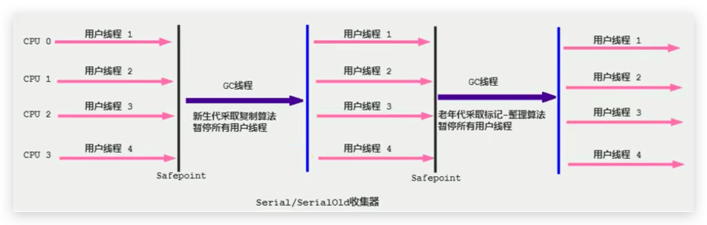

# 垃圾回收器-Serial回收器(串行回收)

## 引入

- Serial收集器是最基本、历史最悠久的垃圾收集器。JDK1.3之前回收新生代唯一的选择。

- **Serial收集器作为HotSpot中Client模式下的默认新生代垃圾收集器**。

<!--more-->

## 说明

- Serial收集器采用**复制算法、串行回收和"Stop-the-World"机制的方式执行内存回收**。

- 除了年轻代之外，Serial收集器还提供用于执行老年代垃圾收集的Serial Old收集器。**Serial old收集器同样也采用了串行回收和"Stop the World"机制，只不过内存回收算法使用的是标记-压缩算法**。
  - Serial Old是运行在Client模式下默认的老年代的垃圾回收器
  - Serial Old在Server模式下主要有两个用途：
    - 与新生代的Parallel Scavenge配合使用
    - 作为老年代CMS收集器的后备垃圾收集方案

## 图示



这个收集器是一个单线程的收集器，但它的“单线程”的意义并不仅仅说明**只会使用一个CPU（串行）或一条收集线程去完成垃圾收集工作**。更重要的是在它进行垃圾收集时，**必须暂停其他所有的工作线程**，直到它收集结束（Stop The World）

## 优势

- **简单而高效**（与其他收集器的单线程比），对于限定单个CPU的环境来说，Serial收集器由于没有线程交互的开销，专心做垃圾收集自然可以获得最高的单线程收集效率。
  - 运行在Client模式下的虚拟机是个不错的选择。

- 在用户的桌面应用场景中，可用内存一般不大（几十MB至一两百MB），可以在较短时间内完成垃圾收集（几十ms至一百多ms），只要不频繁发生，使用串行回收器是可以接受的。

## 相关JVM参数

在HotSpot虚拟机中，使用`-XX:+UseSerialGC`参数可以指定年轻代和老年代都使用串行收集器。

- 等价于新生代用Serial GC，且老年代用Serial Old GC

代码：

```java
package com.buubiu;

import java.util.ArrayList;

/**
 *  -XX:+PrintCommandLineFlags
 *
 *  -XX:+UseSerialGC:表明新生代使用Serial GC ，同时老年代使用Serial Old GC
 */
public class GCUseTest {
    public static void main(String[] args) {
        ArrayList<byte[]> list = new ArrayList<>();

        while(true){
            byte[] arr = new byte[100];
            list.add(arr);
            try {
                Thread.sleep(10);
            } catch (InterruptedException e) {
                e.printStackTrace();
            }
        }
    }
}
```

JVM参数：

`-XX:+PrintCommandLineFlags -XX:+UseSerialGC`

输出：

```sh
-XX:InitialHeapSize=268435456 -XX:MaxHeapSize=4294967296 -XX:+PrintCommandLineFlags -XX:ReservedCodeCacheSize=251658240 -XX:+SegmentedCodeCache -XX:+UseCompressedClassPointers -XX:+UseCompressedOops -XX:+UseSerialGC 
```

## 总结

1. 这种垃圾收集器大家了解，现在已经不用串行的了。而且在限定单核CPU才可以用。现在都不是单核的了。
2. 对于交互较强的应用而言，这种垃圾收集器是不能接受的。一般在Java Web应用程序中是不会采用串行垃圾收集器的。
