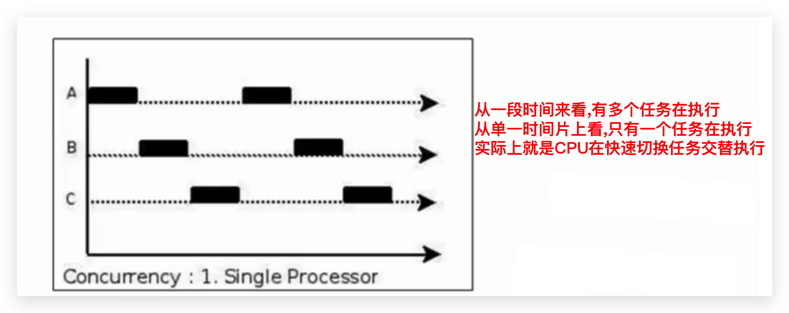
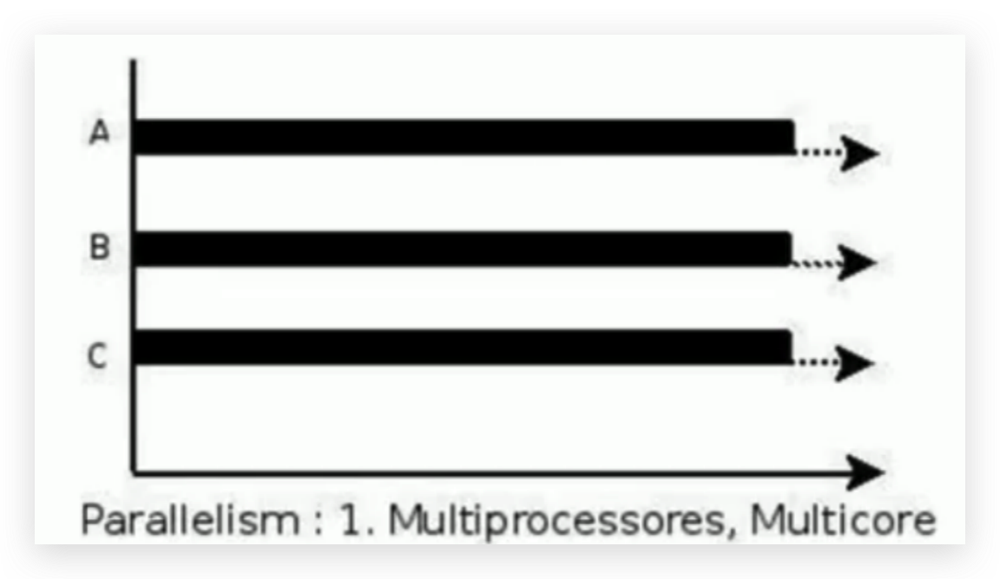
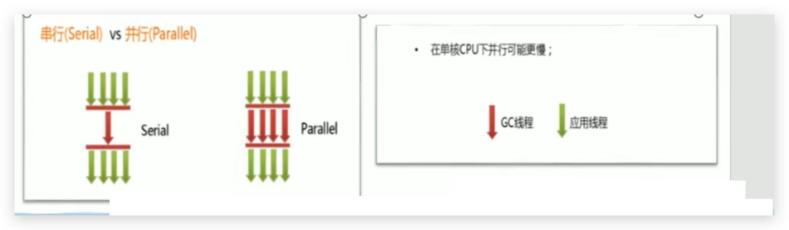
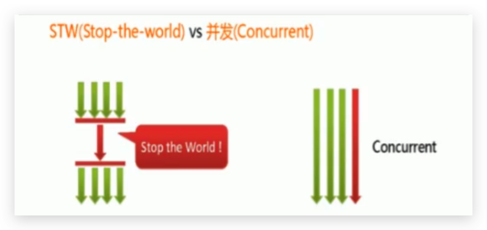

# 垃圾回收-相关概念的概述-并行与并发

## 程序的并发与并行

### 并发(Concurrent)

#### 概念

- 在操作系统中，是指**一个时间段**中有几个程序都处于已启动运行到运行完毕之间，且这几个程序都是在同一个处理器上运行

- 并发不是真正意义上的“同时进行”，只是CPU把一个时间段划分成几个时间片段（时间区间），然后在这几个时间区间之间来回切换。由于CPU处理的速度非常快，只要时间间隔处理得当，即可让用户感觉是多个应用程序同时在进行

<!--more-->

### 并行(Parallel)

#### 概念

- 当系统有一个以上CPU时，当一个CPU执行一个进程时，另一个CPU可以执行另一个进程，两个进程互不抢占CPU资源，可以同时进行，我们称之为并行（Parallel）

- 其实决定并行的因素不是CPU的数量，而是CPU的核心数量，比如一个CPU多个核也可以并行

- 适合科学计算，后台处理等弱交互场景

### 并发与并行比较

- 并发，**指的是多个事情，在**`同一时间段内同时发生了`。
- 并行，**指的是多个事情，在**`同一时间点上同时发生了`。
- 并发的多个任务之间是互相抢占资源的。
- 并行的多个任务之间是不互相抢占资源的。
- 只有在多CPU或者一个CPU多核的情况中，才会发生并行。否则，看似同时发生的事情，其实都是并发执行的。

## 垃圾回收的并发与并行

### 并行与串行

在谈论垃圾收集器的上下文语境中，它们可以解释如下：

#### 并行(Parallel)

- 指**多条垃圾收集线程并行工作**，但此时用户线程仍处于等待状态。

- 如ParNew、Parallel Scavenge、Parallel Old

#### 串行（Serial）

- 相较于并行的概念，单线程执行。
- 如Serial，Serial Old
- 如果内存不够，则程序暂停，启动JVM垃圾回收器进行垃圾回收（单线程）

### 并发(Concurrent)

- 指`同一时间段内`，**用户线程与垃圾收集线程同时执行**（但不一定是并行的，可能会交替执行），垃圾回收线程在执行时不会停顿用户程序的运行。
  - 用户程序在继续运行，而垃圾收集程序线程运行于另一个CPU上；
  - 如：CMS、G1
- 只是同一时间段内并发，并不是没有STW，在某个时间点的时候也可能有STW。

