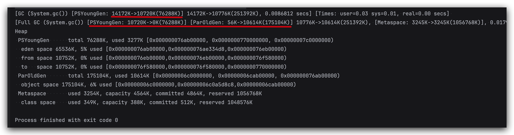
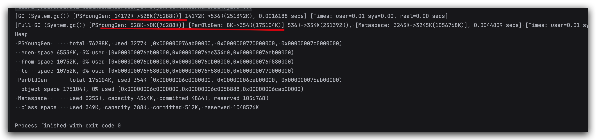
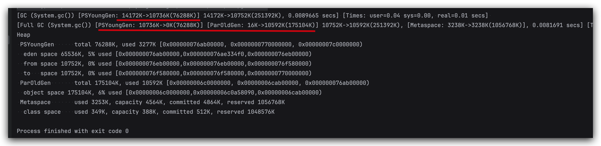
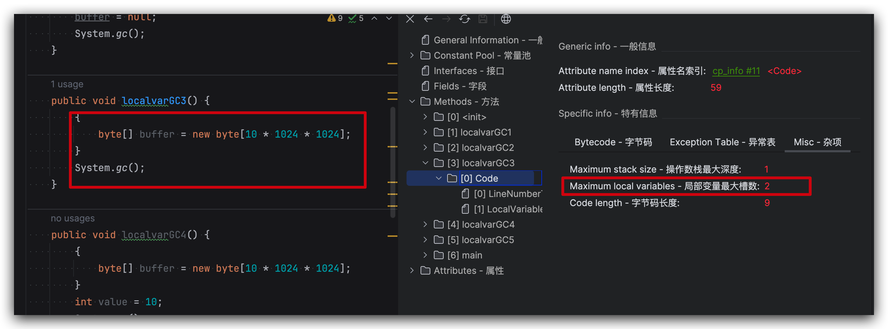
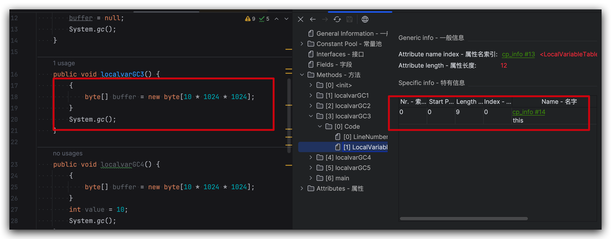
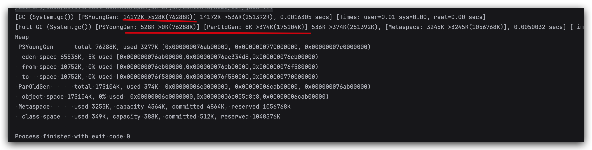
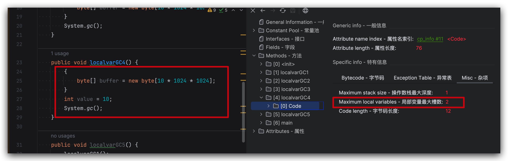
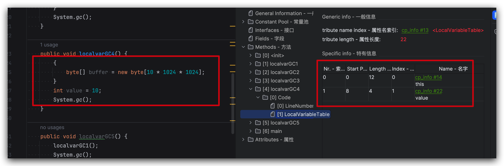
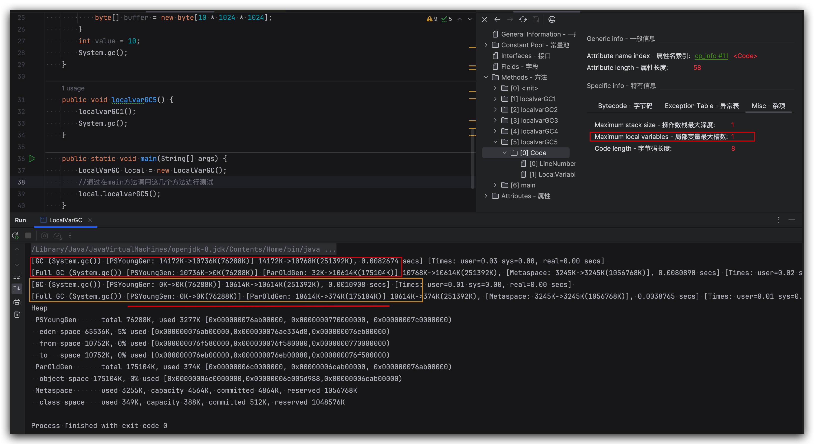

# 垃圾回收-相关概念的概述-System.gc()的理解

## 概念

- 在默认情况下，通过`System.gc()`或者`Runtime.getRuntime().gc() `的调用，`会显式触发Full GC`，同时对老年代和新生代进行回收，尝试释放被丢弃对象占用的内存。

- 然而`System.gc()`调用附带一个免责声明，无法保证对垃圾收集器的调用(不能确保立即生效)

- JVM实现者可以通过`System.gc() `调用来决定JVM的GC行为。而一般情况下，垃圾回收应该是自动进行的，**无须手动触发，否则就太过于麻烦了。**在一些特殊情况下，如我们正在编写一个性能基本测试，我们可以在运行之间调用`System.gc()。`

<!--more-->

## 示例

### 示例一

```java
public class SystemGCTest {
    public static void main(String[] args) {
        new SystemGCTest();
        System.gc();//提醒jvm的垃圾回收器执行gc,但是不确定是否马上执行gc
        //与Runtime.getRuntime().gc();的作用一样。

//        System.runFinalization();//强制调用使用引用的对象的finalize()方法
    }
    //如果发生了GC，这个finalize()一定会被调用
    @Override
    protected void finalize() throws Throwable {
        super.finalize();
        System.out.println("SystemGCTest 重写了finalize()");
    }
}
```

输出结果不确定：有时候会调用 finalize() 方法，有时候并不会调用

### 示例二

```java
//加上参数：  -XX:+PrintGCDetails
public class LocalVarGC {
    public void localvarGC1() {
        byte[] buffer = new byte[10 * 1024 * 1024];//10MB
        System.gc();
    }

    public void localvarGC2() {
        byte[] buffer = new byte[10 * 1024 * 1024];
        buffer = null;
        System.gc();
    }

    public void localvarGC3() {
        {
            byte[] buffer = new byte[10 * 1024 * 1024];
        }
        System.gc();
    }

    public void localvarGC4() {
        {
            byte[] buffer = new byte[10 * 1024 * 1024];
        }
        int value = 10;
        System.gc();
    }

    public void localvarGC5() {
        localvarGC1();
        System.gc();
    }

    public static void main(String[] args) {
        LocalVarGC local = new LocalVarGC();
        //通过在main方法调用这几个方法进行测试
        local.localvarGC1();
    }
}
```

1. **调用 localvarGC1() 方法**

   执行 System.gc() 仅仅是将年轻代的 buffer 数组对象放到了老年代，buffer对象仍然没有回收，只是放到了老年代

   

2. **调用 localvarGC2() 方法**

   由于 buffer 数组对象没有引用指向它，执行 System.gc() 将被回收

   

3. **调用 localvarGC3() 方法**

   虽然出了代码块的作用域，但是 buffer 数组对象并没有被回收

   

   原因：

   1. 看看字节码：实例方法局部变量表第一个变量肯定是 this

   

   2. 发现局部变量表的大小是 2。但是局部变量表里只有一个索引为0，实际上索引为1的位置是buffer在占用着，执行 System.gc() 时，栈中还有 buffer 变量指向堆中的字节数组，所以没有进行GC

   

4. **调用 localvarGC4() 方法**

   出了代码块的作用域， buffer 数组对象被回收了

   

   **原因**：

   1. 出了代码块时，buffer 就出了其作用域范围，此时没有为 value 开启新的槽，value 变量直接占据了 buffer 变量的槽（Slot），导致堆中的字节数组没有引用再指向它，执行 System.gc() 时被回收。

   2. value 位于局部变量表中索引为 1 的位置。value这个局部变量把原本属于buffer的slot给占用了，这样栈上就没有buffer变量指向`new byte[10 * 1024 * 1024]`实例了。

      

      

5. **调用 localvarGC5() 方法**

   局部变量出了方法范围就是失效了，堆中的字节数组一定被回收了，通过局部变量表槽数也能看出来，就1个this了。

   
