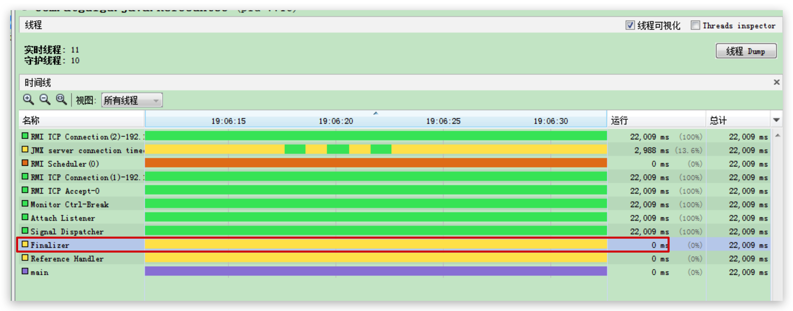

# 垃圾回收-对象的finalization机制

## 概述

1. Java语言提供了对象终止（`finalization`）机制来允许开发人员提供**对象被销毁之前的自定义处理逻辑**。
2. 当垃圾回收器发现没有引用指向一个对象，即：垃圾回收此对象之前，总会先调用这个对象的`finalize()`方法。
3. `finalize() `方法允许在子类中被重写，**用于在对象被回收时进行资源释放**。通常在这个方法中进行一些资源释放和清理的工作，比如关闭文件、套接字和数据库连接等。

<!--more-->

## 注意点

1. 永远不要主动调用某个对象的finalize()方法，应该交给垃圾回收机制调用。理由包括下面三点：
   - 在finalize()时可能会导致对象复活。
   - finalize()方法的执行时间是没有保障的，它完全由GC线程决定，极端情况下，若不发生GC，则finalize()方法将没有执行机会。
   - 一个糟糕的finalize()会严重影响GC的性能。比如finalize是个死循环
2. 从功能上来说，finalize()方法与C++中的析构函数比较相似，但是Java采用的是基于垃圾回收器的自动内存管理机制，所以finalize()方法在**本质上不同于C++中的析构函数**。
3. 由于finalize()方法的存在，**虚拟机中的对象一般处于三种可能的状态。**

## 导致产生的对象三种状态

如果从所有的根节点都无法访问到某个对象，说明对象己经不再使用了。一般来说，此对象需要被回收。但事实上，也并非是“非死不可”的，这时候它们暂时处于“缓刑”阶段。**一个无法触及的对象有可能在某一个条件下“复活”自己**，如果这样，那么对它立即进行回收就是不合理的。为此，定义虚拟机中的对象可能的三种状态。如下：

1. `可触及的`：从根节点开始，可以到达这个对象。
2. `可复活的`：对象的所有引用都被释放，但是对象有可能在finalize()中复活。
3. `不可触及的`：对象的finalize()被调用，并且没有复活，那么就会进入不可触及状态。不可触及的对象不可能被复活，**因为finalize()只会被调用一次**。

以上3种状态中，是由于finalize()方法的存在，进行的区分。**只有在对象不可触及时才可以被回收**。

## 具体过程

判定一个对象objA是否可回收，至少要经历两次标记过程：

1. 如果对象objA到GC Roots没有引用链，则`进行第一次标记`。
2. 进行筛选，判断此对象是否有必要执行finalize()方法
   1. 如果对象objA没有重写finalize()方法，或者finalize()方法已经被虚拟机调用过，则虚拟机视为“没有必要执行”，objA被判定为不可触及的。
   2. 如果对象objA重写了finalize()方法，且还未执行过，那么objA会被插入到F-Queue队列中，由一个虚拟机自动创建的、低优先级的Finalizer线程触发其finalize()方法执行。
   3. **finalize()方法是对象逃脱死亡的最后机会**，稍后GC会对F-Queue队列中的对象`进行第二次标记`。**如果objA在finalize()方法中与引用链上的任何一个对象建立了联系**，那么在第二次标记时，objA会被移出“即将回收”集合。之后，该对象如果再次出现没有引用存在的情况，在这个情况下，finalize()方法不会被再次调用，对象会直接变成不可触及的状态，也就是说，一个对象的finalize()方法只会被调用一次。

**通过 JVisual VM 查看 Finalizer 线程**



## 代码演示 finalize() 方法可复活对象

重写 CanReliveObj 类的 finalize()方法，在调用其 finalize()方法时，将 obj 指向当前类对象 this

```java
/**
 * 测试Object类中finalize()方法，即对象的finalization机制。
 *
 */
public class CanReliveObj {
    public static CanReliveObj obj;//类变量，属于 GC Root


    //此方法只能被调用一次
    @Override
    protected void finalize() throws Throwable {
        super.finalize();
        System.out.println("调用当前类重写的finalize()方法");
        obj = this;//当前待回收的对象在finalize()方法中与引用链上的一个对象obj建立了联系
    }


    public static void main(String[] args) {
        try {
            obj = new CanReliveObj();
            // 对象第一次成功拯救自己
            obj = null;
            System.gc();//调用垃圾回收器
            System.out.println("第1次 gc");
            // 因为Finalizer线程优先级很低，暂停2秒，以等待它
            Thread.sleep(2000);
            if (obj == null) {
                System.out.println("obj is dead");
            } else {
                System.out.println("obj is still alive");
            }
            System.out.println("第2次 gc");
            // 下面这段代码与上面的完全相同，但是这次自救却失败了
            obj = null;
            System.gc();
            // 因为Finalizer线程优先级很低，暂停2秒，以等待它
            Thread.sleep(2000);
            if (obj == null) {
                System.out.println("obj is dead");
            } else {
                System.out.println("obj is still alive");
            }
        } catch (InterruptedException e) {
            e.printStackTrace();
        }
    }
}
```

**如果注释掉finalize()方法**

```java
//此方法只能被调用一次
@Override
protected void finalize() throws Throwable {
  super.finalize();
  System.out.println("调用当前类重写的finalize()方法");
  obj = this;//当前待回收的对象在finalize()方法中与引用链上的一个对象obj建立了联系
}
```

输出结果：

```java
第1次 gc
obj is dead
第2次 gc
obj is dead
```

**放开finalize()方法**

输出结果：

```java
第1次 gc
调用当前类重写的finalize()方法
obj is still alive
第2次 gc
obj is dead
```

第一次自救成功，但由于 finalize() 方法只会执行一次，所以第二次自救失败。
