# 垃圾回收-MAT与JProfiler的GC Roots溯源

## MAT 介绍

1. MAT是Memory Analyzer的简称，它是一款功能强大的Java堆内存分析器。用于查找内存泄漏以及查看内存消耗情况。
2. MAT是基于Eclipse开发的，是一款免费的性能分析工具。
3. 可以在http://www.eclipse.org/mat  下载并使用MAT

为了实时分析GC Roots是哪些东西，中间需要用到一个dump的文件

<!--more-->

## 获取 dump 文件方式

代码：

```java GCRootsTest.java
public class GCRootsTest {
    public static void main(String[] args) {
        List<Object> numList = new ArrayList<>();
        Date birth = new Date();

        for (int i = 0; i < 100; i++) {
            numList.add(String.valueOf(i));
            try {
                Thread.sleep(10);
            } catch (InterruptedException e) {
                e.printStackTrace();
            }
        }

        System.out.println("数据添加完毕，请操作：");
        new Scanner(System.in).next();
        numList = null;
        birth = null;

        System.out.println("numList、birth已置空，请操作：");
        new Scanner(System.in).next();

        System.out.println("结束");
    }
}
```

- numList 和 birth 在第一次捕捉内存快照的时候，为 GC Roots
- 之后 numList 和 birth 置为 null ，对应的引用对象被回收，在第二次捕捉内存快照的时候，就不再是 GC Roots

### 方式一：命令行使用 jmap

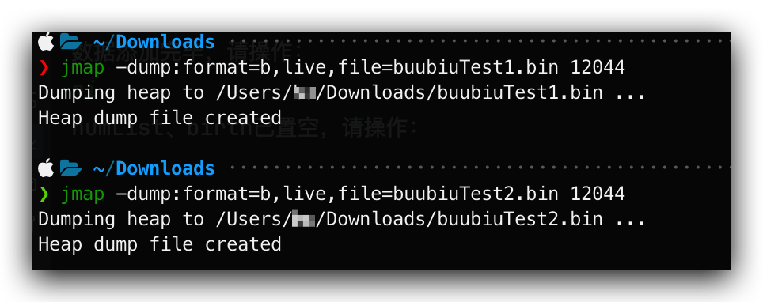

### 方式二：使用JVisualVM

捕获的heap dump文件是一个临时文件，关闭JVisualVM后自动删除，若要保留，需要将其另存为文件。

1. 先执行第一步，然后停下来，去生成此步骤dump文件

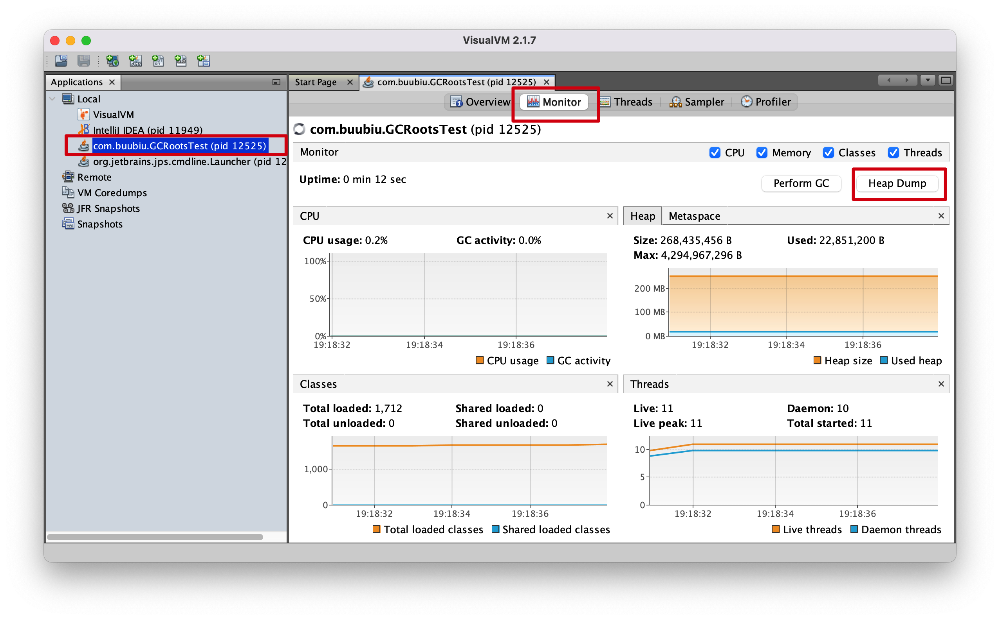

2. 输入命令，继续执行程序

3. 我们接着捕获第二张堆内存快照

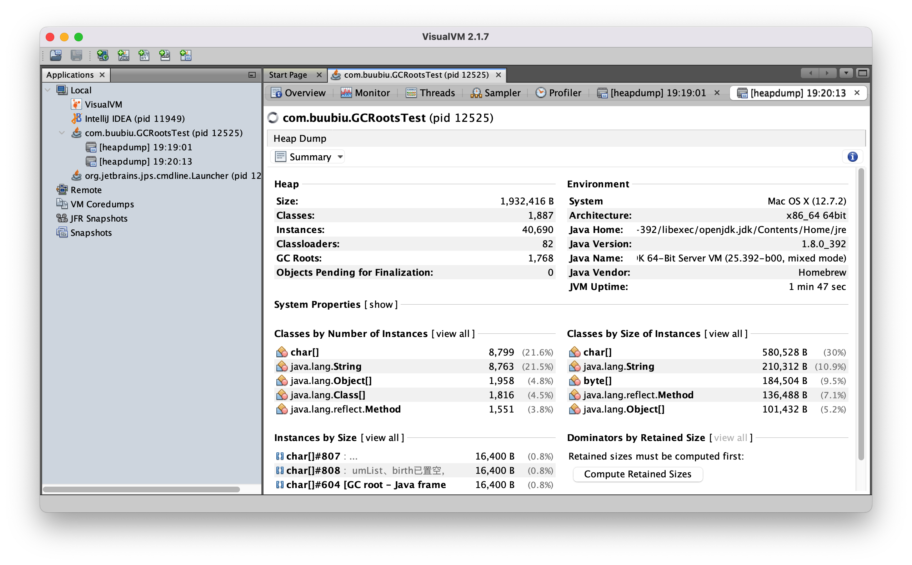

4. 右键 --> 另存为即可

   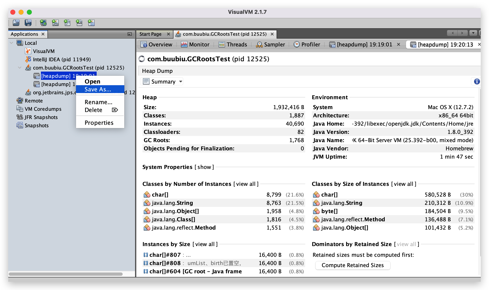

## 使用 MAT 查看堆内存快照

1. 打开 MAT ，选择File --> Open File，打开刚刚的两个dump文件，**我们先打开第一个dump文件**

2. 选择Java Basics --> GC Roots

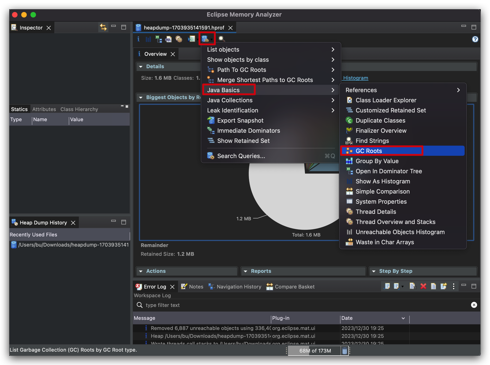

3. 第一次捕捉堆内存快照时，GC Roots 中包含代码定义的两个局部变量，类型分别为 ArrayList 和 Date，Total:21

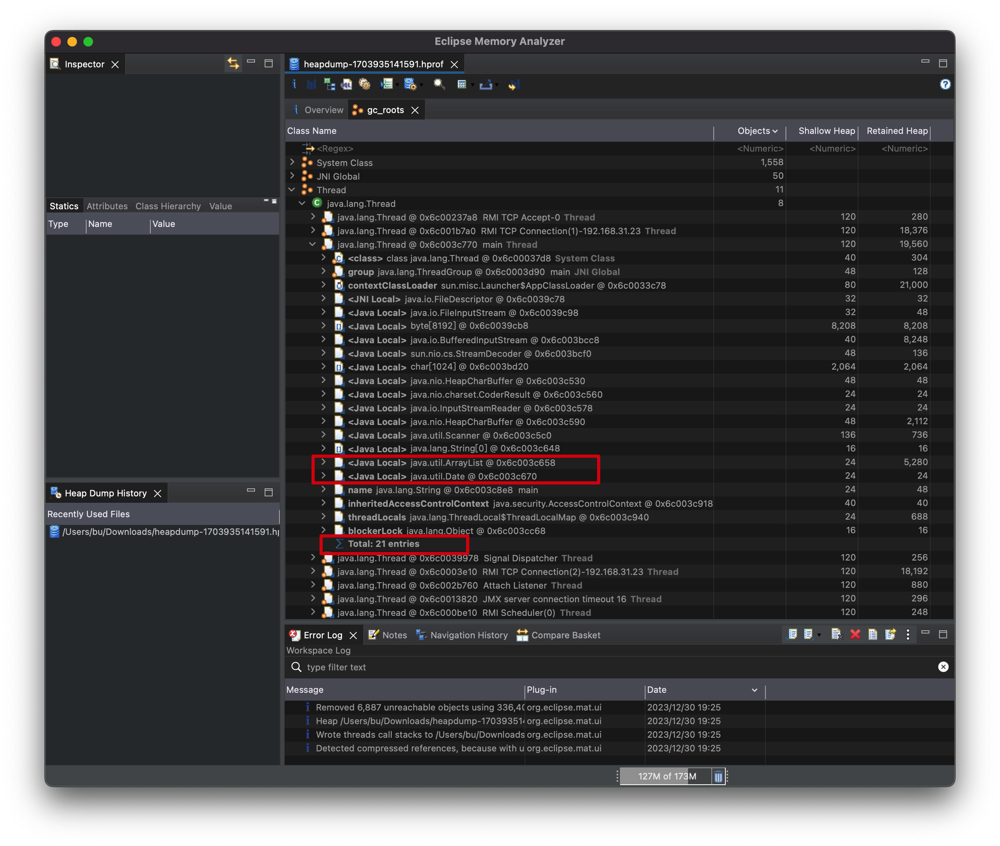

4. 打开第二个dump文件，第二次捕获内存快照时，由于两个局部变量引用的对象被释放，所以这两个局部变量不再作为 GC Roots ，从 Total Entries = 19 也可以看出（少了两个 GC Roots）

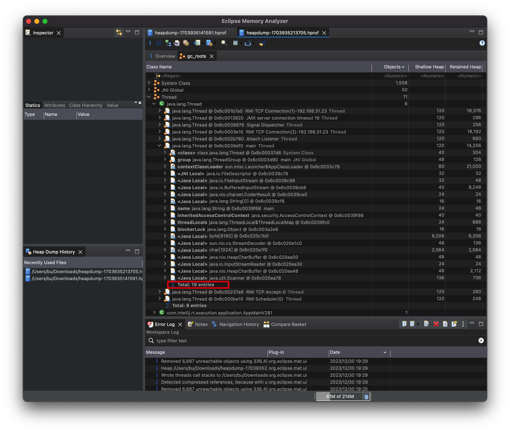

## JProfiler GC Roots 溯源

在实际开发中，很少会查看所有的GC Roots。一般都是查看某一个或几个对象的GC Root是哪个，这个过程叫**GC Roots 溯源**

下面使用 JProfiler 进行 GC Roots 溯源演示

代码:

```java
public class GCRootsTest {
    public static void main(String[] args) {
        List<Object> numList = new ArrayList<>();
        Date birth = new Date();

        for (int i = 0; i < 100; i++) {
            numList.add(String.valueOf(i));
            try {
                Thread.sleep(10);
            } catch (InterruptedException e) {
                e.printStackTrace();
            }
        }

        System.out.println("数据添加完毕，请操作：");
        new Scanner(System.in).next();
        numList = null;
        birth = null;

        System.out.println("numList、birth已置空，请操作：");
        new Scanner(System.in).next();

        System.out.println("结束");
    }
}
```

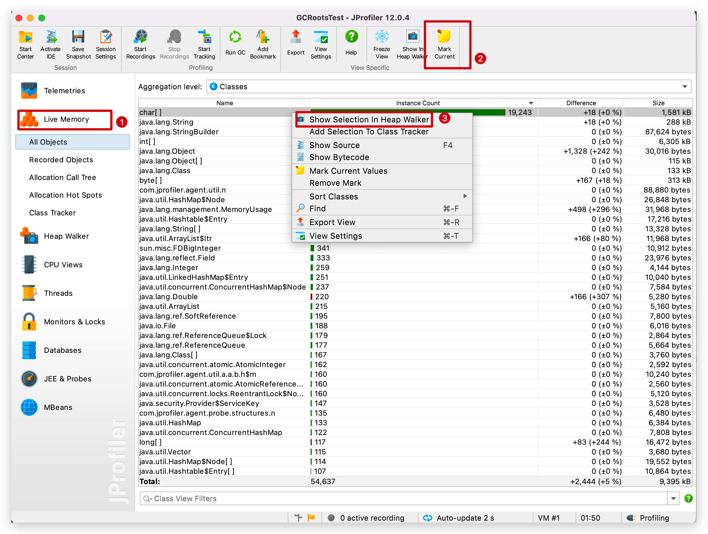

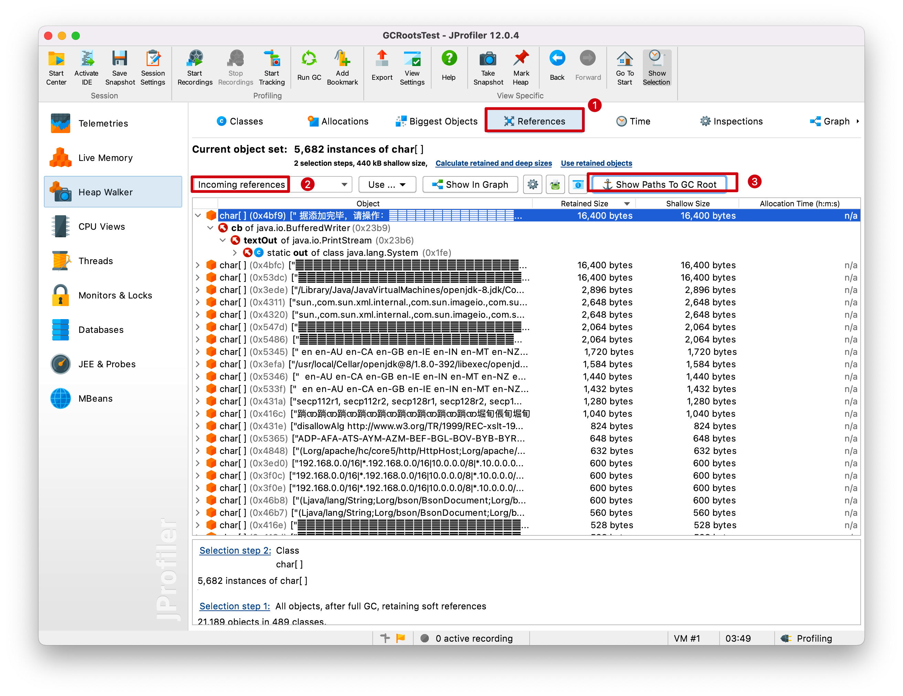

## JProfiler 分析 OOM

代码：

```java
package com.buubiu;

import java.util.ArrayList;

/**
 * -Xms8m -Xmx8m -XX:+HeapDumpOnOutOfMemoryError  
 * HeapDumpOnOutOfMemoryError：这个参数的意思是当程序出现OOM的时候就会在当前工程目录生成一个dump文件 *.hprof
 */
public class HeapOOM {
    byte[] buffer = new byte[1 * 1024 * 1024];//1MB

    public static void main(String[] args) {
        ArrayList<HeapOOM> list = new ArrayList<>();

        int count = 0;
        try{
            while(true){
                list.add(new HeapOOM());
                count++;
            }
        }catch (Throwable e){
            System.out.println("count = " + count);
            e.printStackTrace();
        }
    }
}
```

输出结果：

```java
java.lang.OutOfMemoryError: Java heap space
Dumping heap to java_pid31770.hprof ...
Heap dump file created [7332138 bytes in 0.017 secs]
count = 6
java.lang.OutOfMemoryError: Java heap space
	at com.buubiu.HeapOOM.<init>(HeapOOM.java:10)
	at com.buubiu.HeapOOM.main(HeapOOM.java:18)

Process finished with exit code 0
```

用JProfiler打开这个dump文件

1. 可以找到这个超大对象

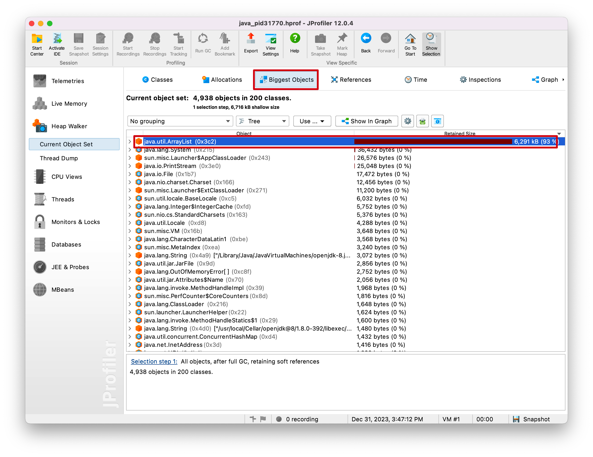

2. 可以发现是main() 线程中出问题，并且是18行

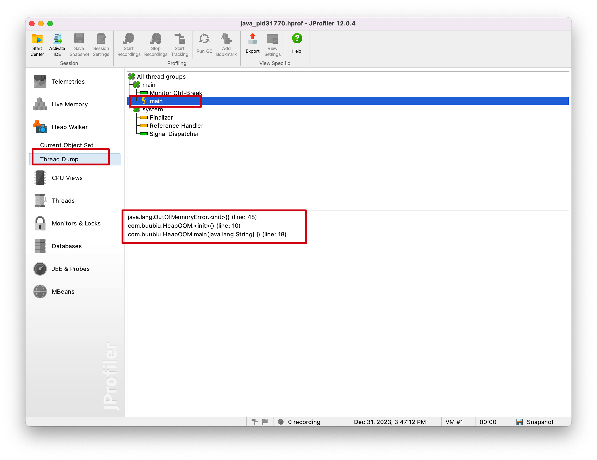
