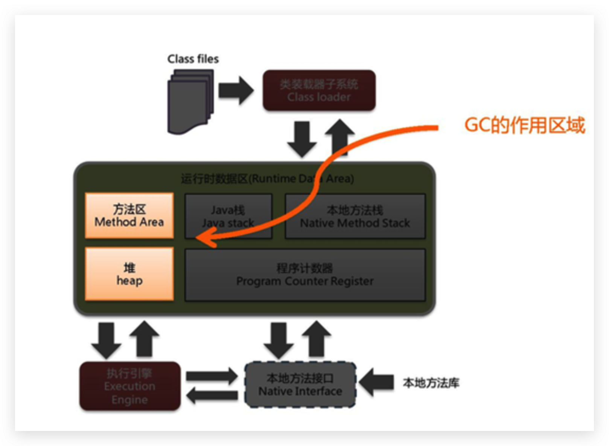

# 垃圾回收-概述

## 什么是垃圾

1. 垃圾是指**在运行程序中没有任何指针指向的对象**，这个对象就是需要被回收的垃圾。
2. 外文：An object is considered garbage when it can no longer be reached from any pointer in the running program.
3. 如果不及时对内存中的垃圾进行清理，那么，这些垃圾对象所占的内存空间会一直保留到应用程序结束，被保留的空间无法被其他对象使用，甚至可能导致内存溢出。

<!--more-->

## 为什么需要GC

1. 对于高级语言来说，一个基本认知是如果不进行垃圾回收，**内存迟早都会被消耗完**，因为不断地分配内存空间而不进行回收，就好像不停地生产生活垃圾而从来不打扫一样。
2. 除了释放没用的对象，垃圾回收也可以清除内存里的记录碎片。碎片整理将所占用的堆内存移到堆的一端，**以便JVM将整理出的内存分配给新的对象**。
3. 随着应用程序所应付的业务越来越庞大、复杂，用户越来越多，**没有GC就不能保证应用程序的正常进行**。而经常造成STW的GC又跟不上实际的需求，所以才会不断地尝试对GC进行优化。

## 早期垃圾回收

1. 在早期的C/C++时代，垃圾回收基本上是手工进行的。开发人员可以使用new关键字进行内存申请，并使用delete关键字进行内存释放。比如以下代码：

```c++
  MibBridge *pBridge= new cmBaseGroupBridge()；
  //如果注册失败，使用Delete释放该对象所占内存区域
  if(pBridge->Register(kDestroy)！=NO ERROR)
  	delete pBridge；
```

2. 这种方式可以灵活控制内存释放的时间，但是会给开发人员带来**频繁申请和释放内存的管理负担**。倘若有一处内存区间由于程序员编码的问题忘记被回收，那么就会产生**内存泄漏**，垃圾对象永远无法被清除，随着系统运行时间的不断增长，垃圾对象所耗内存可能持续上升，直到出现内存溢出并造成**应用程序崩溃**。
3. 有了垃圾回收机制后，上述代码极有可能变成这样

```java
  MibBridge *pBridge=new cmBaseGroupBridge(); 
  pBridge->Register(kDestroy);
```

4. 现在，除了Java以外，C#、Python、Ruby等语言都使用了自动垃圾回收的思想，也是未来发展趋势，可以说这种自动化的内存分配和垃圾回收方式已经成为了现代开发语言必备的标准。

## Java垃圾回收机制

采用 **自动内存管理**

### 优点

1. 自动内存管理，无需开发人员手动参与内存的分配与回收，这样**降低内存泄漏和内存溢出的风险**

   - 没有垃圾回收器，java也会和c++一样，各种悬垂指针，野指针，泄露问题让你头疼不已。

2. 自动内存管理机制，将程序员从繁重的内存管理中释放出来，可以**更专心地专注于业务开发**

3. Oracle官网关于垃圾回收的介绍

   https://docs.oracle.com/javase/8/docs/technotes/guides/vm/gctuning/toc.html

### 缺点

1. 对于Java开发人员而言，自动内存管理就像是一个黑匣子，如果过度依赖于“自动”，那么这将会是一场灾难，最严重的就会**弱化Java开发人员在程序出现内存溢出时定位问题和解决问题的能力**。
2. 此时，了解JVM的自动内存分配和内存回收原理就显得非常重要，只有在真正了解JVM是如何管理内存后，我们才能够在遇见OutofMemoryError时，快速地根据错误异常日志定位问题和解决问题。
3. 当需要排查各种内存溢出、内存泄漏问题时，当垃圾收集成为系统达到更高并发量的瓶颈时，我们就必须对这些“自动化”的技术**实施必要的监控和调节**。

### 应该关心哪些区域的回收



1. 垃圾收集器可以对年轻代回收，也可以对老年代回收，甚至是全堆和方法区的回收，

   - 其中，`Java堆是垃圾收集器的工作重点`

2. 从次数上讲：

   - `频繁收集Young区`

   - `较少收集Old区`

   - `基本不收集Perm区（或元空间）`
