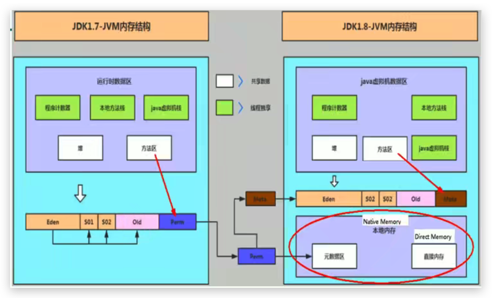
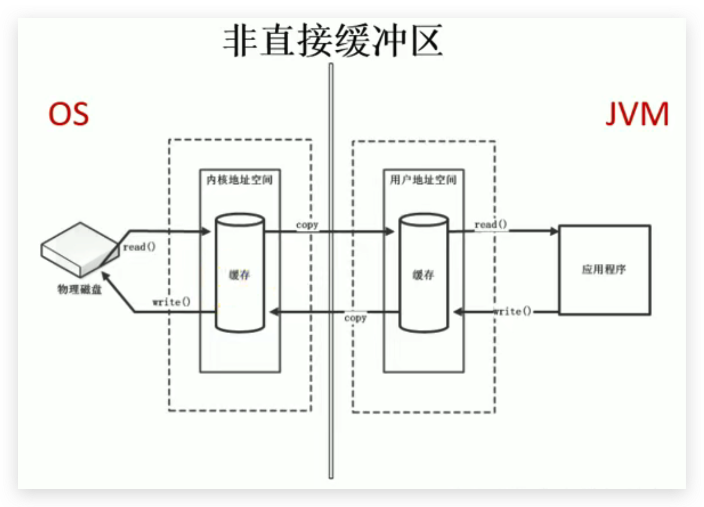
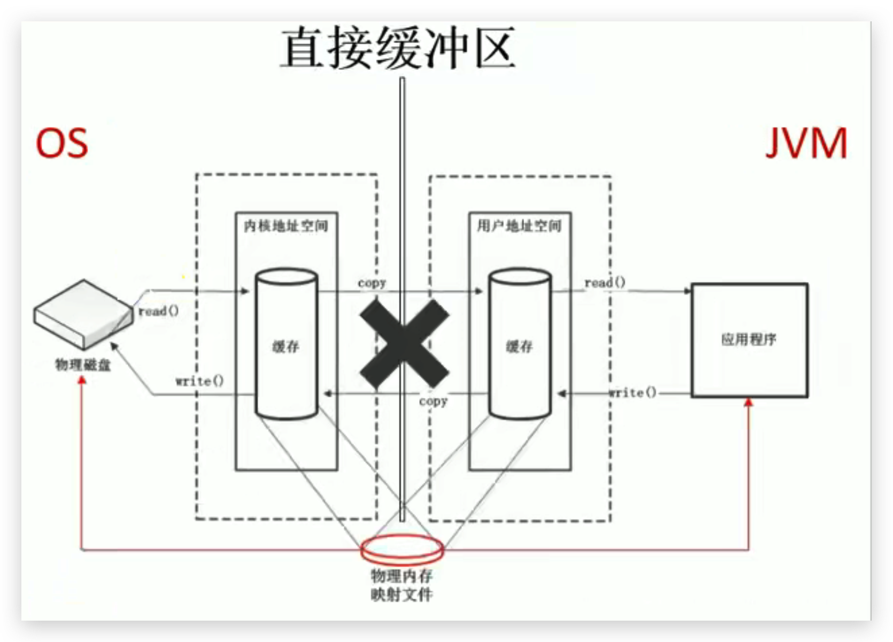

# JVM-运行时数据区-直接内存(JDK8及以上)

##     概述

- 不是虚拟机运行时数据区的一部分，也不是《Java虚拟机规范》中定义的内存区域。

- 直接内存是在Java堆外的、直接向系统申请的内存区间。

- 来源于NIO(New IO / Non-Blocking IO)，通过存在堆中的DirectByteBuffer操作Native内存

- 通常，访问直接内存的速度会优于Java堆。即读写性能高。

  - 因此出于性能考虑，读写频繁的场合可能会考虑使用直接内存。

  - Java的NIO库允许Java程序使用直接内存，用于数据缓冲区

<!--more-->

简单理解：

**java process memory = java heap + native memory**

**java进程中所占用的内存空间 = 堆空间 + 本地内存**

## 非直接缓存区（IO）

读写文件，需要与磁盘交互，需要由用户态切换到内核态。在内核态和用户态时，都需要内存，并且是使用IO(Stream流，通常由byte[]或者char[]组成)的方式。这里需要两份内存存储重复数据，效率低。

## 直接缓冲区（NIO）

使用NIO时，操作系统划出的直接缓存区可以被java代码直接访问，只有一份。NIO适合对大文件的读写操作。

## 问题

### OOM

- 直接内存也可能导致OutofMemoryError异常。`java.lang.OutOfMemoryError: Direct buffer memory`

  由于直接内存在Java堆外，因此它的大小不会直接受限于-Xmx指定的最大堆大小，但是系统内存是有限的，Java堆和直接内存的总和依然受限于操作系统能给出的最大内存。

- 直接内存大小可以通过`-XX:MaxDirectMemorySize=10m`设置

- 如果不指定，默认与堆的最大值-Xmx参数值一致

### 垃圾回收

- 分配回收成本较高
- 不受JVM内存回收管理
