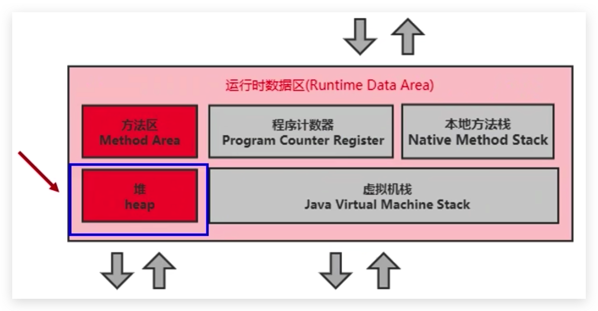
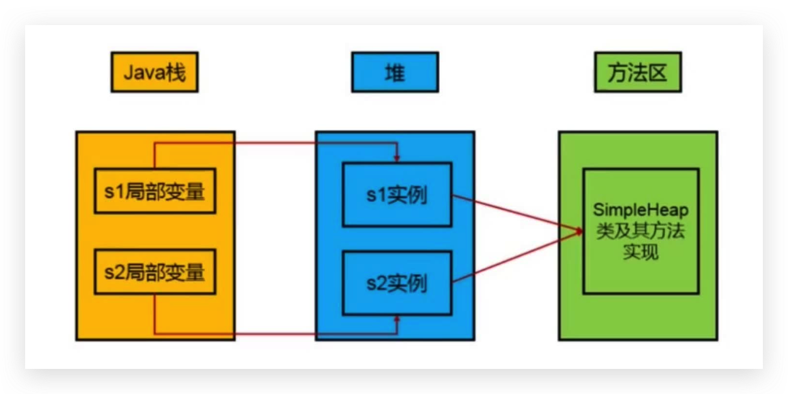
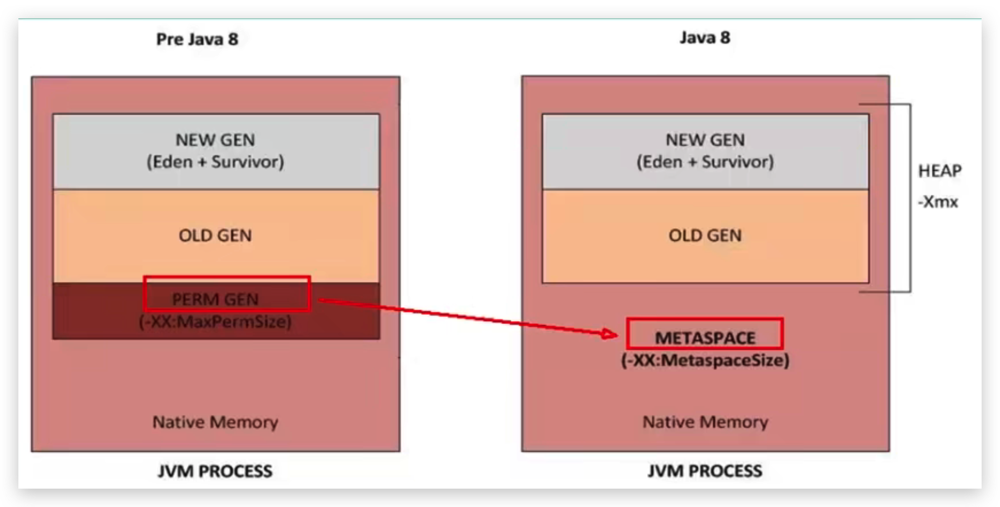
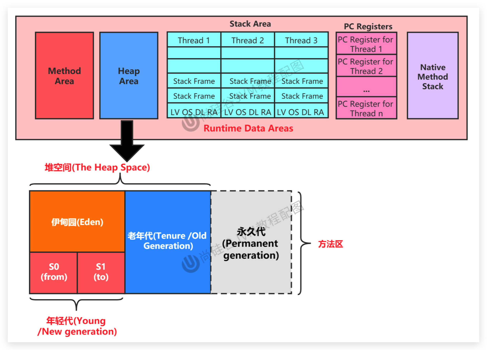
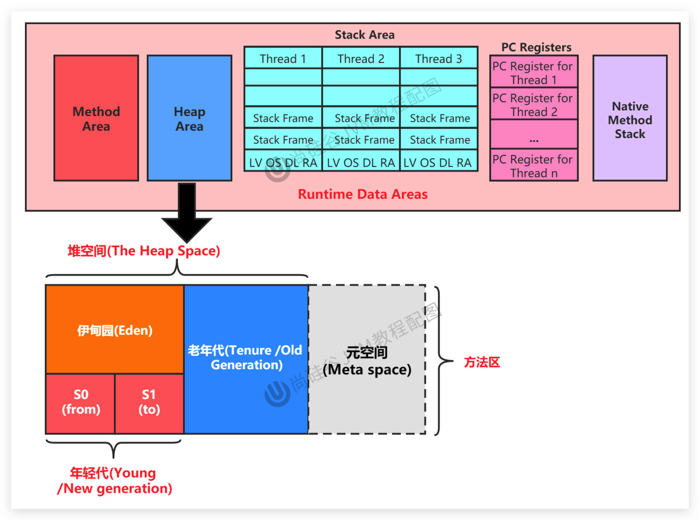

# JVM-运行时数据区-堆(Heap)-堆的核心概念

## 介绍

- 一个 JVM 实例只存在一个堆内存，堆也是 Java 内存管理的核心区域。
- Java 堆区在 JVM 启动的时候即被创建，其空间大小也就确定了。是 JVM 管理的最大一块内存空间。
  - 堆内存的大小是可以调节的。
- 《Java虚拟机规范》规定，堆可以处于物理上不连续的内存空间中，但在逻辑上它应该被视为连续的。
- 所有的线程共享Java堆，在这里还可以划分线程私有的缓冲区（Thread Local Allocation Buffer，TLAB）。

<!--more-->

- 《Java虚拟机规范》中对Java堆的描述是：**所有的对象实例以及数组都应当在运行时分配在堆上**。（The heap is the run-time data area from which memory for all class instances and arrays is allocated）
  - 从实际使用角度看：“几乎”所有的对象实例都在堆分配内存，但并非全部。因为还有一些对象是在栈上分配的（逃逸分析，标量替换）

- 数组和对象可能永远不会存储在栈上（不一定），因为栈帧中保存引用，这个引用指向对象或者数组在堆中的位置。

- 在方法结束后，堆中的对象不会马上被移除，仅仅在垃圾收集的时候才会被移除。

- 如果堆中对象马上被回收，那么用户线程就会收到影响，因为有stop the word
  堆，是GC（Garbage Collection，垃圾收集器）执行垃圾回收的重点区域。

## 堆内存细分

**现代垃圾收集器大部分都基于分代收集理论设计，堆空间细分为：**

- Java7 及之前堆内存逻辑上分为三部分：`新生区+养老区+永久区`

  - Young/New Generation Space 新生区 
    - 又被划分为Eden区和Survivor区
  - Old/Tenure generation space 养老区 
  - Perm/Permanent Space 永久区 

  

- Java 8及之后堆内存逻辑上分为三部分：`新生区+养老区+元空间`

  - Young/New Generation Space 新生区
    - 又被划分为Eden区和Survivor区
  - Old/Tenure generation space 养老区
  - Meta Space 元空间 Meta

  

>新生区 <–> 新生代 <–> 年轻代 、 养老区 <–> 老年区 <–> 老年代、 永久区 <–> 永久代

## 堆空间内部结构

### JDK7以及之前

### JDK8以及之后

