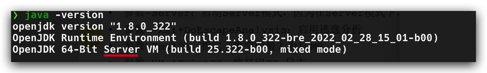
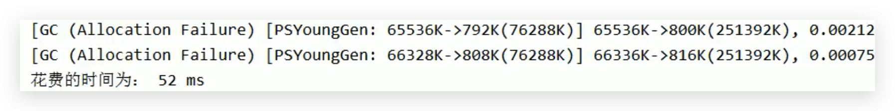
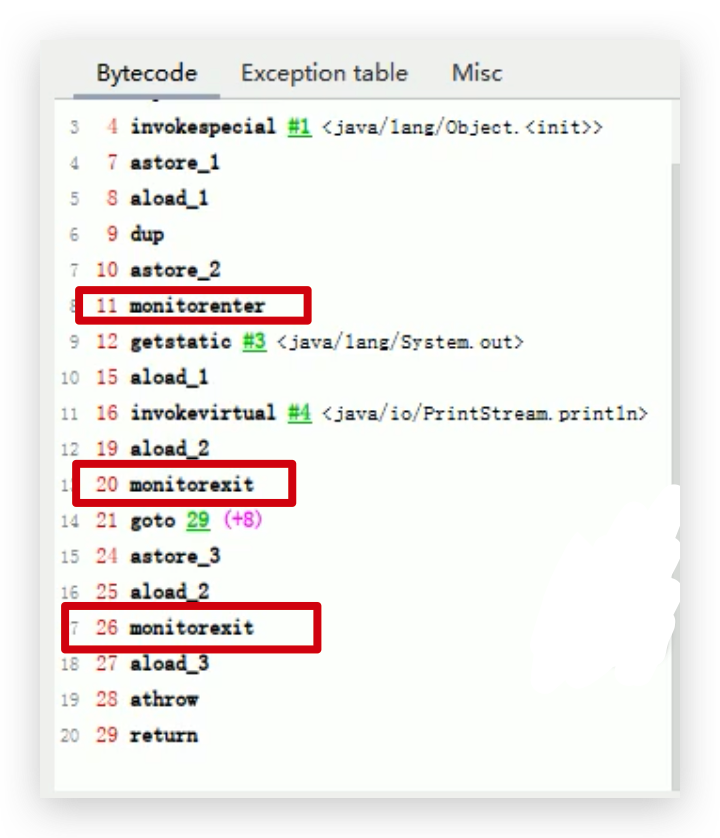
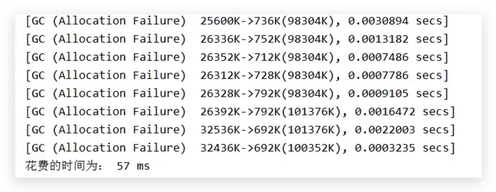

# JVM-运行时数据区-堆(Heap)-逃逸分析-代码优化

## 介绍

使用逃逸分析，编译器可以对代码做如下优化：

1. **栈上分配**：将堆分配转化为栈分配。如果一个对象在子程序中被分配，要使指向该对象的指针永远不会发生逃逸，对象可能是栈上分配的候选，而不是堆上分配
2. **同步省略**：如果一个对象被发现只有一个线程被访问到，那么对于这个对象的操作可以不考虑同步。
3. **分离对象或标量替换**：有的对象可能不需要作为一个连续的内存结构存在也可以被访问到，那么对象的部分（或全部）可以不存储在内存，而是存储在CPU寄存器中。

<!--more-->

注意：逃逸分析只能在java服务器端的模式下才会开启，不过我们本地安装的java都是server端，从java 版本命令上可以看出：



## 栈上分配

### 解释

- JIT 编译器在编译期间根据逃逸分析的结果，发现如果一个对象并没有逃逸出方法的话，就可能被优化成栈上分配。分配完成后，继续在调用栈内执行，最后线程结束，栈空间被回收，局部变量对象也被回收。这样就无须进行垃圾回收了。
- **常见的栈上分配的场景**
  - 分别是给成员变量赋值、方法返回值、实例引用传递
- Oracle Hotspot 并没有启用这一功能

### 例子

代码：

```java
/**
 * 栈上分配测试
 * -Xmx256m -Xms256m -XX:-DoEscapeAnalysis -XX:+PrintGCDetails
 */
public class StackAllocation {
    public static void main(String[] args) {
        long start = System.currentTimeMillis();

        for (int i = 0; i < 10000000; i++) {
            alloc();
        }
        // 查看执行时间
        long end = System.currentTimeMillis();
        System.out.println("花费的时间为： " + (end - start) + " ms");
        // 为了方便查看堆内存中对象个数，线程sleep
        try {
            Thread.sleep(1000000);
        } catch (InterruptedException e1) {
            e1.printStackTrace();
        }
    }

    private static void alloc() {
        User user = new User();//未发生逃逸
    }

    static class User {

    }
}
```

#### 未开启逃逸分析

1. 修改JVM 参数为：`-Xmx256m -Xms256m -XX:-DoEscapeAnalysis -XX:+PrintGCDetails`

2. 执行结果：发生了GC，并且时间为 52ms

   

#### 开启逃逸分析

1. 修改JVM 参数为：`-Xmx256m -Xms256m -XX:+DoEscapeAnalysis -XX:+PrintGCDetails`

2. 执行结果：没有发生GC，并且时间为 4ms，因为user对象有大部分没有分配到堆空间中，伊甸园区根本就没有满。

   

## 同步省略（锁消除）

### 解释

- 线程同步的代价是相当高的，同步的后果是降低并发性和性能。

- 在动态编译同步块的时候，JIT编译器可以借助逃逸分析来**判断同步块所使用的锁对象是否只能够被一个线程访问而没有被发布到其他线程**。如果没有，那么JIT编译器在编译这个同步块的时候就会取消对这部分代码的同步。这样就能大大提高并发性和性能。这个**取消同步的过程就叫同步省略，也叫锁消除**。

### 例子

代码1：

```java
public void f() {
    Object hollis = new Object();
    synchronized(hollis) {
        System.out.println(hollis);
    }
}
```

代码中对hollis这个对象加锁，但是hollis对象的生命周期只在f()方法中，并不会被其他线程所访问到，所以在JIT编译阶段就会被优化掉，优化成：

代码2

```java
public void f() {
    Object hellis = new Object();
		System.out.println(hellis);
}
```

查看代码1的字节码：



注意：字节码文件中并没有进行优化，可以看到加锁和释放锁的操作依然存在，**同步省略操作是在解释运行时发生的**

## 标量替换

### 解释

- `标量（scalar）`是指一个无法再分解成更小的数据的数据。Java中的原始数据类型就是标量。

- 相对的，那些还可以分解的数据叫做`聚合量（Aggregate）`，Java中的对象就是聚合量，因为他可以分解成其他聚合量和标量。

- 在JIT阶段，如果经过逃逸分析，发现一个对象不会被外界访问的话，那么经过JIT优化，就会把这个对象拆解成若干个其中包含的若干个成员变量来代替。这个过程就是**标量替换。**

### 作用

- 可以大大减少堆内存的占用。因为一旦不需要创建对象了，那么就不再需要分配堆内存了。
- 标量替换为栈上分配提供了很好的基础。

### 参数设置

`-XX:+ElimilnateAllocations`：开启了标量替换（默认打开），允许将对象打散分配在栈上。

### 例子

代码：

```java
/**
 * 标量替换测试
 */
public class ScalarReplace {
    public static class User {
        public int id;
        public String name;
    }

    public static void alloc() {
        User u = new User();//未发生逃逸
        u.id = 5;
        u.name = "buubiu";
    }

    public static void main(String[] args) {
        long start = System.currentTimeMillis();
        for (int i = 0; i < 10000000; i++) {
            alloc();
        }
        long end = System.currentTimeMillis();
        System.out.println("花费的时间为： " + (end - start) + " ms");
    }
}
```

#### 未开启标量替换

1. 设置 JVM 参数：`-Xmx100m -Xms100m -XX:+DoEscapeAnalysis -XX:+PrintGC -XX:-EliminateAllocations`

2. 执行结果：

   

#### 开启标量替换

1. 设置 JVM 参数：`-Xmx100m -Xms100m -XX:+DoEscapeAnalysis -XX:+PrintGC -XX:+EliminateAllocations`

2. 执行结果：时间缩短，并且没有发生GC

   

## 逃逸分析并不是很成熟

1. 关于逃逸分析的论文在1999年就已经发表了，但直到JDK1.6才有实现，而且这项技术到如今也并不是十分成熟的。
2. 其根本原因就是**无法保证逃逸分析的性能消耗一定能高于他的消耗。虽然经过逃逸分析可以做标量替换、栈上分配、和锁消除。但是逃逸分析自身也是需要进行一系列复杂的分析的，这其实也是一个相对耗时的过程。**
3. 一个极端的例子，就是经过逃逸分析之后，发现没有一个对象是不逃逸的。那这个逃逸分析的过程就白白浪费掉了。
4. 虽然这项技术并不十分成熟，但是它也**是即时编译器优化技术中一个十分重要的手段**。
5. 注意到有一些观点，认为通过逃逸分析，JVM会在栈上分配那些不会逃逸的对象，这在理论上是可行的，但是取决于JVM设计者的选择。据我所知，**Oracle Hotspot JVM中并未这么做**（刚刚演示的效果，是因为HotSpot实现了标量替换），这一点在逃逸分析相关的文档里已经说明，**所以可以明确在HotSpot虚拟机上，所有的对象实例都是创建在堆上**。
6. 目前很多书籍还是基于JDK7以前的版本，JDK已经发生了很大变化，intern字符串的缓存和静态变量曾经都被分配在永久代上，而永久代已经被元数据区取代。但是**intern字符串缓存和静态变量并不是被转移到元数据区，而是直接在堆上分配**，**所以这一点同样符合前面一点的结论：对象实例都是分配在堆上**。
