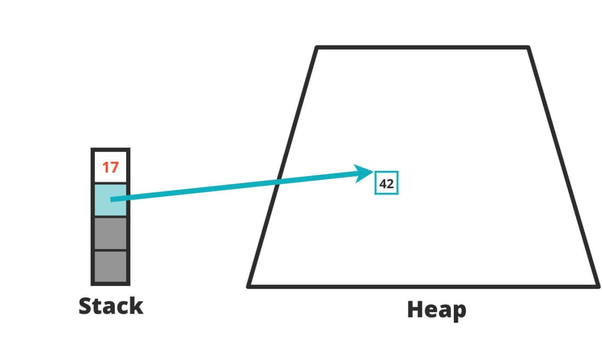

# JVM-运行时数据区-堆(Heap)-逃逸分析(Escape Analysis)

## 背景



**堆是分配对象的唯一选择么？**

- 在《深入理解Java虚拟机》中关于Java堆内存有这样一段描述：
  - 随着JIT(及时编译器)编译期的发展与**逃逸分析技术**逐渐成熟，栈上分配、标量替换优化技术将会导致一些微妙的变化，所有的对象都分配到堆上也渐渐变得不那么“绝对”了。
  - 在Java虚拟机中，对象是在Java堆中分配内存的，这是一个普遍的常识。但是，有一种特殊情况，那就是**如果经过逃逸分析（Escape Analysis）后发现，一个对象并没有逃逸出方法的话，那么就可能被优化成栈上分配。**这样就无需在堆上分配内存，也无须进行垃圾回收了。这也是最常见的堆外存储技术。

- 此外，基于OpenJDK深度定制的TaoBao VM，其中创新的GCIH（GC invisible heap）技术实现off-heap，将生命周期较长的Java对象从heap中移至heap外，并且GC不能管理GCIH内部的Java对象，以此达到降低GC的回收频率和提升GC的回收效率的目的。

<!--more-->

## 概述

- 如何将堆上的对象分配到栈，需要使用逃逸分析手段。
- 这是一种可以有效减少Java程序中同步负载和内存堆分配压力的跨函数全局数据流分析算法。
- 通过逃逸分析，Java Hotspot编译器能够分析出一个新的对象的引用的使用范围从而决定是否要将这个对象分配到堆上。

## 原理

逃逸分析的基本行为就是**分析对象动态作用域**：

- 当一个对象在方法中被定义后，对象只在方法内部使用，则认为没有发生逃逸。
- 当一个对象在方法中被定义后，它被外部方法所引用，则认为发生逃逸。例如作为调用参数传递到其他地方中。

## 逃逸分析举例

1. 没有发生逃逸的对象，则可以分配到栈（无线程安全问题）上，随着方法执行的结束，栈空间就被移除（也就无需GC）

   ```java
   public void my_method() {
       V v = new V();
       // use v
       // ....
       v = null;
   }
   ```

2. 下面代码中的 StringBuffer sb 发生了逃逸，不能在栈上分配

   ```java
   public static StringBuffer createStringBuffer(String s1, String s2) {
       StringBuffer sb = new StringBuffer();
       sb.append(s1);
       sb.append(s2);
       return sb;
   }
   ```

3. 如果想要StringBuffer sb不发生逃逸，可以这样写

   ```java
   public static String createStringBuffer(String s1, String s2) {
       StringBuffer sb = new StringBuffer();
       sb.append(s1);
       sb.append(s2);
       return sb.toString();
   }
   ```

4. 总结：**如何快速的判断是否发生了逃逸分析，就看new的对象实体是否有可能在方法外被调用。**

   ```java
   
   /**
    * 逃逸分析
    */
   public class EscapeAnalysis {
   
       public EscapeAnalysis obj;
   
       /*
       方法返回EscapeAnalysis对象，发生逃逸
        */
       public EscapeAnalysis getInstance(){
           return obj == null? new EscapeAnalysis() : obj;
       }
       /*
       为成员属性赋值，发生逃逸
        */
       public void setObj(){
           this.obj = new EscapeAnalysis();
       }
       //思考：如果当前的obj引用声明为static的？仍然会发生逃逸。
   
       /*
       对象的作用域仅在当前方法中有效，没有发生逃逸
        */
       public void useEscapeAnalysis(){
           EscapeAnalysis e = new EscapeAnalysis();
       }
       /*
       引用成员变量的值，发生逃逸
        */
       public void useEscapeAnalysis1(){
           EscapeAnalysis e = getInstance();
           //getInstance().xxx()同样会发生逃逸
       }
   }
   
   ```

5. `所以综上所述：开发中能使用局部变量的，就不要使用在方法外定义。`

## 逃逸分析参数设置

1. 在JDK 6u23（JDK 1.7） 版本之后，HotSpot中默认就已经开启了逃逸分析
2. 如果使用的是较早的版本，开发人员则可以通过：
   - 选项`-XX:+DoEscapeAnalysis`显式开启逃逸分析
   - 通过选项`-XX:+PrintEscapeAnalysis`查看逃逸分析的筛选结果
