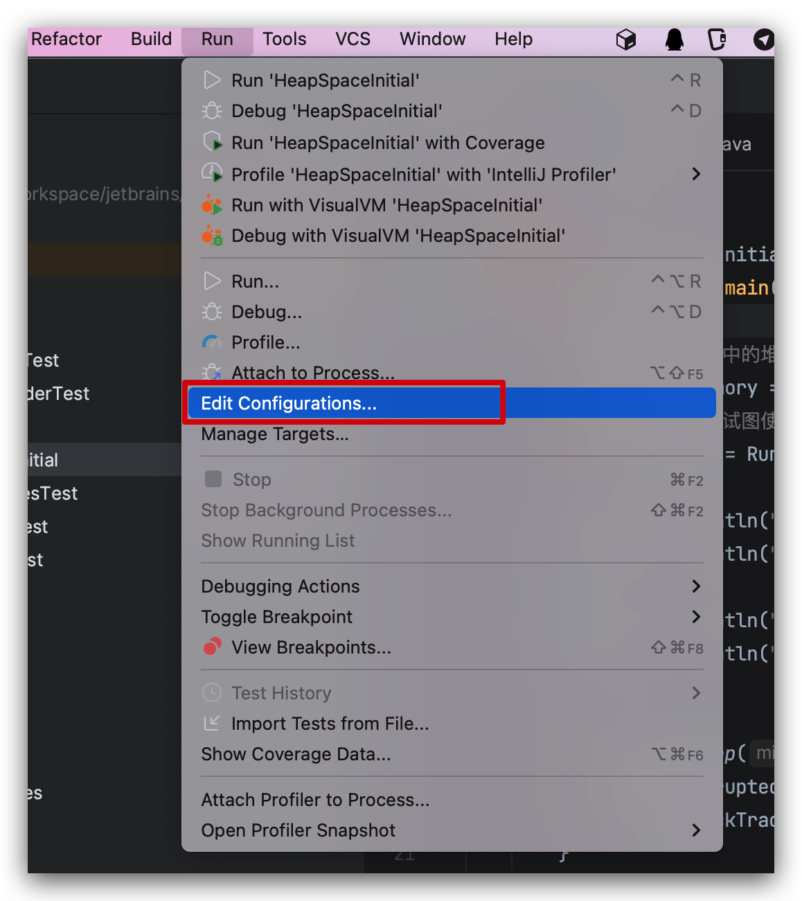
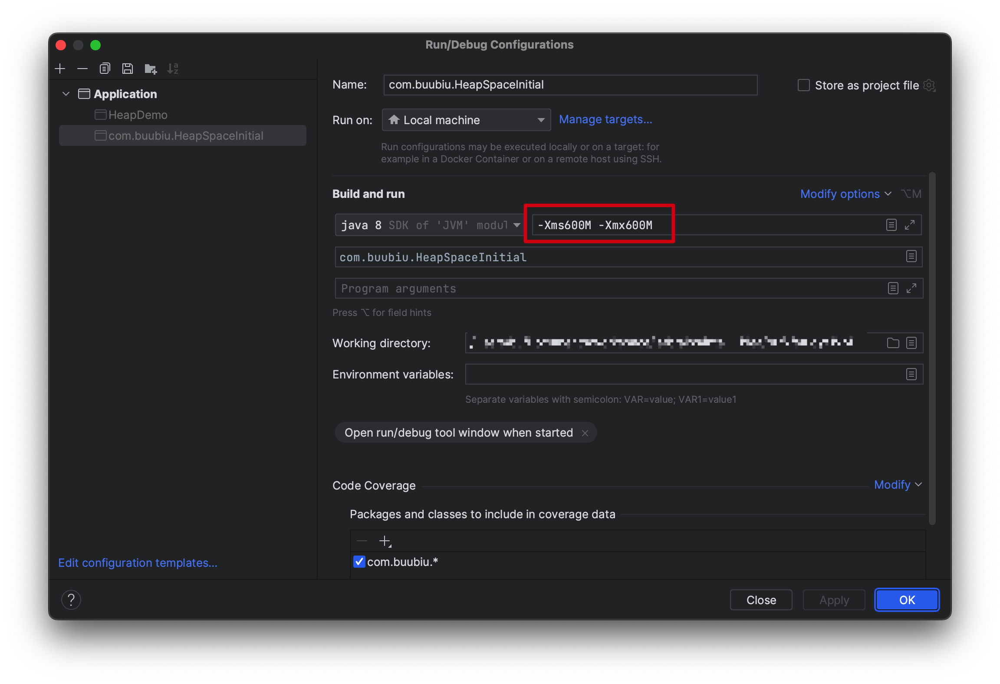
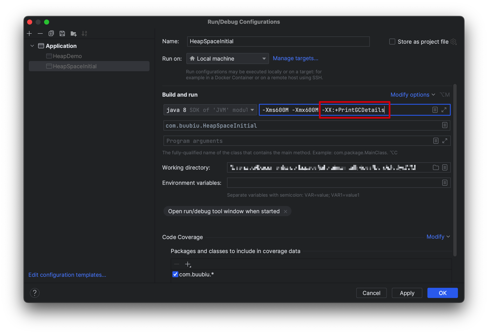
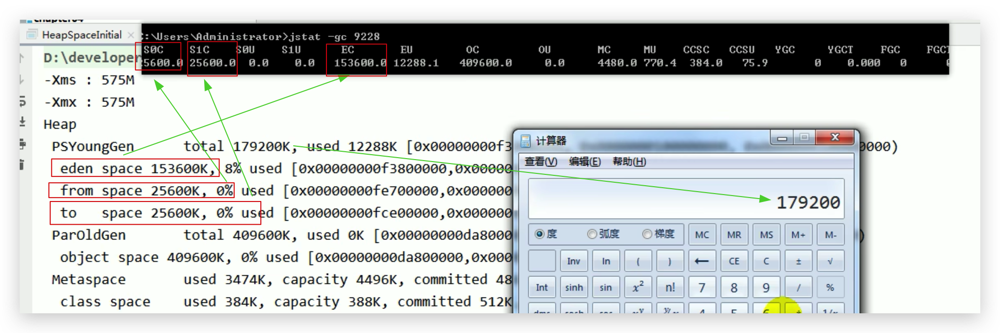
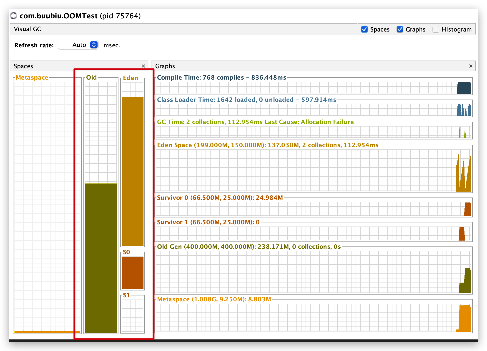
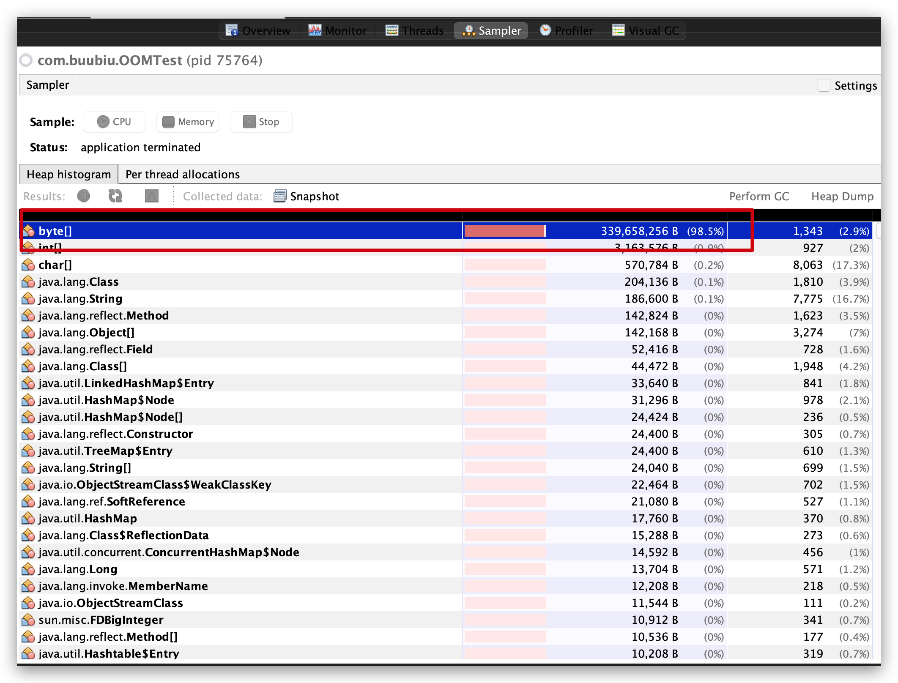

# JVM-运行时数据区-堆(Heap)-设置堆内存大小和OOM

## 设置堆内存

Java 堆区用于存储Java对象实例，那么堆的大小在JVM启动时就已经设定好了，可以通过选项"`-Xms`"和"`-Xmx`"来进行设置。

- **`-Xms`**用于表示堆区的起始内存，等价于**`-XX:InitialHeapSize`**
- **`-Xmx`**则用于表示堆区的最大内存，等价于**`-XX:MaxHeapSize`**

<!--more-->

### -Xms

-Xms 用来设置堆空间（年轻代+老年代）的初始内存大小

 *      -X 是jvm的运行参数
 *      ms 是memory start

例如：-Xms1024、-Xms10K、-Xms20M、-Xms2G

### -Xmx

-Xmx 用来设置堆空间（年轻代+老年代）的最大内存大小

例如：-Xmx1024、-Xmx10K、-Xmx20M、-Xmx2G

## 使用方法

- 一旦堆区中的内存大小超过 -Xmx 所指定的最大内存时，将会抛出OutofMemoryError异常。

- 通常会将-Xms和-Xmx两个参数配置相同的值，**其目的是为了能够在Java垃圾回收机制清理完堆区后不需要重新分隔计算堆区的大小，从而提高性能**

  >假设两个不一样，初始内存小，最大内存大。在运行期间如果堆内存不够用了，会一直扩容直到最大内存。如果内存够用且多了，也会不断的缩容释放。频繁的扩容和释放造成不必要的压力，避免在GC之后调整堆内存给服务器带来压力。
  >如果两个设置一样的就少了频繁扩容和缩容的步骤。内存不够了就直接报OOM

### 默认情况

- 初始内存大小：物理电脑内存大小除以64

- 最大内存大小：物理电脑内存大小除以4

代码：

```java
public class HeapSpaceInitial {
    public static void main(String[] args) {

        //返回Java虚拟机中的堆内存总量
        long initialMemory = Runtime.getRuntime().totalMemory() / 1024 / 1024;
        //返回Java虚拟机试图使用的最大堆内存量
        long maxMemory = Runtime.getRuntime().maxMemory() / 1024 / 1024;

        System.out.println("-Xms : " + initialMemory + "M");
        System.out.println("-Xmx : " + maxMemory + "M");

        System.out.println("系统内存大小为：" + initialMemory * 64.0 / 1024 + "G");
        System.out.println("系统内存大小为：" + maxMemory * 4.0 / 1024 + "G");

        try {
            Thread.sleep(1000000);
        } catch (InterruptedException e) {
            e.printStackTrace();
        }
    }
}

==============
-Xms : 245M
-Xmx : 3641M
系统内存大小为：15.3125G
系统内存大小为：14.22265625G
```

### 手动设置

以IDEA为例：





代码：

```java
public class HeapSpaceInitial {
    public static void main(String[] args) {

        //返回Java虚拟机中的堆内存总量
        long initialMemory = Runtime.getRuntime().totalMemory() / 1024 / 1024;
        //返回Java虚拟机试图使用的最大堆内存量
        long maxMemory = Runtime.getRuntime().maxMemory() / 1024 / 1024;

        System.out.println("-Xms : " + initialMemory + "M");
        System.out.println("-Xmx : " + maxMemory + "M");

        try {
            Thread.sleep(1000000);
        } catch (InterruptedException e) {
            e.printStackTrace();
        }
    }
}

==============
-Xms : 575M
-Xmx : 575M
```

少25M的原因如下：

### 查看设置的参数

#### 通过命令行(jps / jstat)查看

1. 先查到进程id(通过 jps 命令)

   ```sh
   $ jps
   13237 HeapSpaceInitial
   13339 Jps
   ```

2. 在查看内存分配情况（通过 **jstat** 命令）

   ```sh
   #SOC: 年轻代的S0区总共容量
   #S1C: 年轻代的S1区总共容量
   #S0U: 年轻代的S0区使用的量
   #S1U: 年轻代的S1区使用的量
   #EC: 年轻代的伊甸园区总共容量
   #EU: 年轻代的伊甸园区使用的量
   #OC: 老年代总共容量
   #OU: 老年代使用的量
   $ jstat -gc 13237
    S0C    S1C    S0U    S1U      EC       EU        OC         OU       MC     MU    CCSC   CCSU   YGC     YGCT    FGC    FGCT     GCT   
   25600.0 25600.0  0.0    0.0   153600.0 15360.5   409600.0     0.0     4480.0 781.5  384.0   76.6       0    0.000   0      0.000    0.000
   ```

3. 计算年轻代和老年代（其中年轻代的S0区和S1区两个只有一个能使用，另一个用不了），所以：

   - 25600+25600+153600+409600 = 614400K

     614400 /1024 = `600M`

   - 25600+153600+409600 = 588800K

     588800 /1024 = `575M`

#### 通过JVM参数(-XX:+PrintGCDetails)查看

意思是：程序执行完后打印 GC 过程中的细节



代码：

```java
public class HeapSpaceInitial {
    public static void main(String[] args) {

        //返回Java虚拟机中的堆内存总量
        long initialMemory = Runtime.getRuntime().totalMemory() / 1024 / 1024;
        //返回Java虚拟机试图使用的最大堆内存量
        long maxMemory = Runtime.getRuntime().maxMemory() / 1024 / 1024;

        System.out.println("-Xms : " + initialMemory + "M");
        System.out.println("-Xmx : " + maxMemory + "M");
    }
}

==============
-Xms : 575M
-Xmx : 575M
Heap
 PSYoungGen      total 179200K, used 9216K [0x00000007b3800000, 0x00000007c0000000, 0x00000007c0000000)
  eden space 153600K, 6% used [0x00000007b3800000,0x00000007b41001a0,0x00000007bce00000)
  from space 25600K, 0% used [0x00000007be700000,0x00000007be700000,0x00000007c0000000)
  to   space 25600K, 0% used [0x00000007bce00000,0x00000007bce00000,0x00000007be700000)
 ParOldGen       total 409600K, used 0K [0x000000079a800000, 0x00000007b3800000, 0x00000007b3800000)
  object space 409600K, 0% used [0x000000079a800000,0x000000079a800000,0x00000007b3800000)
 Metaspace       used 3075K, capacity 4496K, committed 4864K, reserved 1056768K
  class space    used 328K, capacity 388K, committed 512K, reserved 1048576K
```

分析方法同上。



## 手动模拟OOM

代码：

```java
package com.buubiu;

import java.util.ArrayList;
import java.util.Random;

public class OOMTest {
    public static void main(String[] args) {
        ArrayList<Picture> list = new ArrayList<>();
        while(true){
            try {
                Thread.sleep(20);
            } catch (InterruptedException e) {
                e.printStackTrace();
            }
            list.add(new Picture(new Random().nextInt(1024 * 1024)));
        }
    }
}

class Picture{
    private byte[] pixels;

    public Picture(int length) {
        this.pixels = new byte[length];
    }
}
```

1. 设置堆内存

   `-Xms600m -Xmx600m`

2. 输出结果：

   ```java
   Exception in thread "main" java.lang.OutOfMemoryError: Java heap space
   	at com.buubiu.Picture.<init>(OOMTest.java:24)
   	at com.buubiu.OOMTest.main(OOMTest.java:15)
   ```

   

3. 观察堆内存变化

   

4. 原因：模拟的大对象导致堆内存溢出

   
