# JVM-运行时数据区-堆(Heap)-对象分配的过程

## 概述

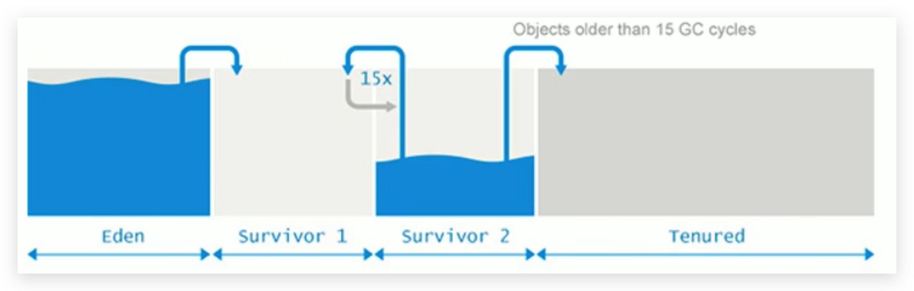

为新对象分配内存是一件非常严谨和复杂的任务，JVM的设计者们不仅需要考虑内存如何分配、在哪里分配等问题，并且由于内存分配算法与内存回收算法密切相关，所以还需要考虑GC执行完内存回收后是否会在内存空间中产生内存碎片。

<!--more-->

## 对象分配过程

### 对象分配的一般过程

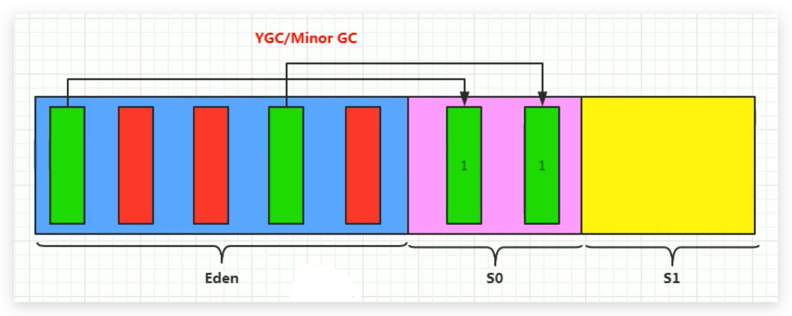

1. new 的对象先放伊甸园区。此区有大小限制。
2. 当伊甸园的空间填满时，程序又需要创建对象，JVM 的垃圾回收器将对伊甸园区进行垃圾回收，这个垃圾回收操作`叫做 Minor GC 或者 YGC(Young GC)  `，目的是将伊甸园区的不再被其他对象所引用的对象进行销毁；再加载新的对象放到伊甸园区。
3. 然后将伊甸园中的剩余对象**移动到幸存者0区（或者叫做 to 区**），此时把对象的年龄标记为1
   - 我们把幸存者区为空的区叫做 to 区，非空的叫做 from 区
   - 最初始的话，会随机选个区为to区
   - 总之：**谁是空区谁就是to区**

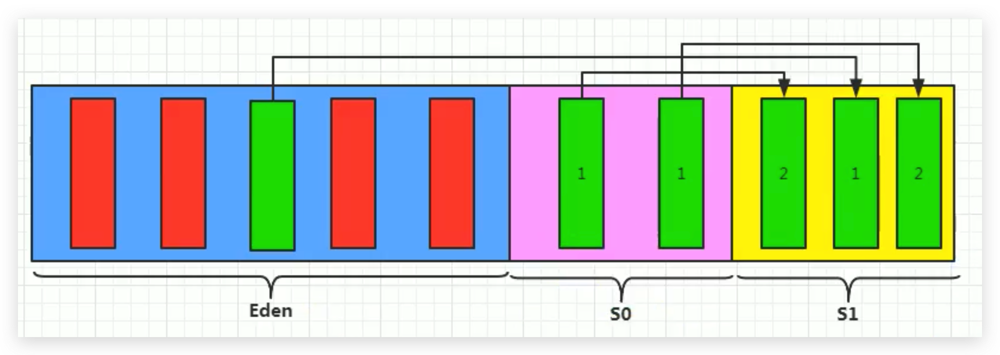

​          所以说：**在 YGC 后，伊甸园区肯定是空的了**

4. 如果下一次伊甸园区又满了，再次触发垃圾回收YGC，此时除了将伊甸园中的剩余对象移动到幸存者1区外（这些对象的年龄记为1），还有上次幸存下来的放到幸存者0区的，如果没有被回收，也会被放到幸存者1区（这些对象的年龄记为2）。
5. 如果再次经历垃圾回收，此时会重新放回幸存者0区，接着再去幸存者1区，反复移动

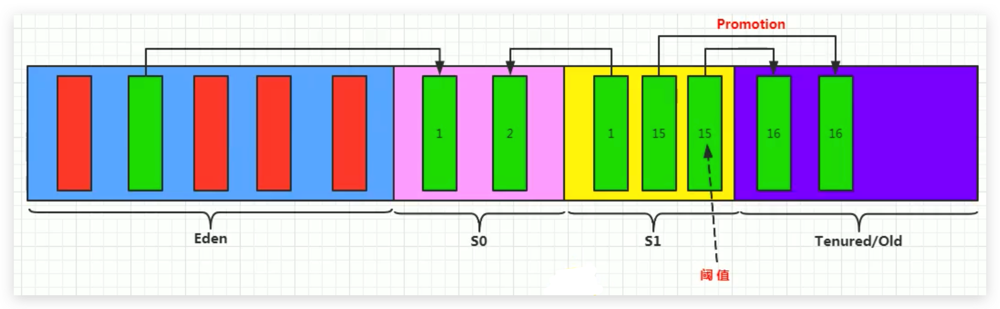

6. 当幸存者区的对象的年龄超过15，或者说反复移动15次以上，JVM 就会把这些对象晋升（Promotion）到养老区。

   - 这个 15 次数可以设置，默认是 15 次。
   - 可以设置参数： `-XX:MaxTenuringThreshold=<N>`进行设置。

7. 在养老区，相对悠闲。当养老区内存不足时，会再次`触发GC（Major GC 或者 OGC(Old GC)）`，进行养老区的内存清理。

8. **若养老区执行了 Major GC 之后发现依然无法进行对象的保存，就会产生 OOM 异常**。

   ```java
   java.lang.OutOfMemoryError: Java heap space
   ```

   

总结：

- `针对幸存者 s0,s1 区：复制之后有交换，谁空谁是 to。`
- `关于垃圾回收：频繁在新生区收集，很少在养老区收集，几乎不在 永久区/元空间 收集。`


### 对象分配的特殊情况

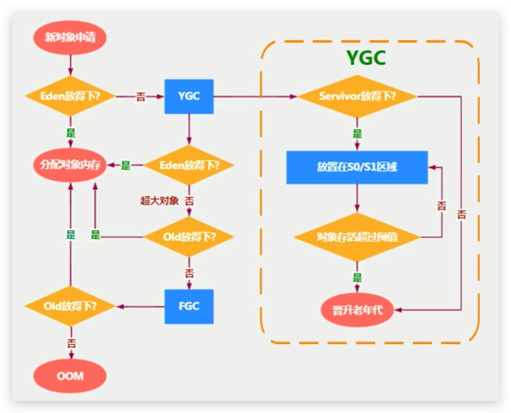

1. 如果来了一个新对象，先看看 Eden 是否放的下？
   - 如果 Eden 放得下，则直接放到 Eden 区
   - 如果 Eden 放不下，则触发 Minor GC(YGC) ，执行垃圾回收，看看还能不能放下？

2. 将对象放到老年区有两种情况：
   - 如果 Eden 执行了 Minor GC(YGC)  还是无法放不下该对象，说明是超大对象，直接放到老年代
   - 那万一老年代都放不下，则先触发 FGC|Major GC(Old GC)(这里把FGC和OGC混着用了)，再看看能不能放下，放得下最好，但如果还是放不下，那只能报 OOM

3. 如果 Eden 区满了，将对象往幸存区复制时，发现幸存区放不下，那只能让他们直接晋升至老年区

### 对象分配示意图

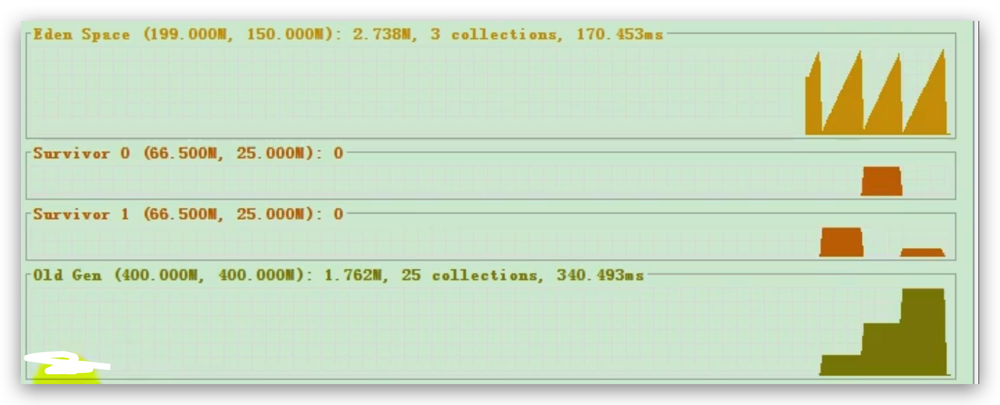

## JVM调试工具

1. JDK命令行
2. Eclipse：Memory Analyzer Tool
3. Jconsole
4. Visual VM（实时监控，推荐）
5. Jprofiler（IDEA插件）
6. Java Flight Recorder（实时监控）
7. GCViewer
8. GCEasy

## Minor GC、Major GC、Full GC

JVM 在进行 GC 时，并非每次都对上面三个内存（新生代、老年代和方法区（永久代））区域一起回收的，大部分时候回收的都是指新生代。

<!--more-->

针对Hotspot VM的实现，它里面的GC按照回收区域又分为两大种类型：一种是`部分收集（Partial GC）`，一种是`整堆收集（Full GC）`

### 部分收集（Partial GC）

定义：**不是完整收集整个Java堆的垃圾收集**。其中又分为：

- **新生代收集（Minor GC/Young GC）**：只是新生代（Eden，s0，s1）的垃圾收集
- **老年代收集（Major GC/Old GC）**：只是老年代的圾收集。
  - 目前，只有**CMS GC**会有单独收集老年代的行为。
  - `注意，很多时候Major GC会和Full GC混淆使用，需要具体分辨是老年代回收还是整堆回收。`
- **混合收集（Mixed GC）**：收集整个新生代以及部分老年代的垃圾收集。
  - 目前，只有 **G1 GC** 会有这种行为。

### 整堆收集（Full GC）

定义：**收集整个 Java 堆和方法区的垃圾收集。**

## GC策略的触发机制

### 年轻代GC

年轻代GC（Minor GC）触发机制：

- 当年轻代空间不足时，就会触发Minor GC，这里的年轻代满指的是Eden代满，Survivor满不会引发GC，在Eden区满的时候，会顺带触发s0区的GC。（每次Minor GC会清理年轻代的内存）

- 因为Java对象**大多都具备朝生夕灭**的特性，所以Minor GC非常频繁，一般回收速度也比较快。这一定义既清晰又易于理解。

- Minor GC会引发STW（Stop The World），暂停其它用户的线程，等垃圾回收结束，用户线程才恢复运行

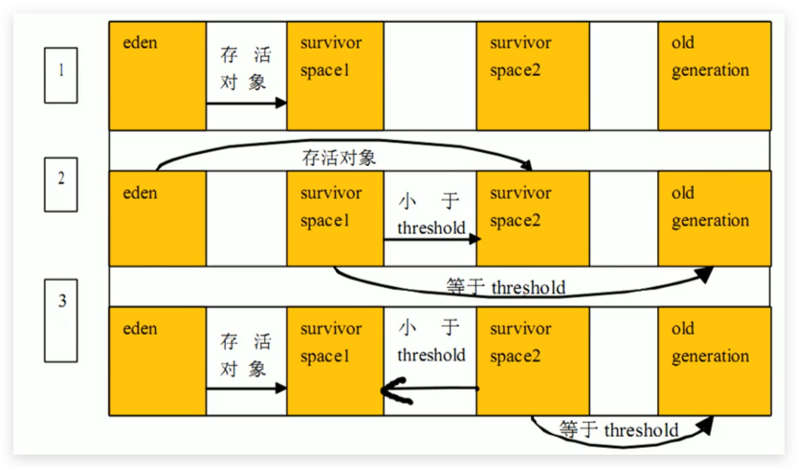

### 老年代GC

老年代GC（Major GC/Full GC）触发机制：

- 指发生在老年代的 GC，对象从老年代消失时，就表示 Major Gc 或 Full GC 发生了
- 出现了 Major GC，经常会伴随至少一次的 Minor GC（但非绝对的，在 Parallel Scavenge 收集器的收集策略里就有直接进行 MajorGC 的策略选择过程）。
- Major GC 的速度一般会比 Minor GC 慢10倍以上，STW的时间更长。
- 如果 Major GC 后，内存还不足，就报 OOM 了。

### Full GC

Full GC 触发机制，有以下五种情况：

1. 调用 System.gc() 时，系统建议执行 Full GC，但是不必然执行
2. 老年代空间不足
3. 方法区空间不足
4. 通过 Minor GC 后进入老年代的平均大小大于老年代的可用内存
5. 由 Eden 区、survivor space0（From Space）区向 survivor space1（To Space）区复制时，对象大小大于 To Space 可用内存，则把该对象转存到老年代，且老年代的可用内存小于该对象大小

说明：**Full GC 是开发或调优中尽量要避免的。这样STW时间会短一些**

## 堆空间分代思想

**为什么要把Java堆分代？不分代就不能正常工作了吗？**

经研究，不同对象的生命周期不同。70%-99%的对象是临时对象。

- 新生代：有Eden、两块大小相同的survivor（又称为from/to或s0/s1）构成，to总为空。
- 老年代：存放新生代中经历多次GC仍然存活的对象。
- 其实不分代完全可以，分代的唯一理由就是优化GC性能。如果没有分代，那所有的对象都在一块，就如同把一个学校的人都关在一个教室。GC的时候要找到哪些对象没用，这样就会对堆的所有区域进行扫描。而很多对象都是朝生夕死的，如果分代的话，把新创建的对象放到某一地方，当GC的时候先把这块存储“朝生夕死”对象的区域进行回收，这样就会腾出很大的空间出来。


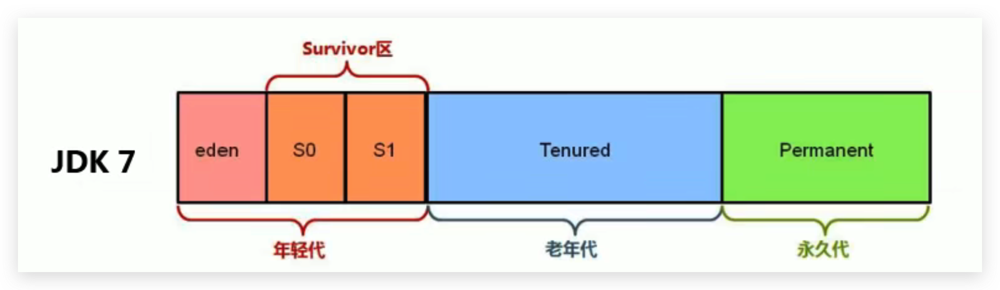

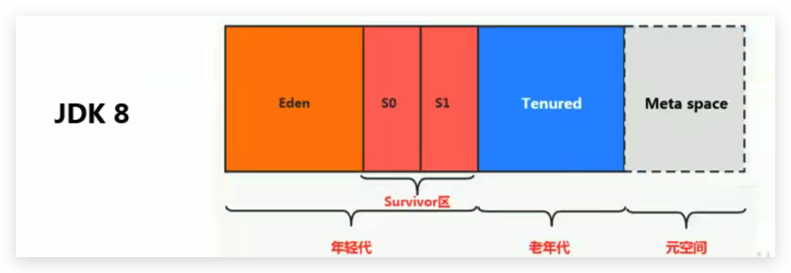

## 为对象分配内存TLAB

### 背景

1. 堆区是线程共享区域，任何线程都可以访问到堆区中的共享数据
2. 由于对象实例的创建在JVM中非常频繁，因此在并发环境下从堆区中划分内存空间是线程不安全的
3. 为避免多个线程操作同一地址，需要使用加锁等机制，进而影响分配速度

### 概述

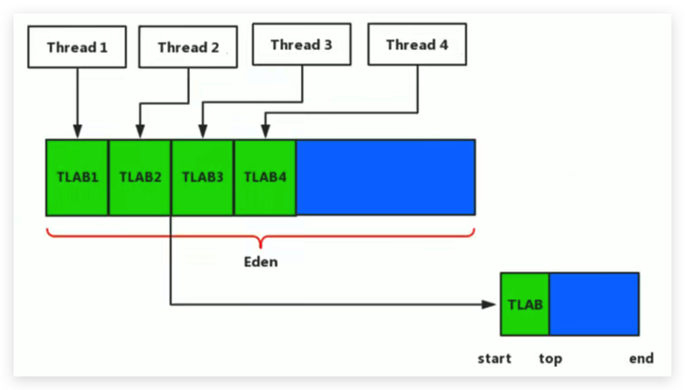

1. `TLAB：Thread Local Allocation Buffer`
2. 从内存模型而不是垃圾收集的角度，对Eden区域继续进行划分，JVM为**每个线程分配了一个私有缓存区域**，它包含在Eden空间内。
3. 多线程同时分配内存时，使用TLAB可以避免一系列的非线程安全问题，同时还能够提升内存分配的吞吐量，因此我们可以将这种内存分配方式称之为**快速分配策略**。
4. 据我所知所有OpenJDK衍生出来的JVM都提供了TLAB的设计。

### 使用说明

1. 尽管不是所有的对象实例都能够在TLAB中成功分配内存，但**JVM确实是将TLAB作为内存分配的首选**。
2. 在程序中，开发人员可以通过选项“**-XX:UseTLAB**”设置是否开启TLAB空间，默认是开启的。
3. 默认情况下，TLAB空间的内存非常小，**仅占有整个Eden空间的1%**，当然我们可以通过选项`-XX:TLABWasteTargetPercent`设置TLAB空间所占用Eden空间的百分比大小。
4. 一旦对象在TLAB空间分配内存失败时，JVM就会尝试着通过**使用加锁机制确保数据操作的原子性**，从而直接在Eden空间中分配内存。

**TLAB分配过程如下：**

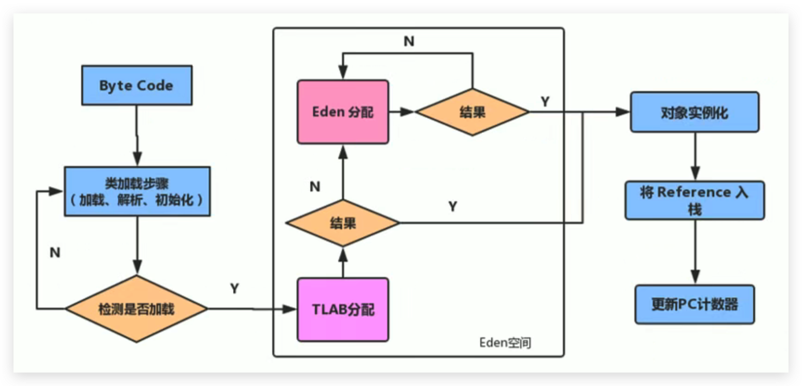

## 对象分配总结

1. 如果对象在Eden出生并经过第一次Minor GC后仍然存活，并且能被Survivor容纳的话，将被移动到Survivor空间中，并将对象年龄设为1。
2. 对象在Survivor区中每熬过一次MinorGC，年龄就增加1岁，当它的年龄增加到一定程度（默认为15岁，其实每个JVM、每个GC都有所不同）时，就会被晋升到老年代
3. 对象晋升老年代的年龄阀值，可以通过选项**-XX:MaxTenuringThreshold**来设置

**针对不同年龄段的对象分配策略（或对象提升(Promotion)规则如下所示：**

1. **优先分配到Eden**
2. **大对象直接分配到老年代**
   - 尽量避免程序中出现过多的大对象
3. **长期存活的对象分配到老年代**
4. **动态对象年龄判断**
   - 如果Survivor区中相同年龄的所有对象大小的总和大于Survivor空间的一半，年龄大于或等于该年龄的对象可以直接进入老年代，无须等到MaxTenuringThreshold中要求的年龄。
5. **空间分配担保**
   - ` -XX:HandlePromotionFailure `：（见下面解释）

## 堆空间常用参数设置总结

官方文档：https://docs.oracle.com/javase/8/docs/technotes/tools/unix/java.html

- `-XX:+PrintFlagsInitial` : 查看所有的参数的默认初始值

- `-XX:+PrintFlagsFinal ` ：查看所有的参数的最终值（可能会存在修改，不再是初始值）

  - 修改后显示的值会有一个冒号 :=

    

  - 具体查看某个参数的命令行指令：`jinfo -flag SurvivorRatio 进程id`

 * `-Xms`：初始堆空间内存 （默认为物理内存的1/64）

 * `-Xmx`：最大堆空间内存（默认为物理内存的1/4）

 * `-Xmn`：设置新生代的大小。(初始值及最大值)

 * `-XX:NewRatio`：配置新生代与老年代在堆结构的占比

 * `-XX:SurvivorRatio`：设置新生代中Eden和S0/S1空间的比例

   * 如果S0/S1区分配的比较小的话，不合理，因为对象等不到年龄为15就会被送到老年代了，这样导致 Minor GC/YGC 失去意义了。
   * 如果S0/S1区分配的比较大的话，也不合理，因为Eden区较小的话，则 Minor GC/YGC 出现的频率就会变高，而GC频率高的话，STW（用户线程停止操作）的总体时间也会高，最后会影响整体的性能。

 * `-XX:MaxTenuringThreshold`：设置新生代垃圾的最大年龄

 * `-XX:+PrintGCDetails`：输出详细的GC处理日志

 * 打印gc简要信息：① `-XX:+PrintGC`  或者   ② `-verbose:gc`

 * `-XX:HandlePromotionFailure`：是否设置空间分配担保

   参数说明：

   - 在发生Minor GC之前，虚拟机会**检查老年代最大可用的连续空间是否大于新生代所有对象的总空间**。
     - 如果大于，则此次Minor GC是安全的，正常 Minor GC 即可。
     - 但如果小于，则虚拟机会查看`-XX:HandlePromotionFailure`设置值是否允担保失败。
       1. 如果HandlePromotionFailure=true，那么会继续**检查老年代最大可用连续空间是否大于历次晋升到老年代的对象的平均大小**。
          - 如果大于，则尝试进行一次Minor GC，但这次Minor GC依然是有风险的；在这步，若小于了，则会进行 Old GC。
          - 如果小于，则进行一次Full GC。
       2. 如果HandlePromotionFailure=false，则进行一次Full GC。
   - JDK 1.5 默认关闭，JDK 1.6 默认开启
   - 在JDK6 Update 24之后，HandlePromotionFailure参数不会再影响到虚拟机的空间分配担保策略，观察openJDK中的源码变化，虽然源码中还定义了HandlePromotionFailure参数，但是在代码中已经不会再使用它。
   - JDK6 Update 24之后的规则变为**只要老年代的连续空间大于新生代对象总大小或者历次晋升的平均大小就会进行Minor GC**，否则将进行Full GC。

