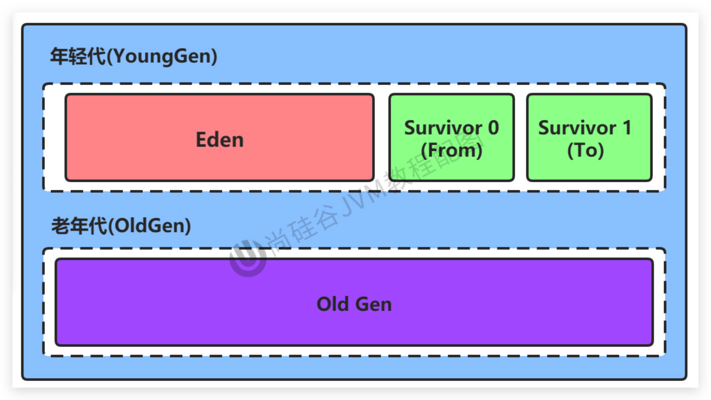
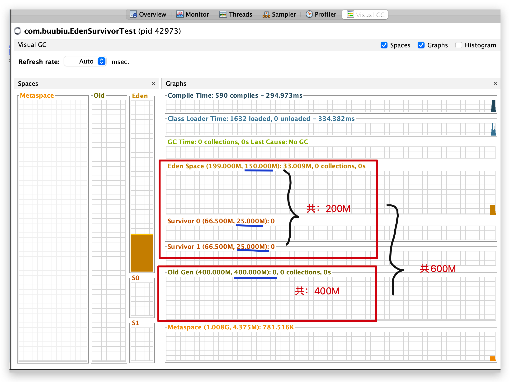

# JVM-运行时数据区-堆(Heap)-年轻代和老年代

## 定义



- 存储在 JVM 中的 Java 对象可以被划分为两类：
  - 一类是生命周期较短的瞬时对象，这类对象的创建和消亡都非常迅速
  - 另外一类对象的生命周期却非常长，在某些极端的情况下还能与 JVM 的生命周期保持一致。
- Java 堆区进一步细分的话：可以分为 `年轻代(YoungGen)`和`老年代(OldGen)`
  - 其中年轻代又可以划分为：`Eden（伊甸园）空间`与`Survivor0（幸存者0）空间`、`Survivor1（幸存者1）空间`（有时也叫做 `from区`、`to区`）

<!--more-->

## 参数调整

> 注意：下面的参数开发中一般不会手动调


- 配置新生代与老年代在堆结构的占比

  - 默认`-XX:NewRatio=2`，表示新生代占1，老年代占2，新生代占整个堆的1/3

  - 可以修改 `-XX:NewRatio=4`，表示新生代占1，老年代占4，新生代占整个堆的1/5

  - 该参数的实际值可以通过命令行 `jinfo`查看：

    ```sh
    $ jps
    5596 NewRatioTest
    $ jinfo -flag NewRatio 5586
    -XX:NewRatio=2
    ```

  - 或者通过 `jvisualvm`查看：

    

- 在HotSpot中，Eden空间和另外两个survivor空间缺省所占的比例是`8 : 1 : 1`

  - 但是实际上通过上图可以看到：Eden 与 两个Survivor占比是：`6:1:1(150:25:25)`

    原因：默认有个自适应的内存分配策略，我们可以关闭这个参数，但是也不管用

    参数为：`-XX:-UseAdaptiveSizePolicy`：减号表示关闭

    要想真正的8:1:1，必须手动指定一下分配参数值：`-XX:SurvivorRatio=8`

- 可以通过参数`-XX:SurvivorRatio`调整这个空间比例。比如`-XX:SurvivorRatio=8`

- **几乎所有**的Java对象都是在Eden区被new出来的，除非这个对象非常大，超过 Eden区的大小了，可能会直接进入 老年代区 了。
- 绝大部分的 Java 对象的销毁都在新生代进行了。
  - IBM公司的专门研究表明，新生代中80%的对象都是“朝生夕死”的。
- 可以使用选项`-Xmn`设置新生代最大内存大小，但这个参数一般使用默认值就可以了。
  - 当既设置 `-XX:NewRatio`，又设置 `-Xmn`时，以 `-Xmn`为生效。
