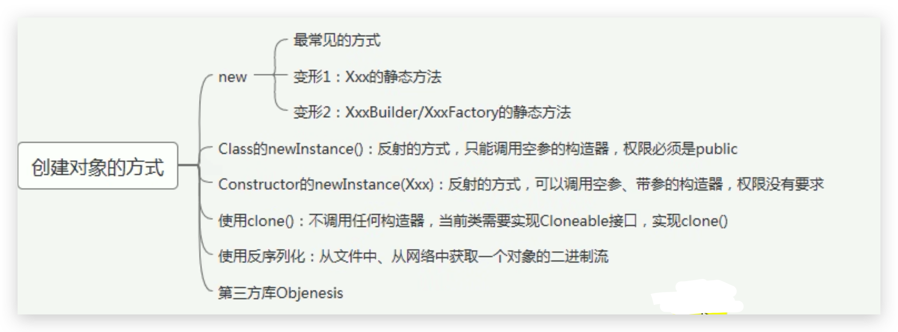
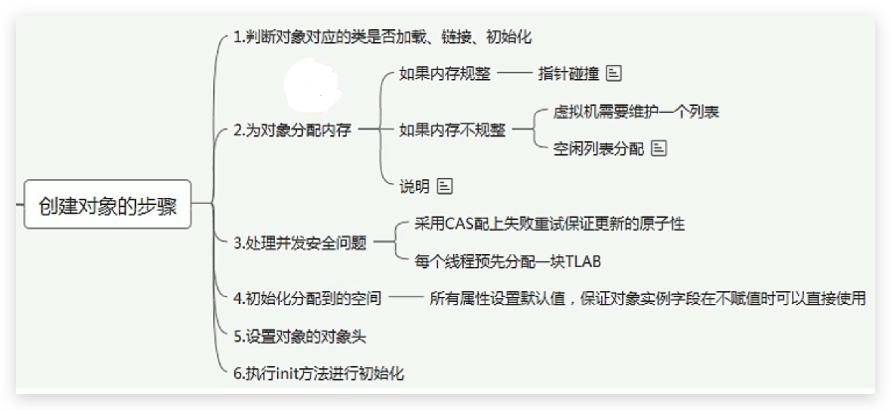
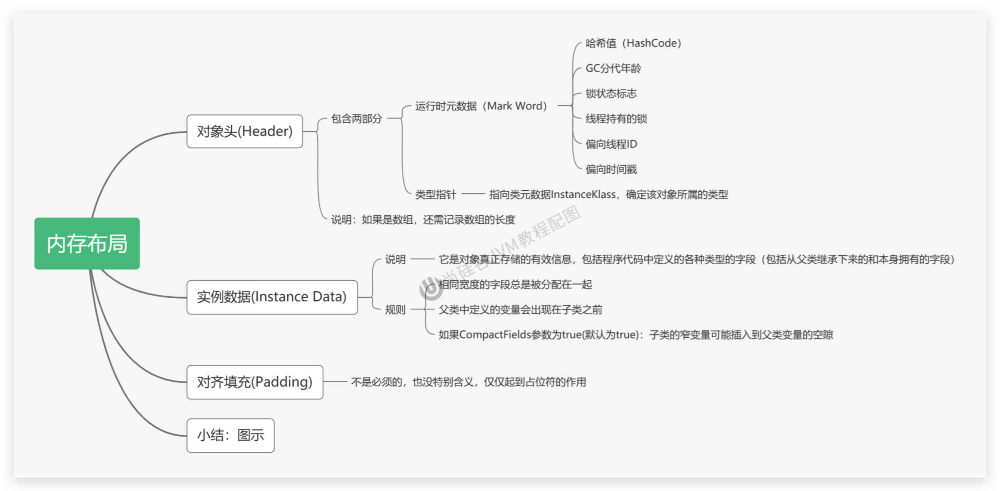
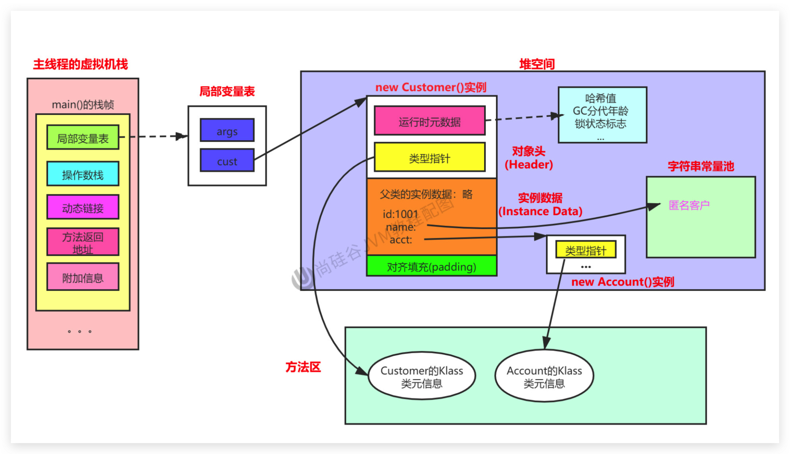
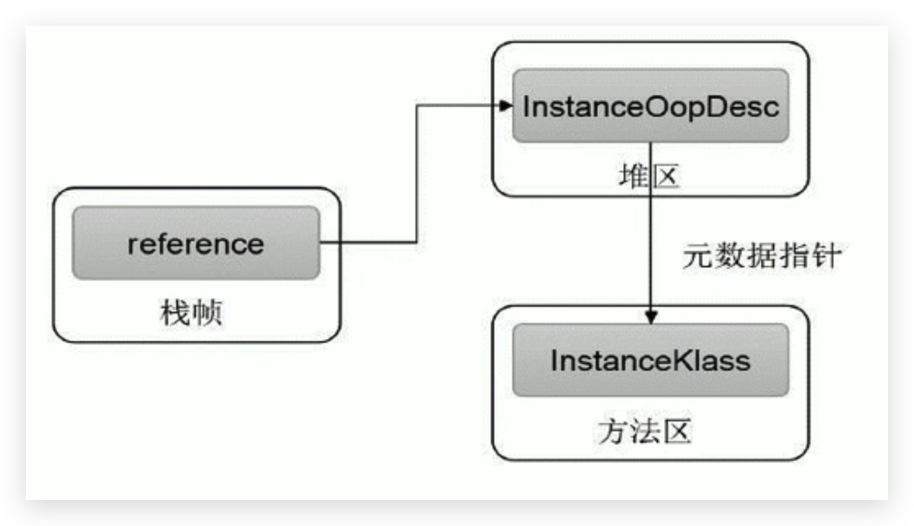
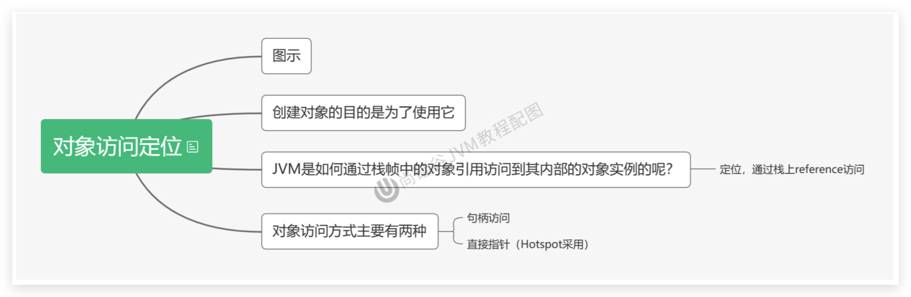
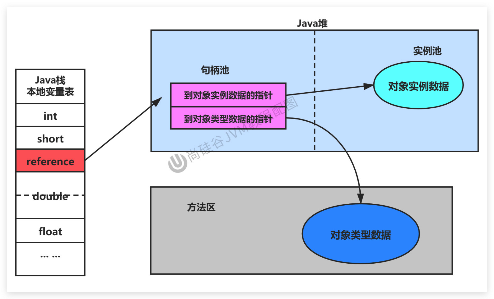
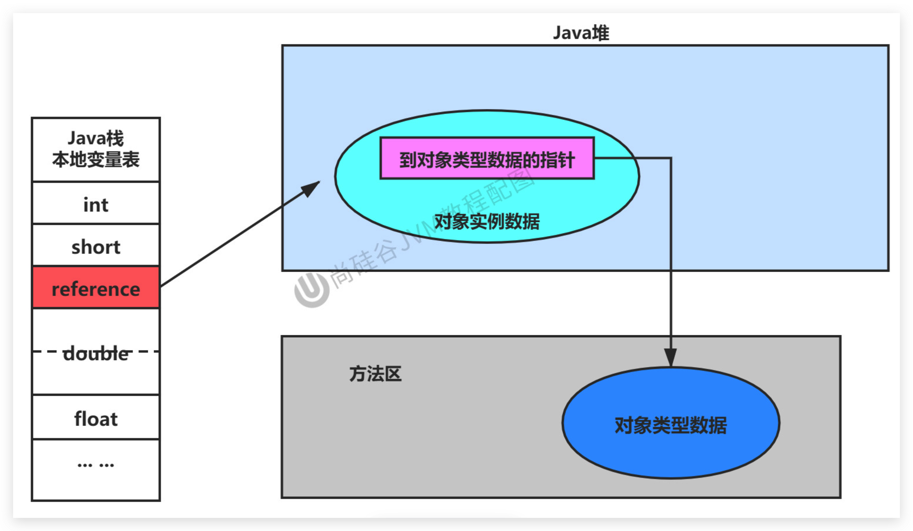

# JVM-运行时数据区-对象的实例化内存布局与访问定位

## 创建对象的方式



1. new：最常见的方式、单例类中调用getInstance的静态类方法，XXXFactory的静态方法
2. Class的newInstance方法：在JDK9里面被标记为过时的方法，因为只能调用空参构造器，并且权限必须为 public
3. Constructor的newInstance(Xxxx)：反射的方式，可以调用空参的，或者带参的构造器
4. 使用clone()：不调用任何的构造器，要求当前的类需要实现Cloneable接口中的clone方法
5. 使用序列化：从文件中，从网络中获取一个对象的二进制流，序列化一般用于Socket的网络传输
6. 第三方库 Objenesis

<!--more-->

## 创建对象的过程

### 从字节码的角度看

Java 代码：

```java
public class ObjectTest {
    public static void main(String[] args) {
        Object obj = new Object();
    }
}
```

字节码反编译：

```java
 public static void main(java.lang.String[]);
    descriptor: ([Ljava/lang/String;)V
    flags: ACC_PUBLIC, ACC_STATIC
    Code:
      stack=2, locals=2, args_size=1
         0: new           #2                  // class java/lang/Object
         3: dup           
         4: invokespecial #1                  // Method java/lang/Object."<init>":()V
         7: astore_1
         8: return
      LineNumberTable:
        line 9: 0
        line 10: 8
      LocalVariableTable:
        Start  Length  Slot  Name   Signature
            0       9     0  args   [Ljava/lang/String;
            8       1     1   obj   Ljava/lang/Object;
}
```

### 从具体执行的过程角度看



#### 判断对象对应的类是否加载、链接、初始化

- 虚拟机遇到一条`new`指令，首先去检查这个指令的参数能否在`Metaspace`的常量池中定位到一个类的符号引用，并且检查这个符号引用代表的类是否已经被加载，解析和初始化。（即判断类元信息是否存在）。
- 如果该类没有加载，那么在双亲委派模式下，使用当前类加载器以`ClassLoader + 包名 + 类名为key`进行查找对应的`.class`文件，如果没有找到文件，则抛出`ClassNotFoundException`异常，如果找到，则进行类加载，并生成对应的`Class`对象。

####  为对象分配内存

首先计算对象占用空间的大小，接着在堆中划分一块内存给新对象。

如果实例成员变量是引用变量，仅分配引用变量空间即可，即4个字节大小

- **如果内存规整：采用指针碰撞分配内存**

  - 如果内存是规整的，那么虚拟机将采用的是`指针碰撞法（Bump The Point）`来为对象分配内存。

    意思是所有用过的内存在一边，空闲的内存放另外一边，中间放着一个指针作为分界点的指示器，分配内存就仅仅是把指针往空闲内存那边挪动一段与对象大小相等的距离罢了。如果垃圾收集器选择的是`Serial` 、`ParNew`这种基于压缩算法的，虚拟机采用这种分配方式。一般使用带`Compact`（整理）过程的收集器时，使用指针碰撞。

  - 标记压缩（整理）算法会整理内存碎片，堆内存一边存对象，另一边为空闲区域

- **如果内存不规整，虚拟机需要维护一个列表，使用空闲列表分配**

  - 如果内存不是规整的，已使用的内存和未使用的内存相互交错，那么虚拟机将采用的是空闲列表来为对象分配内存。

    意思是虚拟机维护了一个列表，记录上哪些内存块是可用的，再分配的时候从列表中找到一块足够大的空间划分给对象实例，并更新列表上的内容。这种分配方式成为了 “`空闲列表（Free List）`”

说明：选择哪种分配方式由Java堆是否规整所决定，而Java堆是否规整又由所采用的垃圾收集器是否带有压缩整理功能决定。

#### 处理并发安全问题

在分配内存空间时，另外一个问题是及时保证 new 对象时候的线程安全性；

创建对象是非常频繁的操作，虚拟机需要解决并发问题。

虚拟机采用了两种方式解决并发问题：

1. `CAS(Compare And Swap) `失败重试、区域加锁：保证指针更新操作的原子性；
2. TLAB 把内存分配的动作按照线程划分在不同的空间之中进行，即每个线程在Java堆中（Eden区）预先分配一小块内内存，称为`本地线程分配缓冲区（TLAB，Thread Local Allocation Buffer）`，虚拟机是否使用 TLAB，可以 通过 `-XX:+UseTLAB`参数来设定

#### 初始化分配到的空间

内存分配结束后，虚拟机将分配到的内存空间都初始化为零值（不包括对象头）。这一步保证了对象的实例字段在Java 代码中可以不用赋初始值就可以直接使用，程序能访问到这些字段的数据类型所对应的零值。

给对象属性赋值的顺序：

1. 属性的默认值初始化
2. 显示初始化或者代码块初始化（并列关系，谁先谁后看代码编写的顺序）
3. 构造器初始化

#### 设置对象的对象头

将对象的所属类（即类的元数据信息）、对象的HashCode和对象的GC信息、锁信息等数据存储在对象的对象头中。这个过程的具体设置方式取决于JVM实现。

#### 执行init方法进行初始化

- 在Java程序的视角看来，初始化才正式开始。初始化成员变量，执行实例化代码块，调用类的构造方法，并把堆内对象的首地址赋值给引用变量

- 因此一般来说（由字节码中跟随invokespecial指令所决定），new指令之后会接着就是执行init方法，把对象按照程序员的意愿进行初始化，这样一个真正可用的对象才算完成创建出来。

## 对象的内存布局

我们 new 的对象是放到堆空间中的，那么堆空间中的对象里面都有哪几部分结构呢



具体的内存布局：

示例代码：

```java Customer.java
public class Customer {
  int id = 1001;
  String name;
  Account acct;

  {
    name = "匿名客户";
  }
  public Customer(){
    acct = new Account();
  }
}
class Account{

}
```

```java CustomerTest.java
public class CustomerTest {
  public static void main(String[] args) {
        Customer cust = new Customer();
    }
}
```



## 对象访问定位

创建对象的目的是为了使用它，那么**JVM是如何通过栈帧中的对象引用访问到其内部的对象实例呢？** （通过栈上 引用 （reference）访问），具体有两种实现方式：





### 句柄访问



1. 缺点：在堆空间中开辟了一块空间作为句柄池，句柄池本身也会占用空间；通过两次指针访问才能访问到堆中的对象，效率低
2. 优点：reference中存储稳定句柄地址，对象被移动（垃圾收集时移动对象很普遍）时只会改变句柄中实例数据指针即可，reference本身不需要被修改

### 直接指针（Hotspot 采用）



1. 优点：直接指针是局部变量表中的引用，直接指向堆中的实例，效率高；在对象实例中有类型指针，指向的是方法区中的对象类型数据
2. 缺点：对象被移动（垃圾收集时移动对象很普遍）时需要修改 reference 的值
