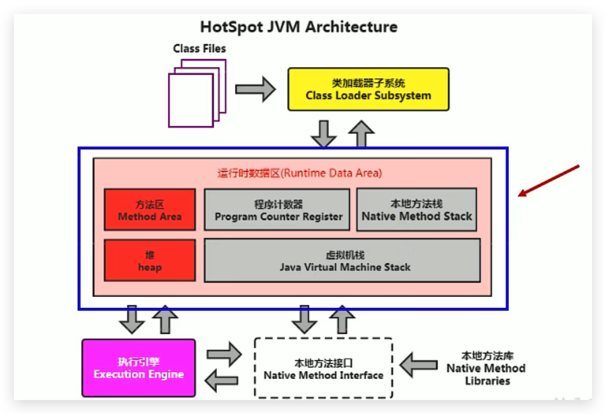
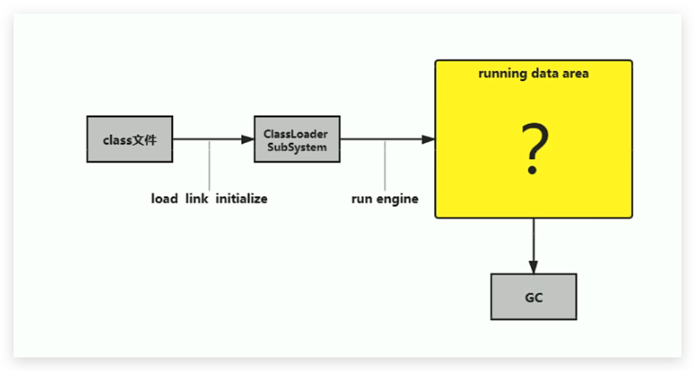
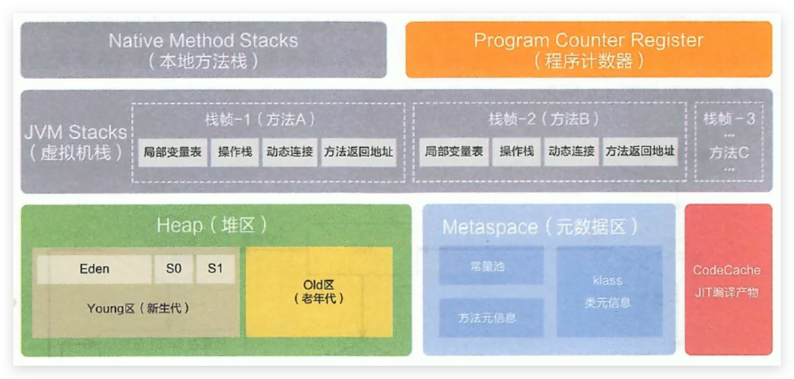
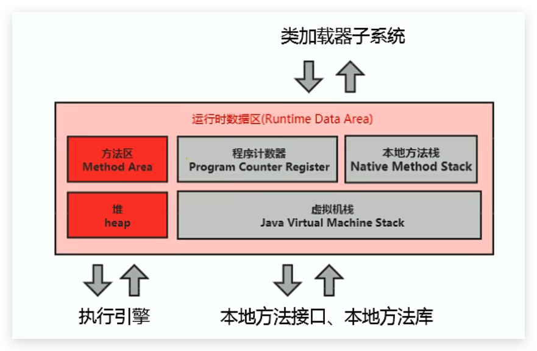
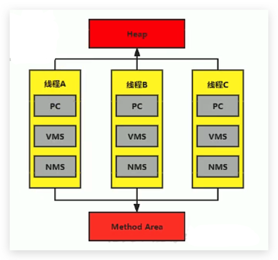
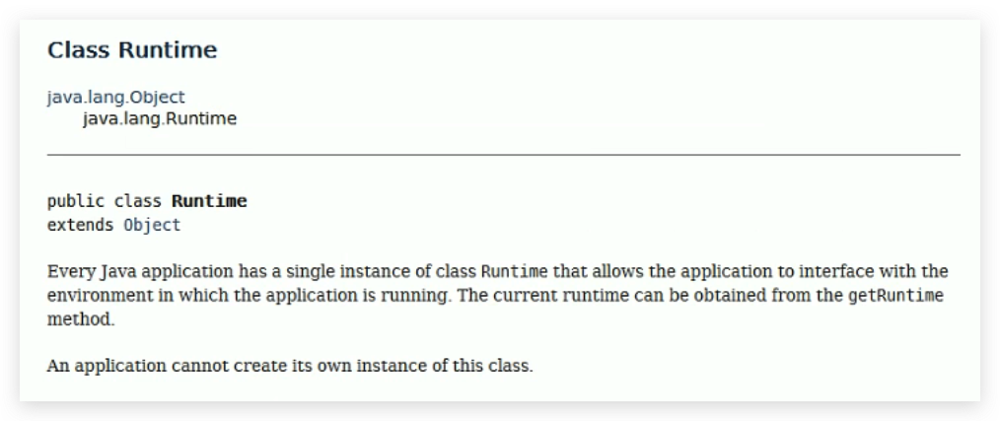

# JVM-运行时数据区概述及线程

## 引言

在类加载完成后进入运行时数据区阶段。

<!--more-->

类的加载 --> 验证 --> 准备 --> 解析 --> 初始化，这几个阶段完成后，就会用到执行引擎对编写的类进行使用，同时执行引擎将会使用到运行时数据区

## 内存的概念

内存是非常重要的系统资源，是硬盘和CPU的中间仓库及桥梁，承载着操作系统和应用程序的实时运行。JVM内存布局规定了Java在运行过程中内存申请、分配、管理的策略，保证了JVM的高效稳定运行。**不同的JVM对于内存的划分方式和管理机制存在着部分差异。**

## 整体分析

下图为阿里巴巴JDK8手册的图：

### 虚拟机内的线程和进程

Java虚拟机定义了若干种程序运行期间会使用到的运行时数据区：其中有一些会随着虚拟机启动而创建，随着虚拟机退出而销毁。另外一些则是与线程一一对应的，这些与线程对应的数据区域会随着线程开始和结束而创建和销毁。

**上图分析得出：**

1. **红色部分为：一个进程对应着一份，或者理解成一个虚拟机实例对应着一份**
2. **灰色部分为：一个线程对应着一份**
3. **`进程包括线程，比如1个进程对应着5个线程，这5个线程共用这1个进程的方法区和堆空间`**

上图分析得出：

**灰色的为单独线程私有的，红色的为多个线程共享的。即：**

- **每个线程：独立包括程序计数器（PC）、栈（VMS）、本地栈（NMS）。**
- **线程间共享：堆（Heap）、堆外内存或者叫方法区（永久代或元空间、代码缓存）（Method Area）**

### Class Runtime

每个JVM只有一个Runtime实例，是单例的，即为运行时环境，相当于JVM内存结构中的运行时数据区。

## 线程

### 简介

1. 线程是一个程序里的运行单元。JVM允许一个应用有多个线程并行的执行

2. **在Hotspot JVM里，每个线程都与操作系统的本地线程直接映射**

   - 当一个Java线程准备好执行以后，此时一个操作系统的本地线程也同时创建。Java线程执行终止后，本地线程也会回收

     >Java线程执行终止后，JVM是否一并执行终止取决于：
     >
     >1. 正常终止：没有异常，或者有异常但是被捕获了。
     >2. 非正常终止：有异常，没有捕获，若当前程序中只剩下守护线程了，则JVM也一并终止，若是非守护线程（普通线程），但是此线程是最后一个，JVM也是一并终止退出，其他情况JVM不会终止。

3. 操作系统负责将线程安排调度到任何一个可用的CPU上。一旦本地线程初始化成功，它就会调用Java线程中的run()方法

### JVM后台线程

- 如果你使用jconsole或者是任何一个调试工具，都能看到在后台有许多线程在运行。这些后台线程不包括调用public static void main(String[])的main线程以及所有这个main线程自己创建的线程。

- 这些主要的后台系统线程在Hotspot JVM里主要是以下几个：
  1. **虚拟机线程**：这种线程的操作是需要JVM达到安全点才会出现。这些操作必须在不同的线程中发生的原因是他们都需要JVM达到安全点，这样堆才不会变化。这种线程的执行类型括"stop-the-world"的垃圾收集，线程栈收集，线程挂起以及偏向锁撤销.
  2. **周期任务线程**：这种线程是时间周期事件的体现（比如中断），他们一般用于周期性操作的调度执行
  3. **GC线程**：这种线程对在JVM里不同种类的垃圾收集行为提供了支持
  4. **编译线程**：这种线程在运行时会将字节码编译成到本地代码
  5. **信号调度线程**：这种线程接收信号并发送给JVM，在它内部通过调用适当的方法进行处理
