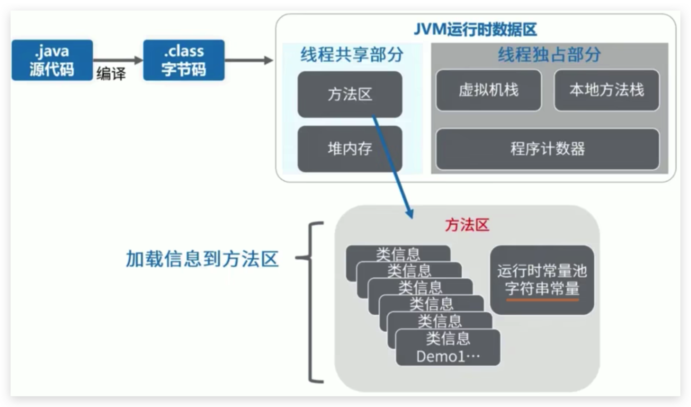
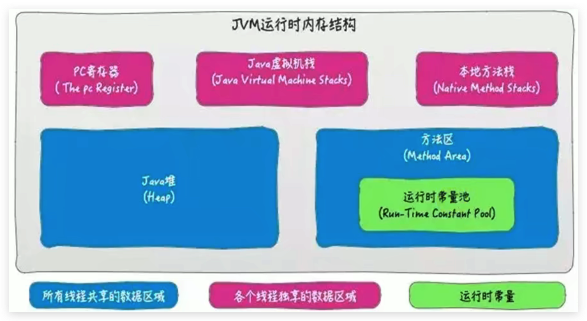
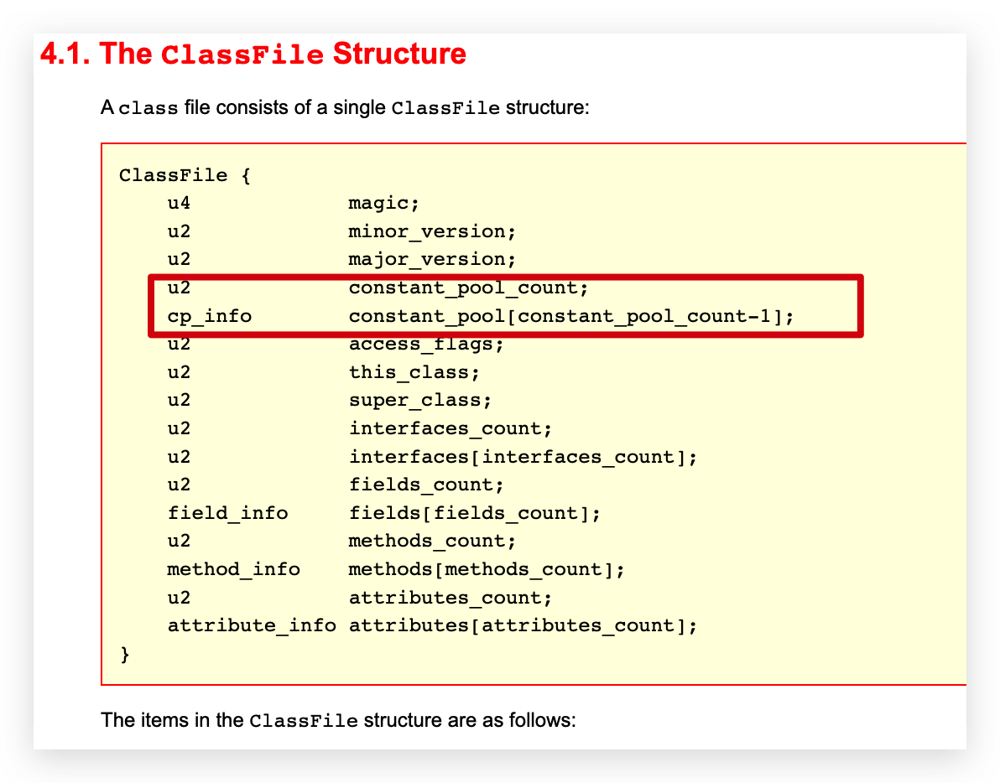
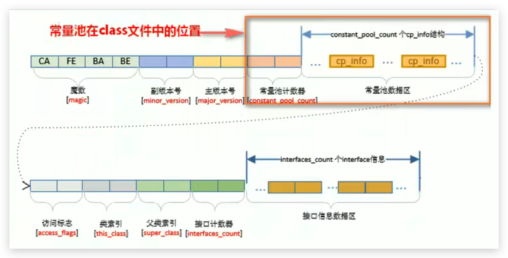
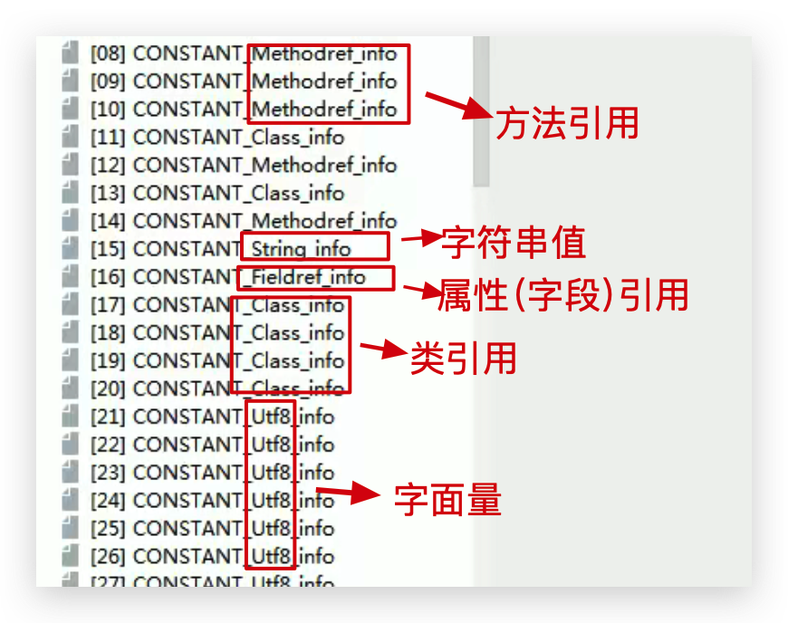

# JVM-运行时数据区-方法区(Method Area)-内部结构

## 方法区存储了什么



《深入理解Java虚拟机》书中对方法区（Method Area）存储内容描述如下：它用于存储已被虚拟机加载的**类型信息、常量、静态变量、即时编译器编译后的代码缓存**等。

<!--more-->


## 类型信息

对每个加载的类型（类class、接口interface、枚举enum、注解annotation），JVM必须在方法区中存储以下类型信息：

- 这个类型的完整有效名称（全名=包名.类名）
- 这个类型直接父类的完整有效名（对于interface或是java.lang.Object，都没有父类）
- 这个类型的修饰符（public，abstract，final的某个子集）
- 这个类型实现接口的一个有序列表（因为可以实现多个类）

## 域（Field）信息

或者叫 成员变量或属性。

- JVM必须在方法区中保存类型的所有域的相关信息以及域的声明顺序。

- 域的相关信息包括：域名称，域类型，域修饰符（public，private，protected，static，final，volatile，transient的某个子集）

## 方法（Method）信息

JVM必须保存所有方法的以下信息，同域信息一样包括声明顺序：

- 方法名称
- 方法的返回类型（包括 void 返回类型）
- 方法参数的数量和类型（按顺序）
- 方法的修饰符（public，private，protected，static，final，synchronized，native，abstract的一个子集）
- 方法的字节码（bytecodes）、操作数栈、局部变量表及参数个数（abstract和native方法除外）
- 异常表（abstract和native方法除外）
  - 每个异常处理的开始位置、结束位置、代码处理在程序计数器中的偏移地址、被捕获的异常类的常量池索引

### 举例

java 代码：

```java
package com.buubiu;

import java.io.Serializable;

/**
 * 测试方法区的内部构成
 */
public class MethodInnerStrucTest extends Object implements Comparable<String>, Serializable {
    //属性
    public int num = 10;
    private static String str = "测试方法的内部结构";
    //构造器
    //方法
    public void test1(){
        int count = 20;
        System.out.println("count = " + count);
    }
    public static int test2(int cal){
        int result = 0;
        try {
            int value = 30;
            result = value / cal;
        } catch (Exception e) {
            e.printStackTrace();
        }
        return result;
    }

    @Override
    public int compareTo(String o) {
        return 0;
    }
}
```

javap 反编译：

`javap -v -p MethodInnerStrucTest.class > MethodInnerStrucTest.txt `

反编译字节码文件，并输出值文本文件中，便于查看。参数 -p 确保能查看 private 权限类型的字段或方法

```java
......
//类型信息
public class com.buubiu.MethodInnerStrucTest extends java.lang.Object
implements java.lang.Comparable<java.lang.String>, java.io.Serializable
  minor version: 0
  major version: 52
  flags: ACC_PUBLIC, ACC_SUPER //类的权限信息
   ......
{
  //域信息
  public int num;
    descriptor: I //字段类型为 Integer
    flags: ACC_PUBLIC //字段权限修饰符为 public

  private static java.lang.String str;
    descriptor: Ljava/lang/String; //字段类型为 String
    flags: ACC_PRIVATE, ACC_STATIC //字段权限修饰符为 private 并且是静态

  //方法信息-构造器
  public com.buubiu.MethodInnerStrucTest();
    descriptor: ()V
    flags: ACC_PUBLIC
    Code:
      stack=2, locals=1, args_size=1 //操作数栈深度 局部变量表个数（包括形参this) 形参个数(这里的1表示有个this)
    ......

  //方法信息-普通方法
  public void test1();
    descriptor: ()V //方法返回值类型为 void
    flags: ACC_PUBLIC //方法权限修饰符为 public
    Code: //字节码
      stack=3, locals=2, args_size=1 //操作数栈深度 局部变量表个数（包括形参this) 形参个数(这里的1表示有个this)
      ......

  //方法信息-普通方法
  public static int test2(int);
    descriptor: (I)I //方法返回值类型为 int
    flags: ACC_PUBLIC, ACC_STATIC //方法权限修饰符为 public 并且为静态
    Code:
      stack=2, locals=3, args_size=1 //操作数栈深度 局部变量表长度 参数个数(这里的1表示有个int)
         ......
      Exception table: //异常表
         from    to  target type
             2     9    12   Class java/lang/Exception
......
```

## 静态变量

### non-final 类型的类变量

- 静态变量是和类关联在一起的，随着类的加载而加载，他们成为类数据在逻辑上的一部分
- 类变量被类的所有实例共享，即使没有类实例时，你也可以访问它

**举例**

1. 如下代码所示，即使我们把order设置为null，也不会出现空指针异常
2. 这更加表明了 static 类型的字段和方法随着类的加载而加载，并不属于特定的类实例

```java
public class MethodAreaTest {
    public static void main(String[] args) {
        Order order = null;
        order.hello();
        System.out.println(order.count);
    }
}

class Order {
    public static int count = 1;
    public static final int number = 2;


    public static void hello() {
        System.out.println("hello!");
    }
}
============
hello!
1
```

### 全局常量：static final

- 全局常量就是使用 static final 进行修饰
- **被声明为final的类变量的处理方法则不同，每个全局常量在编译的时候就会被分配了。**

代码：

```java
class Order {
    public static int count = 1;
    public static final int number = 2;
    ...
}  
```

字节码：

```java
public static int count;
    descriptor: I
    flags: ACC_PUBLIC, ACC_STATIC

  public static final int number;
    descriptor: I
    flags: ACC_PUBLIC, ACC_STATIC, ACC_FINAL
    ConstantValue: int 2 //可以发现 staitc和final同时修饰的number 的值在编译上的时候已经初始化了。
```

## 运行时常量池

### 常量池与运行时常量池



- 方法区，内部包含了运行时常量池
- 字节码文件，内部包含了常量池。
- 要弄清楚方法区，需要理解清楚ClassFile，因为加载类的信息都在方法区。
- 要弄清楚方法区的运行时常量池，需要理解清楚ClassFile中的常量池。
- `字节码文件(.class)中的常量池(Constant pool)被加载到方法区以后，我们就把对应的常量池结构叫作运行时常量池`

### 常量池

#### 定义

官方文档：https://docs.oracle.com/javase/specs/jvms/se8/html/jvms-4.html





一个有效的字节码文件中除了包含类的版本信息、字段、方法以及接口等描述符信息外。还包含一项信息就是`常量池表（Constant Pool Table）`，包括各种字面量(固定值，字符串等)和对类型、域和方法的符号引用。

#### 为什么需要常量池

1. 一个java源文件中的类、接口，编译后产生一个字节码文件。而Java中的字节码需要数据支持，通常这种数据会很大以至于不能直接存到字节码里，换另一种方式，可以存到常量池。这个字节码包含了指向常量池的引用。在动态链接的时候会用到运行时常量池

2. 比如一下代码：

   ```java
   public class SimpleClass {
       public void sayHello() {
           System.out.println("hello");
       }
   }
   ```

   虽然上述代码只有194字节，但是里面却使用了String、System、PrintStream及Object等结构。这里的代码量其实很少了，如果代码多的话，引用的结构将会更多，这里就需要用到常量池了。

#### 常量池存储什么

存储的数据类型包括：

- 数量值(字面量)
- 字符串值
- 类引用
- 字段引用
- 方法引用



#### 总结

**常量池、可以看做是一张表，虚拟机指令根据这张常量表找到要执行的类名、方法名、参数类型、字面量等类型。**

### 运行时常量池

#### 定义

- 运行时常量池（`Runtime Constant Pool`）是方法区的一部分。
- 常量池表（`Constant Pool Table`）是Class字节码文件的一部分，**用于存放编译期生成的各种字面量与符号引用，这部分内容将在类加载后存放到方法区的运行时常量池中。**

#### 动态性

- 运行时常量池，在加载类和接口到虚拟机后，就会创建对应的运行时常量池。
- JVM为每个已加载的类型（类、接口、枚举或注解）都维护一个常量池。池中的数据项像数组项一样，是通过**索引访问**的。
- 运行时常量池中包含多种不同的常量，包括编译期就已经明确的数值字面量，也包括到运行期解析后才能够获得的方法或者字段引用。此时不再是常量池中的符号地址了，这里换为真实地址。
  - 运行时常量池，相对于Class文件常量池的另一重要特征是：`具备动态性`。
  - 所以：**运行时常量池有可能比常量池的内容多**

- 运行时常量池类似于传统编程语言中的符号表（symbol table），但是它所包含的数据却比符号表要更加丰富一些。
- 当创建类或接口的运行时常量池时，如果构造运行时常量池所需的内存空间超过了方法区所能提供的最大值，则JVM会抛OutofMemoryError异常。
