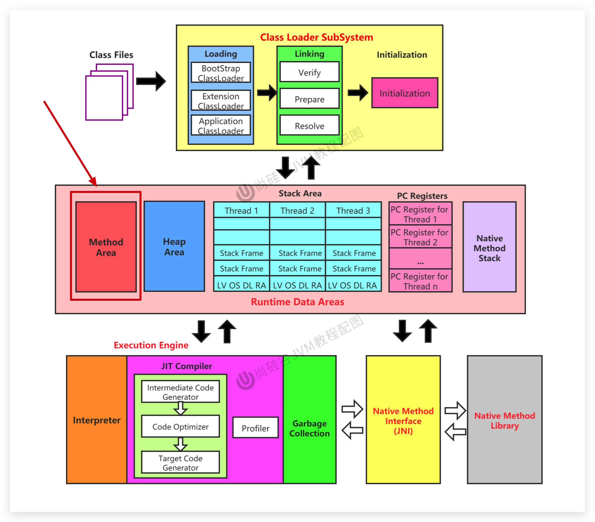
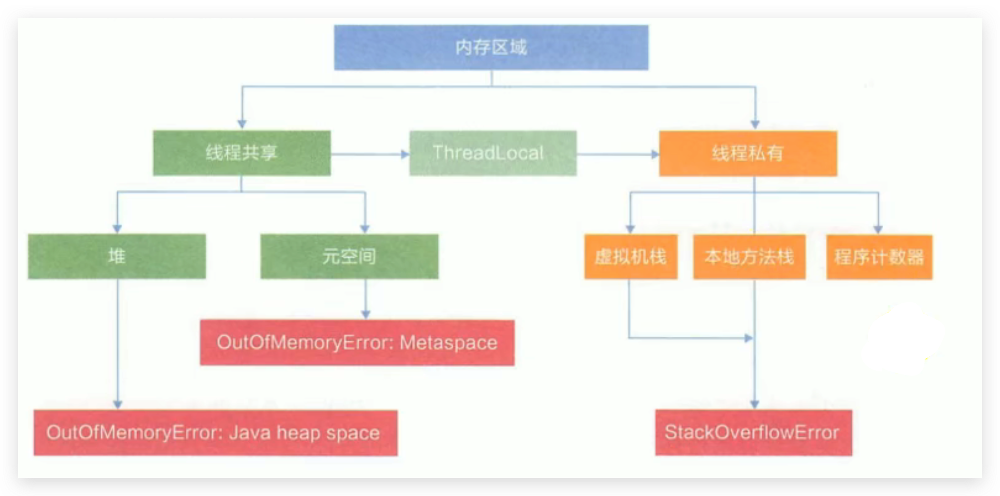
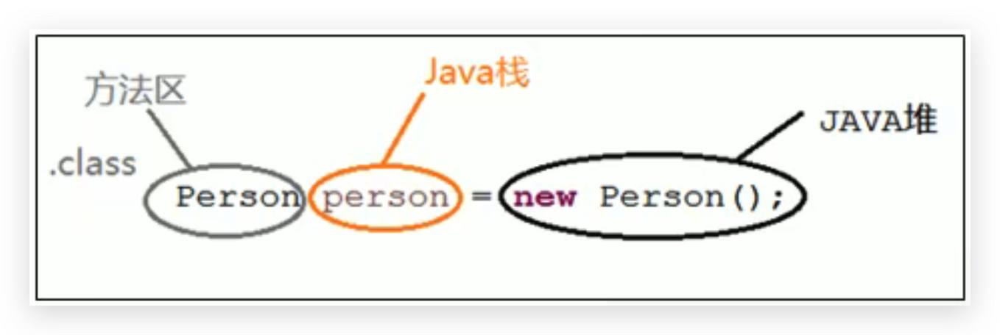
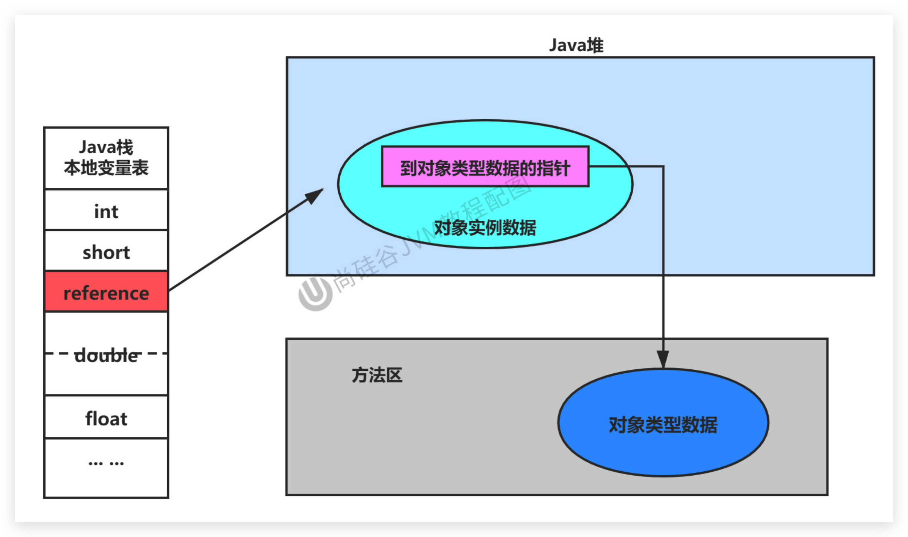
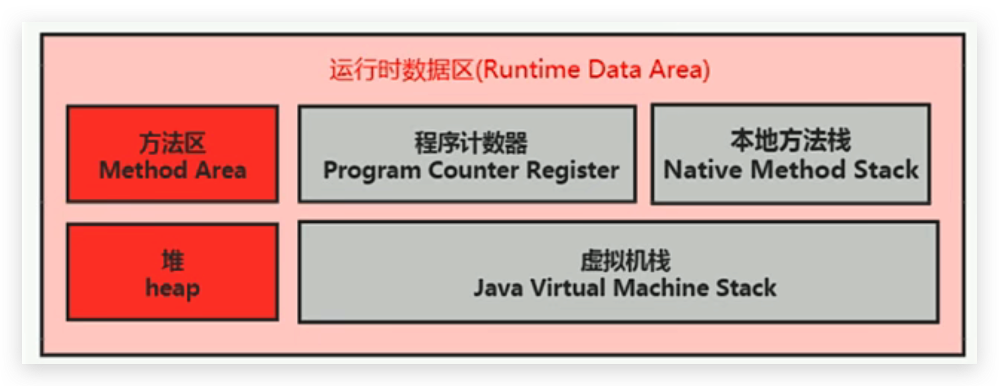
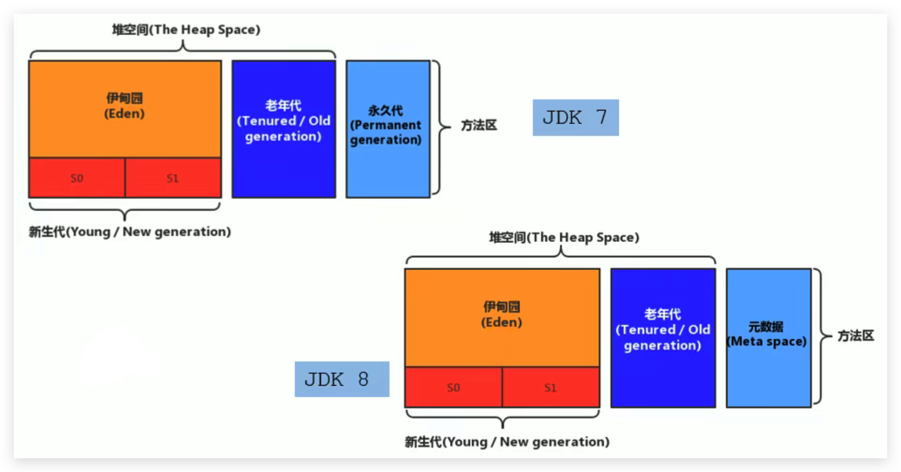
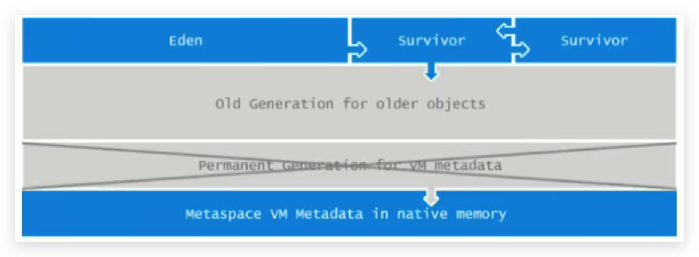

# JVM-运行时数据区-方法区(Method Area)-概述

## 栈、堆、方法区的交互关系

- 方法区所在 JVM 中的位置：

**三者之间是相互配合的关系，不是竞争关系。**

<!--more-->

- 从线程共享与否的角度来看：

ThreadLocal：如何保证多个线程在并发环境下的安全性？典型场景就是数据库连接管理，以及会话管理。

- 从对象创建的代码上来看：
  1. Person 类的 .class 信息存放在方法区中
  2. person 变量存放在 Java 栈的局部变量表中
  3. 真正的 person 对象存放在 Java 堆中
  4. 在 person 对象中，有个指针指向方法区中的 person 类型数据，表明这个 person 对象是用方法区中的 Person 类 new 出来的

- 从内存结构上来看：

## 对方法区的理解

官方文档：https://docs.oracle.com/javase/specs/jvms/se8/html/jvms-2.html#jvms-2.5.4

- 《Java虚拟机规范》中明确说明：**尽管所有的方法区在逻辑上是属于堆的一部分，但一些简单的实现可能不会选择去进行垃圾收集或者进行压缩**。但对于HotSpotJVM而言，方法区还有一个别名叫做`Non-Heap（非堆）`，目的就是要和堆分开。
- 所以，**方法区可以看作是一块独立于Java堆的内存空间。**

- 方法区主要存放的是 Class，而堆中主要存放的是实例化的对象

- 方法区（Method Area）与Java堆一样，是各个线程共享的内存区域。
- 方法区在JVM启动的时候被创建，并且它的实际的物理内存空间中和Java堆区一样都可以是不连续的。
- 方法区的大小，跟堆空间一样，可以选择固定大小或者可扩展。
- 方法区的大小决定了系统可以保存多少个类，如果系统定义了太多的类，导致方法区溢出，虚拟机同样会抛出内存溢出错误：`java.lang.OutofMemoryError:PermGen space(JDK8之前)`或者`java.lang.OutOfMemoryError:Metaspace(JDK8以及之后)`
  - 加载大量的第三方的jar包
  - Tomcat部署的工程过多（30~50个）
  - 大量动态的生成反射类
- 关闭JVM就会释放这个区域的内存。

## HotSpot方法区演进

- 在 JDK7 及以前，习惯上把方法区，称为永久代。JDK8开始，使用元空间取代了永久代。

- 本质上，方法区和永久代并不等价。仅是对Hotspot而言的可以看作等价。《Java虚拟机规范》对如何实现方法区，不做统一要求。例如：BEAJRockit / IBM J9 中不存在永久代的概念。
  - 现在来看，当年使用永久代，不是好的idea。导致Java程序更容易 OOM（超过-XX:MaxPermsize上限）

- 而到了JDK8，终于完全废弃了永久代的概念，改用与JRockit、J9一样在本地内存中实现的元空间（Metaspace）来代替

  

- 元空间的本质和永久代类似，都是对JVM规范中方法区的实现。不过元空间与永久代最大的区别在于：**元空间不在虚拟机设置的内存中，而是使用本地内存**。

- 永久代、元空间二者并不只是名字变了，内部结构也调整了

- 根据《Java虚拟机规范》的规定，如果方法区无法满足新的内存分配需求时，将抛出OOM异常
