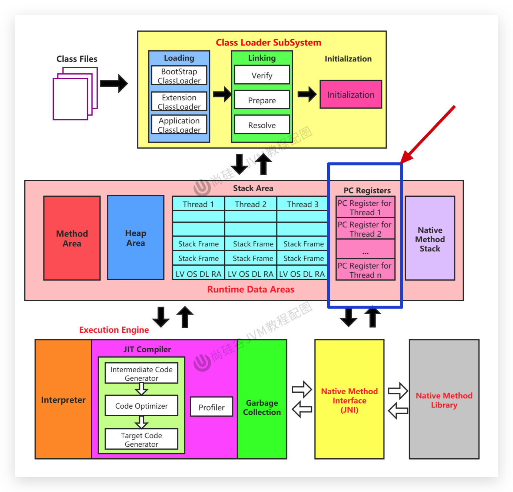
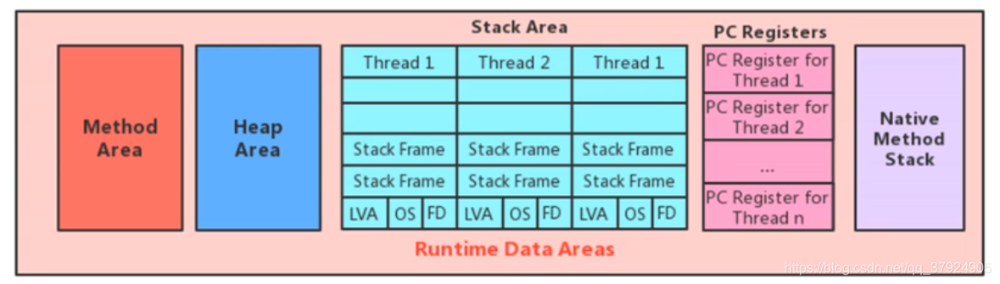
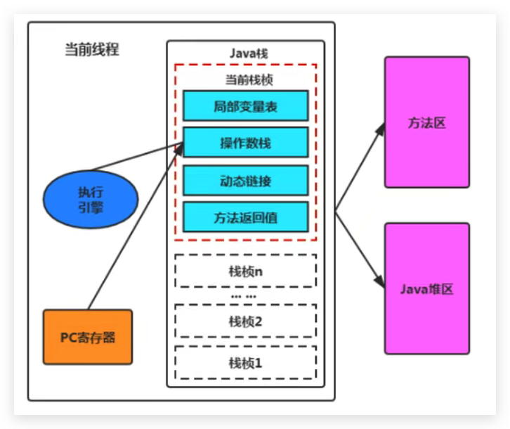
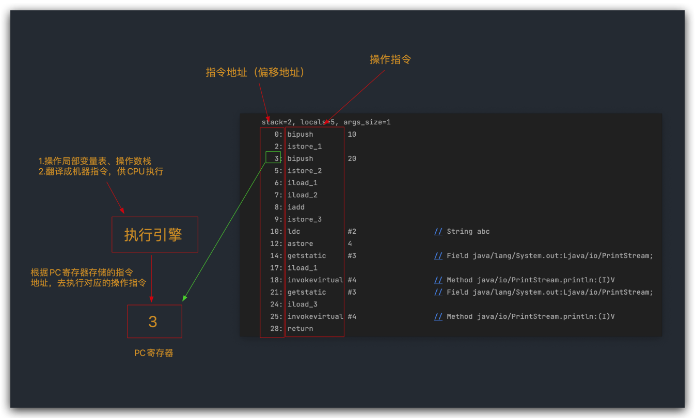
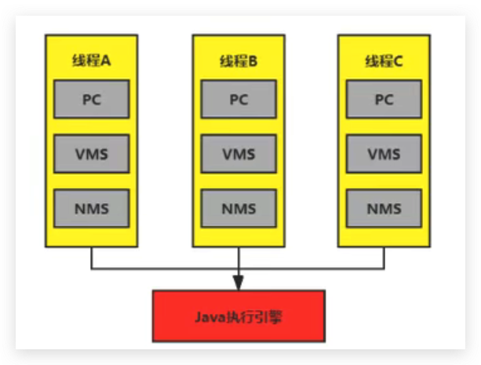

# JVM-运行时数据区-程序计数器(PC寄存器)

## 介绍



官方地址：https://docs.oracle.com/javase/specs/jvms/se8/html/index.html



JVM中的程序计数寄存器（Program Counter Register）中，Register 的命名源于CPU的寄存器，寄存器存储指令相关的现场信息。CPU只有把数据装载到寄存器才能够运行。

<!--more-->

这里，并非是广义上所指的物理寄存器，或许将其翻译为PC计数器（或指令计数器）会更加贴切（也称为程序钩子），并且也不容易引起一些不必要的误会。`JVM中的PC寄存器是对物理PC寄存器的一种抽象模拟。`

## 作用



PC寄存器用来存储指向下一条指令的地址，也即将要执行的指令代码。由执行引擎读取下一条指令。

- 它是一块很小的内存空间，几乎可以忽略不记。也是运行速度最快的存储区域。
- 在JVM规范中，每个线程都有它自己的程序计数器，是线程私有的，生命周期与线程的生命周期保持一致。
- 任何时间一个线程都只有一个方法在执行，也就是所谓的`当前方法`。程序计数器会存储当前线程正在执行的Java方法的JVM指令地址；或者，如果是在执行native（本地方法栈，调用c/c++的时候）方法，则地址是未指定值（undefned）。

- 它是程序控制流的指示器，分支、循环、跳转、异常处理、线程恢复等基础功能都需要依赖这个计数器来完成。

- 字节码解释器工作时就是通过改变这个计数器的值来选取下一条需要执行的字节码指令

- **它是唯一一个在Java虚拟机规范中没有规定任何OutofMemoryError情况，也没有 GC 情况的区域。**

  扩展：GC（垃圾回收）、OOM（内存溢出）

  - 存在GC的地方有：Heap Area（堆内存）、Method Area（非堆内存）、Native Mehtod Stack（本地方法栈）
  - 存在OOM的地方由：Heap Area（堆内存）、Method Area（非堆内存）、Native Mehtod Stack（本地方法栈）、**Stack Area（栈）**

## 举例说明

```java PCRegisterTest.java
package com.buubiu;

/**
 * @comment:
 * @author: buubiu
 * @create: 2022/5/26 13:31
 */
public class PCRegisterTest {

	public static void main(String[] args) {
		int i = 10;
		int j = 20;
		int k = i + j;

		String s = "abc";
		System.out.println(i);
		System.out.println(k);
	}

}
```

查看字节码：

```sh
$ javap -verbose PCRegisterTest.class
Classfile /com/buubiu/PCRegisterTest.class
  Last modified 2022-5-26; size 663 bytes
  MD5 checksum 2b77dd6af5bf87b0f434bc3d9cc35e0b
  Compiled from "PCRegisterTest.java"
public class com.buubiu.PCRegisterTest
  minor version: 0
  major version: 52
  flags: ACC_PUBLIC, ACC_SUPER
Constant pool:
   #1 = Methodref          #6.#26         // java/lang/Object."<init>":()V
   #2 = String             #27            // abc
   #3 = Fieldref           #28.#29        // java/lang/System.out:Ljava/io/PrintStream;
   #4 = Methodref          #30.#31        // java/io/PrintStream.println:(I)V
   #5 = Class              #32            // com/buubiu/PCRegisterTest
   #6 = Class              #33            // java/lang/Object
   #7 = Utf8               <init>
   #8 = Utf8               ()V
   #9 = Utf8               Code
  #10 = Utf8               LineNumberTable
  #11 = Utf8               LocalVariableTable
  #12 = Utf8               this
  #13 = Utf8               Lcom/buubiu/PCRegisterTest;
  #14 = Utf8               main
  #15 = Utf8               ([Ljava/lang/String;)V
  #16 = Utf8               args
  #17 = Utf8               [Ljava/lang/String;
  #18 = Utf8               i
  #19 = Utf8               I
  #20 = Utf8               j
  #21 = Utf8               k
  #22 = Utf8               s
  #23 = Utf8               Ljava/lang/String;
  #24 = Utf8               SourceFile
  #25 = Utf8               PCRegisterTest.java
  #26 = NameAndType        #7:#8          // "<init>":()V
  #27 = Utf8               abc
  #28 = Class              #34            // java/lang/System
  #29 = NameAndType        #35:#36        // out:Ljava/io/PrintStream;
  #30 = Class              #37            // java/io/PrintStream
  #31 = NameAndType        #38:#39        // println:(I)V
  #32 = Utf8               com/buubiu/PCRegisterTest
  #33 = Utf8               java/lang/Object
  #34 = Utf8               java/lang/System
  #35 = Utf8               out
  #36 = Utf8               Ljava/io/PrintStream;
  #37 = Utf8               java/io/PrintStream
  #38 = Utf8               println
  #39 = Utf8               (I)V
{
  public com.buubiu.PCRegisterTest();
    descriptor: ()V
    flags: ACC_PUBLIC
    Code:
      stack=1, locals=1, args_size=1
         0: aload_0
         1: invokespecial #1                  // Method java/lang/Object."<init>":()V
         4: return
      LineNumberTable:
        line 8: 0
      LocalVariableTable:
        Start  Length  Slot  Name   Signature
            0       5     0  this   Lcom/buubiu/PCRegisterTest;

  public static void main(java.lang.String[]);
    descriptor: ([Ljava/lang/String;)V
    flags: ACC_PUBLIC, ACC_STATIC
    Code:
      stack=2, locals=5, args_size=1
         0: bipush        10
         2: istore_1
         3: bipush        20
         5: istore_2
         6: iload_1
         7: iload_2
         8: iadd
         9: istore_3
        10: ldc           #2                  // String abc
        12: astore        4
        14: getstatic     #3                  // Field java/lang/System.out:Ljava/io/PrintStream;
        17: iload_1
        18: invokevirtual #4                  // Method java/io/PrintStream.println:(I)V
        21: getstatic     #3                  // Field java/lang/System.out:Ljava/io/PrintStream;
        24: iload_3
        25: invokevirtual #4                  // Method java/io/PrintStream.println:(I)V
        28: return
      LineNumberTable:
        line 11: 0
        line 12: 3
        line 13: 6
        line 15: 10
        line 16: 14
        line 17: 21
        line 18: 28
      LocalVariableTable:
        Start  Length  Slot  Name   Signature
            0      29     0  args   [Ljava/lang/String;
            3      26     1     i   I
            6      23     2     j   I
           10      19     3     k   I
           14      15     4     s   Ljava/lang/String;
}
SourceFile: "PCRegisterTest.java"
```

主要看 main 方法：



## 两个问题

### 使用PC寄存器存储字节码指令有什么用？

或者问：**为什么使用PC寄存器记录当前线程的执行地址？**

因为CPU需要不停的切换各个线程，这时候切换回来以后，就得知道接着从哪开始继续执行。

JVM的字节码解释器就需要通过改变PC寄存器的值来明确下一条应该执行什么样的字节码指令。



### PC寄存器为什么会被设定为线程私有？

**为了能够准确地记录各个线程正在执行的当前字节码指令地址，最好的办法自然是为每一个线程都分配一个PC寄存器**，这样一来各个线程之间便可以进行独立计算，从而不会出现相互干扰的情况。


## CPU时间片

- CPU时间片即CPU分配给各个程序的时间，每个线程被分配一个时间段，称作它的时间片
- 在宏观上：我们可以同时打开多个应用程序，每个程序并行不悖，同时运行。
- 但在微观上：由于只有一个CPU，一次只能处理程序要求的一部分，如何处理公平，一种方法就是引入时间片，每个程序轮流执行。


> 这边要区分并行和并发：
>
> 1. 并行是与串行相比较的
>    1. 串行是线程排队执行
>    2. 并行是线程同时执行
> 2. 并发在CPU处理JVM线程的时候，由于CPU交换处理频率非常快，让人感觉线程是并行似的，其实它们是并发的。
