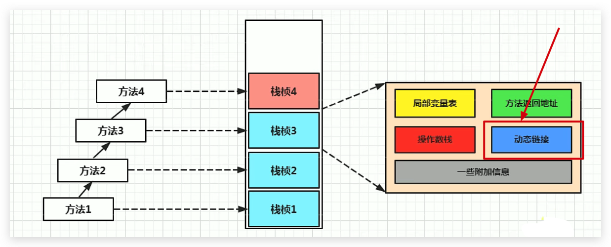
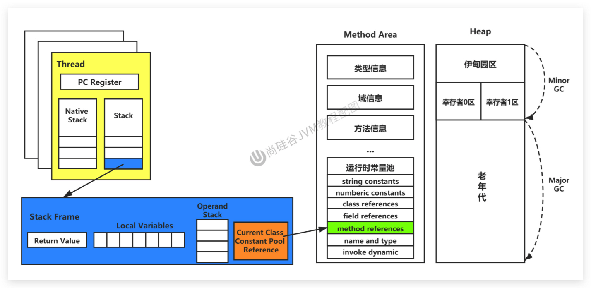

# JVM-运行时数据区-虚拟机栈-动态链接（Dynamic Linking）

## 定义

- 动态链接，又叫**指向运行时常量池的方法引用**
- 每一个栈帧内部都包含一个指向**运行时常量池**中**该栈帧所属方法的引用**。包含这个引用的目的就是为了支持当前方法的代码能够实现`动态链接（Dynamic Linking）`，比如：invokedynamic 指令

<!--more-->

## 作用

在Java源文件被编译到字节码文件中时，所有的变量和方法引用都作为**符号引用（Symbolic Reference）**保存在class文件的常量池里。比如：描述一个方法调用了另外的其他方法时，就是通过常量池中指向方法的符号引用来表示的，那么**动态链接的作用就是为了将这些符号引用转换为调用方法的直接引用**

## 为什么要用常量池呢

常量池的作用：就是为了提供一些符号和常量，便于指令的识别
