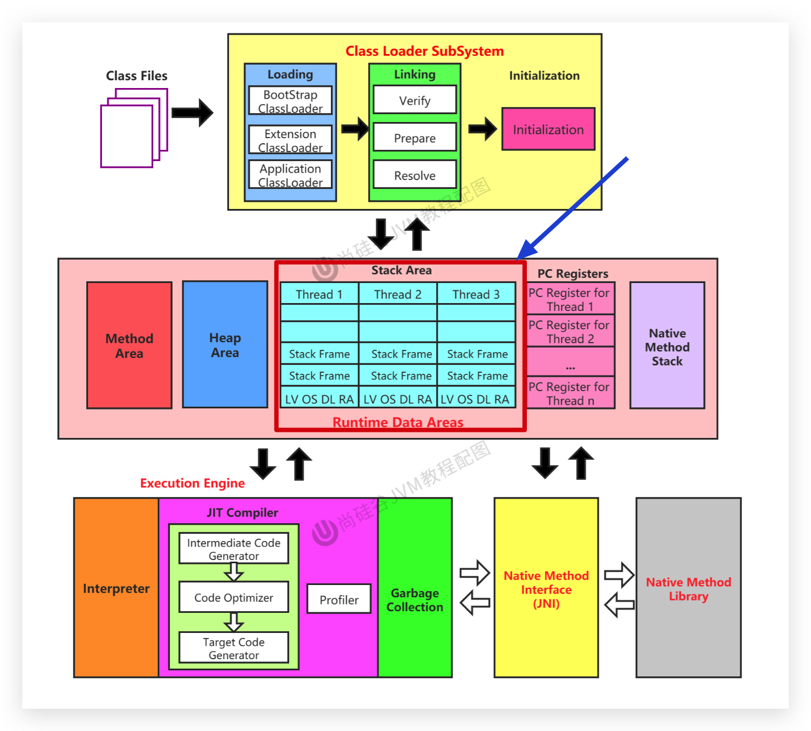
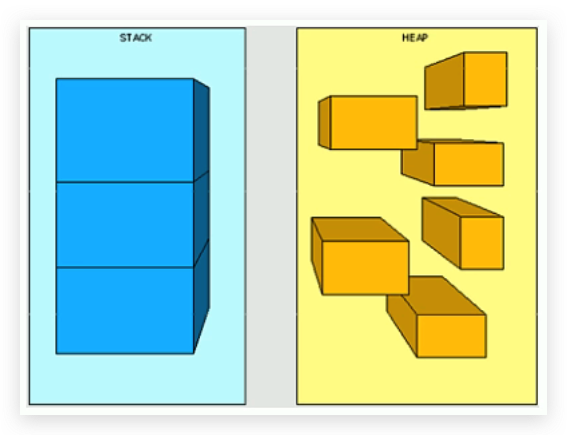
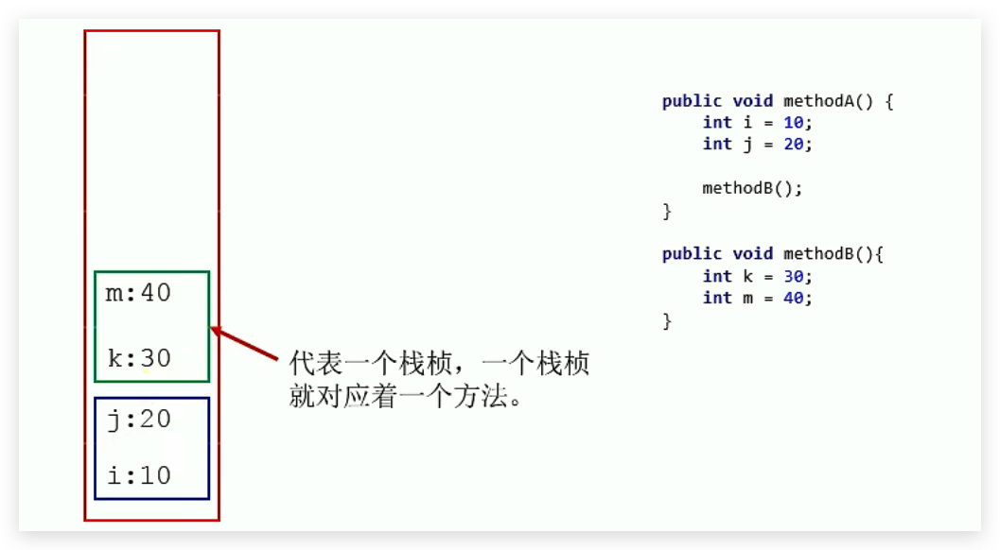
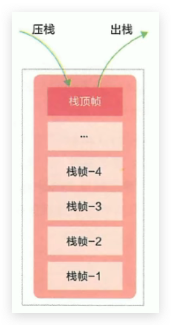
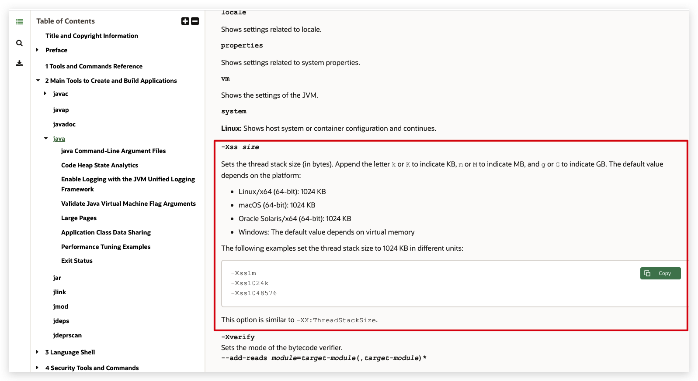
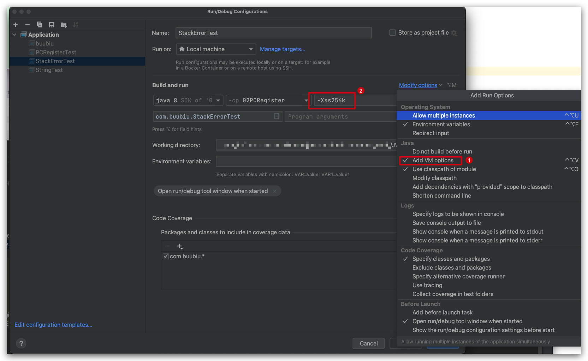
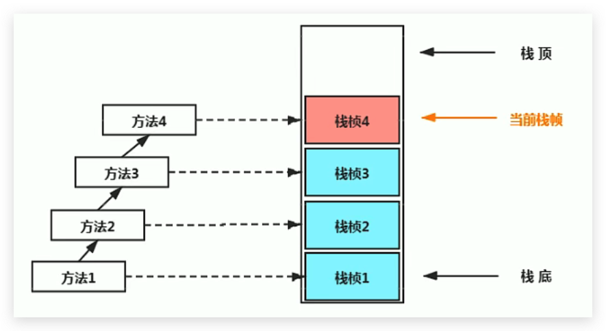
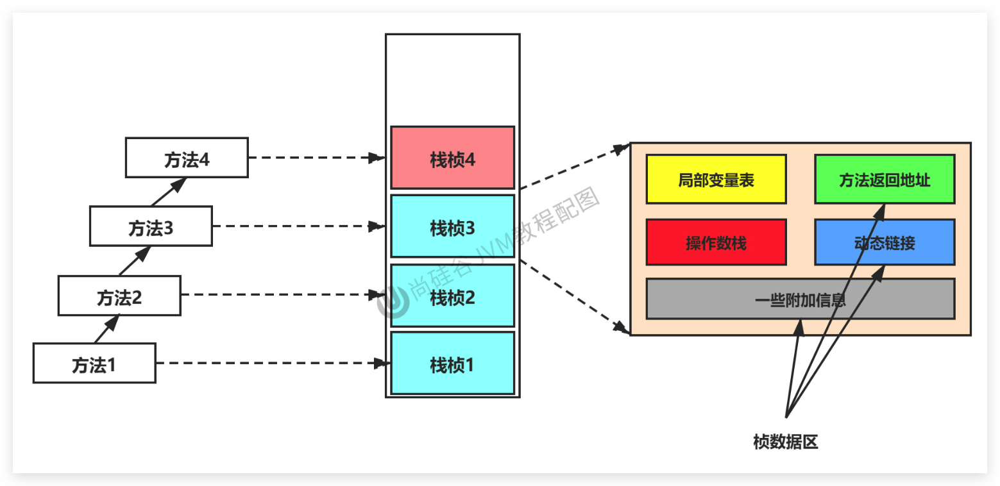
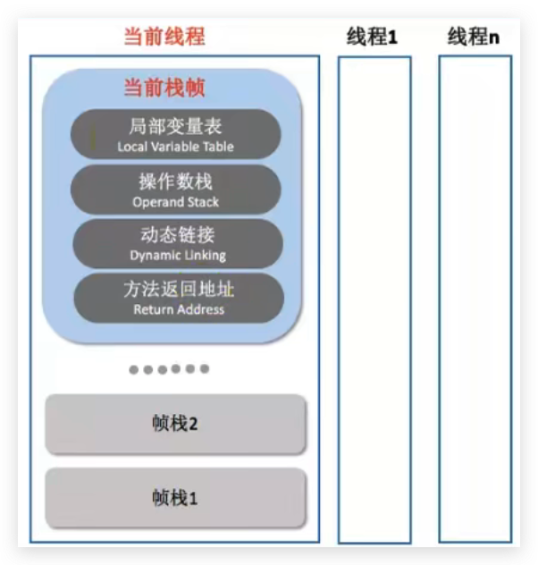

# JVM-运行时数据区-虚拟机栈

## 概述

官方：https://docs.oracle.com/javase/specs/jvms/se8/html/jvms-2.html#jvms-2.5.2

### 背景

由于跨平台性的设计，Java的指令都是根据栈来设计的。不同平台CPU架构不同，所以不能设计为基于寄存器的。

**优点是跨平台，指令集小，编译器容易实现，缺点是性能下降，实现同样的功能需要更多的指令。**



<!--more-->

### 内存中的栈与堆

`栈是运行时的单位，而堆是存储的单位。`

- 栈解决程序的运行问题，即程序如何执行，或者说如何处理数据。
- 堆解决的是数据存储的问题，即数据怎么放、放在哪里。



### 虚拟机栈基本内容

#### Java虚拟机栈是什么？



Java虚拟机栈（Java Virtual Machine Stack），早期也叫Java栈。

- 每个线程在创建时都会创建一个虚拟机栈，其内部保存一个个的栈帧（Stack Frame），对应着一次次的Java方法调用。
- Java虚拟机栈和PC寄存器一样，是线程私有的。

#### 生命周期

生命周期和线程一致，线程结束了，该虚拟机栈也就销毁了

#### 作用

主管Java程序的运行，它保存方法的局部变量（8 种基本数据类型、引用数据类型对象的引用地址）、部分结果，并参与方法的调用和返回。

> 扩展：
>
> 1. 局部变量是与成员变量（或属性）进行比较的
> 2. 基本数据变量是与引用类型变量（类、数组、接口）进行比较的

#### 栈的特点

- 栈是一种快速有效的分配存储方式，访问速度仅次于程序计数器。
- JVM直接对Java栈的操作只有两个：
  - 每个方法执行，伴随着进栈（入栈、压栈）
  - 执行结束后的出栈操作
- 对于栈来说不存在垃圾回收（GC）问题，但是会有内存溢出（OOM）问题



#### 栈中可能出现的异常

**Java 虚拟机规范允许Java栈的大小是动态的或者是固定不变的。**

- 如果采用固定大小的Java虚拟机栈，那每一个线程的Java虚拟机栈容量可以在线程创建的时候独立选定。如果线程请求分配的栈容量超过Java虚拟机栈允许的最大容量，Java虚拟机将会抛出一个`StackoverflowError（内存溢出）` 异常。

- 如果Java虚拟机栈可以动态扩展，并且在尝试扩展的时候无法申请到足够的内存，或者在创建新的线程时没有足够的内存去创建对应的虚拟机栈，那Java虚拟机将会抛出一个 `OutofMemoryError（内存溢出）` 异常。

#### 设置栈内存的大小

官方：https://docs.oracle.com/en/java/javase/11/tools/java.html#GUID-3B1CE181-CD30-4178-9602-230B800D4FAE



可以使用参数 `-Xss` 选项来设置线程的最大栈空间，栈的大小直接决定了函数调用的最大可达深度。

```sh
-Xss1m
-Xss1024k
-Xss1048576
```



例如：

```java
package com.buubiu;

/**
 * @comment:
 * @author: buubiu
 * @create: 2022/5/26 16:06
 *
 * 默认情况下： count：10824
 * 设置栈的大小：-Xss256k : count: 1875
 */
public class StackErrorTest {

	private static  int count = 1;
	public static void main(String[] args) {
		System.out.println(count);
		count++;
		main(args);
	}
}
```

## 栈的存储单位

### 栈中存储什么？

- 每个线程都有自己的栈，栈中的数据都是以`栈帧（Stack Frame）的格式存在`，或者说`栈帧是栈中的基本单位`。
- 在这个线程上正在执行的每个方法都是各自对应一个栈帧，或者说 `方法和栈帧是一一对应的关系`。
- 栈帧是一个内存区块，是一个数据集，维系着方法执行过程中的各种数据信息。

### 栈运行原理

- JVM 直接对 Java 栈的操作只有两个，就是对栈的 `压栈`和`出栈`，**遵循“先进后出”或者“后进先出”原则**。

- 在一条活动线程中，一个时间点上，只会有一个活动的栈帧。即只有当前正在执行的方法的栈帧（**栈顶栈帧**）是有效的，这个栈帧被称为`当前栈帧（Current Frame）`，与当前栈帧相对应的方法就是`当前方法（Current Method）`，定义这个方法的类就是`当前类（Current Class）`。

- 执行引擎运行的所有字节码指令只针对当前栈帧进行操作。

- 如果在该方法中调用了其他方法，对应的新的栈帧会被创建出来，放在栈的顶端，成为新的当前栈帧。

  

- 不同线程中所包含的栈帧是不允许存在相互引用的，即不可能在一个栈帧中引用另外一个线程的栈帧。
- 如果当前方法调用了其他方法，方法返回之际，当前栈帧会传回此方法的执行结果给前一个栈帧，接着虚拟机会丢弃当前栈帧，使得前一个栈帧重新成为当前栈帧。
- Java 方法有两种返回函数的方式，不管使用哪种方式，都会导致栈帧被弹出。
  - **一种是正常的函数返回，使用return 指令**；详见[JVM-运行时数据区-虚拟机栈-方法返回地址（Return-Address）/#正常完成出口](../JVM-运行时数据区-虚拟机栈-方法返回地址（Return-Address）/#正常完成出口)
  - **另一种是抛出异常**，详见[JVM-运行时数据区-虚拟机栈-方法返回地址（Return-Address）/#异常完成出口](../JVM-运行时数据区-虚拟机栈-方法返回地址（Return-Address）/#异常完成出口)

### 栈帧的内部结构

每个栈帧中存储着：

- `局部变量表（Local Variables）`
- `操作数栈（Operand Stack）（或表达式栈）`
- 动态链接（Dynamic Linking)（或指向运行时常量池的方法引用）
- 方法返回地址（Return Address）（或方法正常退出或者异常退出的定义）
- 一些附加信息

有时候 把 方法返回地址、动态链接、一些附加信息 统称为 **帧数据区**




