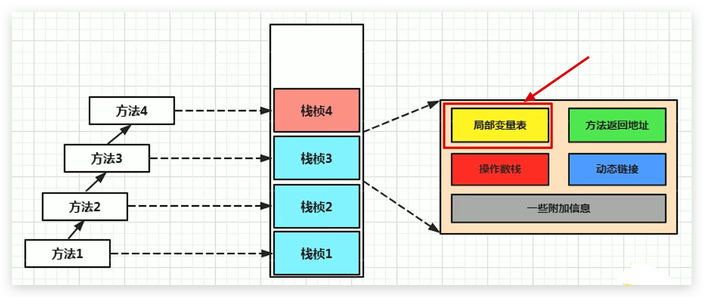
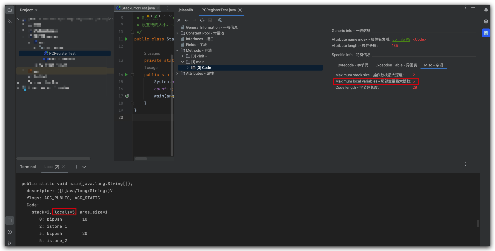
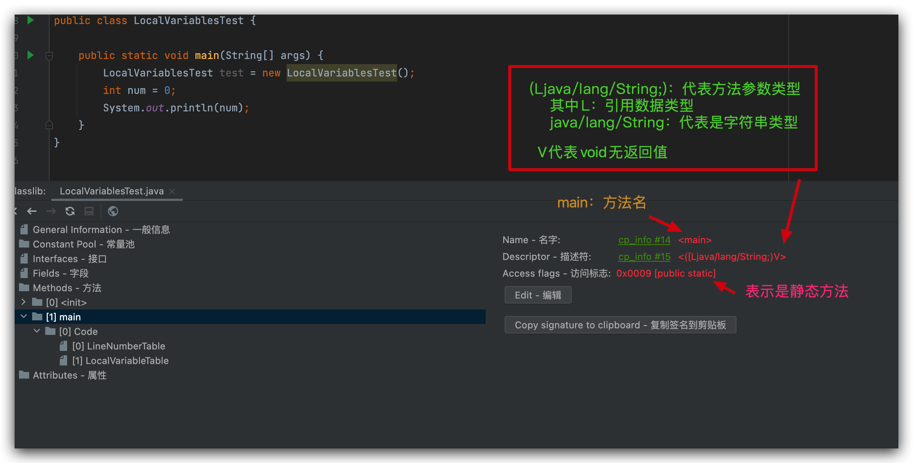
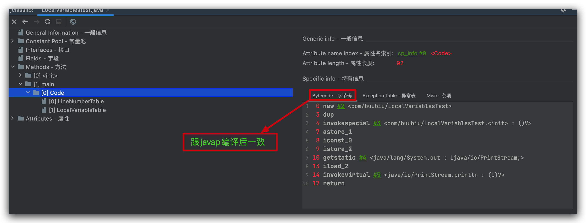
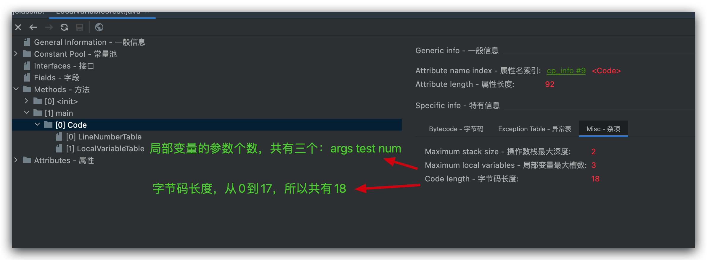
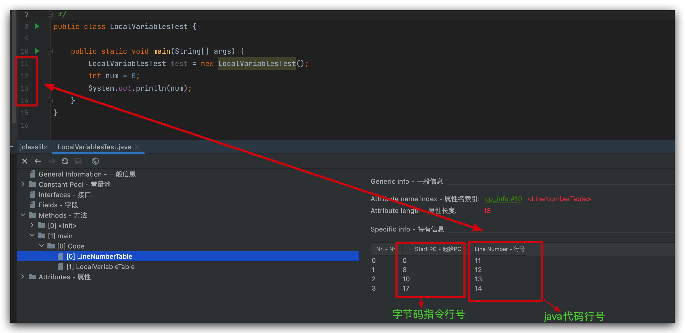
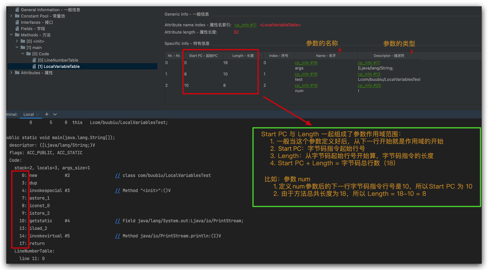
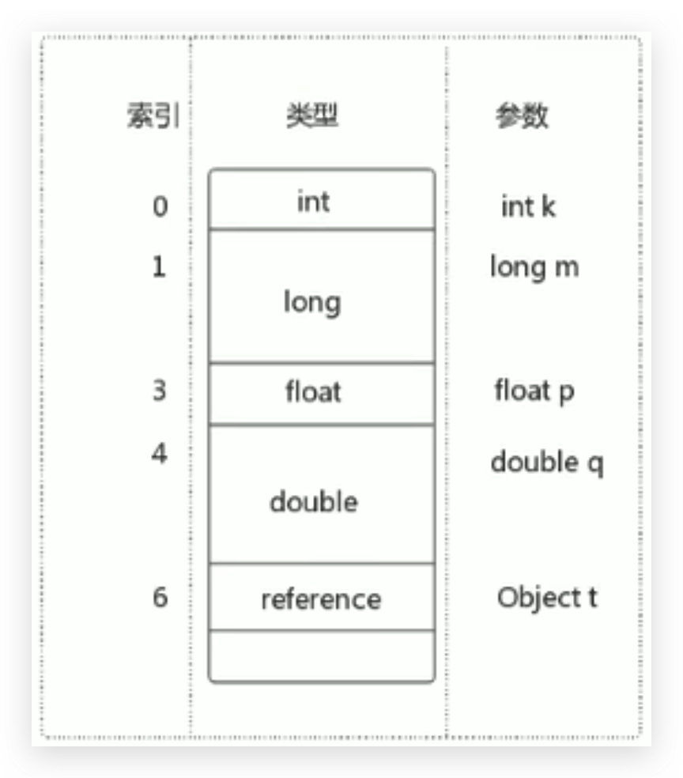
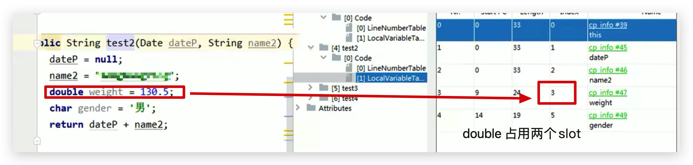
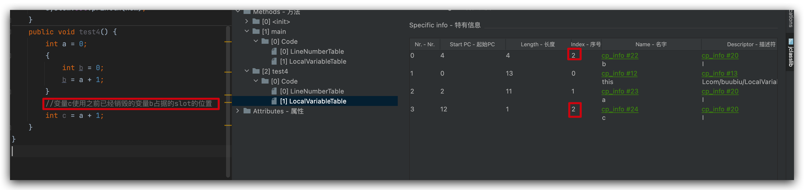

# JVM-运行时数据区-虚拟机栈-局部变量表（Local Variables）

## 定义



- 局部变量表也被称之为局部变量数组或本地变量表

- **定义为一个数字数组，主要用于存储方法参数和定义在方法体内的局部变量**，这些数据类型包括各类基本数据类型、对象引用（reference），以及returnAddress返回值类型。

- 由于局部变量表是建立在线程的栈上，是线程的私有数据，因此**不存在数据安全问题**

- **局部变量表所需的容量大小是在编译期确定下来的**，并保存在方法的Code属性的maximum local variables数据项中。在方法运行期间是不会改变局部变量表的大小的。

  可以通过反编译（`javap -v XXX.class`）或者 jclasslib 插件看到：

  <!--more-->

  

- **方法嵌套调用的次数由栈的大小决定。一般来说，栈越大，方法嵌套调用次数越多**。对一个函数而言，它的参数和局部变量越多，使得局部变量表越膨胀，它的栈帧就越大，以满足方法调用所需传递的信息增大的需求。进而函数调用就会占用更多的栈空间，导致其嵌套调用次数就会减少。

- **局部变量表中的变量只在当前方法调用中有效**。在方法执行时，虚拟机通过使用局部变量表完成参数值到参数变量列表的传递过程。**当方法调用结束后，随着方法栈帧的销毁，局部变量表也会随之销毁。**

## 举例

java源码：

```java LocalVariablesTest.java
package com.buubiu;

/**
 * @comment:
 * @author: buubiu
 * @create: 2022/5/30 13:50
 */
public class LocalVariablesTest {

	public static void main(String[] args) {
		LocalVariablesTest test = new LocalVariablesTest();
		int num = 0;
		System.out.println(num);
	}
}
```

反编译后的字节码（只看main方法）：

```shell
public static void main(java.lang.String[]);
    descriptor: ([Ljava/lang/String;)V
    flags: ACC_PUBLIC, ACC_STATIC
    Code:
      stack=2, locals=3, args_size=1
         0: new           #2                  // class com/buubiu/LocalVariablesTest
         3: dup
         4: invokespecial #3                  // Method "<init>":()V
         7: astore_1
         8: iconst_0
         9: istore_2
        10: getstatic     #4                  // Field java/lang/System.out:Ljava/io/PrintStream;
        13: iload_2
        14: invokevirtual #5                  // Method java/io/PrintStream.println:(I)V
        17: return
      LineNumberTable:
        line 11: 0
        line 12: 8
        line 13: 10
        line 14: 17
      LocalVariableTable:
        Start  Length  Slot  Name   Signature
            0      18     0  args   [Ljava/lang/String;
            8      10     1  test   Lcom/buubiu/LocalVariablesTest;
           10       8     2   num   I
```

插件jclasslib显示（只看main方法）：

1. main方法



2. code





3. LineNumberTable（行号表）：字节码指令的行号与java源码的行号对应关系



4. LocalVariableTable（局部变量表）



Start PC 与 Length 一起组成了参数作用域范围：

​	1. 一般当这个参数定义好后，从下一行开始就是作用域的开始

​	2. Start PC：字节码指令起始行号

​	3. Length：从字节码起始行号开始算，字节码指令的长度

	4. Start PC + Length = 字节码总行数（18）

比如：参数 num

​	1. 定义num参数后的下一行字节码指令行号是10，所以Start PC 为 10

​	2. 由于方法总共长度为18，所以 Length = 18-10 = 8

## 槽 Slot

### 概念与使用

- 参数值的存放总是从局部变量数组索引 0 的位置开始，到数组长度-1的索引结束。
- 局部变量表，**最基本的存储单元是Slot（变量槽）**
- 局部变量表中存放编译期可知的各种基本数据类型（8种），引用类型（reference），returnAddress类型的变量。
- 在局部变量表里，**32位以内的类型只占用一个 slot（包括引用类型和returnAddress类型），64位的类型（long和double）占有两个slot。**
  - byte、short、char、float 在存储前被转换为int，boolean 也被转换为 int，0表示false，非0表示true。
  - long 和 double 则占用两个  slot
- JVM会为局部变量表中的每一个Slot都分配一个访问索引，通过这个索引即可成功访问到局部变量表中指定的局部变量值
- 当一个实例方法被调用的时候，它的方法参数和方法体内部定义的局部变量将会 **按照顺序被复制** 到局部变量表中的每一个 Slot 上
- **如果需要访问局部变量表中一个64bit的局部变量值时，只需要使用前一个索引即可。**（比如下图：访问long或double类型变量时，使用索引为 1 或 4，而不是 2 或 5





- 如果当前栈帧是由构造方法（或者叫构造器init()，方法名是类名）或者实例方法（非静态的方法）创建的，那么 **该对象中引用的 this 将会存放在 index 为 0 的 slot 处**，其余的参数按照参数表顺序继续排列赋值。

  - 由上述可得，**为什么static静态方法中无法使用this变量**

    **因为：this 变量不存在于 static 修饰的方法的局部变量表中！**

### Slot 的重复利用

**栈帧中的局部变量表中的槽位（Slot）是可以重复利用的**

如果一个局部变量过了其作用域，那么在其作用域之后声明的新的局部变量就很可能会复用过期局部变量的槽位，从而 **达到节省资源的目的**。

```java
public void test4() {
		int a = 0;
		{
			int b = 0;
			b = a + 1;
		}
		//变量c使用之前已经销毁的变量b占据的slot的位置
		int c = a + 1;
	}
```



## 静态变量与局部变量的对比

- 参数表分配完毕之后，再根据方法体内定义的变量的顺序和作用域分配。
- 我们知道成员变量有两次初始化的机会，第一次是在“**准备阶段**”，执行系统初始化，对类变量设置零值，另一次则是在“**初始化**”阶段，赋予程序员在代码中定义的初始值。
- 和类变量初始化不同的是，局部变量表不存在系统初始化的过程，这意味着一旦定义了局部变量则必须人为的初始化，否则无法使用。

### 变量的分类与赋值

变量的分类与赋值：

#### 按照数据类型分

1. 基本数据类型（8种byte、short、int、long、float、double、char、boolean）
2. 引用数据类型（类、数组、接口、枚举）

#### 按照在类中声明的位置分

1. 成员变量（在方法外面的变量），在使用前，都经历过默认初始化赋值。

   1. 类变量（静态变量，static修饰的）

      赋值操作：**在类加载阶段中 linking 的 prepare 阶段，给类变量默认赋值，然后在 initial 阶段，给类变量显示赋值即静态代码块赋值**

   2. 实例变量（非静态变量），归具体的实例对象所有，所以叫实例变量

      赋值操作：**随着对象的创建，会在堆空间中分配实例变量空间，并进行默认赋值**

2. 局部变量（在方法里面的变量）

   赋值操作：**在使用前，必须要进行显示赋值，否则，编译不通过。**

   例如：

   ```java
   public void test(){
     int num;
     System.out.println(num);//报错：变量num未进行初始化。
   }
   ```

## 扩展说明

1. 在栈帧中，与性能调优关系最为密切的部分就是前面提到的局部变量表。在方法执行时，虚拟机使用局部变量表完成方法的传递。
2. `局部变量表中的变量也是重要的垃圾回收根节点，只要被局部变量表中直接或间接引用的对象都不会被回收。`

